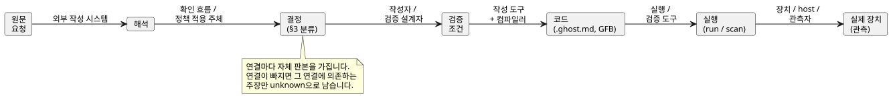
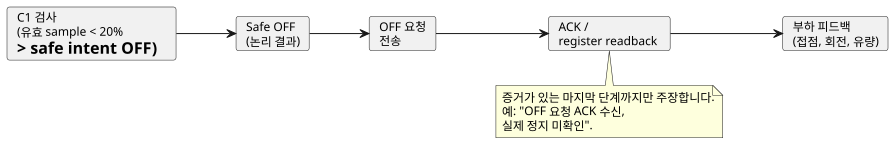

<!-- translation-source: docs/INTENT-CONSISTENCY-CONTRACT.en.md -->
[영문 원문](INTENT-CONSISTENCY-CONTRACT.en.md)

# 의도 정합성의 판단 책임과 근거 계약

상태: [#565](https://github.com/callin2/ghostflow-language/issues/565)의 공통 설계 계약입니다.
[#559](https://github.com/callin2/ghostflow-language/issues/559)의 다섯 후속 기능은 이 계약을 각자의 입력, 결과, 완료 기준에 적용합니다.

- 이 문서의 의무는 **후속 작업을 위한 설계 기준**입니다. 새 API, 저장 스키마, 승인 UI가 구현되었다는 뜻이 아닙니다.
- 이 문서는 기존 언어 문법, 실행 의미, 배포 정책을 바꾸지 않습니다.

공통 근거 레코드에는 이미 구현된 작성 API, 검증기, CLI, 저장/복원 기능이 있습니다. 이들은 [의도 근거 구현 계약](INTENT-EVIDENCE.ko.md)을 따릅니다. 구조, 판본(revision), 명시적 연결을 검사하지만, 아래에서 설명하는 네 가지 판단은 수행하지 **않습니다**.

이 문서의 내용:

1. **판단 대상과 권한** — 서로 구분되는 네 가지 판단.
2. **계층별 책임** — 작성 에이전트부터 장치까지 누가 무엇을 소유하는가.
3. **결정 상태** — 결정의 네 분류와, 이것이 기존 anchor 메타데이터와 대응하는 방식.
4. **최소 근거와 판본 연결** — 원문 요청부터 실제 장치까지 이어지는 연결.
5. **펌프 예제** — 확인과 검사를 분리해서 연결하기.
6. **공통 검토 사례** — 막아야 할 오판.
7. **다섯 후속 이슈의 설계 기준.**
8. **기존 근거와 완료 경계.**

## 1. 판단 대상과 권한

다음 두 질문은 혼동하기 쉽습니다.

- 해석이 요구자의 의도에 맞는가?
- 코드가 명시된 조건을 지키는가?

이 둘은 서로 다른 판단입니다. 같은 LLM이 잘못된 해석으로 코드와 테스트를 함께 작성하면, 코드와 테스트가 서로 일치하더라도 최초 의도와는 어긋날 수 있습니다.
근거 연결은 이 판단들을 추적 가능하게 합니다. 연결 자체가 해석이 적절하다는 것을 증명하지는 않습니다.

아래 표는 네 가지 판단을 나열합니다. 각 판단마다 누가 결정하는지, 어떤 입력이 필요한지, 어떤 근거를 남길지, 무엇을 주장할 수 있는지를 보여 줍니다.

| 판단 | 결정 권한과 수행 주체 | 필요한 입력 | 남길 근거 | 허용하는 주장과 한계 |
|---|---|---|---|---|
| 해석이 요구자의 의도에 맞는가? | 사용자 또는 그 범위의 권한을 위임받은 도메인 책임자가 결정합니다. 외부 LLM이나 작성 도구는 해석, 질문, 대안을 제안할 수 있습니다. | 원문과 맥락, 해석 판본, 결정이 필요한 항목, 적용 가능한 승인 정책 | 정확히 어떤 해석을 누가 어떤 권한으로 확인했는지, 그리고 확인 범위, 시점, 근거 | 지정한 해석과 범위가 확인되었다고 말할 수 있습니다. 침묵, 컴파일 성공, 그럴듯한 문장, 다른 모델의 동의는 확인을 대신하지 않습니다. |
| 명시한 요구들이 서로 충돌하는가? | 도구는 표현할 수 있는 조건 사이의 충돌을 검사합니다. LLM은 모호함과 충돌 가능성을 제안할 수 있습니다. 정책 간 우선순위의 설정과 변경은 해당 결정 권한자가 합니다. | 판본이 고정된 조건, 가정, 우선순위, 적용 범위, 그리고 검사기의 지원 범위 | 충돌하는 조건, 반례/검사 결과, 검사하지 못한 영역 | 지원하는 형식, 모델, 범위에 한한 충돌 또는 무충돌 결과입니다. 자연어 전체의 일관성, 누락 없음, 어느 정책을 포기할지는 자동으로 확정하지 않습니다. |
| 코드가 명시 조건을 지키는가? | 컴파일러, 검증기, 시뮬레이터가 각자의 기능 범위 안에서 검사합니다. 조건의 의미와 기대값은 외부에서 확정합니다. | 코드/산출물, 조건과 기대값의 근거, 초기 상태, 입력, 시계, 설정, 실행 계약 | 진단, 실행/반례, 지원 범위와 관측 범위, 정확한 판본 | 타입 검사, 특정 시나리오 통과, 제한된 형식 증명을 구분합니다. 컴파일 성공은 임의 요구의 준수를 증명하지 않으며, 테스트 통과는 모든 입력에 대한 동등성을 확립하지 않습니다. |
| 실제 장치가 조건을 지키는가? | 장치/관측 시스템이 사실을 수집합니다. 지정된 인수 책임자 또는 승인된 인수 정책이 충족 여부를 판단합니다. | 배포 판본, 장치, 설치 binding, 시험 절차, 관측 지점, 품질과 시간 기준, 인수 조건 | 명령, 응답, readback, 물리 피드백과 그 출처, 결과, 누락, 불일치 | 관측한 장치, 조건, 시간, 물리량에 한해서만 주장합니다. 시뮬레이션, 전송 성공, ACK, 레지스터 값은 부하 동작 전체를 증명하지 않습니다. |

권한과 검사 능력을 구분한다고 해서 사람이 매번 모든 값을 직접 검사해야 한다는 뜻은 **아닙니다**.

- 승인된 정책은 명시된 범위 안의 판단을 자동화할 수 있습니다.
- 이 경우 도구는 정책, 권한, 범위, 판본, 그리고 정책 적용의 근거를 전달받아야 합니다.
- LLM이나 검사기가 그 권한 밖의 결정을 새로 만들어 승인된 것으로 취급해서는 안 됩니다.

## 2. 계층별 책임

| 계층 | 소유하는 일 | 전달해야 할 것 |
|---|---|---|
| 외부 작성 에이전트 / API / 요구 확인 흐름 | 자연어 해석, 미결정 후보 발견, 질문, 확인 기록, 승인 정책 적용, 판본 보관 | 원문, 해석, 조건의 식별자와 출처, 결정 상태, 권한 근거와 범위 |
| GhostFlow 정본 `.ghost.md` | 작성자가 명시적으로 작성한 설명, 의도, 가정, 실행 코드 | 기존 anchor/link와 정본 판본. 실행 규칙은 이 소스와 그 파생 산출물에 둡니다. |
| 언어, 컴파일러, 검증 도구 | 명시적 구조, 타입, 관계의 검사, 소스 추적, 지원하는 조건의 검증 | 실제로 검사한 범위, 진단, 코드·조건·실행 결과 사이의 결속, unsupported/unknown 결과의 사유 |
| 런타임과 설명 도구 | 정해진 의미에 따른 실행과 실제 평가 흔적의 투영 | 정확한 run/scan과 requested/safe 결과, 평가됨·평가되지 않음·오류의 구분 |
| Device / host / driver / renderer | 설치/배포, 장치 통신, 입력 품질, 실제 출력의 적용/관측 | 장치/설치 판본, 시간과 품질, 적용/피드백의 근거, 실패/누락 |
| 소비 UI / 외부 에이전트 | 근거를 보여 주고 질문과 판단을 돕는 일 | 근거 수준과 미해결 범위를 유지한 설명 |

이 표에서 네 가지 경계가 나옵니다.

- GhostFlow 언어, 도구체인, 런타임 안에 자연어 해석 에이전트가 있다고 가정하지 않습니다.
- 외부 작성 시스템의 결정 기록은 실행 프로그램을 대신하는 두 번째 DSL이 아닙니다.
- 파생 맵, IR, 시각화는 정본 소스에서 생성합니다. 별도로 편집 가능한 제어 의미를 만들지 않습니다.
- 언어 도구는 지원하는 명시적 연결을 검증할 수 있습니다. 하지만 필드 모양만으로 외부 기록의 진위나 사용자의 권한을 인증할 수는 없습니다.

## 3. 결정 상태와 기존 메타데이터의 관계

아래 네 분류는 외부 결정 기록이 무엇을 뜻하는지 설명합니다. 기존 anchor의 새 enum 값을 정의하는 것이 **아닙니다**.
출처, 확인 상태, 적용 범위는 서로 별개의 정보입니다. 사람이 작성했다는 사실만으로 확인된 것이 되지 않으며, 정책에서 결과를 도출했다는 사실만으로 권한이 생기지도 않습니다.

| 분류 | 필요한 근거 | 기존 anchor와의 연결 | 허용하지 않는 승격 |
|---|---|---|---|
| 확정된 결정 | 결정 권한, 확인한 해석/조건의 판본과 범위, 확인 기록 | 확인이 존재하는 `intent` 또는 `premise`에 `status=confirmed`; `origin`은 실제 출처를 보존 | 한 항목의 확인을 문서 전체의 승인으로 확장하지 않습니다. |
| 승인된 정책에서 도출한 결정 | 정책 식별자, 판본, 권한, 유효 범위, 적용한 입력과 도출 근거, 그 정책이 위임한 결정 범위 | 적합한 `intent/premise`에 연결하고, 정책과 도출 근거는 외부 기록에 유지합니다. 정책이 그 결정을 포괄할 때만 확정된 결정으로 취급합니다. | 임의의 관행이나 기본값을 승인된 정책이라 부르지 않으며, 직접적인 사용자 진술로 바꾸지 않습니다. |
| LLM 가정 | 제안 주체, 이유, 영향을 받는 조건/코드, 미확인 상태 | `kind=assumption status=unconfirmed origin=ai`; 후보 코드는 `relation=assumes` 사용 | `confirmed`로 자동 승격하지 않습니다. 확인된 뒤에는 `intent/premise`로 재분류하고 확인 근거를 남깁니다. |
| 미결정 사항 | 질문/선택지, 결정 권한자(또는 미지정이라는 사실), 영향을 받는 주장/작업 | 외부 기록과 정본 설명에 보존합니다. 이미 작성된 미확인 가정은 기존 형식으로 연결할 수 있습니다. | 코드에 없는 동작을 자동으로 미결정 사항으로 추론하지 않으며, 존재하지 않는 `status=undecided` 문법을 만들지 않습니다. |

기존 [anchor 계약](INTENT-ANCHOR-MAP.ko.md)과의 대응은 다음과 같습니다.

- `kind`는 `intent/premise/assumption`, `status`는 `confirmed/unconfirmed/superseded`, `origin`은 `user/operator/engineer/ai/imported`입니다.
- `implements/constrains/fallback/assumes`는 작성된 관계입니다. `implements` 주석이 구현의 정확성을 증명하지 않습니다.
- `assumption`은 `confirmed`일 수 없고, `superseded` anchor는 현재 node에 연결할 수 없습니다.
- `origin=user`와 `status=confirmed`라는 텍스트는 사용자가 실제로 확인했다는 증거를 대신하지 않습니다.

미결정 사항이 있다고 해서 일괄 차단이 정당화되지는 않습니다.

- 미결정이라는 이유만으로 모든 작성, 시뮬레이션, 배포를 차단하는 규칙을 추가하지 않습니다.
- 대신 그 사항에 의존하는 주장과 작업을 특정합니다. 그 작업을 허용할지, 보류할지, 차단할지는 해당 작업에 적용되는 명시된 제품/설치 정책을 따릅니다.
- 필수 정책 입력을 생략한 선언에 대한 기존 언어 오류는 그대로 유지됩니다.

## 4. 전달해야 할 최소 근거와 판본 연결

다음은 **논리적** 정보 요구사항입니다. 필드 이름, 전송 형식, 저장소, 승인 API를 고정하지 않습니다.
후속 기능은 기존 identity와 source trace를 재사용하고, 실제 소비 경계에 맞는 버전 있는 스키마를 정의하는 것이 좋습니다.

그림은 여섯 연결을 순서대로 보여 주고 각 연결의 주된 생산자를 표시합니다. 표는 각 연결이 담는 최소 정보를 나열합니다.

| 연결 | 최소 정보 | 주된 생산자 |
|---|---|---|
| 원문 → 해석 | 원문 식별자, 불변 판본/참조, 관련 범위; 해석 식별자, 판본, 내용; 추가된 가정과 생략된 범위 | 외부 작성 시스템 |
| 해석 → 결정 | §3 분류, 출처, 확인/정책 근거와 권한 범위, 결정 시점, 미결정 항목 | 요구 확인 흐름 / 정책 적용 주체 |
| 결정 → 검증 조건 | 조건 식별자와 판본; 관측 변수, 단위, 시간 기준; 전제/기대값; 어떤 결정에서 도출했는지; 독립적으로 검토한 기대값의 근거 | 작성자 / 검증 설계자 |
| 조건 → 코드 | 정본 문서 판본/digest, anchor와 코드 node/span의 연결, 조건과 대상의 관계, bytecode/컴파일러와 검사기의 판본 | 작성 도구와 컴파일러 |
| 코드 → 실행 | 산출물, 설정, 초기 상태, 입력 tape, runtime/target 계약의 판본; run/scan/논리 시간; 수행한 검사와 관측 범위 | 실행/검증 도구 |
| 실행 → 실제 장치 | 배포, 장치, profile/binding identity, 명령/관측 상관 키, 관측 시각/시계 기준/품질/관측 지점 | Device / host / 관측자 |

**보고 규칙.**

- 각 소비자는 자신의 주장에 필요한 연결을 확인합니다. 상류 정보가 없으면 누락된 연결과 그 영향을 받는 주장만 unknown/unavailable이 됩니다.
- 모든 단계를 하나의 `passed`나 `intent matches` 결과로 합치지 않습니다. 검증 결과, 해석의 확인 상태, 물리 확인 상태를 각각 따로 반환하고 표시합니다.
- 반례나 실패 위치는 관측된 위반 지점입니다. 그것만으로 근본 원인이 어디에 있는지, 무엇을 고쳐야 하는지가 확정되지는 않습니다.

**출처, 복사본, 서명.**

- 원문 요청은 외부 시스템에 보관할 수 있습니다. 정본 소스에 담긴 설명은 기존 소스 문서에서 읽습니다.
- 설명 텍스트를 복사했다면 원본 판본과 변환/발췌 관계를 남겨, 복사본이 독립적으로 편집되는 진실의 원천이 되지 않게 합니다.
- 문서/hash/anchor 연결은 내용과 판본을 결속합니다. 이는 의미상의 적합성이나 권한 인증과는 별개입니다.
- 서명은 신뢰하는 서명자가 증명하는 범위 안에서 산출물을 인증합니다. 서명만으로 자연어 해석이 옳다고 주장하지 않습니다.

### 변경 후 근거의 유효 범위

**확인은 내용, 판본, 범위에 결속됩니다.**

- 확인은 해석의 내용, 판본, 범위에 결속됩니다. 해석이 바뀌면 ID나 bytecode가 그대로라도 이전 확인을 그대로 옮기지 않습니다.
- 기존 결정이 새 판본에도 적용된다고 주장하려면 변경 영향과 적용 근거를 기록합니다.
- 의미를 바꾸지 않는 순수한 편집 변경은 연결 위치와 digest를 갱신할 수 있습니다. 모든 결정을 무조건 다시 묻도록 요구하는 정책은 만들지 않습니다.

**다른 변경은 재평가를 일으킵니다.**

- 정책, 조건, 코드, 설정, 설치 binding, 런타임이 바뀌면 영향을 받는 연결과 검증 범위를 다시 평가합니다.
- 이전 결과는 해당 과거 판본의 근거로 유지합니다. 새 판본의 결과로 이름만 바꿔 붙이지 않습니다.
- 정책의 유효성이나 권한 범위를 확인할 수 없으면, 정책에서 도출된 상태와 현재 적용 가능성을 분리해 둡니다.
- 수명/최대 age는 해당 계약이 공급합니다. 모든 장치에 공통인 신선도 값 하나를 만들어 내지 않습니다.
- 이전 run의 scan 0에 대한 설명을 새 run의 scan 0에 연결하지 않습니다. 시계가 호환되지 않으면 시간만으로 명령과 피드백을 상관시키지 않습니다.

## 5. 펌프 예제: 확인과 검사를 분리해서 연결하기

이 절의 수치, 식별자, 확인은 계약을 설명하기 위한 **가상** 예시입니다. 실제 사용자의 운전 승인이나 실행 시험 결과가 아닙니다.
이 절은 실행 문법을 추가하지 않으며, 시간, 입력 품질, 장치 동작에 대해 암묵적으로 아무것도 선택하지 않습니다.

원문 `U1/r1`: “물이 부족하면 펌프를 멈춰.”
LLM의 후보 해석 `I1/r1`: “수위가 20% 미만이면 1초 안에 정지하고, 수위가 회복되면 자동으로 재시작한다.”

후보 해석은 원문에 없던 세부 사항 세 가지를 더합니다. 각각은 처음에 LLM 가정입니다.

| 항목 | 최초 상태 | 확인할 의미 |
|---|---|---|
| 부족 기준은 20% 미만 | LLM 가정 | 어떤 센서와 단위인지, 어떤 품질 기준을 적용하는지, 경계값과 측정 실패를 어떻게 다루는지 |
| 1초 안에 정지 | LLM 가정 | 시작 시점이 물리적 저수위인지 유효 sample 수신인지, 완료가 safe OFF인지 실제 정지인지 |
| 회복 후 자동 재시작 | LLM 가정 | 재시작 조건과 권한. 원문은 이를 결정하지 않습니다. |

### 부분 확인 후의 제한된 검사

가상 결정 `D1/r1`에서 권한 있는 사람이 다음만 확인했다고 가정합니다: “유효한 수위 sample이 20% 미만인 accepted scan에서는 safe pump intent가 OFF여야 한다.”

- 해석을 `I1/r2`로 갱신하고, `D1/r1`은 그 조건에만 연결합니다.
- 1초 안의 물리적 정지와 자동 재시작은 여전히 미해결입니다.

이 결정만으로 다음 검사를 정의할 수 있습니다.

| 연결 | 기록할 내용 |
|---|---|
| 조건 `C1/r1` | 유효한 수위 sample이 20% 미만인 accepted scan에서 safe pump intent = OFF. 정상 운전과 재시작 동작은 이 조건의 검사 범위 밖입니다. |
| 코드 `P1/r1` | 정본 문서와 GFB digest, 저수위 제약의 node/anchor와 그 `C1/r1` 연결. 후보 코드에 다른 가정이 있으면 따로 표시합니다. |
| 시나리오 `S1/r1` | 초기 상태, 설정, target 계약, 논리 시계를 고정한 상태에서 scan A에 유효 sample 19%, scan B에 20%를 공급합니다. 정확한 run/scan을 기록합니다. |
| 기대값 | A는 C1에 따라 safe OFF여야 합니다. B는 C1의 전제가 거짓이므로 C1만으로는 ON도 OFF도 요구하지 않습니다. 기대값은 코드 출력을 베끼지 말고 D1/C1에서 도출합니다. |
| 결과 해석 | A가 OFF이면 이 시나리오에서 C1을 준수한다는 근거입니다. 모든 운전 정책(B에서의 동작 포함), 자동 재시작, 1초 안의 물리적 정지를 증명하지는 않습니다. 실제 결과를 얻기 전에는 통과로 기록하지 않습니다. |

**유효하지 않거나 오래된 sample.** 유효하지 않거나 오래된(stale) sample은 이 조건의 전제를 만족하는 유효한 수위가 되지 않습니다.

- 이를 0%로 대체해 “저수위 조건 통과”로 계산하지 않습니다.
- 대신 품질 상태와 별도의 fault 정책이 필요한지를 드러냅니다.
- 구체적인 fault 동작은 승인된 조건에서 가져와야 합니다.

### 이후의 물리적 주장과 변경

“1초 안의 실제 정지”를 검사하려면 시작/종료 관측 지점, 시간 기준과 허용 오차, 장치 binding, 정지에 대한 인수 조건을 별도로 확정해야 합니다.

출력 경로의 각 단계는 서로 다른 증거입니다. 주장은 증거가 있는 마지막 단계까지만 할 수 있습니다.

Safe OFF, 전송 요청, ACK, register readback, 실제 접점/회전/유량은 각각 다른 증거입니다.
예를 들어 OFF ACK는 있지만 부하 피드백이 없으면 “OFF 요청 ACK 수신, 실제 정지 미확인”으로 기록합니다.
기존 C1 시뮬레이션은 그 범위 안에서 계속 유효합니다. 그 결과가 추가적인 물리적 주장을 대신하지는 않습니다.

**정책이 바뀔 때.** 나중에 부족 기준이 15%로 바뀌면 다음과 같이 합니다.

- 해석, 결정, 조건, 코드의 새 판본을 관련 시나리오와 연결합니다.
- 19%에서의 C1/r1 성공(C1/r1이 OFF를 요구한 경우)을 새 15% 정책의 근거로 재사용하지 않습니다.
- 원문이 재시작을 금지하지 않았다는 이유만으로 자동 재시작이 확정되었다고 추론하지 않습니다. 이 예제는 배포 허용 여부도 결정하지 않습니다.

## 6. 공통 검토 사례

후속 기능은 아래 오판을 막는, 자기 범위 안의 결과 검사와 회귀 검사를 마련하는 것이 좋습니다. 이 문서는 새 검사 엔진을 구현하지 않습니다.

| 상황 | 유지해야 할 판단 |
|---|---|
| LLM이 같은 20% 추측으로 코드와 테스트를 작성했고 모두 통과함 | 미확인 해석은 여전히 미확인입니다. 기대값에 대한 독립적인 결정 근거가 필요합니다. |
| `implements` link나 `confirmed` 표기만 있음 | link/표기가 존재한다는 사실만 확립됩니다. 권한 있는 확인이나 의미상 준수를 인증하지 않습니다. |
| 문서 일부만 확인되었거나 일부 시나리오만 일치함 | 확인/검사한 범위와 나머지 범위를 분리합니다. |
| LLM이 자연어 충돌 가능성을 제시함 | 후보와 검증된 충돌을 구분합니다. 정책 우선순위를 임의로 정하지 않습니다. |
| 승인된 정책은 있지만 그 범위, 판본, 현재 유효성을 알 수 없음 | 그 정책이 적용된다는 주장은 unknown입니다. 관계없는 작업까지 막지 않습니다. |
| capability는 선언되어 있지만 현재 설치 증거가 없거나 오래됨 | declared/installed/observed 구분, 출처/시각, 불확실한 이유를 유지합니다. |
| 설명의 source/run/scan이 출력 sample과 다름 | join을 실패/stale로 표시합니다. 현재 출력의 이유로 사용하지 않습니다. |
| branch가 평가되지 않았거나, 입력이 누락/fault 상태임 | 정상적인 false/0으로 위장하지 않습니다. |
| 논리가 OFF이거나 ACK가 있지만 부하 관측이 없음 | 확보한 증거 단계까지만 주장합니다. 물리적 결과는 미확인으로 남깁니다. |
| 미결정 항목이 발견됨 | 영향을 받는 조건/작업을 특정합니다. 실행 전체를 차단하는 것은 그 범위에 명시적 정책이 적용될 때뿐입니다. |

## 7. 다섯 후속 이슈의 설계 기준

#565는 공통 책임 경계를 정합니다. 각 후속 이슈는 자체 wire 스키마, 알고리즘, UI, 저장, 구현을 결정합니다.
구현자는 아래 기준을 해당 이슈의 완료 조건과 실제 검증에 포함하는 것이 좋습니다.

| 후속 이슈 | 입력과 결과에 대한 계약 | 해당 이슈에 남은 세부 사항 |
|---|---|---|
| [#560 동작 차이](https://github.com/callin2/ghostflow-language/issues/560) | 두 프로그램, 시나리오, 초기 상태, target, 관측/시간 범위, 그리고 외부에서 확정한 기대 변경/불변 조건을 받습니다. 관측된 차이와, 제공된 조건의 충족/위반을 분리합니다. | 비교 단위, 시간 정렬, 결과 스키마, replay 한계. 의도 판단 없이도 diff는 가능하지만, 기대 조건이 없으면 변경이 의도된 것인지는 unknown입니다. |
| [#561 실패 축소](https://github.com/callin2/ghostflow-language/issues/561) | 외부에서 제공한 실패 조건/assertion과 그 요구 근거를 고정합니다. 같은 위반을 보존하는 재현/축소 결과를 만듭니다. | 축소 비용 척도, 탐색 범위, 재현 보장. “가장 짧음”은 증명된 범위 안에서만 주장합니다. 요구 link만으로 oracle이 적절하다는 것이 확립되지는 않습니다. |
| [#562 사용 가능한 계약 조회](https://github.com/callin2/ghostflow-language/issues/562) | 언어/도구는 제공된 계약을 검증하고 조회합니다. 장치/host는 실제 설치, 점유, 관측 사실을 identity, 판본, 시각과 함께 공급합니다. 호출자는 질의 범위를 제공하고, 에이전트는 작업과의 관련성을 판단합니다. | 질의 인터페이스, 제공자, freshness/unknown 동작, 관련성 필터를 따로 정의합니다. 선언된 capability를 현재 설치 사실로 승격하지 않습니다. |
| [#563 실행 이유](https://github.com/callin2/ghostflow-language/issues/563) | 실제 평가 결과/값/source를 외부 의도 provenance와 연결합니다. source/run/scan과 명령/관측 identity를 검증하고, 연결이 없으면 그렇다고 명시합니다. | 기존 #88/#553에 대한 재사용/추가 범위를 정합니다. 내부 평가 설명과 외부 의도 설명을 구분하고, requested/safe/applied/confirmed 증거를 보존합니다. |
| [#564 미결정 의도](https://github.com/callin2/ghostflow-language/issues/564) | 외부 에이전트/작성 흐름이 후보를 발견하고, 질문하고, 해결합니다. 언어/도구는 명시적으로 제공된 상태와, 필수 스키마에 따른 누락을 표현하고 진단합니다. | 발견/표현/해결을 위한 인터페이스와 필요한 외부 상태 모델. 코드가 없다는 이유로 누락된 의도를 추론하지 않으며, 보편적인 배포 차단 정책을 추가하지 않습니다. |

## 8. 기존 근거와 완료 경계

검토 기준: `dev`의 `e664687259e7b66fa1a3f8db0a49cf823cdb9815`.
이 문서는 다음 기존 계약과 구현을 바탕으로 책임과 근거 전달을 통합합니다.

- [정본 소스/anchor 계약](INTENT-ANCHOR-MAP.ko.md), [추출기](../tools/literate.mjs), [source trace](../tools/source-trace.mjs): 명시적 메타데이터와 판본 결속. 이는 확인 권한의 인증과는 구분됩니다.
- [언어/장치 책임](reference/08-language-runtime-and-device-boundaries.md), [출력 증거 단계](reference/04-sensors-constraints-control.md#47-requested-safe-applied-confirmed), [장치 경계](LLM-TOOLCHAIN-ARCHITECTURE.md#physical-driver-and-device-boundary): 운영 정책과 물리 관측의 소유권.
- [현재 Boolean 출력 설명](BOOLEAN-OUTPUT-EXPLANATION.ko.md): 완료된 scan 하나의 requested Boolean 결과를 설명하는 제한된 구현입니다. 이를 모든 timer/state/safety/물리 설명이 제공된다는 주장으로 확대하지 않습니다.
- [외부 작성 예제](LLM-AUTHORING-WORKFLOW.ko.md): 모델 호출 없이 정본 소스, 판본, 가정, 가상 출력을 다루는 예제.
- [#553](https://github.com/callin2/ghostflow-language/issues/553), [#88](https://github.com/callin2/ghostflow-language/issues/88), [#545](https://github.com/callin2/ghostflow-language/issues/545): 진단, 실행 설명, capability/replay에 관한 관련 작업. #565는 이 이슈들이 전부 완료되었다고 선언하지 않습니다.

**#565의 완료로 간주하는 것.** 완료 근거는 네 판단의 책임표, 상태/판본 연결, 계층 경계, 펌프 예제, 다섯 이슈로의 인계입니다.

- 문서, 번역, 인덱스 검사는 산출물 일관성 검사입니다. 의도 정합성이나 장치 인수에 대한 자동 증명이 아닙니다.
- 후속 기능 구현과 저장소 통합의 실제 상태는 연결된 이슈/PR에 따로 기록합니다.
