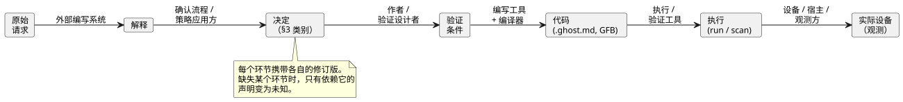
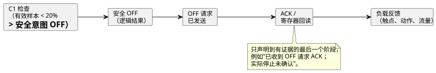

<!-- translation-source: docs/INTENT-CONSISTENCY-CONTRACT.en.md -->
[英文原文](INTENT-CONSISTENCY-CONTRACT.en.md)

# 意图一致性的责任与证据契约

[韩文原文](INTENT-CONSISTENCY-CONTRACT.md)

状态：[#565](https://github.com/callin2/ghostflow-language/issues/565) 的共享设计契约。
[#559](https://github.com/callin2/ghostflow-language/issues/559) 中的五项后续功能会把本契约应用到各自的输入、结果和完成标准上。

- 这里的义务是**后续工作的设计标准**。它们并不意味着新的 API、存储模式或审批 UI 已经实现。
- 本文不改变现有的语言语法、执行语义或部署策略。

共享的证据记录已经具备已实现的编写 API、校验器、CLI 以及持久化/恢复功能。它们遵循[意图证据实现契约](INTENT-EVIDENCE.zh.md)。它们检查结构、修订版和显式链接，但**不**执行下文所述的四种判断。

本文内容：

1. **判断什么，由谁拥有权限**——四种相互独立的判断。
2. **各层的责任**——从编写代理到设备，谁负责什么。
3. **决定状态**——四类决定，以及它们如何对应到现有的锚点元数据。
4. **最低限度的证据与修订版链接**——从原始请求到实际设备的链条。
5. **泵示例**——确认与验证分别链接。
6. **常见审查情形**——需要防止的误判。
7. **五个后续 issue 的设计标准。**
8. **现有证据与完成边界。**

## 1. 判断什么，由谁拥有权限

有两个问题很容易混淆：

- 某个解释是否符合请求者的意图？
- 代码是否遵守显式的条件？

它们是两个独立的判断。如果同一个 LLM 根据一个错误的解释同时编写代码和测试，那么代码和测试可能彼此一致，却仍然偏离原始意图。
证据链接让这些判断可以追溯。链接本身并不能证明某个解释是恰当的。

下表列出四种判断。对每一种，它说明由谁决定、需要哪些输入、应保留哪些证据，以及可以作出什么声明。

| 判断 | 决定权限与执行者 | 所需输入 | 应保留的证据 | 允许的声明与限制 |
|---|---|---|---|---|
| 解释是否符合请求者的意图？ | 由用户，或在该范围内被授予权限的领域负责人决定。外部 LLM 或编写工具可以提出解释、问题和备选方案。 | 原始请求与上下文、解释的修订版、需要决定的事项、适用的审批策略 | 究竟确认了哪个解释、由谁确认、依据什么权限，包括确认范围、时间和依据 | 可以声明指定的解释和范围已被确认。沉默、编译成功、看似合理的措辞，或另一个模型的赞同，都不能替代确认。 |
| 显式需求之间是否相互冲突？ | 工具检查它们能够表示的条件之间的冲突。LLM 可以指出歧义和可能的冲突。相关的决定权限方设定或更改策略之间的优先级。 | 固定到修订版的条件、假设、优先级和范围，以及检查器所支持的范围 | 相互冲突的条件、反例/检查结果，以及未检查的区域 | 只针对所支持的形式、模型和范围给出冲突或无冲突的结果。它不会自动确立所有自然语言的一致性、不存在遗漏，或应当放弃哪条策略。 |
| 代码是否满足显式条件？ | 编译器、校验器和仿真器各自在其能力范围内检查。条件的含义和期望值在外部确立。 | 代码/产物、条件和期望值的依据、初始状态、输入、时钟、设置和执行契约 | 诊断、执行/反例、支持的与观测到的范围，以及精确的修订版 | 区分类型检查、通过某个特定场景，以及有界的形式化证明。编译成功不能证明遵守任意需求，测试通过也不能确立对所有输入的等价性。 |
| 实际设备是否满足条件？ | 设备/观测系统收集事实。指定的验收负责人或经批准的验收策略决定这些事实是否满足条件。 | 已部署的修订版、设备、已安装的绑定、测试流程、观测点、质量与时间标准，以及验收条件 | 命令、响应、回读、物理反馈及其来源、结果、遗漏和差异 | 声明只适用于被观测的设备、条件、时间和物理量。仿真、发送成功、ACK 或寄存器值，都不能证明负载的完整行为。 |

把权限与检查能力分开，**并不**意味着每次都必须由人手工检查每个值。

- 经批准的策略可以在其声明的范围内自动作出判断。
- 此时工具必须收到该策略、权限、范围、修订版以及应用它的依据。
- LLM 或检查器不得在该权限之外制造决定，并把它当作已批准。

## 2. 各层的责任

| 层 | 负责 | 必须提供 |
|---|---|---|
| 外部编写代理 / API / 需求确认流程 | 自然语言解释、发现未决定的候选、提问、确认记录、应用审批策略，以及保留修订版 | 原始请求、解释和条件的标识符与来源；决定状态；权限依据和范围 |
| 规范的 GhostFlow `.ghost.md` | 作者显式编写的说明、意图、假设和可执行代码 | 现有的锚点/链接和规范修订版。可执行规则留在这个源文件及其派生产物中。 |
| 语言、编译器和验证工具 | 检查显式的结构、类型和关系；源追踪；验证受支持的条件 | 实际检查的范围、诊断、代码与条件和执行结果之间的绑定，以及不支持/未知结果的原因 |
| 运行时和解释工具 | 在定义好的语义下执行，并投影实际的求值追踪 | 精确的 run/scan 以及 requested/safe 结果，区分已求值、未求值和出错的情形 |
| 设备 / 宿主 / 驱动程序 / 渲染器 | 安装/部署、设备通信、输入质量，以及实际输出的应用/观测 | 设备/安装的修订版、时间和质量、应用/反馈的证据，以及失败/遗漏 |
| 使用方 UI / 外部代理 | 呈现证据，并协助提问和判断 | 保持证据级别和未解决范围的说明 |

从这张表可以得出四条边界：

- 不要假设 GhostFlow 语言、工具链或运行时内部存在一个自然语言解释代理。
- 外部编写系统的决定记录不是取代可执行程序的第二种 DSL。
- 派生的映射、IR 和可视化都由规范源生成。它们不会产生可单独编辑的控制语义。
- 语言工具可以验证受支持的显式链接。它们无法仅凭字段结构来认证外部记录的真实性或用户的权限。

## 3. 决定状态及其与现有元数据的关系

下面四个类别描述外部决定记录的含义。它们**不**为现有锚点定义新的枚举值。
来源、确认状态和范围是相互独立的信息。仅凭由人编写并不会使某项内容成为已确认，从策略推导出结果本身也不会赋予权限。

| 类别 | 所需证据 | 与现有锚点的关联 | 不允许的提升 |
|---|---|---|---|
| 已确认的决定 | 决定权限、被确认的解释/条件的修订版和范围，以及确认记录 | 对存在确认的 `intent` 或 `premise` 使用 `status=confirmed`；`origin` 保留实际来源 | 不要把对单个条目的确认扩展为对整份文档的批准。 |
| 由经批准策略推导出的决定 | 策略标识符、修订版、权限和生效范围；所应用的输入和推导依据；该策略所委托的决定范围 | 链接到合适的 `intent/premise`，并把策略和推导依据保存在外部记录中。只有当策略覆盖该决定时，才把它视为已确认的决定。 | 不要把任意的惯例或默认值称为经批准的策略，也不要把它变成用户的直接陈述。 |
| LLM 假设 | 提出者、理由、受影响的条件/代码，以及未确认状态 | `kind=assumption status=unconfirmed origin=ai`；候选代码使用 `relation=assumes` | 不要自动把它提升为 `confirmed`。确认之后，将其重新分类为 `intent/premise` 并保留确认证据。 |
| 未决定的事项 | 问题/选项、决定权限（或权限尚未指定这一事实），以及受影响的声明/工作 | 将其保存在外部记录和规范说明中。已经编写好的未确认假设可以用现有形式链接。 | 不要从代码中缺失的行为自动推断出未决定的事项，也不要编造并不存在的 `status=undecided` 语法。 |

这与现有[锚点契约](INTENT-ANCHOR-MAP.zh.md)的对应关系如下：

- `kind` 为 `intent/premise/assumption`，`status` 为 `confirmed/unconfirmed/superseded`，`origin` 为 `user/operator/engineer/ai/imported`。
- `implements/constrains/fallback/assumes` 是作者编写的关系。`implements` 注释并不能证明实现是正确的。
- `assumption` 不能是 `confirmed`，`superseded` 锚点不能链接到当前节点。
- 文本 `origin=user` 和 `status=confirmed` 不能替代用户实际确认过某事的证据。

未决定的事项并不构成一概阻止的理由：

- 不要仅因为某事尚未决定，就添加一条阻止所有编写、仿真或部署的规则。
- 而应识别依赖该事项的声明和工作。这些工作是被允许、推迟还是阻止，取决于针对该工作的显式产品/安装策略。
- 对于省略了必需策略输入的声明，现有的语言错误保持不变。

## 4. 需要传递的最低限度证据与修订版链接

以下是**逻辑上的**信息要求。它们不固定字段名、传输格式、存储或审批 API。
后续功能应复用现有的身份标识和源追踪，并定义一个符合实际使用方边界的、带版本的模式。

该图按顺序展示六个环节及其各自的主要产出方。下表列出每个环节携带的最低限度信息。

| 环节 | 最低限度信息 | 主要产出方 |
|---|---|---|
| 原始请求 → 解释 | 原始请求的标识符、不可变的修订版/引用以及相关范围；解释的标识符、修订版和内容；额外的假设和被省略的范围 | 外部编写系统 |
| 解释 → 决定 | §3 类别、来源、确认/策略依据和权限范围、决定时间、未决定的事项 | 需求确认流程 / 策略应用方 |
| 决定 → 验证条件 | 条件标识符和修订版；观测变量、单位和时间基准；前提条件/期望值；其所派生自的决定；经过独立审查的期望值的依据 | 作者 / 验证设计者 |
| 条件 → 代码 | 规范文档的修订版/摘要、锚点到代码节点/范围的链接、条件到目标的关系、字节码/编译器和检查器的修订版 | 编写工具和编译器 |
| 代码 → 执行 | 产物、设置、初始状态、输入带以及运行时/目标契约的修订版；run/scan/逻辑时间；所执行的检查和观测范围 | 执行/验证工具 |
| 执行 → 实际设备 | 部署、设备、profile/绑定身份、命令/观测关联键、观测时间/时钟基准/质量/观测点 | 设备 / 宿主 / 观测方 |

**报告规则。**

- 每个使用方检查其自身声明所需的环节。如果上游信息缺失，只有缺失的环节和受影响的声明变为未知/不可用。
- 不要把所有阶段合并成一个 `passed` 或 `intent matches` 结果。应分别返回并显示验证结果、解释的确认状态和物理确认状态。
- 反例或失败位置是观测到的违规点。它本身并不能确定根本原因在哪里，或必须修复什么。

**来源、副本和签名。**

- 原始请求可以保存在外部系统中。规范源中的说明从现有源文档中读取。
- 如果复制了说明文本，应保留其源修订版以及转换/摘录关系，避免副本变成一个被独立编辑的事实来源。
- 文档/哈希/锚点链接绑定的是内容和修订版。这与语义上的适当性以及权限认证是两回事。
- 签名在可信签名者所证明的范围内认证一个产物。仅凭签名并不声称某个自然语言解释是正确的。

### 变更后证据的有效范围

**确认绑定到内容、修订版和范围。**

- 确认绑定到解释的内容、修订版和范围。当解释发生变化时，即使其 ID 或字节码不变，也不要原样沿用旧的确认。
- 若要声明某个现有决定同样适用于新修订版，应记录变更的影响以及应用它的依据。
- 不改变含义的纯编辑性修改可以更新链接位置和摘要。不要制定无条件要求重新询问每项决定的策略。

**其他变更会触发重新评估。**

- 当策略、条件、代码、设置、安装绑定或运行时发生变化时，应重新评估受影响的环节和验证范围。
- 把先前的结果保留为其历史修订版的证据。不要把它们重新标注为新修订版的结果。
- 如果无法检查策略的有效性或权限范围，应把由策略推导出的状态与其当前适用性分开。
- 适用的契约提供有效期/最大时效。不要编造一个所有设备通用的新鲜度值。
- 不要把先前一次运行中 scan 0 的解释关联到新一次运行的 scan 0。当时钟互不兼容时，不要仅凭时间来关联命令和反馈。

## 5. 泵示例：分别链接确认与验证

本节中的数字、标识符和确认都是用来说明本契约的**假设性**示例。它们不是实际用户的运行批准，也不是执行测试的结果。
本节不新增任何执行语法，也不对时间、输入质量或设备行为作出任何隐含选择。

原始请求 `U1/r1`：“水位低时停止泵。”
LLM 候选解释 `I1/r1`：“水位低于 20% 时在 1 秒内停止，水位恢复后自动重启。”

候选解释增加了原始请求中没有说明的三个细节。每一项都以 LLM 假设的身份开始：

| 条目 | 初始状态 | 需要确认的含义 |
|---|---|---|
| “低”指低于 20% | LLM 假设 | 哪个传感器和单位、适用什么质量要求，以及如何处理边界值和测量失败 |
| 1 秒内停止 | LLM 假设 | 起始时间是物理上的低水位还是收到有效样本的时刻，以及完成指的是安全 OFF 还是实际停止 |
| 恢复后自动重启 | LLM 假设 | 重启条件和权限。原始请求并未决定这一点。 |

### 部分确认后的有界检查

假设在假设性决定 `D1/r1` 中，有权限的人只确认了这一点：“对于带有低于 20% 的有效水位样本的已接受 scan，泵的安全意图必须为 OFF。”

- 将解释更新为 `I1/r2`，并且只把 `D1/r1` 链接到该条件。
- 1 秒内的物理停止和自动重启仍未解决。

这个决定足以定义以下检查：

| 环节 | 需要记录的内容 |
|---|---|
| 条件 `C1/r1` | 对于带有低于 20% 的有效水位样本的已接受 scan，泵的安全意图 = OFF。正常运行和重启行为不在该条件的检查范围内。 |
| 代码 `P1/r1` | 规范文档和 GFB 的摘要、低水位约束的节点/锚点，及其到 `C1/r1` 的链接。候选代码中的其他假设应单独标记。 |
| 场景 `S1/r1` | 在固定的初始状态、设置、目标契约和逻辑时钟下，在 scan A 提供有效的 19% 样本，在 scan B 提供 20% 样本。记录精确的 run/scan。 |
| 期望值 | 在 C1 下，A 必须为安全 OFF。对于 B，C1 的前提条件为假，因此仅凭 C1 既不要求 ON 也不要求 OFF。期望值应从 D1/C1 推导，而不是复制代码输出。 |
| 结果解释 | 如果 A 为 OFF，这是该场景下遵守 C1 的证据。它不能证明所有运行策略（包括 B 处的行为）、自动重启或 1 秒内的物理停止。在获得实际结果之前，不要记录通过。 |

**无效或陈旧的样本。** 无效或陈旧的样本不会变成满足该条件前提的有效水位。

- 不要用 0% 替代它并将其计为“低水位条件通过”。
- 而应公开质量状态，以及是否需要单独的故障策略。
- 具体的故障行为必须来自经批准的条件。

### 后续的物理声明与变更

要检查“1 秒内实际停止”，需要另行确立起止观测点、时间基准和容差、设备绑定，以及停止的验收条件。

输出路径的每个阶段都是不同的证据。声明最多只能延伸到最后一个有证据的阶段：

安全 OFF、发送请求、ACK、寄存器回读，以及实际的触点/动作/流量，都是不同的证据。
例如，如果有 OFF ACK 但没有负载反馈，应记录为“已收到 OFF 请求 ACK；实际停止未确认”。
现有的 C1 仿真在其范围内仍然有效。它的结果不能替代额外的物理声明。

**策略变更时。** 如果之后低水位阈值改为 15%：

- 把解释、决定、条件和代码的新修订版与相关场景链接起来。
- 不要把 C1/r1 在 19% 时的成功（C1/r1 在该处要求 OFF）复用为新的 15% 策略的证据。
- 不要仅因为原始请求没有禁止重启，就推断出已确认的自动重启。本示例也不决定是否允许部署。

## 6. 常见审查情形

后续功能应建立范围内的结果检查和回归检查，以防止下列误判。本文并不实现新的检查引擎。

| 情形 | 应保持的判断 |
|---|---|
| LLM 根据同一个 20% 的猜测编写了代码和测试，而且全部通过 | 未确认的解释仍是未确认的。期望值需要独立的决定依据。 |
| 只有 `implements` 链接或 `confirmed` 标签 | 只能确立链接/标签的存在。它不能认证有权限的确认或语义上的遵守。 |
| 只确认了文档的一部分，或只有部分场景匹配 | 把已确认/已检查的范围与其余范围分开。 |
| LLM 指出自然语言中可能存在的冲突 | 区分候选冲突与已验证的冲突。不要任意选择策略优先级。 |
| 存在经批准的策略，但其范围、修订版或当前有效性未知 | “它适用”这一声明是未知的。不要阻止无关的工作。 |
| 声明了某项能力，但当前的安装证据缺失或过旧 | 保留声明/已安装/已观测的区分、来源/时间，以及不确定的原因。 |
| 某个解释的 source/run/scan 与输出样本不一致 | 将该关联标记为失败/陈旧。不要把它当作当前输出的原因。 |
| 某个分支未被求值，或某个输入缺失/故障 | 不要把它伪装成正常的 false/0。 |
| 逻辑为 OFF 或已有 ACK，但没有负载观测 | 只声明到可用的证据阶段为止。物理结果保持未确认。 |
| 发现了一个未决定的事项 | 识别受影响的条件/工作。只有当某条显式策略适用于该范围时，才整体阻止执行。 |

## 7. 五个后续 issue 的设计标准

#565 确立了共享的责任边界。每个后续 issue 自行决定其传输模式、算法、UI、存储和实现。
实现者应把下列标准纳入该 issue 的完成条件和实际验证中。

| 后续 issue | 输入与结果的契约 | 留给该 issue 的细节 |
|---|---|---|
| [#560 行为差异](https://github.com/callin2/ghostflow-language/issues/560) | 接收两个程序、一个场景、初始状态、目标、观测/时间范围，以及在外部确立的期望变化/不变量。把观测到的差异与对所给条件的满足/违反分开。 | 比较单位、时间对齐、结果模式和重放限制。不做意图判断也可以得出差异；若没有期望条件，某个变化是否有意为之是未知的。 |
| [#561 失败缩减](https://github.com/callin2/ghostflow-language/issues/561) | 固定外部提供的失败条件/断言及其需求依据。产出保持同一违规的复现/缩减结果。 | 缩减代价度量、搜索范围和复现保证。只在已证明的范围内声称“最短”。仅有需求链接并不能确立判定准则（oracle）是恰当的。 |
| [#562 可用契约查询](https://github.com/callin2/ghostflow-language/issues/562) | 语言/工具校验并查询所提供的契约。设备/宿主提供带身份、修订版和时间的实际安装、占用和观测事实。调用方提供查询范围，代理判断与任务的相关性。 | 另行定义查询接口、提供方、新鲜度/未知时的行为，以及相关性过滤。不要把声明的能力提升为当前的安装事实。 |
| [#563 执行原因](https://github.com/callin2/ghostflow-language/issues/563) | 把实际的求值结果/值/来源链接到外部意图来源。校验 source/run/scan 和命令/观测的身份，并在链接缺失时加以说明。 | 定义相对于现有 #88/#553 的复用范围/额外范围。区分内部求值解释与外部意图解释，并保留 requested/safe/applied/confirmed 证据。 |
| [#564 未决定的意图](https://github.com/callin2/ghostflow-language/issues/564) | 外部代理/编写流程负责发现、询问并解决候选。语言/工具表达并诊断显式提供的状态，以及必需模式下的遗漏。 | 发现/表达/解决的接口，以及所需的外部状态模型。不要从代码的缺失推断出被省略的意图，也不要添加通用的部署阻止策略。 |

## 8. 现有证据与完成边界

审查基线：`dev` 上的 `e664687259e7b66fa1a3f8db0a49cf823cdb9815`。
本文基于以下现有契约和实现，整合了责任划分与证据交接。

- [规范源/锚点契约](INTENT-ANCHOR-MAP.zh.md)、[提取器](../tools/literate.mjs)、[源追踪](../tools/source-trace.mjs)：显式元数据和修订版绑定。这与认证确认权限是两回事。
- [语言/设备的责任](reference/08-language-runtime-and-device-boundaries.zh.md)、[输出证据阶段](reference/04-sensors-constraints-control.zh.md#47-requestedsafeappliedconfirmed)、[设备边界](LLM-TOOLCHAIN-ARCHITECTURE.zh.md)：运行策略和物理观测的所有权。
- [当前的布尔输出解释](BOOLEAN-OUTPUT-EXPLANATION.zh.md)：一个有限的实现，用于解释某个已完成 scan 的请求布尔结果。不要把它扩展为“所有定时器/状态/安全/物理解释都已可用”的声明。
- [外部编写示例](LLM-AUTHORING-WORKFLOW.zh.md)：一个不调用模型、包含规范源、修订版、假设和虚拟输出的示例。
- [#553](https://github.com/callin2/ghostflow-language/issues/553)、[#88](https://github.com/callin2/ghostflow-language/issues/88)、[#545](https://github.com/callin2/ghostflow-language/issues/545)：关于诊断、执行解释以及能力/重放的相关工作。#565 并不宣布这些 issue 已全部完成。

**#565 的完成标准是什么。** 完成证据包括：四种判断的责任表、状态/修订版链接、层边界、泵示例，以及向五个 issue 的交接。

- 文档、翻译和索引检查属于产物一致性检查。它们不是意图一致性或设备验收的自动证明。
- 后续功能实现和仓库集成的实际状态，单独记录在所链接的 issue/PR 中。
