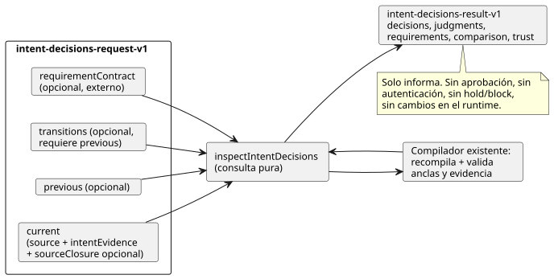

<!-- translation-source: docs/INTENT-DECISIONS.md -->
[Original en inglés](INTENT-DECISIONS.md)

# Inspeccionar las decisiones de intención escritas por el autor

`inspectIntentDecisions(request)` en `tools/intent-decisions.mjs` es una **consulta pura** sobre la fuente canónica de GhostFlow y sobre `intent-evidence-v1` validado por el compilador.
`node tools/ghostdecisions.mjs --request request.json --format json` es la CLI JSON/TOON; la salida TOON es la predeterminada.
Esto implementa [#564](https://github.com/callin2/ghostflow-language/issues/564) usando el contrato de [#565](https://github.com/callin2/ghostflow-language/issues/565). La [versión en coreano](INTENT-DECISIONS.ko.md) describe el mismo contrato.

**Qué hace.** Recompila cada fuente canónica suministrada y reutiliza la validación que el compilador existente hace de las anclas escritas por el autor y de la evidencia de intención. Los registros externos originales siguen visibles junto a las conclusiones estructurales limitadas del compilador. Los cuatro tipos de decisión siempre permanecen separados: `confirmed`, `policy-derived`, `assumption` y `undecided`.

**Qué no hace.** Esta API no:

- infiere la intención a partir del lenguaje natural ni genera preguntas;
- aprueba una decisión ni autentica a un actor;
- hace cumplir un requisito ni cambia una compuerta del runtime;
- sintetiza un valor predeterminado de control.



El diagrama muestra las partes de la solicitud, el paso de recompilación y el resultado. El resultado solo informa; cualquier retención (hold) o bloqueo (block) queda en manos de un consumidor externo.

## Solicitud

El objeto de nivel superior requiere `schema: "GhostFlow/intent-decisions-request-v1"` y `current`. También puede aportar `requirementContract`, `previous` y `transitions`. `transitions` requiere `previous`.

**`current` y `previous`.** `current`, y el `previous` opcional, requieren cada uno:

- `source: { text, filename, documentId, revisionId }`. `text` es el programa canónico `.ghost.md` completo, y los ID nombran explícitamente su revisión escrita por el autor.
- `intentEvidence`: un registro `GhostFlow/intent-evidence-v1` completo. Se compila de forma independiente y se liga a esa fuente. Se rechaza un registro de evidencia cuyo digest de la fuente, digest de confirmación de la interpretación, digest de condición o vínculo a un nodo escrito por el autor esté obsoleto (no coincida).
- `sourceClosure` opcional: un array acotado de `{ filename, revision, text }` que se pasa directamente al compilador para las importaciones explícitas. La consulta nunca lee archivos importados del disco.

**Importaciones.** Cuando se compilan importaciones, `source.sourceClosureSha256` en el resultado es el hash del cierre canónico del compilador, incluidas las revisiones de los documentos importados y su texto exacto. Si el cierre cambia mientras los ID de documento/revisión raíz siguen siendo los mismos, eso también cuenta como `source-revision-reused`, incluso cuando el SHA de la fuente raíz no cambia. El compilador sigue haciendo cumplir las fijaciones SHA de las importaciones.

**`requirementContract`.** Es opcional y externo. Su forma es `{ id, revision, reference, requirements }`.

- Un `requirements: []` vacío explícito es `supplied`, sin requisitos incumplidos.
- Omitir el contrato es `not-supplied`.

Cada requisito tiene exactamente estos campos:

```json
{
  "id": "R-PUMP",
  "interpretation": { "id": "I-PUMP", "revision": "r1", "sha256": "<optional exact content SHA-256>" },
  "level": "confirmed",
  "conditionRefs": [{ "id": "C-PUMP", "revision": "r1", "sha256": "<exact condition SHA-256>" }],
  "actionRefs": ["action:deploy"],
  "claimRefs": ["claim:ready"],
  "onUnmet": "hold"
}
```

| Campo | Significado |
|---|---|
| `interpretation` | `id` es obligatorio. `revision` y `sha256` son fijaciones exactas opcionales. El digest es el `intentInterpretationDigest` existente, que cubre el contenido interpretado pero excluye la confirmación declarada. |
| `conditionRefs` | Opcional. Cuando se aporta, contiene referencias exactas id/revisión/digest a condiciones que pertenecen a esa interpretación. |
| `level` | `represented` o `confirmed` (véase más abajo). |
| `onUnmet` | `report`, `hold` o `block`. |
| `actionRefs`, `claimRefs` | Arrays distintos de cadenas únicas. |

Los dos niveles difieren así:

- **`represented`** solo requiere una interpretación coincidente y las referencias de condición que se hayan aportado. Puede incluir un supuesto o un estado sin decidir sin cambiar ese estado.
- **`confirmed`** requiere además la confirmación `recorded` de la interpretación informada por el compilador (incluida una decisión vigente derivada de una política) y el estado `recorded` de **cada referencia de condición aportada**. Si no se aportan referencias de condición, `confirmed` comprueba solo la decisión de la interpretación; nunca implica que todas las condiciones estén confirmadas.

`onUnmet`, `actionRefs` y `claimRefs` se devuelven como metadatos para un consumidor externo. Esta consulta no realiza por sí misma la retención ni el bloqueo.

**Los códigos de incumplimiento** distinguen:

- una interpretación ausente;
- una discrepancia de revisión/contenido de la interpretación;
- una condición ausente o modificada;
- una condición fuera del alcance confirmado;
- estados de decisión como `undecided`, `unconfirmed` o `policy-not-current`.

Solo se comprueban los requisitos aportados explícitamente. Un contrato ausente no produce ningún requisito faltante inferido.

## Revisión anterior y transiciones

Cuando se aporta `previous`, se compila y valida de forma independiente. Cada fila de interpretación incluye dos digests:

| Digest | Qué cubre |
|---|---|
| `contentSha256` | El digest existente del compilador sobre el contenido interpretado, excluida la decisión. |
| `recordSha256` | SHA-256 del JSON canónico `{ interpretation, conditions }`, que incluye la decisión completa y **todas las condiciones que pertenecen a esta interpretación**. Por tanto, un cambio solo en las condiciones cambia esta identidad de comparación, aunque el texto interpretado y el bytecode no cambien. |

**Emparejamiento de filas.** La comparación devuelve filas `added`, `removed`, `unchanged` o `changed`, cada una con ambos registros completos.

- Las filas con el mismo ID se emparejan por ID.
- Un cambio de nombre entre ID se empareja solo mediante una transición explícita y sin ambigüedad.
- Una transición es `{ from: { id, revision, sha256 }, to: { id, revision, sha256 }, actor, recordRef, at }`. Sus digests son los valores `recordSha256` completos.
- Las fijaciones deben ser uno a uno. Se rechazan las fijaciones duplicadas, ambiguas, obsoletas o discordantes.

**Diagnósticos.** Son diagnósticos, no bloqueos en tiempo de ejecución:

| Diagnóstico | Cuándo |
|---|---|
| `transition-link-missing` | Una fila modificada no tiene transición. |
| `interpretation-revision-reused` | El contenido interpretado cambió con el mismo ID y la misma revisión. |
| `condition-revision-reused:<id>` | Una condición cambió con el mismo ID de condición y la misma revisión. |
| `source-revision-reused` | En la comparación raíz: los bytes de la fuente cambiaron con los mismos ID de documento y de revisión. |

Cambiar solo la decisión o las condiciones puede mantener la misma revisión del contenido interpretado, pero el registro completo modificado sigue necesitando un vínculo de transición. Un cambio de nombre no activa la advertencia de revisión de interpretación con el mismo ID. Ninguna confirmación anterior se transfiere automáticamente a la fuente actual.

## Resultado y límites

**Éxito.** Una llamada correcta devuelve `GhostFlow/intent-decisions-result-v1` con:

- `outcome: "completed"`;
- los digests exactos de la solicitud, la fuente y la evidencia;
- `current.decisions`, `current.judgments`, `requirements`, `comparison` y `trust`.

Cada decisión conserva la interpretación original, la referencia a la fuente original, la decisión y todas las condiciones que le pertenecen, con su alcance de confirmación y los ID de comprobación externos. Varias cosas se dejan deliberadamente sin resolver:

- Los juicios existentes siguen como `not-evaluated`; la autoridad del actor sigue como `not-authenticated`.
- Los estados de política `current`, `expired` y `unknown` siguen siendo distintos en el registro original. `expired` y `unknown` no pueden satisfacer un requisito `confirmed`.
- Los hashes de la fuente y del bytecode se informan por separado, de modo que los cambios de prosa con bytecode idéntico siguen siendo identificables.

**Límites de entrada.**

| Límite | Valor |
|---|---|
| Entrada | Datos JSON acíclicos, como máximo 524.288 bytes UTF-8 serializados y profundidad 24 |
| Texto de la fuente | Como máximo 262.144 caracteres |
| Cierre de la fuente | Como máximo 32 entradas |
| Requisitos, registros de transición y otras listas acotadas | Como máximo 128 entradas |

Se rechazan los arrays dispersos, los ID/referencias duplicados, los campos con formato incorrecto y las marcas de tiempo erróneas. La API copia las entradas antes de compilar; los resultados no comparten referencias con los objetos de quien llama.

**Límite de salida.** La salida completa está limitada a 524.288 bytes UTF-8. Si la expansión supera este límite, la API devuelve solo `outcome: "incomplete"`, el SHA-256 exacto de la solicitud y un diagnóstico `output-limit`. No devuelve ninguna respuesta parcial de cumplido o confirmado, y la CLI termina con código 1. Una entrada con formato incorrecto emite `rejected` en la CLI y termina con código 1.

Ejecute la regresión ficticia ejecutable desde la raíz del repositorio:

```sh
node --test tests/intent-decisions.test.mjs
```

Cubre los cuatro estados de decisión, la confirmación parcial, las políticas de requisitos explícitas, la deriva de la fuente, las transiciones exactas, los límites y la paridad JSON/TOON. Los actores y las referencias de los fixtures son inventados; la prueba no establece autoridad externa ni comportamiento de dispositivos.
