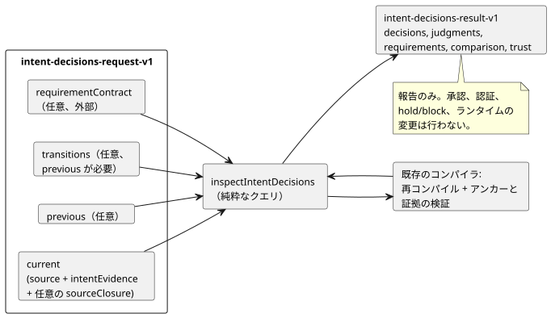

<!-- translation-source: docs/INTENT-DECISIONS.md -->
[英語の原文](INTENT-DECISIONS.md)

# 作成者が記述した意図の判断を調べる

`tools/intent-decisions.mjs`の`inspectIntentDecisions(request)`は、正本のGhostFlowソースと、コンパイラが検証した`intent-evidence-v1`に対する**純粋なクエリ**です。
`node tools/ghostdecisions.mjs --request request.json --format json`はJSON/TOON用のCLIで、既定の出力はTOONです。
これは[#565](https://github.com/callin2/ghostflow-language/issues/565)の契約を用いて[#564](https://github.com/callin2/ghostflow-language/issues/564)を実装したものです。[韓国語版](INTENT-DECISIONS.ko.md)も同じ契約を説明しています。

**行うこと。** 与えられた各正本ソースを再コンパイルし、作成者が記述したアンカーと意図証拠に対する既存のコンパイラの検証を再利用します。元の外部レコードは、コンパイラによる限定的な構造上の結論と並べて見える状態に保たれます。4つの判断の種類は常に別々に保たれます：`confirmed`、`policy-derived`、`assumption`、`undecided`。

**行わないこと。** このAPIは次のことを行いません。

- 自然言語から意図を推論したり、質問を生成したりすること
- 判断を承認したり、行為者を認証したりすること
- 要件を強制したり、ランタイムのゲートを変更したりすること
- 制御の既定値を合成すること



この図は、要求の構成要素、再コンパイルの段階、結果を示しています。結果は報告するだけで、保留（hold）やブロック（block）は外部の利用側に委ねられます。

## 要求

トップレベルのオブジェクトには`schema: "GhostFlow/intent-decisions-request-v1"`と`current`が必要です。さらに`requirementContract`、`previous`、`transitions`を与えることもできます。`transitions`には`previous`が必要です。

**`current`と`previous`。** `current`と、任意の`previous`には、それぞれ次が必要です。

- `source: { text, filename, documentId, revisionId }`。`text`は完全な正本の`.ghost.md`プログラムで、IDはその作成者が記述したリビジョンを明示的に指定します。
- `intentEvidence`：完全な`GhostFlow/intent-evidence-v1`レコード。独立にコンパイルされ、そのソースに結び付けられます。ソースダイジェスト、解釈確認ダイジェスト、条件ダイジェスト、または作成者が記述したノードリンクが古い（一致しない）証拠レコードは拒否されます。
- 任意の`sourceClosure`：明示的なインポートのためにコンパイラへ直接渡される、`{ filename, revision, text }`の有界な配列。クエリがインポートされたファイルをディスクから読むことは決してありません。

**インポート。** インポートがコンパイルされると、結果の`source.sourceClosureSha256`は、インポートされた文書のリビジョンと厳密なテキストを含む、コンパイラの正準クロージャのハッシュになります。ルート文書／リビジョンのIDが同じままクロージャが変わった場合も、ルートソースのSHAが変わっていなくても、`source-revision-reused`として扱われます。コンパイラは引き続きインポートのSHAピンを強制します。

**`requirementContract`。** これは任意で、外部のものです。形は`{ id, revision, reference, requirements }`です。

- 明示的な空の`requirements: []`は`supplied`で、満たされない要件はありません。
- 契約を省略すると`not-supplied`です。

すべての要件は、厳密に次のフィールドを持ちます。

```json
{
  "id": "R-PUMP",
  "interpretation": { "id": "I-PUMP", "revision": "r1", "sha256": "<optional exact content SHA-256>" },
  "level": "confirmed",
  "conditionRefs": [{ "id": "C-PUMP", "revision": "r1", "sha256": "<exact condition SHA-256>" }],
  "actionRefs": ["action:deploy"],
  "claimRefs": ["claim:ready"],
  "onUnmet": "hold"
}
```

| フィールド | 意味 |
|---|---|
| `interpretation` | `id`は必須です。`revision`と`sha256`は任意の厳密なピンです。ダイジェストは既存の`intentInterpretationDigest`で、解釈された内容をカバーしますが、主張された確認は含みません。 |
| `conditionRefs` | 任意です。指定する場合は、その解釈が所有する条件への、id／revision／ダイジェストの厳密な参照を持ちます。 |
| `level` | `represented`または`confirmed`（後述）。 |
| `onUnmet` | `report`、`hold`、または`block`。 |
| `actionRefs`、`claimRefs` | 一意な文字列からなる、互いに別々の配列。 |

2つのレベルの違いは次のとおりです。

- **`represented`**は、一致する解釈と、与えられた条件参照だけを要求します。仮定や未決定の状態を含んでいても、その状態は変わりません。
- **`confirmed`**はさらに、解釈についてコンパイラが報告した`recorded`の確認（現在有効なポリシー由来の判断を含む）と、**与えられた各条件参照**についての`recorded`状態を要求します。条件参照が与えられていない場合、`confirmed`は解釈の判断だけをチェックします。すべての条件が確認済みであることを意味することは決してありません。

`onUnmet`、`actionRefs`、`claimRefs`は、外部の利用側のためのメタデータとして返されます。このクエリ自身が保留やブロックを行うことはありません。

**未充足コード**は次を区別します。

- 解釈の欠落
- 解釈のリビジョン／内容の不一致
- 条件の欠落または変更
- 確認された範囲外の条件
- `undecided`、`unconfirmed`、`policy-not-current`などの判断状態

テストされるのは、明示的に与えられた要件だけです。契約がなければ、欠けている要件が推論されることはありません。

## 以前のリビジョンと遷移

`previous`が与えられると、それは独立にコンパイルされ、検証されます。各解釈の行には2つのダイジェストが含まれます。

| ダイジェスト | カバーする内容 |
|---|---|
| `contentSha256` | 解釈された内容に対するコンパイラの既存のダイジェスト。判断は含みません。 |
| `recordSha256` | 正準JSON`{ interpretation, conditions }`のSHA-256。完全な判断と、**この解釈が所有するすべての条件**を含みます。したがって、条件だけが変わった場合も、解釈されたテキストとバイトコードが変わらなくても、この比較用の同一性は変わります。 |

**行の対応付け。** 比較では`added`、`removed`、`unchanged`、`changed`の行が返され、それぞれ両方の完全なレコードを持ちます。

- 同じIDの行は、IDによって対応付けられます。
- IDをまたぐ名前変更は、明示的で曖昧さのない遷移を通じてのみ対応付けられます。
- 遷移は`{ from: { id, revision, sha256 }, to: { id, revision, sha256 }, actor, recordRef, at }`です。そのダイジェストは完全な`recordSha256`の値です。
- ピンは1対1でなければなりません。重複した、曖昧な、古い、または一致しないピンは拒否されます。

**診断。** これらは診断であり、ランタイムのブロッカーではありません。

| 診断 | 発生する条件 |
|---|---|
| `transition-link-missing` | 変更された行に遷移がありません。 |
| `interpretation-revision-reused` | 同じIDとリビジョンのまま、解釈された内容が変わりました。 |
| `condition-revision-reused:<id>` | 同じ条件IDとリビジョンのまま、条件が変わりました。 |
| `source-revision-reused` | ルートの比較で、同じ文書IDとリビジョンIDのまま、ソースのバイトが変わりました。 |

判断や条件だけを変えた場合、解釈された内容のリビジョンは同じままにできますが、変更された完全なレコードには遷移リンクが引き続き必要です。名前変更では、同一IDの解釈リビジョン警告は発生しません。以前の確認が現在のソースへ自動的に引き継がれることはありません。

## 結果と制限

**成功。** 呼び出しが成功すると、次を含む`GhostFlow/intent-decisions-result-v1`が返されます。

- `outcome: "completed"`
- 要求／ソース／証拠の厳密なダイジェスト
- `current.decisions`、`current.judgments`、`requirements`、`comparison`、`trust`

各判断は、元の解釈、元のソース参照、判断、および確認範囲と外部チェックIDを伴う所有されたすべての条件を保持します。いくつかの事項は意図的に未解決のまま残されます。

- 既存の判定（judgments）は`not-evaluated`のまま、行為者の権限は`not-authenticated`のままです。
- ポリシーの`current`、`expired`、`unknown`は、元のレコードの中で区別されたままです。`expired`と`unknown`は`confirmed`の要件を満たせません。
- ソースとバイトコードのハッシュは別々に報告されるため、バイトコードが同一の散文変更も識別できます。

**入力の制限。**

| 制限 | 値 |
|---|---|
| 入力 | 非巡回のJSONデータ。シリアライズ後のUTF-8で最大524,288バイト、深さ24まで |
| ソーステキスト | 最大262,144文字 |
| ソースクロージャ | 最大32エントリ |
| 要件、遷移レコード、その他の有界なリスト | 最大128エントリ |

疎な配列、重複したID／参照、不正形式のフィールド、不正なタイムスタンプは拒否されます。APIはコンパイル前に入力をコピーするため、結果が呼び出し側のオブジェクトを共有（エイリアス）することはありません。

**出力の制限。** 完全な出力は524,288 UTF-8バイトに制限されます。展開がこの上限を超える場合、APIは`outcome: "incomplete"`、厳密な要求SHA-256、`output-limit`診断だけを返します。部分的な充足や確認の回答は返さず、CLIは終了コード1で終了します。不正形式の入力では、CLIは`rejected`を出力し、終了コード1で終了します。

実行可能な架空の回帰テストを、リポジトリのルートから実行します。

```sh
node --test tests/intent-decisions.test.mjs
```

このテストは、4つの判断状態、部分的な確認、明示的な要件ポリシー、ソースのドリフト、厳密な遷移、上限、JSON/TOONの一致性をカバーします。フィクスチャの行為者と参照は架空のものであり、このテストは外部の権限やデバイスの動作を確立するものではありません。
