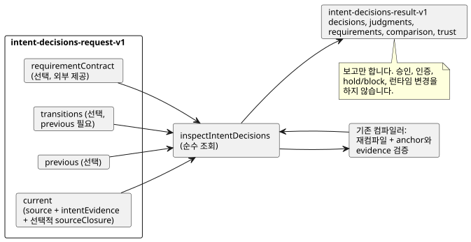

<!-- translation-source: docs/INTENT-DECISIONS.md -->
[영문 원문](INTENT-DECISIONS.md)

# 작성된 의도 결정 확인하기

`tools/intent-decisions.mjs`의 `inspectIntentDecisions(request)`는 정본 GhostFlow 소스와 컴파일러가 검증한 `intent-evidence-v1`에 대한 **순수 조회**입니다.
`node tools/ghostdecisions.mjs --request request.json --format json`은 JSON/TOON CLI이며, 기본 출력 형식은 TOON입니다.
이 기능은 [#565](https://github.com/callin2/ghostflow-language/issues/565) 계약을 사용해 [#564](https://github.com/callin2/ghostflow-language/issues/564)를 구현합니다. [영문 버전](INTENT-DECISIONS.md)도 같은 계약을 설명합니다.

**하는 일.** 제공된 각 정본 소스를 다시 컴파일하고, 작성된 anchor와 intent evidence에 대한 기존 컴파일러의 검증을 재사용합니다. 원래의 외부 레코드는 컴파일러의 제한적인 구조적 결론과 나란히 그대로 보입니다. 네 가지 decision kind는 항상 구분해서 유지합니다: `confirmed`, `policy-derived`, `assumption`, `undecided`.

**하지 않는 일.** 이 API는 다음을 하지 않습니다.

- 자연어에서 의도를 추론하거나 질문을 생성하는 일.
- 결정을 승인하거나 행위자를 인증하는 일.
- 요구사항을 강제하거나 런타임 gate를 바꾸는 일.
- 제어 기본값을 합성하는 일.



그림은 요청의 구성 요소, 재컴파일 단계, 결과를 보여 줍니다. 결과는 보고만 하며, hold나 block은 외부 소비자에게 맡겨집니다.

## 요청

최상위 객체에는 `schema: "GhostFlow/intent-decisions-request-v1"`과 `current`가 필요합니다. `requirementContract`, `previous`, `transitions`도 제공할 수 있습니다. `transitions`를 제공하려면 `previous`가 필요합니다.

**`current`와 `previous`.** `current`와 선택적인 `previous`에는 각각 다음이 필요합니다.

- `source: { text, filename, documentId, revisionId }`. `text`는 완전한 정본 `.ghost.md` 프로그램이며, ID는 작성된 해당 revision을 명시적으로 가리킵니다.
- `intentEvidence`: 완전한 `GhostFlow/intent-evidence-v1` 레코드. 독립적으로 컴파일되어 해당 소스에 결속됩니다. source digest, interpretation confirmation digest, condition digest, 작성된 node link 중 하나라도 오래되어(일치하지 않아) stale인 evidence 레코드는 거부됩니다.
- 선택적인 `sourceClosure`: 명시적 import를 위해 컴파일러에 직접 전달하는 `{ filename, revision, text }`의 제한된 배열. 조회는 import된 파일을 디스크에서 읽지 않습니다.

**Import.** import를 컴파일하면 결과의 `source.sourceClosureSha256`은 import된 문서의 revision과 정확한 텍스트를 포함한 컴파일러의 정본 closure를 hash합니다. root 문서/revision ID가 같은데 closure가 바뀌면, root source SHA가 바뀌지 않았더라도 `source-revision-reused`에 해당합니다. import SHA pin은 여전히 컴파일러가 강제합니다.

**`requirementContract`.** 선택적이며 외부에서 제공됩니다. 형태는 `{ id, revision, reference, requirements }`입니다.

- 명시적인 빈 `requirements: []`는 `supplied`이며, 충족되지 않은 요구사항이 없습니다.
- contract를 생략하면 `not-supplied`입니다.

모든 requirement는 정확히 다음 필드를 가집니다.

```json
{
  "id": "R-PUMP",
  "interpretation": { "id": "I-PUMP", "revision": "r1", "sha256": "<optional exact content SHA-256>" },
  "level": "confirmed",
  "conditionRefs": [{ "id": "C-PUMP", "revision": "r1", "sha256": "<exact condition SHA-256>" }],
  "actionRefs": ["action:deploy"],
  "claimRefs": ["claim:ready"],
  "onUnmet": "hold"
}
```

| 필드 | 의미 |
|---|---|
| `interpretation` | `id`는 필수입니다. `revision`과 `sha256`은 선택적인 정확한 pin입니다. digest는 기존 `intentInterpretationDigest`이며, 해석된 내용은 포함하지만 주장된 confirmation은 제외합니다. |
| `conditionRefs` | 선택 사항입니다. 제공하면 해당 interpretation이 소유한 condition에 대한 정확한 id/revision/digest 참조를 담습니다. |
| `level` | `represented` 또는 `confirmed`(아래 참조). |
| `onUnmet` | `report`, `hold`, `block`. |
| `actionRefs`, `claimRefs` | 서로 구분되는, 고유 문자열 배열. |

두 level의 차이는 다음과 같습니다.

- **`represented`**는 일치하는 interpretation과, 제공된 condition 참조만 요구합니다. assumption이나 undecided 상태를 포함할 수 있으며 그 상태를 바꾸지 않습니다.
- **`confirmed`**는 여기에 더해 interpretation에 대해 컴파일러가 보고한 `recorded` confirmation(현재 유효한 policy-derived decision 포함)과, **제공된 각 condition 참조**의 `recorded` 상태를 요구합니다. condition 참조를 제공하지 않으면 `confirmed`는 interpretation decision만 검사합니다. 모든 condition이 확인되었다는 뜻이 결코 아닙니다.

`onUnmet`, `actionRefs`, `claimRefs`는 외부 소비자를 위한 메타데이터로 반환됩니다. 이 조회가 hold나 block을 직접 수행하지는 않습니다.

**미충족 코드**는 다음을 구분합니다.

- interpretation 누락.
- interpretation revision/내용 불일치.
- condition 누락 또는 변경.
- 확인된 범위 밖의 condition.
- `undecided`, `unconfirmed`, `policy-not-current` 같은 decision 상태.

명시적으로 제공된 requirement만 검사합니다. contract가 없으면 누락된 requirement를 추론하지 않습니다.

## 이전 revision과 transition

`previous`를 제공하면 독립적으로 컴파일하고 검증합니다. 각 interpretation 행에는 digest 두 개가 들어갑니다.

| Digest | 대상 |
|---|---|
| `contentSha256` | decision을 제외한, 해석된 내용에 대해 컴파일러가 기존 방식으로 계산한 digest. |
| `recordSha256` | canonical JSON `{ interpretation, conditions }`의 SHA-256. 완전한 decision과 **이 interpretation이 소유한 모든 condition**을 포함합니다. 따라서 해석된 텍스트와 bytecode가 바뀌지 않아도 condition만 바뀌면 이 비교 identity가 달라집니다. |

**행 짝짓기.** 비교 결과는 `added`, `removed`, `unchanged`, `changed` 행을 반환하며, 각 행에는 양쪽의 완전한 레코드가 들어갑니다.

- ID가 같은 행은 ID로 짝을 짓습니다.
- ID가 바뀐 이름 변경은 명시적이고 모호하지 않은 transition을 통해서만 짝을 짓습니다.
- transition의 형태는 `{ from: { id, revision, sha256 }, to: { id, revision, sha256 }, actor, recordRef, at }`입니다. digest는 전체 `recordSha256` 값입니다.
- pin은 일대일이어야 합니다. 중복되거나, 모호하거나, stale이거나, 일치하지 않는 pin은 거부됩니다.

**진단.** 다음은 진단일 뿐 런타임 blocker가 아닙니다.

| 진단 | 발생 조건 |
|---|---|
| `transition-link-missing` | 변경된 행에 transition이 없습니다. |
| `interpretation-revision-reused` | 같은 ID와 revision에서 해석된 내용이 바뀌었습니다. |
| `condition-revision-reused:<id>` | 같은 condition ID와 revision에서 condition이 바뀌었습니다. |
| `source-revision-reused` | root 비교에서, 같은 문서 ID와 revision ID인데 소스 바이트가 바뀌었습니다. |

decision이나 condition만 바꾸면 해석된 내용의 revision은 그대로 둘 수 있지만, 변경된 전체 레코드에는 여전히 transition link가 필요합니다. 이름 변경에는 같은 ID의 interpretation revision 경고가 발생하지 않습니다. 이전 confirmation은 현재 소스로 자동 이전되지 않습니다.

## 결과와 한도

**성공.** 성공한 호출은 `GhostFlow/intent-decisions-result-v1`을 다음과 함께 반환합니다.

- `outcome: "completed"`.
- 정확한 request/source/evidence digest.
- `current.decisions`, `current.judgments`, `requirements`, `comparison`, `trust`.

각 decision은 원래 interpretation, 원래 source 참조, decision, 그리고 확인 범위와 외부 check ID를 포함한 소유 condition 전체를 유지합니다. 다음 사항은 의도적으로 해결하지 않은 채 둡니다.

- 기존 judgment는 `not-evaluated`로, 행위자 권한은 `not-authenticated`로 남습니다.
- 정책의 `current`, `expired`, `unknown`은 원래 레코드에서 서로 구분됩니다. `expired`와 `unknown`은 `confirmed` requirement를 충족할 수 없습니다.
- 소스 hash와 bytecode hash를 따로 보고하므로, bytecode가 같은 본문 변경도 식별할 수 있습니다.

**입력 한도.**

| 한도 | 값 |
|---|---|
| 입력 | 순환 없는 JSON 데이터, 직렬화된 UTF-8 기준 최대 524,288바이트, 깊이 24 |
| 소스 텍스트 | 최대 262,144자 |
| Source closure | 최대 32개 항목 |
| Requirements, transition 레코드, 기타 제한 목록 | 최대 128개 항목 |

희소 배열, 중복 ID/참조, 잘못된 필드, 잘못된 timestamp는 거부됩니다. API는 컴파일 전에 입력을 복사하므로, 결과가 호출자 객체와 별칭(alias)을 공유하지 않습니다.

**출력 한도.** 완전한 출력은 UTF-8 기준 524,288바이트로 제한됩니다. 확장 결과가 이 한도를 넘으면 API는 `outcome: "incomplete"`, 정확한 request SHA-256, `output-limit` 진단만 반환합니다. 부분적인 충족 또는 확인 답변은 반환하지 않으며, CLI는 종료 코드 1로 끝납니다. 형식이 잘못된 입력에 대해 CLI는 `rejected`를 출력하고 종료 코드 1로 끝납니다.

저장소 root에서 실행 가능한 가상 회귀 테스트를 실행합니다.

```sh
node --test tests/intent-decisions.test.mjs
```

이 테스트는 네 가지 decision 상태, 부분 확인, 명시적 requirement 정책, 소스 drift, 정확한 transition, 한도, JSON/TOON parity를 다룹니다. Fixture의 행위자와 참조는 지어낸 것이며, 이 테스트는 외부 권한이나 장치 동작을 입증하지 않습니다.
