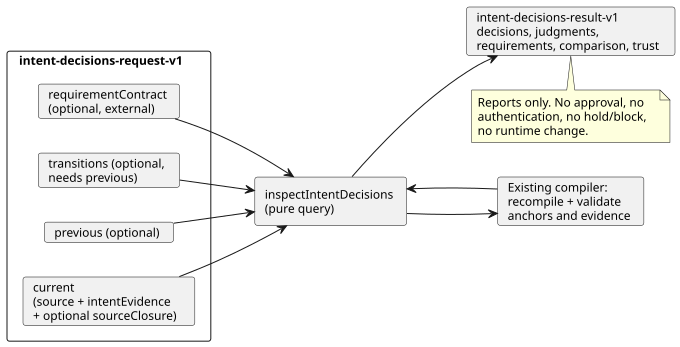

# Inspect authored intent decisions

`inspectIntentDecisions(request)` in `tools/intent-decisions.mjs` is a **pure query** over canonical GhostFlow source and compiler-validated `intent-evidence-v1`.
`node tools/ghostdecisions.mjs --request request.json --format json` is the JSON/TOON CLI; TOON output is the default.
This implements [#564](https://github.com/callin2/ghostflow-language/issues/564) using the [#565](https://github.com/callin2/ghostflow-language/issues/565) contract. The [Korean version](INTENT-DECISIONS.ko.md) describes the same contract.

**What it does.** It recompiles each supplied canonical source and reuses the existing compiler's validation of authored anchors and intent evidence. Original external records stay visible beside the compiler's limited structural conclusions. The four decision kinds always remain separate: `confirmed`, `policy-derived`, `assumption`, and `undecided`.

**What it does not do.** This API does not:

- infer intent from natural language or generate a question;
- approve a decision or authenticate an actor;
- enforce a requirement or change a runtime gate;
- synthesize a control default.



The diagram shows the request parts, the recompilation step, and the result. The result only reports; any hold or block is left to an external consumer.

## Request

The top-level object requires `schema: "GhostFlow/intent-decisions-request-v1"` and `current`. It may also supply `requirementContract`, `previous`, and `transitions`. `transitions` requires `previous`.

**`current` and `previous`.** `current`, and optional `previous`, each require:

- `source: { text, filename, documentId, revisionId }`. `text` is the complete canonical `.ghost.md` program, and the IDs explicitly name its authored revision.
- `intentEvidence`: a complete `GhostFlow/intent-evidence-v1` record. It is compiled independently and bound to that source. An evidence record whose source digest, interpretation confirmation digest, condition digest, or authored node link is stale (does not match) is rejected.
- Optional `sourceClosure`: a bounded array of `{ filename, revision, text }` passed directly to the compiler for explicit imports. The query never reads imported files from disk.

**Imports.** When imports are compiled, `source.sourceClosureSha256` in the result hashes the compiler's canonical closure, including imported document revisions and exact text. If the closure changes while the root document/revision IDs stay the same, that also counts as `source-revision-reused` — even when the root source SHA is unchanged. The compiler still enforces import SHA pins.

**`requirementContract`.** This is optional and external. Its shape is `{ id, revision, reference, requirements }`.

- An explicit empty `requirements: []` is `supplied`, with no unmet requirements.
- Omitting the contract is `not-supplied`.

Every requirement has exactly these fields:

```json
{
  "id": "R-PUMP",
  "interpretation": { "id": "I-PUMP", "revision": "r1", "sha256": "<optional exact content SHA-256>" },
  "level": "confirmed",
  "conditionRefs": [{ "id": "C-PUMP", "revision": "r1", "sha256": "<exact condition SHA-256>" }],
  "actionRefs": ["action:deploy"],
  "claimRefs": ["claim:ready"],
  "onUnmet": "hold"
}
```

| Field | Meaning |
|---|---|
| `interpretation` | `id` is required. `revision` and `sha256` are optional exact pins. The digest is the existing `intentInterpretationDigest`, which covers interpreted content but excludes the claimed confirmation. |
| `conditionRefs` | Optional. When provided, it holds exact id/revision/digest references to conditions owned by that interpretation. |
| `level` | `represented` or `confirmed` (see below). |
| `onUnmet` | `report`, `hold`, or `block`. |
| `actionRefs`, `claimRefs` | Distinct arrays of unique strings. |

The two levels differ as follows:

- **`represented`** requires only a matching interpretation and any supplied condition references. It can include an assumption or undecided state without changing that state.
- **`confirmed`** additionally requires the interpretation's compiler-reported `recorded` confirmation (including a current policy-derived decision) and `recorded` status for **each supplied condition reference**. If no condition references are supplied, `confirmed` checks the interpretation decision only; it never implies that all conditions are confirmed.

`onUnmet`, `actionRefs`, and `claimRefs` are returned as metadata for an external consumer. This query does not perform the hold or block itself.

**Unmet codes** distinguish:

- a missing interpretation;
- an interpretation revision/content mismatch;
- a missing or changed condition;
- a condition outside the confirmed scope;
- decision states such as `undecided`, `unconfirmed`, or `policy-not-current`.

Only the explicitly supplied requirements are tested. An absent contract produces no inferred missing requirement.

## Previous revision and transitions

When `previous` is supplied, it is compiled and validated independently. Each interpretation row includes two digests:

| Digest | What it covers |
|---|---|
| `contentSha256` | The compiler's existing digest of interpreted content, excluding the decision. |
| `recordSha256` | SHA-256 of canonical JSON `{ interpretation, conditions }`, including the complete decision and **all conditions owned by this interpretation**. A condition-only change therefore changes this comparison identity, even if the interpreted text and bytecode do not change. |

**Pairing rows.** The comparison returns `added`, `removed`, `unchanged`, or `changed` rows, each with both complete records.

- Rows with the same ID pair by ID.
- A rename across IDs pairs only through an explicit, unambiguous transition.
- A transition is `{ from: { id, revision, sha256 }, to: { id, revision, sha256 }, actor, recordRef, at }`. Its digests are the full `recordSha256` values.
- Pins must be one-to-one. Duplicate, ambiguous, stale, or mismatched pins are rejected.

**Diagnostics.** These are diagnostics, not runtime blockers:

| Diagnostic | When |
|---|---|
| `transition-link-missing` | A changed row has no transition. |
| `interpretation-revision-reused` | Interpreted content changed under the same ID and revision. |
| `condition-revision-reused:<id>` | A condition changed under the same condition ID and revision. |
| `source-revision-reused` | On the root comparison: source bytes changed under the same document and revision IDs. |

Changing only the decision or the conditions can keep the same interpreted-content revision, but the changed full record still needs a transition link. A rename does not trigger the same-ID interpretation revision warning. No prior confirmation is transferred to the current source automatically.

## Result and limits

**Success.** A successful call returns `GhostFlow/intent-decisions-result-v1` with:

- `outcome: "completed"`;
- exact request/source/evidence digests;
- `current.decisions`, `current.judgments`, `requirements`, `comparison`, and `trust`.

Each decision keeps the original interpretation, the original source reference, the decision, and all owned conditions with their confirmation scope and external check IDs. Several things are deliberately left unresolved:

- The existing judgments stay `not-evaluated`; actor authority stays `not-authenticated`.
- Policy `current`, `expired`, and `unknown` remain distinct in the original record. `expired` and `unknown` cannot meet a `confirmed` requirement.
- Source and bytecode hashes are reported separately, so prose changes with identical bytecode remain identifiable.

**Input limits.**

| Limit | Value |
|---|---|
| Input | Acyclic JSON data, at most 524,288 serialized UTF-8 bytes and depth 24 |
| Source text | At most 262,144 characters |
| Source closure | At most 32 entries |
| Requirements, transition records, other bounded lists | At most 128 entries |

Sparse arrays, duplicate IDs/references, malformed fields, and bad timestamps are rejected. The API copies inputs before compilation; results do not alias caller objects.

**Output limit.** Complete output is capped at 524,288 UTF-8 bytes. If expansion exceeds this bound, the API returns only `outcome: "incomplete"`, the exact request SHA-256, and an `output-limit` diagnostic. It returns no partial met or confirmed answer, and the CLI exits 1. Malformed input emits `rejected` in the CLI and exits 1.

Run the executable fictional regression from the repository root:

```sh
node --test tests/intent-decisions.test.mjs
```

It covers the four decision states, partial confirmation, explicit requirement policies, source drift, exact transitions, bounds, and JSON/TOON parity. Fixture actors and references are invented; the test does not establish external authority or device behavior.
