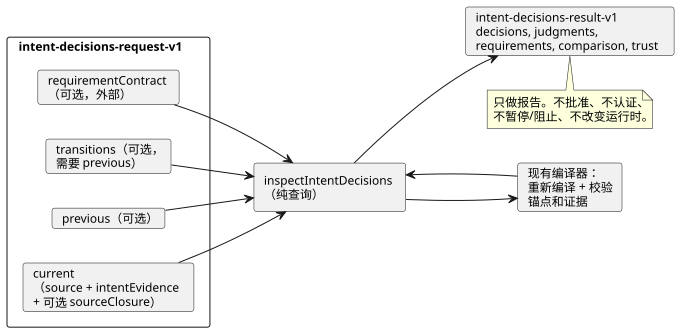

<!-- translation-source: docs/INTENT-DECISIONS.md -->
[英文原文](INTENT-DECISIONS.md)

# 检查作者编写的意图决定

`tools/intent-decisions.mjs` 中的 `inspectIntentDecisions(request)` 是一个对规范 GhostFlow 源文件和经编译器校验的 `intent-evidence-v1` 进行的**纯查询**。
`node tools/ghostdecisions.mjs --request request.json --format json` 是 JSON/TOON CLI；默认输出 TOON。
它基于 [#565](https://github.com/callin2/ghostflow-language/issues/565) 契约实现了 [#564](https://github.com/callin2/ghostflow-language/issues/564)。[韩文版](INTENT-DECISIONS.ko.md)描述的是同一份契约。

**它做什么。** 它重新编译每个所提供的规范源文件，并复用现有编译器对作者编写的锚点和意图证据的校验。原始的外部记录与编译器有限的结构性结论并列可见。四种决定种类始终保持分离：`confirmed`、`policy-derived`、`assumption` 和 `undecided`。

**它不做什么。** 此 API 不会：

- 从自然语言推断意图或生成问题；
- 批准某个决定或认证某个执行者；
- 强制执行某项需求或改变运行时门控；
- 合成控制默认值。



该图展示请求的各个部分、重新编译步骤和结果。结果只做报告；任何暂停或阻止都留给外部使用方。

## 请求

顶层对象需要 `schema: "GhostFlow/intent-decisions-request-v1"` 和 `current`。它还可以提供 `requirementContract`、`previous` 和 `transitions`。`transitions` 需要 `previous`。

**`current` 与 `previous`。** `current` 以及可选的 `previous` 各自需要：

- `source: { text, filename, documentId, revisionId }`。`text` 是完整的规范 `.ghost.md` 程序，这些 ID 显式命名其作者编写的修订版。
- `intentEvidence`：一份完整的 `GhostFlow/intent-evidence-v1` 记录。它被独立编译并绑定到该源文件。若证据记录的源摘要、解释确认摘要、条件摘要或作者编写的节点链接已陈旧（不匹配），则会被拒绝。
- 可选的 `sourceClosure`：一个有界的 `{ filename, revision, text }` 数组，为显式导入直接传给编译器。查询绝不会从磁盘读取被导入的文件。

**导入。** 当编译导入时，结果中的 `source.sourceClosureSha256` 是对编译器规范闭包的哈希，包括被导入文档的修订版和精确文本。如果闭包发生变化而根文档/修订版 ID 保持不变，这也计为 `source-revision-reused`——即使根源文件的 SHA 未变。编译器仍会强制执行导入的 SHA 固定值。

**`requirementContract`。** 这是可选的外部输入。其结构为 `{ id, revision, reference, requirements }`。

- 显式的空 `requirements: []` 为 `supplied`，没有未满足的需求。
- 省略该契约则为 `not-supplied`。

每项需求都恰好具有以下字段：

```json
{
  "id": "R-PUMP",
  "interpretation": { "id": "I-PUMP", "revision": "r1", "sha256": "<optional exact content SHA-256>" },
  "level": "confirmed",
  "conditionRefs": [{ "id": "C-PUMP", "revision": "r1", "sha256": "<exact condition SHA-256>" }],
  "actionRefs": ["action:deploy"],
  "claimRefs": ["claim:ready"],
  "onUnmet": "hold"
}
```

| 字段 | 含义 |
|---|---|
| `interpretation` | `id` 为必需。`revision` 和 `sha256` 是可选的精确固定值。该摘要是现有的 `intentInterpretationDigest`，它覆盖被解释的内容，但不包括所声称的确认。 |
| `conditionRefs` | 可选。提供时，它包含对该解释所拥有条件的精确 id/修订版/摘要引用。 |
| `level` | `represented` 或 `confirmed`（见下文）。 |
| `onUnmet` | `report`、`hold` 或 `block`。 |
| `actionRefs`、`claimRefs` | 由唯一字符串组成的两个不同数组。 |

两个级别的区别如下：

- **`represented`** 只要求解释匹配，以及所提供的条件引用匹配。它可以包含假设或未决定状态，而不改变该状态。
- **`confirmed`** 还要求解释具有编译器报告的 `recorded` 确认（包括当前有效的 policy-derived 决定），并且**每个所提供的条件引用**都具有 `recorded` 状态。如果没有提供条件引用，`confirmed` 只检查解释的决定；它绝不意味着所有条件都已确认。

`onUnmet`、`actionRefs` 和 `claimRefs` 作为元数据返回给外部使用方。此查询本身不执行暂停或阻止。

**未满足代码**区分以下情况：

- 缺失的解释；
- 解释的修订版/内容不匹配；
- 缺失或已更改的条件；
- 超出已确认范围的条件；
- `undecided`、`unconfirmed` 或 `policy-not-current` 等决定状态。

只测试显式提供的需求。缺少契约时不会推断出任何缺失的需求。

## 先前修订版与转换

提供 `previous` 时，它会被独立编译和校验。每个解释行包含两个摘要：

| 摘要 | 覆盖内容 |
|---|---|
| `contentSha256` | 编译器现有的被解释内容摘要，不包括决定。 |
| `recordSha256` | 规范 JSON `{ interpretation, conditions }` 的 SHA-256，包括完整的决定以及**该解释所拥有的全部条件**。因此，即使被解释的文本和字节码都未变化，仅更改条件也会改变这一比较身份。 |

**行的配对。** 比较会返回 `added`、`removed`、`unchanged` 或 `changed` 行，每行都带有两份完整记录。

- ID 相同的行按 ID 配对。
- 跨 ID 的重命名只能通过显式且无歧义的转换来配对。
- 转换的形式为 `{ from: { id, revision, sha256 }, to: { id, revision, sha256 }, actor, recordRef, at }`。其中的摘要是完整的 `recordSha256` 值。
- 固定值必须一一对应。重复、有歧义、陈旧或不匹配的固定值会被拒绝。

**诊断。** 以下是诊断，而不是运行时阻止项：

| 诊断 | 触发时机 |
|---|---|
| `transition-link-missing` | 某个已更改的行没有转换。 |
| `interpretation-revision-reused` | 在相同 ID 和修订版下，被解释的内容发生了变化。 |
| `condition-revision-reused:<id>` | 在相同条件 ID 和修订版下，某个条件发生了变化。 |
| `source-revision-reused` | 在根比较中：在相同的文档 ID 和修订版 ID 下，源字节发生了变化。 |

只更改决定或条件时，可以保持被解释内容的修订版不变，但已更改的完整记录仍然需要转换链接。重命名不会触发同 ID 解释修订版警告。先前的确认不会自动转移到当前源文件。

## 结果与限制

**成功。** 调用成功时返回 `GhostFlow/intent-decisions-result-v1`，其中包含：

- `outcome: "completed"`；
- 精确的请求/源/证据摘要；
- `current.decisions`、`current.judgments`、`requirements`、`comparison` 和 `trust`。

每个决定都保留原始解释、原始源引用、决定本身，以及所拥有的全部条件及其确认范围和外部检查 ID。有几件事被刻意保持为未解决：

- 现有的判断保持 `not-evaluated`；执行者权限保持 `not-authenticated`。
- 策略的 `current`、`expired` 和 `unknown` 在原始记录中保持区分。`expired` 和 `unknown` 不能满足 `confirmed` 需求。
- 源哈希和字节码哈希分别报告，因此字节码相同的散文修改仍然可以识别。

**输入限制。**

| 限制 | 值 |
|---|---|
| 输入 | 无环的 JSON 数据，序列化后最多 524,288 个 UTF-8 字节，深度最多 24 |
| 源文本 | 最多 262,144 个字符 |
| 源闭包 | 最多 32 个条目 |
| 需求、转换记录及其他有界列表 | 最多 128 个条目 |

稀疏数组、重复的 ID/引用、格式错误的字段和错误的时间戳都会被拒绝。API 在编译前复制输入；结果不会与调用方的对象共享引用。

**输出限制。** 完整输出上限为 524,288 个 UTF-8 字节。如果展开后超出此上限，API 只返回 `outcome: "incomplete"`、精确的请求 SHA-256 和一条 `output-limit` 诊断。它不返回部分的满足或确认结果，CLI 以退出码 1 退出。格式错误的输入在 CLI 中输出 `rejected` 并以退出码 1 退出。

在仓库根目录运行这个可执行的虚构回归测试：

```sh
node --test tests/intent-decisions.test.mjs
```

它涵盖四种决定状态、部分确认、显式需求策略、源漂移、精确转换、上限，以及 JSON/TOON 一致性。测试夹具中的执行者和引用都是虚构的；该测试不确立外部权限或设备行为。
