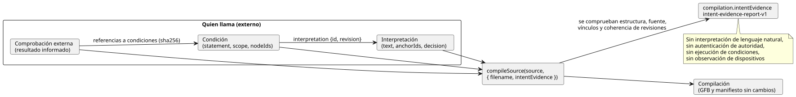

<!-- translation-source: docs/INTENT-EVIDENCE.md -->
[Original en inglés](INTENT-EVIDENCE.md)

# API de autoría de evidencia de intención

[한국어](INTENT-EVIDENCE.ko.md)

Esta API implementa el [contrato compartido de responsabilidad de la intención](INTENT-CONSISTENCY-CONTRACT.es.md). Su seguimiento se hace en [#565](https://github.com/callin2/ghostflow-language/issues/565).

Un *registro de evidencia de intención* (intent evidence record) es un registro externo de cómo alguien interpretó una solicitud, qué decidió y qué condiciones del código se derivan de ello. Ese registro se puede pasar al compilador. El compilador lo valida y lo conserva junto con la compilación.

Lo que el compilador **sí** comprueba:

- la estructura del registro;
- la identidad exacta del documento fuente;
- los vínculos escritos por el autor entre anclas y nodos del compilador;
- que las revisiones y los resúmenes criptográficos (digests) dentro del registro sean coherentes.

Lo que el compilador **no** hace:

- interpretar lenguaje natural;
- autenticar quién tenía la autoridad para decidir;
- ejecutar ni evaluar condiciones;
- observar un dispositivo.

En este documento:

- [Puntos de entrada públicos](#puntos-de-entrada-públicos): cómo pasar un registro y qué ocurre ante un error.
- [Esquema del registro](#esquema-del-registro): campos, límites, tipos de decisión y comprobaciones externas.
- [Lectura del resultado](#lectura-del-resultado): qué contiene el informe.
- [Ejemplo ejecutable de autoría](#ejemplo-ejecutable-de-autoría): un script de Node de principio a fin y una solicitud de CLI.
- [Persistencia y límite admitido](#persistencia-y-límite-admitido): límites para guardar, restaurar y empaquetar.

El diagrama siguiente muestra las partes de un registro y dónde interviene el compilador. Quien llama aporta todos los registros; el compilador solo los comprueba e informa.



## Puntos de entrada públicos

Dos puntos de entrada aceptan el registro:

- `tools/toolchain.mjs` (Node)
- `tools/browser-toolchain.mjs` (navegador o Worker)

Ambos aceptan `compileSource(source, { filename, intentEvidence })`. La opción `intentEvidence` es opcional:

- **Con la opción**, la compilación incorpora `compilation.intentEvidence`, un informe en el formato `GhostFlow/intent-evidence-report-v1`.
- **Sin la opción**, la salida de la compilación es exactamente la misma que antes.
- **En ambos casos**, los bytes GFB y el manifiesto de control son idénticos. Una evidencia válida nunca los modifica.

Ambos puntos de entrada exportan además `intentInterpretationDigest`, `intentConditionDigest` e `INTENT_EVIDENCE_LIMITS`. Los digests se calculan sobre JSON canónico: las claves de los objetos se ordenan y se conserva el orden de los arrays.

| Digest | Abarca | Excluye |
|---|---|---|
| Digest de interpretación | `id`, `revision`, `original`, `text`, `anchorIds` | la `decision` |
| Digest de condición | todo el registro de condición | — |

Si los metadatos aportados no son válidos, el compilador lanza `GF_INTENT_EVIDENCE`. El error lleva un diagnóstico estructurado y un `evidencePath` que apunta al campo defectuoso.

Un registro válido pero incompleto **no** es un error. Estos casos se compilan con normalidad:

- un supuesto válido;
- un elemento sin decidir;
- una comprobación externa ausente;
- una interpretación confirmada parcialmente.

Esta función solo valida una solicitud de autoría opcional. No añade ninguna barrera en tiempo de ejecución ni ninguna barrera de despliegue.

## Esquema del registro

Todos los campos enumerados a continuación son obligatorios salvo que se marquen explícitamente como opcionales. El compilador rechaza:

- campos desconocidos;
- identificadores duplicados;
- valores de enumeración no válidos;
- referencias que no coinciden.

El registro es un registro de procedencia, es decir, un historial de dónde provino la intención. No es un DSL de condiciones ejecutables.

| Registro | Campos |
|---|---|
| Raíz | `format: GhostFlow/intent-evidence-v1`, `sourceDocumentSha256`, `interpretations[]`, `conditions[]`, `checks[]` |
| Interpretación | `id`, `revision`, `original: { id, revision, reference }`, `text`, `anchorIds[]`, `decision` |
| Condición | `id`, `revision`, `interpretation: { id, revision }`, `statement`, `scope`, `nodeIds[]` |
| Referencia a condición | `id`, `revision`, `sha256` de `intentConditionDigest` |
| Comprobación externa | `id`, `judgment`, `conditions[]` de referencias a condiciones, `result`, `producer`, `evidenceRef`, `scope`, `at`, `context` |

**Identificadores.** Los ID y los nombres de revisión deben coincidir con `[A-Za-z][A-Za-z0-9._:-]{0,127}`.

**ID de nodo.** Los ID de nodo del compilador son los ID numéricos devueltos en `sourceMap`/`intentLinks`. Cópielos de la compilación. Nunca los genere a partir de una línea del código fuente ni de un nombre.

**Vínculos.** Cada nodo de una condición ya debe tener un vínculo escrito por el autor hacia una de las anclas de la interpretación de esa condición. Se permite una lista de nodos vacía; se informa como sin vincular. Solo se pueden seleccionar anclas que aparezcan en los metadatos de intención de la compilación. El compilador no infiere vínculos para documentos importados ni para código sin anotar.

**Texto sin interpretar.** `original.reference` es un localizador de un registro externo e inmutable, aportado por quien llama. El compilador lo conserva, pero no lo recupera ni lo autentica. `statement` y `scope` permanecen como texto plano sin interpretar. Esto incluye las unidades, la temporización, los supuestos y el rango de observación que haya elegido quien llama.

**Orden y cobertura parcial.** El orden de los arrays forma parte del hash del registro. Un registro puede abarcar solo una parte de un programa. Las anclas activas que el registro no representa siguen siendo visibles en el informe de cobertura.

**Límites:**

| Límite | Valor |
|---|---|
| Tamaño canónico | 262,144 bytes UTF-8 |
| Entradas por array | 128 |
| Caracteres por campo de texto general | 8,192 |
| Profundidad de anidamiento del JSON canónico | 16 |

El compilador también rechaza arrays dispersos, números no finitos, enteros no seguros, Unicode mal formado y objetos que no son JSON. La CLI limita además el tamaño del archivo sin procesar.

**Marcas de tiempo**: deben ser cadenas ISO UTC válidas terminadas en `Z`, con segundos enteros o exactamente tres dígitos de milisegundos. Esta comprobación es solo sintáctica. El compilador no consulta un reloj de pared ni infiere la antigüedad de una política.

### Variantes de decisión

Cada interpretación tiene una sola `decision`. Su `kind` selecciona una de cuatro variantes.

| `decision.kind` | Campos adicionales | Significado |
|---|---|---|
| `confirmed` | `actor`, `authorityRef`, `recordRef`, `at`, `interpretationSha256`, `conditions[]` de referencias exactas a condiciones | Un registro de confirmación aportado que abarca la interpretación con hash y las condiciones enumeradas. La autoridad que lo respalda no se autentica. |
| `policy-derived` | Todos los campos de confirmed más `policy: { id, revision, reference }`, `applicationRef`, `validity: current/expired/unknown` | Conserva la política y su aplicación como evidencia. `current` es solo lo que afirma el proveedor; el compilador no lo establece. Si la validez es `expired` o `unknown`, la condición se informa como `policy-not-current`. |
| `assumption` | `actor`, `reason` | Una propuesta hecha por un LLM. Las anclas vinculadas deben ser `kind=assumption status=unconfirmed origin=ai`. |
| `undecided` | `question`, `owner` (texto no vacío o `null`) | Una decisión externa que sigue abierta. Las anclas vinculadas, si las hay, deben estar sin confirmar. No se introduce ningún valor nuevo de enumeración de anclas. |

Reglas de la confirmación:

- Un registro `confirmed` o `policy-derived` que enumera anclas exige que esas anclas sean anclas de intención/premisa ya existentes y confirmadas. No puede confirmar de forma silenciosa un supuesto escrito por el autor.
- Las anclas reemplazadas (superseded) se rechazan.
- En un mismo registro, un ancla activa no puede tener más de una interpretación vigente.
- Una condición que no esté en la lista explícita de la confirmación queda como `outside-confirmed-scope`. Una lista vacía no confirma ninguna condición del código.
- Si cambia el texto de la interpretación o una condición enumerada pero mantiene los digests de confirmación antiguos, la validación falla.

Los hashes detectan la reutilización *incoherente*. No pueden detectar una confirmación falsificada que alguien haya reescrito de forma coherente.

### Contexto de las comprobaciones externas

Una comprobación externa informa de un juicio realizado fuera del compilador.

- `judgment` es `requirements-consistency`, `code-compliance` o `device-compliance`.
- `result` es `satisfied`, `violated` o `unknown`.

Cada comprobación hace referencia al menos a una revisión y un digest exactos de una condición. También aporta un `context` con estos campos:

| Campo del contexto | Regla |
|---|---|
| `sourceDocumentSha256`, `bytecodeSha256` | Deben ser iguales a los de esta compilación canónica. |
| `method` | `static`, `scenario` o `physical`. |
| `setupRef` | Registro externo de las revisiones del verificador, el runtime y el destino, las entradas, el estado inicial, los ajustes y el alcance de la verificación. Se conserva sin desreferenciarlo. |
| `run` | Obligatorio para scenario/physical, prohibido para static: `{ id, scanId, logicalTimeMs }`. El escaneo y el tiempo son enteros seguros no negativos. |
| `device` | Obligatorio solo para physical y `device-compliance`: `{ id, installationRef, commandRef, observationRef, clockRef, stage, quality }`. |

Para un dispositivo:

- `stage` es `requested`, `safe`, `applied`, `readback` o `confirmed`.
- `quality` es `ok`, `unknown` o `fault`.

Estas son etapas de evidencia *informadas*. Un ACK, o un resultado `satisfied` de quien llama, no se convierte en prueba física.

El compilador conserva los campos `run`, de tiempo y `device`, y comprueba su forma. No dispone de una muestra de runtime actual y de confianza con la cual compararlos. Por lo tanto, los consumidores deben validar estas identidades y la evidencia en su propio límite de observación. Si las afirmaciones externas se contradicen entre sí, siguen visibles como afirmaciones informadas. El compilador nunca las convierte en juicios recién certificados.

## Lectura del resultado

El informe tiene estas partes:

| Parte | Contenido |
|---|---|
| `validation` | Confirma que se superaron las comprobaciones de estructura, fuente y coherencia de los vínculos. |
| `decisions` | La clasificación y el alcance de confirmación de cada decisión, con `authority: not-authenticated`. |
| `conditions` | Los ID de nodo y de comprobación, más un estado de confirmación: `recorded`, `outside-confirmed-scope`, `policy-not-current`, `unconfirmed` o `undecided`. |
| `coverage` | Las anclas que el registro no representa y las condiciones sin vínculos. |
| `externalChecks` | El `reportedResult` de cada comprobación, marcado con `trust: external-report`. |

Los cuatro `judgments` permanecen como `not-evaluated`. El verificador de metadatos no juzga la intención, los requisitos, el programa ni un dispositivo. Su trabajo consiste en poner los registros necesarios a disposición de las personas y herramientas que realmente son responsables de esos juicios. El informe no tiene un único booleano de "conforme a la intención".

El informe también incluye:

- el `record` validado e independiente;
- su `recordSha256`;
- el digest de la fuente;
- el digest del bytecode.

## Ejemplo ejecutable de autoría

Ejecute el JavaScript siguiente desde la raíz del repositorio, usando el modo de entrada de módulos de Node. Utiliza el fixture ficticio existente de la bomba. La confirmación es un dato de ejemplo, no una aprobación de operación real. La segunda condición se deja deliberadamente fuera del alcance de la confirmación.

```js
import fs from 'node:fs';
import { compileSource, intentInterpretationDigest, intentConditionDigest } from './tools/toolchain.mjs';
const filename = 'examples/authoring/pump-rev-2.ghost.md';
const source = fs.readFileSync(filename, 'utf8');
const base = await compileSource(source, { filename });
const interpretation = {
  id: 'I-PERMIT', revision: 'r1',
  original: { id: 'U-PERMIT', revision: 'r1', reference: 'example:fictional-request' },
  text: 'Block the pump when permission is absent.',
  anchorIds: ['GF-INT-PUMP-PERMIT'],
};
const condition = {
  id: 'C-PERMIT', revision: 'r1', interpretation: { id: 'I-PERMIT', revision: 'r1' },
  statement: 'Safe pump intent is OFF when permission is false.',
  scope: 'Logical accepted scans only; no physical stopping deadline.',
  nodeIds: base.traceMetadata.intentLinks.filter(x => x.anchorId === 'GF-INT-PUMP-PERMIT' && x.relation === 'constrains').map(x => x.nodeId),
};
interpretation.decision = {
  kind: 'confirmed', actor: 'fictional-operator', authorityRef: 'example:authority',
  recordRef: 'example:confirmation', at: '2026-10-19T00:00:00Z',
  interpretationSha256: intentInterpretationDigest(interpretation),
  conditions: [{ id: condition.id, revision: condition.revision, sha256: intentConditionDigest(condition) }],
};
const evidence = {
  format: 'GhostFlow/intent-evidence-v1', sourceDocumentSha256: base.sourceDocument.sha256,
  interpretations: [interpretation],
  conditions: [condition, { ...condition, id: 'C-RESTART', statement: 'Restart behavior is not confirmed.', nodeIds: [] }],
  checks: [],
};
const result = await compileSource(source, { filename, intentEvidence: evidence });
console.log(result.intentEvidence.conditions);
fs.mkdirSync('build/intent-evidence', { recursive: true });
fs.writeFileSync('build/intent-evidence/record.json', JSON.stringify(evidence, null, 2));
```

Estados esperados:

- `C-PERMIT: recorded`
- `C-RESTART: outside-confirmed-scope`

No se ha ejecutado ningún escenario, por lo que `checks` está vacío.

Para usar el registro desde la CLI, añada la ruta opcional del archivo de evidencia a una solicitud estructurada de CLI:

```toon
format: GhostFlow/cli-request-v1
operation: check
source:
  path: examples/authoring/pump-rev-2.ghost.md
  documentId: GF-EXAMPLE-PUMP
  revisionId: rev-2-input-v1
intentEvidencePath: build/intent-evidence/record.json
```

Guarde la solicitud como `build/intent-evidence/request.toon` y ejecute `node tools/ghostc.mjs --request build/intent-evidence/request.toon --format json`.

- La CLI devuelve el informe en `intentEvidence`. El formato de salida predeterminado es TOON.
- Para `operation: compile`, aporte también `artifactPath`.
- Si el archivo de evidencia falta, está mal formado o es demasiado grande, o si el registro es incoherente, la CLI termina con un código distinto de cero y `GF_INTENT_EVIDENCE`. Los archivos de artefacto existentes no se reemplazan.

## Persistencia y límite admitido

**Guardar.** `writeArtifact` almacena el registro validado en el campo opcional `intentEvidence` del archivo complementario independiente `.map.json`.

**Restaurar.** `restoreArtifactSourceMap` vuelve a compilar la fuente canónica, valida de nuevo el registro y devuelve un informe recién derivado. Nunca confía en un veredicto guardado.

**Exigir un registro concreto.** Pase `expectedIntentEvidenceSha256: report.recordSha256` junto con `expectedSourceSha256`. Así, un registro ausente o alterado se rechaza. Sin un digest esperado, un registro ausente se acepta, de modo que los artefactos ordinarios que no llevan registro siguen siendo compatibles.

Un mapa sin firmar y sus hashes no autentican la autoría. Tampoco impiden un reemplazo coordinado de la fuente y del registro a la vez.

**Paquetes portables.** `portable-package-v1` tiene su propio perfil de mapa de fuente estricto y firmado, y no transporta este registro de autoría externo. Para evitar una pérdida silenciosa, su constructor rechaza explícitamente las compilaciones que llevan evidencia, con `unsupported-intent-evidence`. Cuando use ese perfil de paquete, conserve el registro externo por separado y compile deliberadamente sin la opción `intentEvidence`.

Esta implementación no modifica el formato de paquete firmado, el firmware, el runtime, el servicio de aprobación ni la política de despliegue. Cualquier transporte futuro mediante un paquete firmado debe mantener los mismos límites de evidencia y definir explícitamente la compatibilidad de los consumidores.

**Pruebas.** La suite ejecutable de regresión es `tests/intent-evidence.test.mjs`. Está registrada en la verificación completa y en la cobertura. Abarca:

- decisiones parciales;
- discrepancia de revisión con GFB sin cambios;
- vínculos no válidos;
- límites de las afirmaciones externas y físicas;
- funcionamiento en el navegador;
- persistencia;
- preservación de artefactos en la CLI.

Las pruebas existentes de anclas, de CLI y de paquetes siguen cubriendo los contratos circundantes.
