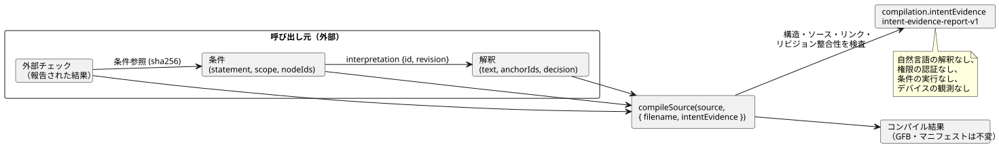

<!-- translation-source: docs/INTENT-EVIDENCE.md -->
[英語の原文](INTENT-EVIDENCE.md)

# 意図証拠のオーサリング API

[한국어](INTENT-EVIDENCE.ko.md)

この API は、共有の[意図責任契約](INTENT-CONSISTENCY-CONTRACT.ja.md)を実装したものです。[#565](https://github.com/callin2/ghostflow-language/issues/565) で追跡されています。

*意図証拠レコード*（intent evidence record）とは、誰かが要求をどのように解釈し、何を決定し、そこからどのコード条件が導かれるかを記録した外部レコードです。このレコードはコンパイラに渡すことができます。コンパイラはそれを検証し、コンパイル結果と一緒に保持します。

コンパイラが**行う**検査：

- レコードの構造
- ソース文書の厳密な同一性
- アンカーとコンパイラノードの間に作成者が記述したリンク
- レコード内のリビジョンとダイジェストが整合していること

コンパイラが**行わない**こと：

- 自然言語を解釈すること
- 誰が決定する権限を持っていたかを認証すること
- 条件を実行または評価すること
- デバイスを観測すること

この文書の内容：

- [公開エントリポイント](#公開エントリポイント) — レコードの渡し方と、エラー時に何が起こるか。
- [レコードのスキーマ](#レコードのスキーマ) — フィールド、上限、決定の種類、外部チェック。
- [結果の読み方](#結果の読み方) — レポートに含まれる内容。
- [実行可能なオーサリング例](#実行可能なオーサリング例) — エンドツーエンドの Node スクリプトと CLI リクエスト。
- [永続化とサポート範囲](#永続化とサポート範囲) — 保存、復元、パッケージ化の制限。

次の図は、レコードを構成する要素と、その中でのコンパイラの位置づけを示しています。レコードはすべて呼び出し元が用意し、コンパイラはそれを検査して報告するだけです。



## 公開エントリポイント

レコードを受け付けるエントリポイントは 2 つあります。

- `tools/toolchain.mjs`（Node）
- `tools/browser-toolchain.mjs`（ブラウザまたは Worker）

どちらも `compileSource(source, { filename, intentEvidence })` を受け付けます。`intentEvidence` オプションは省略可能です。

- **オプションを指定した場合**、コンパイル結果に `compilation.intentEvidence` が追加されます。これは `GhostFlow/intent-evidence-report-v1` 形式のレポートです。
- **オプションを指定しない場合**、コンパイル出力は従来とまったく同じです。
- **どちらの場合も**、GFB のバイト列と制御マニフェストは同一です。有効な証拠がそれらを変更することは決してありません。

どちらのエントリポイントも、`intentInterpretationDigest`、`intentConditionDigest`、`INTENT_EVIDENCE_LIMITS` もエクスポートします。ダイジェストは正規 JSON に対して計算されます。オブジェクトのキーはソートされ、配列の順序は保持されます。

| ダイジェスト | 対象 | 対象外 |
|---|---|---|
| 解釈ダイジェスト | `id`、`revision`、`original`、`text`、`anchorIds` | `decision` |
| 条件ダイジェスト | 条件レコード全体 | — |

渡されたメタデータが無効な場合、コンパイラは `GF_INTENT_EVIDENCE` をスローします。このエラーには、構造化された診断と、問題のあるフィールドを指す `evidencePath` が含まれます。

有効だが不完全なレコードはエラーでは**ありません**。次のケースは通常どおりコンパイルされます。

- 有効な仮定
- 未決定の項目
- 欠けている外部チェック
- 一部だけ確認された解釈

この機能は、省略可能なオーサリングリクエストを検証するだけです。ランタイムゲートやデプロイゲートは追加しません。

## レコードのスキーマ

以下に挙げるフィールドは、明示的に省略可能と記されていない限り、すべて必須です。コンパイラは次のものを拒否します。

- 未知のフィールド
- 重複した識別子
- 無効な列挙値
- 一致しない参照

このレコードは来歴（provenance）の記録、つまり意図がどこから来たかの履歴です。実行可能な条件 DSL ではありません。

| レコード | フィールド |
|---|---|
| ルート | `format: GhostFlow/intent-evidence-v1`、`sourceDocumentSha256`、`interpretations[]`、`conditions[]`、`checks[]` |
| 解釈 | `id`、`revision`、`original: { id, revision, reference }`、`text`、`anchorIds[]`、`decision` |
| 条件 | `id`、`revision`、`interpretation: { id, revision }`、`statement`、`scope`、`nodeIds[]` |
| 条件参照 | `id`、`revision`、`intentConditionDigest` による `sha256` |
| 外部チェック | `id`、`judgment`、条件参照の `conditions[]`、`result`、`producer`、`evidenceRef`、`scope`、`at`、`context` |

**識別子。** ID とリビジョン名は `[A-Za-z][A-Za-z0-9._:-]{0,127}` に一致しなければなりません。

**ノード ID。** コンパイラのノード ID は、`sourceMap`/`intentLinks` で返される数値 ID です。コンパイル結果からコピーしてください。ソース行や名前から生成してはなりません。

**リンク。** 条件内のすべてのノードは、その条件の解釈が持つアンカーのいずれかへの、作成者が記述したリンクをすでに持っていなければなりません。ノードリストは空でもかまいません。その場合はリンクなし（unlinked）として報告されます。選択できるのは、コンパイル結果の意図メタデータに現れるアンカーだけです。インポートされた文書や注釈のないコードについて、コンパイラがリンクを推論することはありません。

**解釈されないテキスト。** `original.reference` は、呼び出し元が提供する、外部の不変レコードへのロケータです。コンパイラはそれを保持しますが、取得も認証もしません。`statement` と `scope` は解釈されないプレーンテキストのままです。呼び出し元が選んだ単位、タイミング、仮定、観測範囲もすべてそこに含まれます。

**順序と部分的なカバレッジ。** 配列の順序はレコードのハッシュの一部です。レコードはプログラムの一部だけを対象にしてもかまいません。レコードが表していないアクティブなアンカーは、カバレッジレポートに引き続き表示されます。

**上限：**

| 上限 | 値 |
|---|---|
| 正規化後のサイズ | 262,144 UTF-8 バイト |
| 配列あたりの要素数 | 128 |
| 一般テキストフィールドあたりの文字数 | 8,192 |
| 正規 JSON のネストの深さ | 16 |

コンパイラは、疎な配列、有限でない数値、安全でない整数、不正な Unicode、JSON でないオブジェクトも拒否します。CLI ではさらに、生のファイルサイズにも上限があります。

**タイムスタンプ**は、`Z` で終わる有効な UTC の ISO 文字列でなければならず、秒は整数秒か、ちょうど 3 桁のミリ秒のどちらかでなければなりません。この検査は構文上のものだけです。コンパイラは壁時計を参照せず、ポリシーの経過期間も推論しません。

### 決定のバリアント

各解釈は 1 つの `decision` を持ちます。その `kind` によって、4 つのバリアントのいずれかが選ばれます。

| `decision.kind` | 追加フィールド | 意味 |
|---|---|---|
| `confirmed` | `actor`、`authorityRef`、`recordRef`、`at`、`interpretationSha256`、厳密な条件参照の `conditions[]` | ハッシュ化された解釈と列挙された条件を対象とする、提供された確認レコードです。その背後にある権限は認証されません。 |
| `policy-derived` | confirmed のすべてのフィールドに加えて `policy: { id, revision, reference }`、`applicationRef`、`validity: current/expired/unknown` | ポリシーとその適用を証拠として保持します。`current` は提供者の主張にすぎず、コンパイラがそれを確立するわけではありません。validity が `expired` または `unknown` の場合、その条件は `policy-not-current` として報告されます。 |
| `assumption` | `actor`、`reason` | LLM による提案です。リンクされたアンカーは `kind=assumption status=unconfirmed origin=ai` でなければなりません。 |
| `undecided` | `question`、`owner`（空でないテキストまたは `null`） | まだ決まっていない外部の決定です。リンクされたアンカーがある場合、それらは未確認でなければなりません。新しいアンカーの列挙値は導入されません。 |

確認に関する規則：

- アンカーを列挙する `confirmed` または `policy-derived` のレコードでは、それらのアンカーが既存の確認済み intent/premise アンカーである必要があります。作成者が記述した仮定を暗黙のうちに確認することはできません。
- 置き換えられた（superseded）アンカーは拒否されます。
- 1 つのレコードの中で、アクティブなアンカーが複数の現行の解釈を持つことはできません。
- 確認の明示的なリストに含まれていない条件は、`outside-confirmed-scope` のままです。空のリストは、コード条件をまったく確認しません。
- 解釈テキストや列挙された条件を変更しても、古い確認ダイジェストをそのまま残していると、検証は失敗します。

ハッシュは*不整合な*再利用を検出します。誰かが整合性を保ったまま書き換えた偽造の確認を検出することはできません。

### 外部チェックのコンテキスト

外部チェックは、コンパイラの外で行われた判断を報告します。

- `judgment` は `requirements-consistency`、`code-compliance`、`device-compliance` のいずれかです。
- `result` は `satisfied`、`violated`、`unknown` のいずれかです。

すべてのチェックは、少なくとも 1 つの厳密な条件リビジョンとダイジェストを参照します。また、次のフィールドを持つ `context` も提供します。

| コンテキストのフィールド | 規則 |
|---|---|
| `sourceDocumentSha256`、`bytecodeSha256` | この正規のコンパイル結果と一致しなければなりません。 |
| `method` | `static`、`scenario`、`physical` のいずれか。 |
| `setupRef` | チェッカー/ランタイム/ターゲットのリビジョン、入力、初期状態、設定、検証範囲を記録した外部レコードです。参照先を辿らずに保持されます。 |
| `run` | scenario/physical では必須、static では禁止：`{ id, scanId, logicalTimeMs }`。スキャン/時刻は非負の安全な整数です。 |
| `device` | physical かつ `device-compliance` の場合にのみ必須：`{ id, installationRef, commandRef, observationRef, clockRef, stage, quality }`。 |

デバイスについて：

- `stage` は `requested`、`safe`、`applied`、`readback`、`confirmed` のいずれかです。
- `quality` は `ok`、`unknown`、`fault` のいずれかです。

これらは*報告された*証拠の段階です。ACK や、呼び出し元の `satisfied` という結果が、物理的な証明になることはありません。

コンパイラは `run`、時刻、`device` の各フィールドを保持し、その形を検査します。それらと比較できる、信頼できる現在のランタイムサンプルをコンパイラは持っていません。したがって利用者は、これらの同一性と証拠を、自身の観測境界で検証しなければなりません。外部の主張が互いに矛盾する場合、それらは報告された主張として表示されたままになります。コンパイラがそれらを新たに認定された判断に変えることは決してありません。

## 結果の読み方

レポートは次の部分で構成されます。

| 部分 | 内容 |
|---|---|
| `validation` | 構造、ソース、リンクの整合性チェックに合格したことを示します。 |
| `decisions` | 各決定の分類と確認範囲。`authority: not-authenticated` が付きます。 |
| `conditions` | ノード ID とチェック ID、および確認状態：`recorded`、`outside-confirmed-scope`、`policy-not-current`、`unconfirmed`、`undecided`。 |
| `coverage` | レコードが表していないアンカーと、リンクを持たない条件。 |
| `externalChecks` | 各チェックの `reportedResult`。`trust: external-report` が付きます。 |

4 つの `judgments` はすべて `not-evaluated` のままです。メタデータチェッカーは、意図、要件、プログラム、デバイスのいずれも判断しません。その役割は、実際にそれらの判断を担う人やツールが必要なレコードを利用できるようにすることです。レポートには、「意図に準拠している」かどうかを示す単一の Boolean はありません。

レポートには次のものも含まれます。

- 切り離された、検証済みの `record`
- その `recordSha256`
- ソースのダイジェスト
- バイトコードのダイジェスト

## 実行可能なオーサリング例

以下の JavaScript を、Node のモジュール入力モードでリポジトリのルートから実行してください。既存の架空のポンプ用フィクスチャを使います。確認はサンプルデータであり、実際の運用承認ではありません。2 つ目の条件は、意図的に確認範囲の外に置いています。

```js
import fs from 'node:fs';
import { compileSource, intentInterpretationDigest, intentConditionDigest } from './tools/toolchain.mjs';
const filename = 'examples/authoring/pump-rev-2.ghost.md';
const source = fs.readFileSync(filename, 'utf8');
const base = await compileSource(source, { filename });
const interpretation = {
  id: 'I-PERMIT', revision: 'r1',
  original: { id: 'U-PERMIT', revision: 'r1', reference: 'example:fictional-request' },
  text: 'Block the pump when permission is absent.',
  anchorIds: ['GF-INT-PUMP-PERMIT'],
};
const condition = {
  id: 'C-PERMIT', revision: 'r1', interpretation: { id: 'I-PERMIT', revision: 'r1' },
  statement: 'Safe pump intent is OFF when permission is false.',
  scope: 'Logical accepted scans only; no physical stopping deadline.',
  nodeIds: base.traceMetadata.intentLinks.filter(x => x.anchorId === 'GF-INT-PUMP-PERMIT' && x.relation === 'constrains').map(x => x.nodeId),
};
interpretation.decision = {
  kind: 'confirmed', actor: 'fictional-operator', authorityRef: 'example:authority',
  recordRef: 'example:confirmation', at: '2026-10-19T00:00:00Z',
  interpretationSha256: intentInterpretationDigest(interpretation),
  conditions: [{ id: condition.id, revision: condition.revision, sha256: intentConditionDigest(condition) }],
};
const evidence = {
  format: 'GhostFlow/intent-evidence-v1', sourceDocumentSha256: base.sourceDocument.sha256,
  interpretations: [interpretation],
  conditions: [condition, { ...condition, id: 'C-RESTART', statement: 'Restart behavior is not confirmed.', nodeIds: [] }],
  checks: [],
};
const result = await compileSource(source, { filename, intentEvidence: evidence });
console.log(result.intentEvidence.conditions);
fs.mkdirSync('build/intent-evidence', { recursive: true });
fs.writeFileSync('build/intent-evidence/record.json', JSON.stringify(evidence, null, 2));
```

期待される状態：

- `C-PERMIT: recorded`
- `C-RESTART: outside-confirmed-scope`

シナリオはまだ実行していないので、`checks` は空です。

CLI からこのレコードを使うには、構造化された CLI リクエストに、省略可能な証拠ファイルのパスを追加します。

```toon
format: GhostFlow/cli-request-v1
operation: check
source:
  path: examples/authoring/pump-rev-2.ghost.md
  documentId: GF-EXAMPLE-PUMP
  revisionId: rev-2-input-v1
intentEvidencePath: build/intent-evidence/record.json
```

このリクエストを `build/intent-evidence/request.toon` として保存し、`node tools/ghostc.mjs --request build/intent-evidence/request.toon --format json` を実行します。

- CLI はレポートを `intentEvidence` に入れて返します。既定の出力形式は TOON です。
- `operation: compile` の場合は、`artifactPath` も指定してください。
- 証拠ファイルが存在しない、形式が不正、大きすぎる、またはレコードに不整合がある場合、CLI は `GF_INTENT_EVIDENCE` とともに 0 以外の終了コードで終了します。既存の成果物ファイルは置き換えられません。

## 永続化とサポート範囲

**保存。** `writeArtifact` は、検証済みのレコードを、独立した `.map.json` コンパニオンファイルの省略可能な `intentEvidence` フィールドに保存します。

**復元。** `restoreArtifactSourceMap` は正規ソースを再コンパイルし、レコードを再度検証して、新たに導出したレポートを返します。保存された判定を信頼することは決してありません。

**特定のレコードを必須にする。** `expectedSourceSha256` と一緒に `expectedIntentEvidenceSha256: report.recordSha256` を渡してください。そうすると、欠けているレコードや改変されたレコードは拒否されます。期待するダイジェストを指定しない場合、レコードがなくても受け入れられるため、レコードを持たない通常の成果物との互換性が保たれます。

署名のないマップとそのハッシュは、作成者を認証しません。また、ソースとレコードの両方を協調して置き換えることも防ぎません。

**ポータブルパッケージ。** `portable-package-v1` は独自の厳格な署名付きソースマッププロファイルを持ち、この外部オーサリングレコードは運びません。暗黙のうちに失われることを防ぐため、そのビルダーは証拠を持つコンパイル結果を `unsupported-intent-evidence` で明示的に拒否します。このパッケージプロファイルを使う場合は、外部レコードを別に保管し、意図的に `intentEvidence` オプションなしでコンパイルしてください。

この実装は、署名付きパッケージの形式、ファームウェア、ランタイム、承認サービス、デプロイポリシーを変更しません。将来、署名付きパッケージを通じて運ぶようにする場合も、同じ証拠の境界を守り、利用者側の互換性を明示的に定義しなければなりません。

**テスト。** 実行可能な回帰テストスイートは `tests/intent-evidence.test.mjs` です。完全な検証とカバレッジの両方に登録されています。対象は次のとおりです。

- 部分的な決定
- GFB が変わらない状態でのリビジョン不一致
- 無効なリンク
- 外部の主張と物理的な主張に対する制限
- ブラウザでの動作
- 永続化
- CLI における成果物の保全

既存のアンカー、CLI、パッケージのテストは、周辺の契約を引き続きカバーしています。
