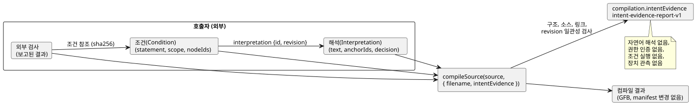

<!-- translation-source: docs/INTENT-EVIDENCE.md -->
[영문 원문](INTENT-EVIDENCE.md)

# 의도 증거 작성 API

이 API는 공통 [의도 책임 계약](INTENT-CONSISTENCY-CONTRACT.md)을 구현합니다. 진행 상황은 [#565](https://github.com/callin2/ghostflow-language/issues/565)에서 추적합니다.

*의도 증거 기록(intent evidence record)*은 누군가가 요청을 어떻게 해석했는지, 무엇을 결정했는지, 그 결정에서 어떤 코드 조건이 나오는지를 담은 외부 기록입니다. 이 기록을 컴파일러에 전달할 수 있습니다. 그러면 컴파일러는 기록을 검증하고 컴파일 결과와 함께 보존합니다.

컴파일러가 **검사하는** 것:

- 기록의 구조
- 소스 문서의 정확한 identity(정체성)
- 앵커와 컴파일러 노드 사이에 작성된 링크
- 기록 안의 revision(판본)과 digest가 서로 일관적인지 여부

컴파일러가 **하지 않는** 것:

- 자연어 해석
- 누가 결정 권한을 가졌는지 인증
- 조건 실행이나 평가
- 장치 관측

이 문서의 구성:

- [공개 진입점](#공개-진입점) — 기록을 전달하는 방법과 오류가 났을 때 일어나는 일
- [기록 스키마](#기록-스키마) — 필드, 제한, 결정 종류와 외부 검사
- [결과 읽기](#결과-읽기) — 보고서에 담기는 내용
- [실행 가능한 작성 예제](#실행-가능한-작성-예제) — 처음부터 끝까지 동작하는 Node 스크립트와 CLI 요청
- [저장과 지원 경계](#저장과-지원-경계) — 저장, 복원, 패키징의 한계

아래 그림은 기록의 구성 요소와 컴파일러의 위치를 보여 줍니다. 모든 기록은 호출자가 제공하며, 컴파일러는 검사하고 보고만 합니다.



## 공개 진입점

기록을 받는 진입점은 두 가지입니다.

- `tools/toolchain.mjs` (Node)
- `tools/browser-toolchain.mjs` (브라우저 또는 Worker)

둘 다 `compileSource(source, { filename, intentEvidence })`를 받습니다. `intentEvidence` 옵션은 선택 사항입니다.

- **옵션을 주면** 컴파일 결과에 `GhostFlow/intent-evidence-report-v1` 형식의 보고서인 `compilation.intentEvidence`가 추가됩니다.
- **옵션을 주지 않으면** 컴파일 출력은 이전과 완전히 같습니다.
- **어느 경우든** GFB 바이트와 control manifest는 동일합니다. 유효한 증거는 이 둘을 절대 바꾸지 않습니다.

두 진입점은 `intentInterpretationDigest`, `intentConditionDigest`, `INTENT_EVIDENCE_LIMITS`도 export합니다. Digest는 canonical JSON으로 계산합니다. 즉 object key는 정렬하고 array 순서는 그대로 유지합니다.

| Digest | 포함 | 제외 |
|---|---|---|
| Interpretation digest | `id`, `revision`, `original`, `text`, `anchorIds` | `decision` |
| Condition digest | condition 기록 전체 | — |

제공된 메타데이터가 유효하지 않으면 컴파일러는 `GF_INTENT_EVIDENCE`를 던집니다. 이 오류에는 구조화된 진단과, 문제가 된 필드를 가리키는 `evidencePath`가 들어 있습니다.

유효하지만 완전하지 않은 기록은 오류가 **아닙니다**. 다음 경우는 정상적으로 컴파일됩니다.

- 유효한 가정(assumption)
- 아직 결정되지 않은 항목
- 누락된 외부 검사
- 부분적으로만 확인된 해석

이 기능은 선택적인 작성 요청만 검증합니다. 런타임 게이트나 배포 게이트를 추가하지 않습니다.

## 기록 스키마

아래에 나열한 모든 필드는 선택 사항이라고 명시하지 않는 한 필수입니다. 컴파일러는 다음을 거부합니다.

- 알 수 없는 필드
- 중복된 식별자
- 유효하지 않은 enum 값
- 일치하지 않는 참조

이 기록은 provenance(출처) 기록, 즉 의도가 어디서 왔는지에 대한 이력입니다. 실행 가능한 조건 DSL이 아닙니다.

| 기록 | 필드 |
|---|---|
| Root | `format: GhostFlow/intent-evidence-v1`, `sourceDocumentSha256`, `interpretations[]`, `conditions[]`, `checks[]` |
| Interpretation | `id`, `revision`, `original: { id, revision, reference }`, `text`, `anchorIds[]`, `decision` |
| Condition | `id`, `revision`, `interpretation: { id, revision }`, `statement`, `scope`, `nodeIds[]` |
| Condition reference | `id`, `revision`, `intentConditionDigest`로 계산한 `sha256` |
| External check | `id`, `judgment`, condition reference로 이루어진 `conditions[]`, `result`, `producer`, `evidenceRef`, `scope`, `at`, `context` |

**식별자.** ID와 revision 이름은 `[A-Za-z][A-Za-z0-9._:-]{0,127}`에 맞아야 합니다.

**노드 ID.** 컴파일러 노드 ID는 `sourceMap`/`intentLinks`가 반환하는 숫자 ID입니다. 컴파일 결과에서 복사해서 쓰십시오. 소스 줄이나 이름으로부터 절대 만들어 내서는 안 됩니다.

**링크.** condition에 있는 모든 노드에는, 그 condition이 가리키는 해석의 앵커 중 하나로 향하는 작성된 링크가 이미 있어야 합니다. 빈 노드 목록은 허용되며, 링크 없음으로 보고됩니다. 컴파일 결과의 의도 메타데이터에 나타나는 앵커만 선택할 수 있습니다. 컴파일러는 가져온(import) 문서나 주석이 달리지 않은 코드에 대해 링크를 추론하지 않습니다.

**해석되지 않는 텍스트.** `original.reference`는 호출자가 제공하는, 변경 불가능한 외부 기록의 위치 표시자입니다. 컴파일러는 이를 보존하지만 가져오거나 인증하지 않습니다. `statement`와 `scope`는 해석되지 않는 일반 텍스트로 남습니다. 호출자가 정한 단위, 시간, 가정, 관측 범위도 마찬가지입니다.

**순서와 부분 커버리지.** Array 순서는 기록 해시의 일부입니다. 기록은 프로그램의 일부만 다룰 수도 있습니다. 기록이 표현하지 않은 활성 앵커는 커버리지 보고서에 계속 표시됩니다.

**제한:**

| 제한 | 값 |
|---|---|
| Canonical 크기 | 262,144 UTF-8 바이트 |
| Array당 항목 수 | 128 |
| 일반 텍스트 필드당 문자 수 | 8,192 |
| Canonical JSON 중첩 깊이 | 16 |

컴파일러는 sparse array, 유한하지 않은 수, 안전 범위를 벗어난 정수, 잘못된 Unicode, JSON이 아닌 object도 거부합니다. CLI는 여기에 더해 원본 파일 크기를 제한합니다.

**타임스탬프**는 `Z`로 끝나는 유효한 UTC ISO 문자열이어야 하며, 초 단위이거나 밀리초 세 자리를 정확히 가져야 합니다. 이 검사는 문법 검사일 뿐입니다. 컴파일러는 벽시계를 참조하지 않으며 정책의 경과 기간을 추론하지 않습니다.

### 결정 종류

각 해석에는 `decision`이 하나 있습니다. 그 `kind`가 네 가지 종류 중 하나를 선택합니다.

| `decision.kind` | 추가 필드 | 의미 |
|---|---|---|
| `confirmed` | `actor`, `authorityRef`, `recordRef`, `at`, `interpretationSha256`, 정확한 condition reference로 이루어진 `conditions[]` | 해시된 해석과 나열된 condition을 다루는, 제공된 확인 기록입니다. 그 뒤에 있는 권한은 인증되지 않습니다. |
| `policy-derived` | confirmed의 모든 필드 + `policy: { id, revision, reference }`, `applicationRef`, `validity: current/expired/unknown` | 정책과 그 적용을 증거로 보존합니다. `current`는 제공자의 주장일 뿐이며 컴파일러가 확립하지 않습니다. validity가 `expired` 또는 `unknown`이면 condition은 `policy-not-current`로 보고됩니다. |
| `assumption` | `actor`, `reason` | LLM이 낸 제안입니다. 연결된 앵커는 `kind=assumption status=unconfirmed origin=ai`여야 합니다. |
| `undecided` | `question`, `owner` (비어 있지 않은 텍스트 또는 `null`) | 아직 열려 있는 외부 결정입니다. 연결된 앵커가 있다면 unconfirmed여야 합니다. 새 앵커 enum 값은 도입하지 않습니다. |

확인에 관한 규칙:

- 앵커를 나열한 `confirmed` 또는 `policy-derived` 기록은 그 앵커가 이미 존재하는 confirmed intent/premise 앵커일 것을 요구합니다. 작성된 가정(assumption)을 조용히 확인 처리할 수 없습니다.
- Superseded 앵커는 거부됩니다.
- 한 기록 안에서 하나의 활성 앵커는 현재 해석을 둘 이상 가질 수 없습니다.
- 확인의 명시적 목록에 없는 condition은 `outside-confirmed-scope`로 남습니다. 빈 목록은 어떤 코드 condition도 확인하지 않습니다.
- 해석 텍스트나 나열된 condition을 바꾸면서 이전 확인 digest를 그대로 두면 검증이 실패합니다.

해시는 *일관되지 않은* 재사용을 감지합니다. 누군가가 일관되게 다시 써서 위조한 확인은 감지할 수 없습니다.

### 외부 검사 context

외부 검사는 컴파일러 밖에서 내려진 판단을 보고합니다.

- `judgment`는 `requirements-consistency`, `code-compliance`, `device-compliance` 중 하나입니다.
- `result`는 `satisfied`, `violated`, `unknown` 중 하나입니다.

모든 검사는 정확한 condition revision과 digest를 하나 이상 참조합니다. 또한 다음 필드를 가진 `context`를 제공합니다.

| Context 필드 | 규칙 |
|---|---|
| `sourceDocumentSha256`, `bytecodeSha256` | 이 canonical 컴파일과 같아야 합니다. |
| `method` | `static`, `scenario`, `physical` 중 하나입니다. |
| `setupRef` | 검사기/런타임/대상의 revision, 입력, 초기 상태, 설정, 검증 범위에 대한 외부 기록입니다. 역참조하지 않고 보존합니다. |
| `run` | scenario/physical에서는 필수, static에서는 금지: `{ id, scanId, logicalTimeMs }`. scan/시간은 음이 아닌 안전 정수입니다. |
| `device` | physical이면서 `device-compliance`일 때만 필수: `{ id, installationRef, commandRef, observationRef, clockRef, stage, quality }`. |

장치의 경우:

- `stage`는 `requested`, `safe`, `applied`, `readback`, `confirmed` 중 하나입니다.
- `quality`는 `ok`, `unknown`, `fault` 중 하나입니다.

이들은 *보고된* 증거 단계입니다. ACK나 호출자의 `satisfied` 결과가 물리적 증명이 되지는 않습니다.

컴파일러는 `run`, 시간, `device` 필드를 보존하고 형태를 검사합니다. 비교할 수 있는 신뢰된 최신 런타임 샘플이 없기 때문입니다. 따라서 소비자는 이 identity와 증거를 자신의 관측 경계에서 검증해야 합니다. 외부 주장이 서로 모순되면 보고된 주장으로서 그대로 드러납니다. 컴파일러는 이를 새로 인증된 판단으로 바꾸지 않습니다.

## 결과 읽기

보고서는 다음 부분으로 이루어집니다.

| 부분 | 내용 |
|---|---|
| `validation` | 구조, 소스, 링크 일관성 검사를 통과했음을 확인합니다. |
| `decisions` | 각 결정의 분류와 확인 범위. `authority: not-authenticated`가 붙습니다. |
| `conditions` | 노드와 검사 ID, 그리고 확인 상태: `recorded`, `outside-confirmed-scope`, `policy-not-current`, `unconfirmed`, `undecided`. |
| `coverage` | 기록이 표현하지 않은 앵커와 링크가 없는 condition. |
| `externalChecks` | 각 검사의 `reportedResult`. `trust: external-report`로 표시됩니다. |

네 가지 `judgments`는 모두 `not-evaluated`로 남습니다. 메타데이터 검사기는 의도, 요구 사항, 프로그램, 장치 중 어느 것도 판단하지 않습니다. 검사기의 역할은 그 판단을 실제로 책임지는 사람과 도구가 필요한 기록을 쓸 수 있게 하는 것입니다. 보고서에는 단일한 "의도 준수" Boolean이 없습니다.

보고서에는 다음도 포함됩니다.

- 분리된 형태로 검증된 `record`
- 그 `recordSha256`
- 소스 digest
- 바이트코드 digest

## 실행 가능한 작성 예제

아래 JavaScript를 저장소 루트에서 Node의 module 입력 모드로 실행하십시오. 기존의 가상 펌프 fixture를 사용합니다. 확인은 예시 데이터일 뿐 실제 운영 승인이 아닙니다. 두 번째 condition은 일부러 확인 범위 밖에 두었습니다.

```js
import fs from 'node:fs';
import { compileSource, intentInterpretationDigest, intentConditionDigest } from './tools/toolchain.mjs';
const filename = 'examples/authoring/pump-rev-2.ghost.md';
const source = fs.readFileSync(filename, 'utf8');
const base = await compileSource(source, { filename });
const interpretation = {
  id: 'I-PERMIT', revision: 'r1',
  original: { id: 'U-PERMIT', revision: 'r1', reference: 'example:fictional-request' },
  text: 'Block the pump when permission is absent.',
  anchorIds: ['GF-INT-PUMP-PERMIT'],
};
const condition = {
  id: 'C-PERMIT', revision: 'r1', interpretation: { id: 'I-PERMIT', revision: 'r1' },
  statement: 'Safe pump intent is OFF when permission is false.',
  scope: 'Logical accepted scans only; no physical stopping deadline.',
  nodeIds: base.traceMetadata.intentLinks.filter(x => x.anchorId === 'GF-INT-PUMP-PERMIT' && x.relation === 'constrains').map(x => x.nodeId),
};
interpretation.decision = {
  kind: 'confirmed', actor: 'fictional-operator', authorityRef: 'example:authority',
  recordRef: 'example:confirmation', at: '2026-10-19T00:00:00Z',
  interpretationSha256: intentInterpretationDigest(interpretation),
  conditions: [{ id: condition.id, revision: condition.revision, sha256: intentConditionDigest(condition) }],
};
const evidence = {
  format: 'GhostFlow/intent-evidence-v1', sourceDocumentSha256: base.sourceDocument.sha256,
  interpretations: [interpretation],
  conditions: [condition, { ...condition, id: 'C-RESTART', statement: 'Restart behavior is not confirmed.', nodeIds: [] }],
  checks: [],
};
const result = await compileSource(source, { filename, intentEvidence: evidence });
console.log(result.intentEvidence.conditions);
fs.mkdirSync('build/intent-evidence', { recursive: true });
fs.writeFileSync('build/intent-evidence/record.json', JSON.stringify(evidence, null, 2));
```

예상 상태:

- `C-PERMIT: recorded`
- `C-RESTART: outside-confirmed-scope`

아무 시나리오도 실행하지 않았으므로 `checks`는 비어 있습니다.

CLI에서 이 기록을 사용하려면 구조화된 CLI 요청에 선택적 증거 파일 경로를 추가합니다.

```toon
format: GhostFlow/cli-request-v1
operation: check
source:
  path: examples/authoring/pump-rev-2.ghost.md
  documentId: GF-EXAMPLE-PUMP
  revisionId: rev-2-input-v1
intentEvidencePath: build/intent-evidence/record.json
```

요청을 `build/intent-evidence/request.toon`으로 저장하고 `node tools/ghostc.mjs --request build/intent-evidence/request.toon --format json`을 실행하십시오.

- CLI는 보고서를 `intentEvidence`에 담아 반환합니다. 기본 출력 형식은 TOON입니다.
- `operation: compile`에서는 `artifactPath`도 제공해야 합니다.
- 증거 파일이 없거나, 형식이 잘못되었거나, 너무 크거나, 기록이 일관되지 않으면 CLI는 `GF_INTENT_EVIDENCE`와 함께 0이 아닌 코드로 종료합니다. 기존 artifact 파일은 교체되지 않습니다.

## 저장과 지원 경계

**저장.** `writeArtifact`는 검증된 기록을 독립 `.map.json` 동반 파일의 선택적 `intentEvidence` 필드에 저장합니다.

**복원.** `restoreArtifactSourceMap`은 canonical 소스를 다시 컴파일하고, 기록을 다시 검증하고, 새로 도출한 보고서를 반환합니다. 저장된 판정을 결코 신뢰하지 않습니다.

**특정 기록 요구.** `expectedSourceSha256`과 함께 `expectedIntentEvidenceSha256: report.recordSha256`을 전달하십시오. 그러면 기록이 없거나 변경된 경우 거부됩니다. 기대 digest가 없으면 기록이 없어도 허용되므로, 기록을 갖지 않은 일반 artifact와의 호환성이 유지됩니다.

서명되지 않은 map과 그 해시는 작성자를 인증하지 않습니다. 소스와 기록을 함께 조직적으로 바꿔치기하는 것도 막지 못합니다.

**이식 가능한 패키지.** `portable-package-v1`은 자체적인 엄격한 서명 source-map 프로필을 가지며, 이 외부 작성 기록을 담지 않습니다. 조용한 유실을 막기 위해, 이 패키지의 빌더는 증거를 가진 컴파일 결과를 `unsupported-intent-evidence`로 명시적으로 거부합니다. 이 패키지 프로필을 사용할 때는 외부 기록을 따로 보관하고, 의도적으로 `intentEvidence` 옵션 없이 컴파일하십시오.

이 구현은 서명 패키지 형식, 펌웨어, 런타임, 승인 서비스, 배포 정책을 바꾸지 않습니다. 앞으로 서명 패키지를 통해 이 기록을 전달하게 된다면 같은 증거 경계를 지켜야 하며, 소비자 호환성을 명시적으로 정의해야 합니다.

**테스트.** 실행 가능한 회귀 테스트 모음은 `tests/intent-evidence.test.mjs`입니다. 전체 검증과 커버리지에 등록되어 있습니다. 다루는 내용은 다음과 같습니다.

- 부분적인 결정
- GFB가 바뀌지 않는 revision 불일치
- 유효하지 않은 링크
- 외부 주장과 물리적 주장의 한계
- 브라우저 동작
- 저장
- CLI artifact 보존

기존 앵커, CLI, 패키지 테스트가 주변 계약을 계속 다룹니다.
