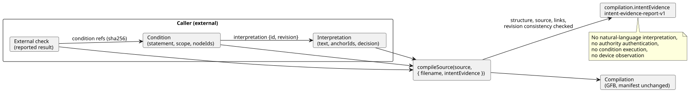

# Intent evidence authoring API

[한국어](INTENT-EVIDENCE.ko.md)

This API implements the shared [intent responsibility contract](INTENT-CONSISTENCY-CONTRACT.en.md). It is tracked in [#565](https://github.com/callin2/ghostflow-language/issues/565).

An *intent evidence record* is an external record of how someone interpreted a request, what they decided, and which code conditions follow from it. You can pass such a record to the compiler. The compiler then validates it and keeps it with the compilation.

What the compiler **does** check:

- the record's structure;
- the exact identity of the source document;
- the authored links between anchors and compiler nodes;
- that revisions and digests inside the record are consistent.

What the compiler **does not** do:

- interpret natural language;
- authenticate who had the authority to decide;
- run or evaluate conditions;
- observe a device.

In this document:

- [Public entry points](#public-entry-points) — how to pass a record and what happens on error.
- [Record schema](#record-schema) — fields, limits, decision kinds and external checks.
- [Reading the result](#reading-the-result) — what the report contains.
- [Runnable authoring example](#runnable-authoring-example) — an end-to-end Node script and CLI request.
- [Persistence and supported boundary](#persistence-and-supported-boundary) — saving, restoring and packaging limits.

The diagram below shows the parts of a record and where the compiler fits. The caller supplies all records; the compiler only checks them and reports.



## Public entry points

Two entry points accept the record:

- `tools/toolchain.mjs` (Node)
- `tools/browser-toolchain.mjs` (browser or Worker)

Both accept `compileSource(source, { filename, intentEvidence })`. The `intentEvidence` option is optional:

- **With the option**, the compilation gains `compilation.intentEvidence`, a report in the `GhostFlow/intent-evidence-report-v1` format.
- **Without the option**, compilation output is exactly as before.
- **In both cases**, the GFB bytes and the control manifest are identical. Valid evidence never changes them.

Both entry points also export `intentInterpretationDigest`, `intentConditionDigest` and `INTENT_EVIDENCE_LIMITS`. The digests are computed over canonical JSON: object keys are sorted, and array order is preserved.

| Digest | Covers | Excludes |
|---|---|---|
| Interpretation digest | `id`, `revision`, `original`, `text`, `anchorIds` | the `decision` |
| Condition digest | the entire condition record | — |

If the supplied metadata is invalid, the compiler throws `GF_INTENT_EVIDENCE`. The error carries a structured diagnostic and an `evidencePath` that points to the faulty field.

A record that is valid but incomplete is **not** an error. These cases compile normally:

- a valid assumption;
- an undecided item;
- a missing external check;
- a partially confirmed interpretation.

This feature validates an optional authoring request only. It adds no runtime gate and no deployment gate.

## Record schema

Every field listed below is required unless it is explicitly marked optional. The compiler rejects:

- unknown fields;
- duplicate identifiers;
- invalid enum values;
- references that do not match.

The record is a provenance record — a history of where intent came from. It is not an executable conditions DSL.

| Record | Fields |
|---|---|
| Root | `format: GhostFlow/intent-evidence-v1`, `sourceDocumentSha256`, `interpretations[]`, `conditions[]`, `checks[]` |
| Interpretation | `id`, `revision`, `original: { id, revision, reference }`, `text`, `anchorIds[]`, `decision` |
| Condition | `id`, `revision`, `interpretation: { id, revision }`, `statement`, `scope`, `nodeIds[]` |
| Condition reference | `id`, `revision`, `sha256` from `intentConditionDigest` |
| External check | `id`, `judgment`, `conditions[]` of condition references, `result`, `producer`, `evidenceRef`, `scope`, `at`, `context` |

**Identifiers.** IDs and revision names must match `[A-Za-z][A-Za-z0-9._:-]{0,127}`.

**Node IDs.** Compiler node IDs are the numeric IDs returned in `sourceMap`/`intentLinks`. Copy them from the compilation. Never generate them from a source line or a name.

**Links.** Every node in a condition must already have an authored link to one of the anchors of that condition's interpretation. An empty node list is allowed; it is reported as unlinked. You may select only anchors that appear in the compilation's intent metadata. The compiler does not infer links for imported documents or for unannotated code.

**Uninterpreted text.** The `original.reference` is a locator for an external, immutable record, supplied by the caller. The compiler keeps it but does not fetch or authenticate it. `statement` and `scope` stay plain, uninterpreted text. That includes any units, timing, assumptions and observation range the caller chose.

**Ordering and partial coverage.** Array order is part of the record hash. A record may cover only part of a program. Active anchors that the record does not represent remain visible in the coverage report.

**Limits:**

| Limit | Value |
|---|---|
| Canonical size | 262,144 UTF-8 bytes |
| Entries per array | 128 |
| Characters per general text field | 8,192 |
| Canonical JSON nesting depth | 16 |

The compiler also rejects sparse arrays, non-finite numbers, unsafe integers, malformed Unicode and non-JSON objects. The CLI additionally limits the raw file size.

**Timestamps** must be valid UTC ISO strings ending in `Z`, with either whole seconds or exactly three millisecond digits. This check is syntactic only. The compiler does not consult a wall clock or infer a policy age.

### Decision variants

Each interpretation has one `decision`. Its `kind` selects one of four variants.

| `decision.kind` | Additional fields | Meaning |
|---|---|---|
| `confirmed` | `actor`, `authorityRef`, `recordRef`, `at`, `interpretationSha256`, `conditions[]` of exact condition references | A supplied confirmation record that covers the hashed interpretation and the listed conditions. The authority behind it is not authenticated. |
| `policy-derived` | All confirmed fields plus `policy: { id, revision, reference }`, `applicationRef`, `validity: current/expired/unknown` | Keeps the policy and its application as evidence. `current` is only the provider's claim; the compiler does not establish it. If validity is `expired` or `unknown`, the condition is reported as `policy-not-current`. |
| `assumption` | `actor`, `reason` | A proposal made by an LLM. Linked anchors must be `kind=assumption status=unconfirmed origin=ai`. |
| `undecided` | `question`, `owner` (nonempty text or `null`) | An external decision that is still open. Linked anchors, if any, must be unconfirmed. No new anchor enum value is introduced. |

Rules for confirmation:

- A `confirmed` or `policy-derived` record that lists anchors requires those anchors to be existing confirmed intent/premise anchors. It cannot silently confirm an authored assumption.
- Superseded anchors are rejected.
- In one record, an active anchor cannot have more than one current interpretation.
- A condition that is not in the confirmation's explicit list stays `outside-confirmed-scope`. An empty list confirms no code condition at all.
- If you change the interpretation text or a listed condition but keep the old confirmation digests, validation fails.

The hashes detect *inconsistent* reuse. They cannot detect a forged confirmation that someone has rewritten consistently.

### External check context

An external check reports a judgment made outside the compiler.

- `judgment` is `requirements-consistency`, `code-compliance`, or `device-compliance`.
- `result` is `satisfied`, `violated`, or `unknown`.

Every check references at least one exact condition revision and digest. It also supplies a `context` with these fields:

| Context field | Rule |
|---|---|
| `sourceDocumentSha256`, `bytecodeSha256` | Must equal this canonical compilation. |
| `method` | `static`, `scenario`, or `physical`. |
| `setupRef` | External record of checker/runtime/target revisions, inputs, initial state, settings and verification scope. Retained without dereferencing. |
| `run` | Required for scenario/physical, forbidden for static: `{ id, scanId, logicalTimeMs }`. Scan/time are nonnegative safe integers. |
| `device` | Required only for physical and `device-compliance`: `{ id, installationRef, commandRef, observationRef, clockRef, stage, quality }`. |

For a device:

- `stage` is `requested`, `safe`, `applied`, `readback`, or `confirmed`.
- `quality` is `ok`, `unknown`, or `fault`.

These are *reported* evidence stages. An ACK, or a caller's `satisfied` result, does not become physical proof.

The compiler keeps the `run`, time and `device` fields and checks their shape. It has no trusted, current runtime sample to compare them with. Consumers must therefore validate these identities and the evidence at their own observation boundary. If external claims contradict each other, they stay visible as reported claims. The compiler never turns them into newly certified judgments.

## Reading the result

The report has these parts:

| Part | Contents |
|---|---|
| `validation` | Confirms that structure, source and link consistency checks passed. |
| `decisions` | Each decision's classification and confirmation scope, with `authority: not-authenticated`. |
| `conditions` | Node and check IDs, plus a confirmation state: `recorded`, `outside-confirmed-scope`, `policy-not-current`, `unconfirmed`, or `undecided`. |
| `coverage` | Anchors the record does not represent, and conditions with no links. |
| `externalChecks` | Each check's `reportedResult`, marked `trust: external-report`. |

All four `judgments` remain `not-evaluated`. The metadata checker does not judge intent, requirements, the program, or a device. Its job is to make the necessary records available to the people and tools who actually own those judgments. The report has no single "intent-compliant" Boolean.

The report also includes:

- the detached, validated `record`;
- its `recordSha256`;
- the source digest;
- the bytecode digest.

## Runnable authoring example

Run the JavaScript below from the repository root, using Node's module input mode. It uses the existing fictional pump fixture. The confirmation is example data, not a real operating approval. The second condition is deliberately left outside the confirmation scope.

```js
import fs from 'node:fs';
import { compileSource, intentInterpretationDigest, intentConditionDigest } from './tools/toolchain.mjs';
const filename = 'examples/authoring/pump-rev-2.ghost.md';
const source = fs.readFileSync(filename, 'utf8');
const base = await compileSource(source, { filename });
const interpretation = {
  id: 'I-PERMIT', revision: 'r1',
  original: { id: 'U-PERMIT', revision: 'r1', reference: 'example:fictional-request' },
  text: 'Block the pump when permission is absent.',
  anchorIds: ['GF-INT-PUMP-PERMIT'],
};
const condition = {
  id: 'C-PERMIT', revision: 'r1', interpretation: { id: 'I-PERMIT', revision: 'r1' },
  statement: 'Safe pump intent is OFF when permission is false.',
  scope: 'Logical accepted scans only; no physical stopping deadline.',
  nodeIds: base.traceMetadata.intentLinks.filter(x => x.anchorId === 'GF-INT-PUMP-PERMIT' && x.relation === 'constrains').map(x => x.nodeId),
};
interpretation.decision = {
  kind: 'confirmed', actor: 'fictional-operator', authorityRef: 'example:authority',
  recordRef: 'example:confirmation', at: '2026-10-19T00:00:00Z',
  interpretationSha256: intentInterpretationDigest(interpretation),
  conditions: [{ id: condition.id, revision: condition.revision, sha256: intentConditionDigest(condition) }],
};
const evidence = {
  format: 'GhostFlow/intent-evidence-v1', sourceDocumentSha256: base.sourceDocument.sha256,
  interpretations: [interpretation],
  conditions: [condition, { ...condition, id: 'C-RESTART', statement: 'Restart behavior is not confirmed.', nodeIds: [] }],
  checks: [],
};
const result = await compileSource(source, { filename, intentEvidence: evidence });
console.log(result.intentEvidence.conditions);
fs.mkdirSync('build/intent-evidence', { recursive: true });
fs.writeFileSync('build/intent-evidence/record.json', JSON.stringify(evidence, null, 2));
```

Expected states:

- `C-PERMIT: recorded`
- `C-RESTART: outside-confirmed-scope`

No scenario has been run, so `checks` is empty.

To use the record from the CLI, add the optional evidence file path to a structured CLI request:

```toon
format: GhostFlow/cli-request-v1
operation: check
source:
  path: examples/authoring/pump-rev-2.ghost.md
  documentId: GF-EXAMPLE-PUMP
  revisionId: rev-2-input-v1
intentEvidencePath: build/intent-evidence/record.json
```

Save the request as `build/intent-evidence/request.toon` and run `node tools/ghostc.mjs --request build/intent-evidence/request.toon --format json`.

- The CLI returns the report in `intentEvidence`. The default output format is TOON.
- For `operation: compile`, also supply `artifactPath`.
- A missing, malformed or oversized evidence file, or an inconsistent record, makes the CLI exit nonzero with `GF_INTENT_EVIDENCE`. Existing artifact files are not replaced.

## Persistence and supported boundary

**Saving.** `writeArtifact` stores the validated record in the optional `intentEvidence` field of the standalone `.map.json` companion file.

**Restoring.** `restoreArtifactSourceMap` recompiles the canonical source, validates the record again and returns a freshly derived report. It never trusts a saved verdict.

**Requiring a specific record.** Pass `expectedIntentEvidenceSha256: report.recordSha256` together with `expectedSourceSha256`. A missing or altered record is then rejected. Without an expected digest, a missing record is accepted, so ordinary artifacts that carry no record stay compatible.

An unsigned map and its hashes do not authenticate authorship. They also do not prevent a coordinated replacement of both source and record.

**Portable packages.** `portable-package-v1` has its own strict, signed source-map profile, and it does not carry this external authoring record. To prevent silent loss, its builder explicitly rejects compilations that carry evidence, with `unsupported-intent-evidence`. When you use that package profile, keep the external record separately and deliberately compile without the `intentEvidence` option.

This implementation does not change the signed package format, firmware, runtime, approval service or deployment policy. Any future transport through a signed package must keep the same evidence boundaries and define consumer compatibility explicitly.

**Tests.** The executable regression suite is `tests/intent-evidence.test.mjs`. It is registered in full verification and in coverage. It covers:

- partial decisions;
- revision mismatch with unchanged GFB;
- invalid links;
- limits on external and physical claims;
- browser operation;
- persistence;
- CLI artifact preservation.

Existing anchor, CLI and package tests continue to cover the surrounding contracts.
