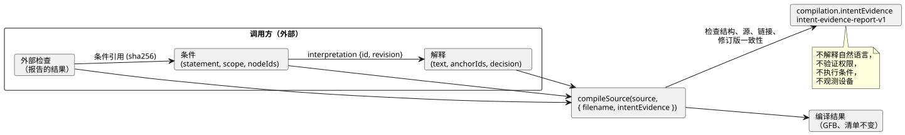

<!-- translation-source: docs/INTENT-EVIDENCE.md -->
[英文原文](INTENT-EVIDENCE.md)

# 意图证据编写 API

[한국어](INTENT-EVIDENCE.ko.md)

本 API 实现了共享的[意图责任契约](INTENT-CONSISTENCY-CONTRACT.zh.md)，由 [#565](https://github.com/callin2/ghostflow-language/issues/565) 跟踪。

*意图证据记录*（intent evidence record）是一种外部记录，用于说明某人如何理解一项请求、做出了什么决定，以及由此得出哪些代码条件。你可以把这样的记录传给编译器。编译器随后对其进行校验，并将其与编译结果一起保存。

编译器**会**检查的内容：

- 记录的结构；
- 源文档的确切身份标识；
- 锚点与编译器节点之间由作者编写的链接；
- 记录内部的修订版与摘要是否一致。

编译器**不会**做的事：

- 解释自然语言；
- 验证谁拥有做出决定的权限；
- 运行或求值条件；
- 观测设备。

本文内容：

- [公开入口](#公开入口)——如何传入记录，以及出错时会发生什么。
- [记录模式](#记录模式)——字段、限制、决定种类和外部检查。
- [读取结果](#读取结果)——报告包含哪些内容。
- [可运行的编写示例](#可运行的编写示例)——一个端到端的 Node 脚本和 CLI 请求。
- [持久化与支持边界](#持久化与支持边界)——保存、恢复与打包方面的限制。

下图展示了记录的组成部分以及编译器所处的位置。所有记录都由调用方提供；编译器只负责检查并报告。



## 公开入口

有两个入口接受该记录：

- `tools/toolchain.mjs`（Node）
- `tools/browser-toolchain.mjs`（浏览器或 Worker）

两者都接受 `compileSource(source, { filename, intentEvidence })`。`intentEvidence` 选项是可选的：

- **提供该选项时**，编译结果会多出 `compilation.intentEvidence`，即 `GhostFlow/intent-evidence-report-v1` 格式的报告。
- **不提供该选项时**，编译输出与以前完全相同。
- **在两种情况下**，GFB 字节和控制清单都完全相同。有效的证据绝不会改变它们。

两个入口还都导出 `intentInterpretationDigest`、`intentConditionDigest` 和 `INTENT_EVIDENCE_LIMITS`。摘要基于规范 JSON 计算：对象的键会排序，数组顺序保持不变。

| 摘要 | 覆盖 | 不包括 |
|---|---|---|
| 解释摘要 | `id`、`revision`、`original`、`text`、`anchorIds` | `decision` |
| 条件摘要 | 整个条件记录 | — |

如果提供的元数据无效，编译器会抛出 `GF_INTENT_EVIDENCE`。该错误携带一个结构化诊断，以及指向出错字段的 `evidencePath`。

有效但不完整的记录**不是**错误。以下情况会正常编译：

- 有效的假设；
- 尚未决定的事项；
- 缺失的外部检查；
- 只得到部分确认的解释。

此功能只校验一个可选的编写请求。它不增加任何运行时关卡，也不增加任何部署关卡。

## 记录模式

除非明确标注为可选，下面列出的每个字段都是必需的。编译器会拒绝：

- 未知字段；
- 重复的标识符；
- 无效的枚举值；
- 无法匹配的引用。

该记录是一份来源（provenance）记录——即意图从何而来的历史。它不是可执行的条件 DSL。

| 记录 | 字段 |
|---|---|
| 根 | `format: GhostFlow/intent-evidence-v1`、`sourceDocumentSha256`、`interpretations[]`、`conditions[]`、`checks[]` |
| 解释 | `id`、`revision`、`original: { id, revision, reference }`、`text`、`anchorIds[]`、`decision` |
| 条件 | `id`、`revision`、`interpretation: { id, revision }`、`statement`、`scope`、`nodeIds[]` |
| 条件引用 | `id`、`revision`、来自 `intentConditionDigest` 的 `sha256` |
| 外部检查 | `id`、`judgment`、由条件引用组成的 `conditions[]`、`result`、`producer`、`evidenceRef`、`scope`、`at`、`context` |

**标识符。** ID 和修订版名称必须匹配 `[A-Za-z][A-Za-z0-9._:-]{0,127}`。

**节点 ID。** 编译器节点 ID 是 `sourceMap`/`intentLinks` 中返回的数字 ID。请从编译结果中复制它们。绝不要根据源代码行或名称生成它们。

**链接。** 条件中的每个节点都必须已经有一条由作者编写的链接，指向该条件所属解释的某个锚点。允许节点列表为空；这种情况会被报告为未链接。你只能选择出现在编译结果意图元数据中的锚点。对于导入的文档或没有注解的代码，编译器不会推断链接。

**不作解释的文本。** `original.reference` 是指向一份外部、不可变记录的定位符，由调用方提供。编译器会保留它，但不会获取或验证它。`statement` 和 `scope` 保持为纯文本，不作解释。这包括调用方选择的任何单位、时序、假设和观测范围。

**顺序与部分覆盖。** 数组顺序是记录哈希的一部分。一份记录可以只覆盖程序的一部分。记录没有涉及的活动锚点会在覆盖报告中保持可见。

**限制：**

| 限制 | 值 |
|---|---|
| 规范大小 | 262,144 UTF-8 字节 |
| 每个数组的条目数 | 128 |
| 每个一般文本字段的字符数 | 8,192 |
| 规范 JSON 嵌套深度 | 16 |

编译器还会拒绝稀疏数组、非有限数、不安全整数、格式错误的 Unicode 以及非 JSON 对象。CLI 还额外限制原始文件大小。

**时间戳**必须是以 `Z` 结尾的有效 UTC ISO 字符串，要么精确到整秒，要么恰好带三位毫秒数字。此检查仅针对语法。编译器不会查询墙钟，也不会推断策略的时效。

### 决定变体

每个解释有一个 `decision`。其 `kind` 选择四种变体之一。

| `decision.kind` | 附加字段 | 含义 |
|---|---|---|
| `confirmed` | `actor`、`authorityRef`、`recordRef`、`at`、`interpretationSha256`、由精确条件引用组成的 `conditions[]` | 一份由调用方提供的确认记录，覆盖经过哈希的解释以及所列条件。其背后的权限不经验证。 |
| `policy-derived` | 所有 confirmed 字段，外加 `policy: { id, revision, reference }`、`applicationRef`、`validity: current/expired/unknown` | 将策略及其应用作为证据保存。`current` 只是提供方的声明；编译器并不确立它。如果 validity 为 `expired` 或 `unknown`，该条件会被报告为 `policy-not-current`。 |
| `assumption` | `actor`、`reason` | 由 LLM 提出的提议。所链接的锚点必须是 `kind=assumption status=unconfirmed origin=ai`。 |
| `undecided` | `question`、`owner`（非空文本或 `null`） | 一项仍未定论的外部决定。所链接的锚点（如果有）必须是未确认的。不会引入新的锚点枚举值。 |

关于确认的规则：

- 列出了锚点的 `confirmed` 或 `policy-derived` 记录，要求这些锚点是已存在且已确认的 intent/premise 锚点。它不能悄悄确认一个由作者编写的假设。
- 已被取代的锚点会被拒绝。
- 在同一份记录中，一个活动锚点不能有多于一个当前解释。
- 不在确认的显式列表中的条件保持为 `outside-confirmed-scope`。空列表不确认任何代码条件。
- 如果你修改了解释文本或某个所列条件，却保留旧的确认摘要，校验就会失败。

这些哈希能检测出*不一致*的复用。但对于被人以一致方式改写的伪造确认，它们无法检测。

### 外部检查上下文

外部检查报告的是在编译器之外做出的判断。

- `judgment` 为 `requirements-consistency`、`code-compliance` 或 `device-compliance`。
- `result` 为 `satisfied`、`violated` 或 `unknown`。

每个检查至少引用一个精确的条件修订版和摘要。它还提供一个包含以下字段的 `context`：

| 上下文字段 | 规则 |
|---|---|
| `sourceDocumentSha256`、`bytecodeSha256` | 必须与本次规范编译一致。 |
| `method` | `static`、`scenario` 或 `physical`。 |
| `setupRef` | 关于检查器/运行时/目标修订版、输入、初始状态、设置和验证范围的外部记录。只保留，不解引用。 |
| `run` | scenario/physical 时必需，static 时禁止：`{ id, scanId, logicalTimeMs }`。scan/time 为非负安全整数。 |
| `device` | 仅在 physical 且 `device-compliance` 时必需：`{ id, installationRef, commandRef, observationRef, clockRef, stage, quality }`。 |

对于设备：

- `stage` 为 `requested`、`safe`、`applied`、`readback` 或 `confirmed`。
- `quality` 为 `ok`、`unknown` 或 `fault`。

这些是*报告的*证据阶段。ACK 或调用方给出的 `satisfied` 结果都不会变成物理证明。

编译器保留 `run`、时间和 `device` 字段并检查其形状。它没有可信的、当前的运行时样本可供比较。因此，使用方必须在自己的观测边界上校验这些身份标识和证据。如果外部声明相互矛盾，它们会作为报告的声明保持可见。编译器绝不会把它们变成新认证的判断。

## 读取结果

报告由以下部分组成：

| 部分 | 内容 |
|---|---|
| `validation` | 确认结构、源和链接一致性检查已通过。 |
| `decisions` | 每个决定的分类和确认范围，带有 `authority: not-authenticated`。 |
| `conditions` | 节点 ID 和检查 ID，以及确认状态：`recorded`、`outside-confirmed-scope`、`policy-not-current`、`unconfirmed` 或 `undecided`。 |
| `coverage` | 记录没有涉及的锚点，以及没有链接的条件。 |
| `externalChecks` | 每个检查的 `reportedResult`，标记为 `trust: external-report`。 |

全部四个 `judgments` 都保持为 `not-evaluated`。元数据检查器不对意图、需求、程序或设备做出判断。它的职责是把必要的记录提供给真正负责这些判断的人和工具。报告中没有一个单一的“符合意图”布尔值。

报告还包括：

- 分离出来并经过校验的 `record`；
- 它的 `recordSha256`；
- 源摘要；
- 字节码摘要。

## 可运行的编写示例

在仓库根目录下，以 Node 的模块输入模式运行下面的 JavaScript。它使用现有的虚构水泵夹具。其中的确认是示例数据，并非真实的运行批准。第二个条件被有意留在确认范围之外。

```js
import fs from 'node:fs';
import { compileSource, intentInterpretationDigest, intentConditionDigest } from './tools/toolchain.mjs';
const filename = 'examples/authoring/pump-rev-2.ghost.md';
const source = fs.readFileSync(filename, 'utf8');
const base = await compileSource(source, { filename });
const interpretation = {
  id: 'I-PERMIT', revision: 'r1',
  original: { id: 'U-PERMIT', revision: 'r1', reference: 'example:fictional-request' },
  text: 'Block the pump when permission is absent.',
  anchorIds: ['GF-INT-PUMP-PERMIT'],
};
const condition = {
  id: 'C-PERMIT', revision: 'r1', interpretation: { id: 'I-PERMIT', revision: 'r1' },
  statement: 'Safe pump intent is OFF when permission is false.',
  scope: 'Logical accepted scans only; no physical stopping deadline.',
  nodeIds: base.traceMetadata.intentLinks.filter(x => x.anchorId === 'GF-INT-PUMP-PERMIT' && x.relation === 'constrains').map(x => x.nodeId),
};
interpretation.decision = {
  kind: 'confirmed', actor: 'fictional-operator', authorityRef: 'example:authority',
  recordRef: 'example:confirmation', at: '2026-10-19T00:00:00Z',
  interpretationSha256: intentInterpretationDigest(interpretation),
  conditions: [{ id: condition.id, revision: condition.revision, sha256: intentConditionDigest(condition) }],
};
const evidence = {
  format: 'GhostFlow/intent-evidence-v1', sourceDocumentSha256: base.sourceDocument.sha256,
  interpretations: [interpretation],
  conditions: [condition, { ...condition, id: 'C-RESTART', statement: 'Restart behavior is not confirmed.', nodeIds: [] }],
  checks: [],
};
const result = await compileSource(source, { filename, intentEvidence: evidence });
console.log(result.intentEvidence.conditions);
fs.mkdirSync('build/intent-evidence', { recursive: true });
fs.writeFileSync('build/intent-evidence/record.json', JSON.stringify(evidence, null, 2));
```

预期状态：

- `C-PERMIT: recorded`
- `C-RESTART: outside-confirmed-scope`

由于没有运行任何场景，`checks` 为空。

要在 CLI 中使用该记录，请把可选的证据文件路径加入结构化 CLI 请求：

```toon
format: GhostFlow/cli-request-v1
operation: check
source:
  path: examples/authoring/pump-rev-2.ghost.md
  documentId: GF-EXAMPLE-PUMP
  revisionId: rev-2-input-v1
intentEvidencePath: build/intent-evidence/record.json
```

将请求保存为 `build/intent-evidence/request.toon`，然后运行 `node tools/ghostc.mjs --request build/intent-evidence/request.toon --format json`。

- CLI 在 `intentEvidence` 中返回报告。默认输出格式为 TOON。
- 对于 `operation: compile`，还需要提供 `artifactPath`。
- 如果证据文件缺失、格式错误或过大，或者记录不一致，CLI 会以 `GF_INTENT_EVIDENCE` 非零退出。已有的产物文件不会被替换。

## 持久化与支持边界

**保存。** `writeArtifact` 将经过校验的记录存放在独立的 `.map.json` 配套文件的可选 `intentEvidence` 字段中。

**恢复。** `restoreArtifactSourceMap` 会重新编译规范源，再次校验记录，并返回重新推导出的报告。它绝不信任已保存的结论。

**要求特定的记录。** 将 `expectedIntentEvidenceSha256: report.recordSha256` 与 `expectedSourceSha256` 一起传入。这样，缺失或被修改的记录就会被拒绝。如果没有提供期望的摘要，缺失记录会被接受，因此不携带记录的普通产物仍保持兼容。

未签名的 map 及其哈希并不能验证作者身份。它们也无法阻止有人协同替换源和记录。

**可移植包。** `portable-package-v1` 有自己严格且带签名的源映射 profile，并且不携带这种外部编写记录。为了防止静默丢失，它的构建器会以 `unsupported-intent-evidence` 明确拒绝携带证据的编译结果。使用该包 profile 时，请单独保存外部记录，并有意地在不带 `intentEvidence` 选项的情况下编译。

此实现不会改变带签名的包格式、固件、运行时、审批服务或部署策略。今后若要通过带签名的包传输，必须保持相同的证据边界，并明确定义使用方的兼容性。

**测试。** 可执行的回归测试套件是 `tests/intent-evidence.test.mjs`。它已注册到完整验证和覆盖率中。它覆盖：

- 部分决定；
- GFB 不变时的修订版不匹配；
- 无效链接；
- 对外部声明和物理声明的限制；
- 浏览器中的运行；
- 持久化；
- CLI 产物保留。

现有的锚点、CLI 和包测试继续覆盖周边契约。
