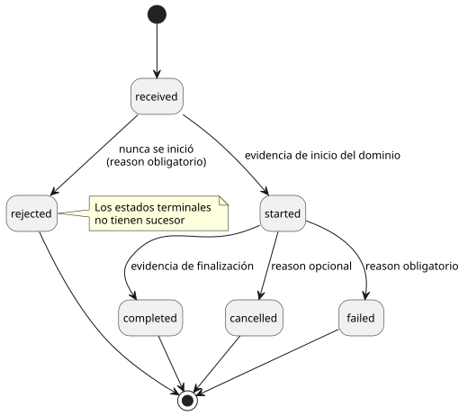
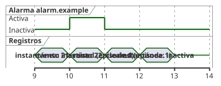

<!-- translation-source: docs/INTERACTION-STREAM-CONTRACT.md -->
[Original en inglés](INTERACTION-STREAM-CONTRACT.md)

# Diseño del contrato del flujo de interacción

[한국어](INTERACTION-STREAM-CONTRACT.ko.md)

Este es el diseño de [#74](https://github.com/callin2/ghostflow-language/issues/74).

Especifica un contrato **normativo** sobre cómo el host y el núcleo informan de las observaciones, pensado para su adopción futura. "Normativo" significa que las reglas siguientes son requisitos (debe/no debe) para cualquier productor o consumidor que adopte el formato.

Lo que este documento **no** hace:

- No implementa productores, transporte, retención ni renderizado.
- No añade nueva gramática al código fuente.

Cómo se relaciona con el trabajo existente:

- La [§5.3](reference/05-settings-and-observation.es.md) de la referencia sigue siendo el límite del lenguaje. Su notación del ciclo de vida no es una enumeración de registro existente.
- Los ajustes (#70) y el [productor acotado solo de alarmas](../contracts/alarm-v1/README.md) (#287) ya están implementados.
- Los descriptores de comandos y el flujo combinado que se describen más abajo son **trabajo futuro**.
- Alarm v1 tiene sus propios esquemas cerrados de descriptor y de informe. Registra en Rust las transiciones consolidadas de estado escalar Bool. No reivindica el formato de flujo combinado que se propone aquí.
- El [contrato v0](../contracts/interaction-v0/README.md) existente no cambia.

En este documento:

1. [Significado y responsabilidad](#significado-y-responsabilidad): los cuatro tipos de registro y quién es responsable de qué.
2. [Formatos futuros separados](#formatos-futuros-separados): los dos formatos propuestos y un registro de ejemplo.
3. [Contratos canónicos de los campos](#contratos-canónicos-de-los-campos): reglas de validación campo por campo.
4. [Ciclo de vida de los comandos](#ciclo-de-vida-de-los-comandos): estados y transiciones de los comandos.
5. [Episodios de alarma y actualizaciones perdidas](#episodios-de-alarma-y-actualizaciones-perdidas): por qué las instantáneas por sí solas pierden alarmas.
6. [Orden, retención y reconexión](#orden-retención-y-reconexión): cursores, almacenamiento acotado, brechas y discontinuidades.
7. [Barreras de rechazo y de adopción](#barreras-de-rechazo-y-de-adopción): resultados obligatorios ante entradas no válidas.

## Significado y responsabilidad

Hay cuatro tipos de registro. Cada uno responde a una pregunta distinta.

| Registro | Pregunta que responde | Identidad |
| --- | --- | --- |
| Instantánea completada | ¿Qué es observable ahora? | Esquema/módulo/fuente exactos, ejecución (run) y escaneo completado |
| Evento ordenado | ¿Qué ocurrió en esta ejecución? | Contrato/módulo/fuente exactos, ejecución, flujo y secuencia |
| Resultado del comando | ¿Cómo se gestionó esta solicitud? | Identidad del evento más el ID del comando y el digest de la solicitud |
| Evento de alarma | ¿Qué condición declarada surgió o se despejó? | Identidad del evento más el descriptor y el ID del episodio |

Las responsabilidades se reparten así:

| Parte | Responsable de |
| --- | --- |
| Núcleo de Rust | El ciclo de vida común y la identidad de la ejecución. Registra los hechos **antes** de invocar los hooks de observación. |
| Programa escrito por el autor | El significado del dominio. |
| Host | Exportar los registros y conservar el historial largo. |
| Renderizadores (por ejemplo, cabinet view) | Consumir la evidencia. |

Esto sigue el [ADR-002 del frontend aceptado en la revisión `8f95786`](https://github.com/callin2/farm_studio_frontend/blob/8f95786/docs/adr-002-runtime-command-lifecycle-and-host-hooks.md). Su implementación es una tarea de adopción aparte.

La finalización de un comando es un **resultado de ejecución**, no un acuse de recibo físico. La [§4.7](reference/04-sensors-constraints-control.es.md) mantiene separadas la evidencia solicitada (requested), segura (safe), aplicada (applied) y confirmada por retroalimentación (confirmed).

**El contrato de descriptores.** El significado proviene de un *contrato de descriptores* externo, explícito y versionado por separado. Debe vincular lo siguiente con esta fuente y este módulo exactos:

- las entradas tipadas de la solicitud;
- la forma de la solicitud y el permiso;
- la evidencia de inicio y de finalización del dominio;
- la condición de la alarma y el significado de su activación y su despeje.

Cada definición de comando o de alarma tiene un `id` público, un `kind`, la procedencia del nodo fuente y anclas de intención.

La severidad de una alarma es un metadato declarado en ese contrato. El contrato también declara el vocabulario de severidades y su significado. No se impone ninguna severidad universal del producto.

El significado nunca se infiere de nombres, valores Bool, nombres de callbacks ni de la intención de salida. No existe ninguna palabra clave nueva de código fuente `command`, `alarm` ni de severidad. El contrato de descriptores es un metadato; no es un segundo programa de control ejecutable.

## Formatos futuros separados

Se proponen dos formatos, cada uno con `version: 1`:

- `GhostFlow/interaction-descriptor-contract-v1`
- `GhostFlow/interaction-stream-v1`

Son etiquetas de diseño. Actualmente **no** son formatos aceptados.

Un registro del flujo vincula dos cosas distintas, y ninguno de los digests sustituye al otro:

- `descriptorContract` vincula las definiciones externas exactas.
- `schema` vincula el esquema estático de instantáneas existente.

Los digests siguen exactamente las reglas estrictas de JSON canónico en UTF-8 del README de v0:

- los arrays conservan su orden y las claves de los objetos se ordenan;
- el Unicode mal formado se rechaza;
- los enteros son enteros seguros y los números son finitos;
- no se permiten arrays dispersos;
- la profundidad máxima es 64.

El digest del descriptor abarca todo el documento del descriptor (que no tiene campo de autodigest). Un digest de solicitud abarca todo el objeto de solicitud tipado.

El JSON siguiente es ficticio. Los digests en cero y los nodos fuente son marcadores de posición. No es un artefacto compilado ni una prueba verificada de la fuente.

```json
{
  "format": "GhostFlow/interaction-stream-v1", "version": 1,
  "context": {
    "schema": {"format":"GhostFlow/interaction-schema-v0","version":"0.1","sha256":"0000000000000000000000000000000000000000000000000000000000000000"},
    "descriptorContract": {"format":"GhostFlow/interaction-descriptor-contract-v1","version":1,"sha256":"0000000000000000000000000000000000000000000000000000000000000000"},
    "module": {"id":"example.control","moduleFingerprint":"0000000000000000","bytecodeSha256":"0000000000000000000000000000000000000000000000000000000000000000"},
    "source": {"documentId":"example.document","revisionId":"example.revision","format":"GhostFlow/source-document-v1","kind":"literate","sha256":"0000000000000000000000000000000000000000000000000000000000000000"},
    "runId":"example.run", "streamId":"example.stream"
  },
  "sequence": 21, "logicalTimeMs": 1000,
  "position": {"kind":"completed-scan","scanId":10},
  "descriptorId":"alarm.example",
  "provenance": {"sourceNodeId":7,"intentAnchorIds":["example.intent"]},
  "payload": {"kind":"alarm","transition":"raised","episodeId":"episode.1"}
}
```

Reglas para la adopción:

- Use el formato de fuente exacto que indica la identidad canónica de la fuente compilada.
- Cada formato referenciado conserva su propio tipo de versión (por ejemplo, `"0.1"` para el esquema y `1` para el contrato de descriptores).
- Cada objeto tiene un conjunto de campos **cerrado**. Rechace los campos desconocidos, las claves JSON duplicadas, los formatos o versiones no admitidos y los campos obligatorios ausentes o con un tipo incorrecto. Ninguna extensión se ignora nunca de forma silenciosa.
- Antes de que cualquier productor reivindique este formato, deben publicarse un esquema legible por máquina y pruebas de conformidad.

## Contratos canónicos de los campos

Cada campo de un registro del flujo tiene un significado y una regla de validación obligatorios.

| Campo | Significado y validación obligatorios |
| --- | --- |
| `context.schema` | Formato/versión/SHA-256 del esquema existente; se verifica contra el esquema estático aportado. |
| `context.descriptorContract` | Formato/versión/SHA-256 admitidos; se verifica contra las definiciones aportadas y su vinculación exacta con el módulo/la fuente. |
| `context.module` | ID público exacto, huella de 16 caracteres hexadecimales en minúscula, digest del bytecode de 64 caracteres hexadecimales en minúscula, con el significado de v0. |
| `context.source` | Documento/revisión/formato/tipo/SHA-256 exactos, con la fuente literaria canónica y el significado de v0. |
| `runId`, `streamId` | Identidades públicas opacas no vacías; juntas identifican un único flujo de ejecución ordenado. |
| `sequence` | Entero seguro no negativo que empieza en cero y aumenta en uno por cada ocurrencia producida originalmente, independientemente de la retención. La retención nunca renumera; nunca se reinicia el contador ni se reutiliza. |
| `logicalTimeMs` | Entero seguro no negativo, no decreciente dentro del flujo; tiempos iguales no implican ocurrencias iguales. |
| `position` | Exactamente `{"kind":"completed-scan","scanId":N}` o `{"kind":"execution-boundary","boundaryId":"opaque.id"}`. Los ID de escaneo son enteros seguros no negativos; los ID de límite son no vacíos y locales a la ejecución. |
| `descriptorId` | ID público que se encuentra en el contrato de descriptores exacto, con un tipo de carga útil coincidente. |
| `provenance` | Exactamente un `sourceNodeId` entero seguro positivo y unos `intentAnchorIds` públicos, no vacíos y distintos; se verifican ambos contra esta revisión exacta de la fuente y el descriptor. |
| `payload` | Exactamente una de las variantes cerradas de comando/alarma que se describen a continuación. |

**Dos tipos de posición:**

- Una ocurrencia **execution-boundary** (límite de ejecución) puede producirse antes de que se complete un escaneo; por ejemplo, cuando se rechaza una solicitud. No debe inventar un escaneo completado. No debe usar un escaneo pendiente como evidencia de finalización.
- Una ocurrencia **completed-scan** (escaneo completado) se refiere a un escaneo que realmente se consolidó. Su tiempo lógico coincide con la finalización de ese escaneo.

**Reglas de identidad:**

- Los ID públicos no deben usar el prefijo reservado `__gf_`.
- Si un consumidor esperaba una identidad distinta, el registro está **obsoleto** (stale).
- Si la identidad o la procedencia se contradicen dentro del registro, se trata de un **error de validación**.
- Los registros nunca se unen entre revisiones por el nombre visible.

## Ciclo de vida de los comandos

Un registro ficticio `received` usa el mismo sobre completo:

```json
{"format":"GhostFlow/interaction-stream-v1","version":1,
 "context":{
  "schema":{"format":"GhostFlow/interaction-schema-v0","version":"0.1","sha256":"0000000000000000000000000000000000000000000000000000000000000000"},
  "descriptorContract":{"format":"GhostFlow/interaction-descriptor-contract-v1","version":1,"sha256":"0000000000000000000000000000000000000000000000000000000000000000"},
  "module":{"id":"example.control","moduleFingerprint":"0000000000000000","bytecodeSha256":"0000000000000000000000000000000000000000000000000000000000000000"},
  "source":{"documentId":"example.document","revisionId":"example.revision","format":"GhostFlow/source-document-v1","kind":"literate","sha256":"0000000000000000000000000000000000000000000000000000000000000000"},
  "runId":"example.run","streamId":"example.stream"},
 "sequence":23,"logicalTimeMs":1100,
 "position":{"kind":"execution-boundary","boundaryId":"request.1"},
 "descriptorId":"command.example","provenance":{"sourceNodeId":8,"intentAnchorIds":["example.intent"]},
 "payload":{"kind":"command","commandId":"command.1","requestSha256":"0000000000000000000000000000000000000000000000000000000000000000","state":"received"}}
```

Una carga útil de comando tiene exactamente estos campos:

| Campo | Regla |
| --- | --- |
| `kind` | Siempre `"command"`. |
| `commandId` | No vacío y local a la ejecución. |
| `requestSha256` | SHA-256 en minúsculas de la solicitud tipada canónica vinculada por el descriptor. |
| `state` | Un estado del ciclo de vida (véase más abajo). |
| `reason` | Solo donde se permite. Exactamente `{"code":"public.code","message":"human-readable detail"}`, ambas cadenas no vacías. Los códigos de motivo los declara el contrato de descriptores. |

Transiciones permitidas:

```text
received -> rejected
received -> started -> completed | cancelled | failed
```

El diagrama de estados siguiente muestra las mismas transiciones y dónde se requiere `reason`.



Estas transiciones son normativas para este contrato propuesto de registros de observación. No son un cambio aceptado del lenguaje fuente.

Qué significa cada estado:

| Estado | Significado | `reason` |
| --- | --- | --- |
| `received` | Precede a cualquier resultado. | Prohibido |
| `rejected` | La ejecución nunca se inició. | Obligatorio |
| `started` | Evidencia de inicio del dominio, según lo declara el descriptor. | Prohibido |
| `completed` | Evidencia de finalización declarada. | Prohibido |
| `cancelled` | Resultado terminal después del inicio. | Opcional (explícito) |
| `failed` | Resultado terminal después del inicio, distinto de `cancelled`. | Obligatorio |

Reglas adicionales:

- Si la ejecución falla en un límite de ejecución **antes** de iniciarse, regístrela como `rejected` con un motivo explícito. Nunca invente un registro `started`.
- Un estado terminal no tiene sucesor.
- Un mismo ID de comando no puede reutilizarse para una solicitud o un descriptor distintos.
- Un reintento con el mismo ID y el mismo digest identifica la **misma** ejecución. No debe volver a iniciar esa ejecución.
- El estado actual del comando conserva el último estado válido del ciclo de vida, con su secuencia y su procedencia originales. No es una nueva ocurrencia del ciclo de vida.

**Historial y brechas:**

- El productor debe registrar la cadena completa, empezando por `received`.
- Después de una brecha explícita, un consumidor puede ver un resultado `started` o terminal sin los pasos anteriores. Conserva ese resultado como historial incompleto y no inventa los pasos que faltan.
- Un consumidor puede rechazar una transición solo cuando una cobertura validada demuestra que el historial pertinente está completo.

**Alcance entre reconexiones.** La deduplicación de comandos y el estado actual tienen como ámbito la **ejecución (run)**. Deben sobrevivir a una reconexión dentro de la misma ejecución y a la recreación del flujo de recolección. Si no pueden recuperarse, el host debe iniciar un nuevo ID de ejecución conforme a su política de nueva ejecución. Un nuevo ID de flujo por sí solo no basta.

## Episodios de alarma y actualizaciones perdidas

Una carga útil de alarma tiene exactamente:

- `kind: "alarm"`;
- `transition: "raised" | "cleared"`;
- un `episodeId` no vacío y local a la ejecución.

Un *episodio* es un periodo durante el cual una alarma está activa.

- Cada nueva transición de inactiva a activa de un descriptor crea un nuevo ID de episodio.
- El despeje correspondiente usa ese mismo ID. No puede despejar un episodio distinto.
- Las observaciones activas repetidas no crean nuevas activaciones.
- El estado actual declarado de la alarma y sus transiciones ordenadas son observaciones separadas.

Ejemplo: una alarma breve que un observador basado solo en instantáneas no detectaría.

| Observación | Estado de la alarma o registro |
| --- | --- |
| Instantánea, escaneo completado 9 | Inactiva |
| Evento, secuencia 21, escaneo completado 10 | `raised`, descriptor `alarm.example`, episodio `episode.1` |
| Evento, secuencia 22, escaneo completado 11 | `cleared`, mismo descriptor y episodio |
| Instantánea, escaneo completado 12 | Inactiva |

El diagrama de tiempos siguiente representa la misma tabla frente a los ID de escaneo completado. Ambas instantáneas ven "inactiva"; solo los dos eventos muestran el episodio.



Las instantáneas de los escaneos 9 y 12 no pueden revelar este episodio. Los eventos retenidos deben mostrar ambas transiciones. Si los eventos se perdieron, el exportador debe informar de una brecha explícita. Ninguna marca de tiempo ni ninguna instantánea inactiva puede reconstruir el historial perdido.

Esta tabla ilustra una observación futura con capacidad para alarmas. No añade descriptores de alarma a v0.

## Orden, retención y reconexión

**Cursor y orden.**

- Un cursor es exactamente `(runId, streamId, sequence)`.
- El orden lo define únicamente `sequence`, nunca el orden de llegada ni las marcas de tiempo.
- La misma secuencia entregada de nuevo con bytes de registro canónico idénticos es una reentrega idempotente (inofensiva). Bytes distintos en la misma secuencia son un error.
- Un consumidor puede almacenar en búfer las entregas fuera de orden. No debe considerar completa una secuencia ausente hasta recibir esa ocurrencia o una evidencia explícita de pérdida.

**Retención acotada en el núcleo (futuro).** El núcleo conserva:

- un anillo acotado de registros recientes;
- el estado actual de los comandos;
- el último resultado por clase de comando (las clases las define el contrato de descriptores externo).

Las ranuras de estado actual y el almacenamiento de deduplicación de solicitudes también tienen presupuestos declarados y finitos. No se permite un mapa no acotado por solicitud. Si la deduplicación segura de identidades o el estado protegido no caben en el presupuesto, la admisión debe fallar de forma explícita.

**Política de retención.** El host exporta los registros antes de que el núcleo los recupere. Una política declarada y finita establece:

- los presupuestos de registros y de bytes;
- la protección prioritaria de los fallos críticos y del último resultado fallido;
- el orden de desalojo;
- el comportamiento de admisión.

La protección no promete un historial ilimitado. Cuando no se puede cumplir una garantía prometida, el núcleo rechaza la admisión o informa de una pérdida explícita conforme a la política declarada. El historial largo exportado es responsabilidad del host.

- El estado protegido actual/último fallido por clase debe mantenerse dentro de su propio presupuesto independiente. Si no se puede preservar, la admisión debe fallar. No se permite el desalojo silencioso.
- Desalojar historial **siempre** informa de una brecha, incluso para el historial crítico priorizado.
- Los registros más recientes/actuales ayudan a responder "¿cuál es el estado ahora?". Nunca sustituyen al historial de ocurrencias.

**Informes de pérdida.** Los informes de pérdida son metadatos de transporte separados. No son ocurrencias del dominio con secuencia. Hay tres tipos cerrados de informe:

| Informe | Campos | Uso |
| --- | --- | --- |
| `coverage` | `kind: "coverage"`, `runId`, `streamId`, `latestSequence`, `availableRanges` | Qué secuencias conserva todavía este exportador. |
| `gap` | `kind: "gap"`, `runId`, `streamId`, `fromSequence`, `toSequence`, `reason` | Un rango exacto y conocido de secuencias no disponibles. |
| `discontinuity` | `kind: "discontinuity"`, `previousRunId`, `previousStreamId`, `runId`, `streamId`, `reason` | Se perdió historial y se desconoce el rango perdido. |

*Reglas del informe de cobertura:*

- `latestSequence` es `null` si todavía no se ha producido ninguna ocurrencia. En caso contrario, es un entero seguro no negativo.
- Cada rango es exactamente `{fromSequence,toSequence}`, inclusivo, con límites seguros no negativos `from <= to <= latestSequence`.
- Los rangos están ordenados y son disjuntos. Si `latestSequence` es `null`, `availableRanges` debe estar vacío.
- El historial producido es `0..latestSequence`. Cada hueco no disponible requiere un informe de brecha exacto, aunque el flujo esté ahora en reposo.
- La cobertura describe lo que conserva el exportador, incluidos los registros críticos interiores retenidos. No afirma que todo el historial producido siga disponible.

*Reglas del informe de brecha:*

- Los límites son enteros seguros no negativos con `from <= to`.
- El intervalo es inclusivo y exacto: cada secuencia que contiene no está disponible en este exportador.
- Los intervalos conocidos adyacentes pueden fusionarse, pero nunca a través de registros retenidos conocidos.
- Descartar registros antes de exportarlos requiere un informe de brecha.
- El rango retenido de una política debe exponer los huecos interiores como intervalos. No debe dar a entender una cobertura continua.

*Informe de discontinuidad.* Si se desconoce el rango perdido, use este informe cerrado separado:
`{"kind":"discontinuity","previousRunId":"old.run","previousStreamId":"old.stream","runId":"new.run","streamId":"new.stream","reason":"history-unavailable"}`.
Todas las identidades y el motivo son cadenas no vacías. No invente límites numéricos.

**Reconexión y reinicio.**

| Suceso | Efecto |
| --- | --- |
| Reconexión con la misma ejecución y el mismo flujo | Se reanuda desde el último cursor aceptado; se exportan las brechas exactas conocidas. |
| Restablecimiento o reinicio | Cambia el ID de ejecución. |
| Flujo recreado sin un orden recuperable | Cambia el ID de flujo. |

Un cambio de ID de ejecución o de ID de flujo inicia un nuevo cursor y requiere una discontinuidad explícita. La secuencia cero o el escaneo cero en la nueva época **no** es una continuación. Ningún comando ni ningún episodio de alarma se une de forma silenciosa a través de ese límite.

## Barreras de rechazo y de adopción

Cada caso siguiente tiene un único resultado obligatorio.

| Caso | Resultado obligatorio |
| --- | --- |
| Campo/versión desconocidos, entero no seguro, digest mal formado | Rechazar el registro. |
| Nuevo tipo de comando/alarma insertado en el esquema/instantánea v0 | El validador v0 existente lo rechaza; no se relaja la compatibilidad. |
| Discrepancia de descriptor/módulo/fuente o ancla no válida | Error de validación; sin respaldo basado en nombres. |
| La ejecución/fuente esperada difiere de un registro válido | Resultado de identidad obsoleta; iniciar un nuevo cursor explícito cuando corresponda. |
| Secuencia duplicada modificada o ID de comando reutilizado con una solicitud modificada | Rechazar como conflicto de identidad. |
| `received -> completed` o sucesor de un estado terminal con cobertura completa demostrada; fallo sin motivo | Rechazar como violación del ciclo de vida. |
| Comando iniciado o terminal observado después de una brecha explícita del historial | Conservar el resultado observado como historial incompleto; nunca fabricar los pasos que faltan. |
| Despeje sin activación conocida después de una brecha explícita | Conservar el despeje como evidencia; marcar el historial del episodio como incompleto, nunca fabricar la activación. |
| Despeje sin activación en un historial completo y validado | Rechazar la transición del episodio. |
| La reconexión/el reinicio pierde historial desconocido | Discontinuidad explícita; sin brecha exacta fabricada. |

La adopción futura debe especificar:

- la serialización y la validación del descriptor externo;
- el registro en el núcleo y la retención acotada;
- la exportación y la recuperación en el host;
- casos de conformidad para cada barrera anterior, para todas las rutas terminales de los comandos, para episodios breves de alarma y para el reinicio.

**Alcance de la evidencia existente.** La evidencia existente de instantáneas completadas y del navegador solo establece esa ruta existente. La [aceptación de #161](https://github.com/callin2/farm_studio_frontend/issues/161#issuecomment-5679111790) del frontend es evidencia únicamente de la ruta Worker/WASM existente. No establece estos nuevos productores ni ningún comportamiento físico. Este diseño no entrega ningún productor de flujo en runtime ni ninguna implementación de retención.
