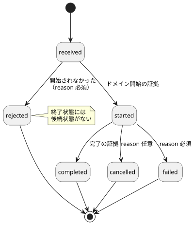
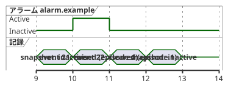

<!-- translation-source: docs/INTERACTION-STREAM-CONTRACT.md -->
[英語の原文](INTERACTION-STREAM-CONTRACT.md)

# インタラクションストリーム契約の設計

[한국어](INTERACTION-STREAM-CONTRACT.ko.md)

これは [#74](https://github.com/callin2/ghostflow-language/issues/74) のための設計です。

この文書は、ホストとコアが観測をどのように報告するかについての**規範的**な契約を、将来の採用に向けて定めます。「規範的」とは、このフォーマットを採用するすべてのプロデューサーとコンシューマーにとって、以下の規則が要件（〜しなければならない／〜してはならない）であるという意味です。

この文書が**行わない**こと：

- プロデューサー、トランスポート、保持、レンダリングは実装しません。
- 新しいソース構文は追加しません。

既存の作業との関係：

- リファレンス [§5.3](reference/05-settings-and-observation.ja.md) が引き続き言語の境界です。そこでのライフサイクル表記は、既存のレコードの列挙値ではありません。
- 設定（#70）と、範囲を限定した[アラーム専用プロデューサー](../contracts/alarm-v1/README.ja.md)（#287）はすでに実装されています。
- コマンドディスクリプタと、以下で説明する統合ストリームは**今後の作業**です。
- Alarm v1 は独自の閉じたディスクリプタとレポートのスキーマを持ちます。これは Rust で、確定済みのスカラー Bool 状態の遷移を記録します。ここで提案する統合ストリームフォーマットを名乗るものではありません。
- 既存の [v0 契約](../contracts/interaction-v0/README.ja.md)は変更されません。

この文書の内容：

1. [意味と所有権](#意味と所有権) — 4 種類のレコードと、誰が何を所有するか。
2. [将来の個別フォーマット](#将来の個別フォーマット) — 提案する 2 つのフォーマットとレコードの例。
3. [正規のフィールド契約](#正規のフィールド契約) — フィールドごとの検証規則。
4. [コマンドのライフサイクル](#コマンドのライフサイクル) — コマンドの状態と遷移。
5. [アラームエピソードと取りこぼされたリフレッシュ](#アラームエピソードと取りこぼされたリフレッシュ) — スナップショットだけではアラームを取りこぼす理由。
6. [順序付け、保持、再接続](#順序付け保持再接続) — カーソル、有界のストレージ、ギャップ、不連続。
7. [拒否と採用ゲート](#拒否と採用ゲート) — 無効な入力に対して求められる結果。

## 意味と所有権

レコードには 4 つの種類があります。それぞれが異なる問いに答えます。

| レコード | 答える問い | 同一性 |
| --- | --- | --- |
| 完了スナップショット | 今、何が観測できるか？ | 厳密なスキーマ/モジュール/ソース、実行（run）、完了したスキャン |
| 順序付きイベント | この実行で何が起きたか？ | 厳密な契約/モジュール/ソース、実行、ストリーム、シーケンス |
| コマンド結果 | この要求はどのように処理されたか？ | イベントの同一性に加えて、コマンド ID と要求ダイジェスト |
| アラームイベント | 宣言されたどの条件が発生または解除されたか？ | イベントの同一性に加えて、ディスクリプタとエピソード ID |

責任は次のように分担されます。

| 当事者 | 所有するもの |
| --- | --- |
| Rust コア | 共通のライフサイクルと実行の同一性。観測フックを呼び出す**前に**事実を記録します。 |
| 作成者が書いたプログラム | ドメインの意味。 |
| ホスト | レコードのエクスポートと長期の履歴の保持。 |
| レンダラー（たとえば cabinet view） | 証拠の消費。 |

これは、採択済みのフロントエンド [ADR-002（リビジョン `8f95786`）](https://github.com/callin2/farm_studio_frontend/blob/8f95786/docs/adr-002-runtime-command-lifecycle-and-host-hooks.md)に従っています。その実装は別の採用タスクです。

コマンドの完了は**実行結果**であり、物理的な応答確認ではありません。[§4.7](reference/04-sensors-constraints-control.ja.md#47-requestedsafeappliedconfirmed) では、requested、safe、applied、そしてフィードバックによる confirmed の証拠を区別しています。

**ディスクリプタ契約。** 意味は、明示的で、別途バージョン管理される外部の*ディスクリプタ契約*から得られます。この契約は、次のものをこの厳密なソースとモジュールに結び付けなければなりません。

- 型付きの要求入力
- 要求の形と権限
- ドメインの開始と完了の証拠
- アラームの条件、発生と解除の意味

各コマンドまたはアラームの定義は、公開 `id`、`kind`、ソースノードの来歴、意図アンカーを持ちます。

アラームの重大度は、その契約で宣言されるメタデータです。契約は重大度の語彙とその意味も宣言します。製品全体で共通の重大度が押し付けられることはありません。

意味が、名前、Bool 値、コールバック名、出力意図から推論されることは決してありません。`command`、`alarm`、重大度のための新しいソースキーワードはありません。ディスクリプタ契約はメタデータであり、2 つ目の実行可能な制御プログラムではありません。

## 将来の個別フォーマット

2 つのフォーマットを提案します。どちらも `version: 1` です。

- `GhostFlow/interaction-descriptor-contract-v1`
- `GhostFlow/interaction-stream-v1`

これらは設計上のラベルです。現時点で受け付けられるフォーマットでは**ありません**。

ストリームレコードは 2 つの異なるものを結び付けます。どちらのダイジェストも、もう一方の代わりにはなりません。

- `descriptorContract` は、厳密な外部定義を結び付けます。
- `schema` は、既存の静的スナップショットスキーマを結び付けます。

ダイジェストは、v0 README の厳格な正規 JSON UTF-8 規則にそのまま従います。

- 配列は順序を保ち、オブジェクトのキーはソートされます。
- 不正な Unicode は拒否されます。
- 整数は安全な整数で、数値は有限です。
- 疎な配列は許可されません。
- 最大の深さは 64 です。

ディスクリプタのダイジェストは、ディスクリプタ文書全体（自己ダイジェストのフィールドは持ちません）を対象とします。要求ダイジェストは、型付きの要求オブジェクト全体を対象とします。

以下の JSON は架空のものです。ゼロのダイジェストとソースノードはプレースホルダです。コンパイル済みの成果物でも、検証済みのソースの証明でもありません。

```json
{
  "format": "GhostFlow/interaction-stream-v1", "version": 1,
  "context": {
    "schema": {"format":"GhostFlow/interaction-schema-v0","version":"0.1","sha256":"0000000000000000000000000000000000000000000000000000000000000000"},
    "descriptorContract": {"format":"GhostFlow/interaction-descriptor-contract-v1","version":1,"sha256":"0000000000000000000000000000000000000000000000000000000000000000"},
    "module": {"id":"example.control","moduleFingerprint":"0000000000000000","bytecodeSha256":"0000000000000000000000000000000000000000000000000000000000000000"},
    "source": {"documentId":"example.document","revisionId":"example.revision","format":"GhostFlow/source-document-v1","kind":"literate","sha256":"0000000000000000000000000000000000000000000000000000000000000000"},
    "runId":"example.run", "streamId":"example.stream"
  },
  "sequence": 21, "logicalTimeMs": 1000,
  "position": {"kind":"completed-scan","scanId":10},
  "descriptorId":"alarm.example",
  "provenance": {"sourceNodeId":7,"intentAnchorIds":["example.intent"]},
  "payload": {"kind":"alarm","transition":"raised","episodeId":"episode.1"}
}
```

採用時の規則：

- コンパイル済みの正本ソースの同一性が示す、厳密なソースフォーマットを使ってください。
- 参照される各フォーマットは、それぞれ独自のバージョンの型を保ちます（たとえば、スキーマでは `"0.1"`、ディスクリプタ契約では `1`）。
- すべてのオブジェクトは**閉じた**フィールド集合を持ちます。未知のフィールド、重複した JSON キー、サポートされていないフォーマットやバージョン、欠けているまたは型の誤った必須フィールドは拒否してください。拡張が黙って無視されることは決してありません。
- いずれかのプロデューサーがこのフォーマットを名乗る前に、機械可読なスキーマと適合性テストを公開しなければなりません。

## 正規のフィールド契約

ストリームレコードの各フィールドには、求められる意味と検証規則があります。

| フィールド | 求められる意味と検証 |
| --- | --- |
| `context.schema` | 既存のスキーマのフォーマット/バージョン/SHA-256。提供された静的スキーマと照合します。 |
| `context.descriptorContract` | サポートされるフォーマット/バージョン/SHA-256。提供された定義と、その厳密なモジュール/ソースへの結び付きと照合します。 |
| `context.module` | 厳密な公開 ID、16 桁の小文字 16 進フィンガープリント、64 桁の小文字 16 進バイトコードダイジェスト。意味は v0 と同じです。 |
| `context.source` | 厳密な文書/リビジョン/フォーマット/種類/SHA-256。正規の文芸的ソースを使い、意味は v0 と同じです。 |
| `runId`、`streamId` | 空でない不透明な公開の同一性。2 つ合わせて 1 つの順序付き実行ストリームを識別します。 |
| `sequence` | 非負の安全な整数。0 から始まり、保持に関係なく、もともと生成された発生ごとに 1 ずつ増えます。保持によって番号が振り直されることはなく、折り返しも再利用もしません。 |
| `logicalTimeMs` | 非負の安全な整数で、ストリーム内では減少しません。時刻が等しくても、発生が同じであることを意味しません。 |
| `position` | 厳密に `{"kind":"completed-scan","scanId":N}` または `{"kind":"execution-boundary","boundaryId":"opaque.id"}`。スキャン ID は非負の安全な整数、境界 ID は空でない実行ローカルな値です。 |
| `descriptorId` | 厳密なディスクリプタ契約に存在し、ペイロードの種類が一致する公開 ID。 |
| `provenance` | 厳密に、正の安全な整数の `sourceNodeId` と、空でない互いに異なる公開の `intentAnchorIds`。どちらもこの厳密なソースリビジョンとディスクリプタに照らして検証します。 |
| `payload` | 以下の閉じたコマンド/アラームのバリアントのうち、ちょうど 1 つ。 |

**2 種類の位置：**

- **execution-boundary**（実行境界）の発生は、スキャンが完了する前に起こりえます。たとえば、要求が拒否された場合です。完了したスキャンをでっち上げてはなりません。保留中のスキャンを完了の証拠として使ってはなりません。
- **completed-scan**（完了スキャン）の発生は、実際に確定したスキャンを指します。その論理時間は、そのスキャンの完了と一致します。

**同一性の規則：**

- 公開 ID は、予約済みの `__gf_` 接頭辞を使ってはなりません。
- コンシューマーが別の同一性を期待していた場合、そのレコードは**古い（stale）**ものです。
- レコード内で同一性や来歴が自己矛盾している場合、それは**検証エラー**です。
- レコードが表示名によってリビジョンをまたいで結合されることは決してありません。

## コマンドのライフサイクル

架空の `received` レコードも、同じ完全なエンベロープを使います。

```json
{"format":"GhostFlow/interaction-stream-v1","version":1,
 "context":{
  "schema":{"format":"GhostFlow/interaction-schema-v0","version":"0.1","sha256":"0000000000000000000000000000000000000000000000000000000000000000"},
  "descriptorContract":{"format":"GhostFlow/interaction-descriptor-contract-v1","version":1,"sha256":"0000000000000000000000000000000000000000000000000000000000000000"},
  "module":{"id":"example.control","moduleFingerprint":"0000000000000000","bytecodeSha256":"0000000000000000000000000000000000000000000000000000000000000000"},
  "source":{"documentId":"example.document","revisionId":"example.revision","format":"GhostFlow/source-document-v1","kind":"literate","sha256":"0000000000000000000000000000000000000000000000000000000000000000"},
  "runId":"example.run","streamId":"example.stream"},
 "sequence":23,"logicalTimeMs":1100,
 "position":{"kind":"execution-boundary","boundaryId":"request.1"},
 "descriptorId":"command.example","provenance":{"sourceNodeId":8,"intentAnchorIds":["example.intent"]},
 "payload":{"kind":"command","commandId":"command.1","requestSha256":"0000000000000000000000000000000000000000000000000000000000000000","state":"received"}}
```

コマンドのペイロードは、ちょうど次のフィールドを持ちます。

| フィールド | 規則 |
| --- | --- |
| `kind` | 常に `"command"`。 |
| `commandId` | 空でない、実行ローカルな値。 |
| `requestSha256` | ディスクリプタが結び付ける、正規の型付き要求の小文字 SHA-256。 |
| `state` | ライフサイクルの状態（下記参照）。 |
| `reason` | 許可されている場合のみ。厳密に `{"code":"public.code","message":"human-readable detail"}` で、どちらの文字列も空であってはなりません。理由コードはディスクリプタ契約で宣言されます。 |

許可される遷移：

```text
received -> rejected
received -> started -> completed | cancelled | failed
```

次の状態図は、同じ遷移と、どこで `reason` が必須になるかを示しています。



これらの遷移は、提案中のこの観測レコード契約にとって規範的なものです。採択済みのソース言語の変更ではありません。

各状態の意味：

| 状態 | 意味 | `reason` |
| --- | --- | --- |
| `received` | すべての結果より前に来ます。 | 禁止 |
| `rejected` | 実行はまったく開始されませんでした。 | 必須 |
| `started` | ディスクリプタが宣言する、ドメイン開始の証拠。 | 禁止 |
| `completed` | 宣言された完了の証拠。 | 禁止 |
| `cancelled` | 開始後の終了結果。 | 任意（明示的） |
| `failed` | 開始後の終了結果で、`cancelled` とは区別されます。 | 必須 |

追加の規則：

- 実行が開始**前**に実行境界で失敗した場合は、明示的な理由を付けて `rejected` として記録してください。`started` レコードをでっち上げてはなりません。
- 終了状態には後続状態がありません。
- 1 つのコマンド ID を、別の要求やディスクリプタに再利用することはできません。
- 同じ ID とダイジェストによる再試行は、**同じ**実行を識別します。その実行を再び開始してはなりません。
- 現在のコマンド状態は、最後の有効なライフサイクル状態を、元のシーケンスと来歴とともに保持します。それは新しいライフサイクルの発生ではありません。

**履歴とギャップ：**

- プロデューサーは、`received` から始まる連鎖全体を記録しなければなりません。
- 明示的なギャップの後、コンシューマーは、それ以前のステップなしに `started` または終了結果を目にすることがあります。その結果は不完全な履歴として保持し、欠けているステップをでっち上げません。
- コンシューマーが遷移を拒否してよいのは、検証済みのカバレッジによって、関連する履歴が完全であることが証明されている場合だけです。

**再接続をまたぐスコープ。** コマンドの重複排除と現在の状態のスコープは**実行（run）**です。これらは、同じ実行内での再接続や、収集ストリームの再作成を経ても失われてはなりません。回復できない場合、ホストは新規実行のポリシーに従って新しい実行 ID を開始しなければなりません。新しいストリーム ID だけでは不十分です。

## アラームエピソードと取りこぼされたリフレッシュ

アラームのペイロードは、ちょうど次のものを持ちます。

- `kind: "alarm"`
- `transition: "raised" | "cleared"`
- 空でない、実行ローカルな `episodeId`

*エピソード*とは、アラームがアクティブである 1 つの期間です。

- 1 つのディスクリプタで非アクティブからアクティブへの遷移が新たに起こるたびに、新しいエピソード ID が作られます。
- 対応する解除は同じ ID を使います。別のエピソードを解除することはできません。
- アクティブな観測が繰り返されても、新しい発生にはなりません。
- 宣言されたアラームの現在の状態と、その順序付きの遷移は、別々の観測です。

例：スナップショットだけを見る観測者が取りこぼしてしまう、短時間のアラーム。

| 観測 | アラームの状態またはレコード |
| --- | --- |
| スナップショット、完了スキャン 9 | 非アクティブ |
| イベント、シーケンス 21、完了スキャン 10 | `raised`、ディスクリプタ `alarm.example`、エピソード `episode.1` |
| イベント、シーケンス 22、完了スキャン 11 | `cleared`、同じディスクリプタとエピソード |
| スナップショット、完了スキャン 12 | 非アクティブ |

次のタイミング図は、同じ表を完了スキャン ID に沿って描いたものです。どちらのスナップショットも「非アクティブ」を見ており、エピソードを示すのは 2 つのイベントだけです。



スキャン 9 と 12 のスナップショットでは、このエピソードは明らかになりません。保持されたイベントは、両方の遷移を示さなければなりません。イベントが失われた場合、エクスポーターは明示的なギャップを報告しなければなりません。どのタイムスタンプも、どの非アクティブなスナップショットも、失われた履歴を再構築することはできません。

この表は、将来のアラーム対応の観測を説明するものです。v0 にアラームディスクリプタを追加するものではありません。

## 順序付け、保持、再接続

**カーソルと順序。**

- カーソルは厳密に `(runId, streamId, sequence)` です。
- 順序は `sequence` だけで定義されます。到着順やタイムスタンプで定義されることは決してありません。
- 同じシーケンスが、正規レコードのバイト列も同一のまま再度配信された場合、それは冪等な（無害な）再配信です。同じシーケンスでバイト列が異なる場合はエラーです。
- コンシューマーは、順序どおりでない配信をバッファしてもかまいません。その発生か、明示的な損失の証拠のどちらかを受け取るまで、欠けているシーケンスを完了扱いにしてはなりません。

**コアでの有界の保持（将来）。** コアは次のものを保持します。

- 最近のレコードの有界リング
- 現在のコマンド状態
- コマンドクラスごとの最新の結果（クラスは外部のディスクリプタ契約で定義されます）

現在状態のスロットと要求の重複排除用ストレージにも、宣言された有限の予算があります。要求ごとの無制限のマップは許可されません。安全な同一性の重複排除や保護された状態が予算に収まらない場合、受け入れ（アドミッション）は明示的に失敗しなければなりません。

**保持ポリシー。** ホストは、コアがレコードを回収する前にそれらをエクスポートします。宣言された有限のポリシーは、次のことを定めます。

- レコード数とバイト数の予算
- 重大な故障と最新の失敗結果の優先保護
- 追い出しの順序
- 受け入れ時の振る舞い

保護は、無制限の履歴を約束するものではありません。約束した保証を守れない場合、コアは宣言されたポリシーに従って、受け入れを拒否するか、明示的な損失を報告します。長期にわたるエクスポート済みの履歴はホストが所有します。

- クラスごとに保護される現在/最新失敗の状態は、それ専用の別の予算内に収まらなければなりません。保存できない場合、受け入れは失敗しなければなりません。黙って追い出すことは許可されません。
- 履歴を追い出すときは、優先度の高い重大な履歴であっても、**常に**ギャップを報告します。
- 最新/現在のレコードは「今の状態はどうか？」に答える助けになります。発生の履歴の代わりになることは決してありません。

**損失レポート。** 損失レポートは別個のトランスポートメタデータです。シーケンス番号の付いたドメインの発生ではありません。閉じたレポートの種類は 3 つあります。

| レポート | フィールド | 用途 |
| --- | --- | --- |
| `coverage` | `kind: "coverage"`、`runId`、`streamId`、`latestSequence`、`availableRanges` | このエクスポーターがまだ持っているシーケンス。 |
| `gap` | `kind: "gap"`、`runId`、`streamId`、`fromSequence`、`toSequence`、`reason` | 利用できないシーケンスの、正確で既知の範囲。 |
| `discontinuity` | `kind: "discontinuity"`、`previousRunId`、`previousStreamId`、`runId`、`streamId`、`reason` | 履歴が失われ、失われた範囲が不明であること。 |

*カバレッジレポートの規則：*

- まだ発生が 1 つも生成されていない場合、`latestSequence` は `null` です。そうでなければ非負の安全な整数です。
- 各範囲は厳密に `{fromSequence,toSequence}` で、両端を含み、`from <= to <= latestSequence` を満たす非負の安全な境界を持ちます。
- 範囲はソートされ、互いに重なりません。`latestSequence` が `null` の場合、`availableRanges` は空でなければなりません。
- 生成された履歴は `0..latestSequence` です。利用できない穴には、ストリームが現在静かであっても、すべて正確なギャップレポートが必要です。
- カバレッジは、保持されている内部の重大なレコードを含め、エクスポーターが保持しているものを記述します。生成された履歴がすべてまだ利用可能であると主張するものではありません。

*ギャップレポートの規則：*

- 境界は `from <= to` を満たす非負の安全な整数です。
- 区間は両端を含み、正確です。区間内のすべてのシーケンスは、このエクスポーターからは利用できません。
- 隣接する既知の区間は統合してもかまいませんが、既知の保持済みレコードをまたいで統合することは決してありません。
- エクスポート前にレコードを破棄する場合は、ギャップレポートが必要です。
- ポリシーの保持範囲は、内部の穴を区間として示さなければなりません。連続したカバレッジがあるかのように示してはなりません。

*不連続レポート。* 失われた範囲が不明な場合は、次の別個の閉じたレポートを使います。
`{"kind":"discontinuity","previousRunId":"old.run","previousStreamId":"old.stream","runId":"new.run","streamId":"new.stream","reason":"history-unavailable"}`。
すべての同一性と理由は、空でない文字列です。数値の境界をでっち上げてはなりません。

**再接続と再起動。**

| 出来事 | 結果 |
| --- | --- |
| 同じ実行とストリームで再接続 | 最後に受け入れたカーソルから再開し、正確な既知のギャップをエクスポートします。 |
| リセットまたは再起動 | 実行 ID が変わります。 |
| 回復可能な順序付けなしでストリームを再作成 | ストリーム ID が変わります。 |

実行 ID またはストリーム ID が変わると、新しいカーソルが始まり、明示的な不連続が必要になります。新しいエポックにおけるシーケンス 0 やスキャン 0 は、継続では**ありません**。コマンドもアラームエピソードも、その境界をまたいで黙って結合されることはありません。

## 拒否と採用ゲート

以下の各ケースには、求められる結果が 1 つずつあります。

| ケース | 求められる結果 |
| --- | --- |
| 未知のフィールド/バージョン、安全でない整数、不正なダイジェスト | レコードを拒否します。 |
| 新しいコマンド/アラームの種類を v0 のスキーマ/スナップショットに挿入 | 既存の v0 バリデーターが拒否します。互換性の緩和はありません。 |
| ディスクリプタ/モジュール/ソースの不一致、または無効なアンカー | 検証エラー。名前によるフォールバックはありません。 |
| 期待する実行/ソースが有効なレコードと異なる | 古い同一性（stale）の結果。適切な場合は明示的に新しいカーソルを開始します。 |
| 内容の変わった重複シーケンス、または要求を変えて再利用されたコマンド ID | 同一性の競合として拒否します。 |
| 完全なカバレッジが証明された状態での `received -> completed` または終了状態の後続、理由のない失敗 | ライフサイクル違反として拒否します。 |
| 明示的な履歴ギャップの後に観測された開始済みまたは終了済みのコマンド | 観測された結果を不完全な履歴として保持します。欠けているステップは決してでっち上げません。 |
| 明示的なギャップの後の、既知の発生を伴わない解除 | 解除を証拠として保持します。エピソードの履歴を不完全とマークし、発生は決してでっち上げません。 |
| 完全な検証済み履歴における、発生を伴わない解除 | エピソードの遷移を拒否します。 |
| 再接続/再起動で範囲不明の履歴が失われる | 明示的な不連続。正確なギャップをでっち上げることはありません。 |

将来の採用では、次のことを規定しなければなりません。

- 外部ディスクリプタのシリアライズと検証
- コアでの記録と有界の保持
- ホストでのエクスポートと回復
- 上記のすべてのゲート、すべてのコマンド終了パス、短時間のアラームエピソード、再起動についての適合性ケース

**既存の証拠の範囲。** 既存の完了スナップショットとブラウザの証拠が裏付けるのは、その既存のパスだけです。フロントエンドの [#161 の受け入れ](https://github.com/callin2/farm_studio_frontend/issues/161#issuecomment-5679111790)は、既存の Worker/WASM パスに対する証拠にすぎません。これらの新しいプロデューサーや、物理的な振る舞いを裏付けるものではありません。この設計は、ランタイムのストリームプロデューサーも保持の実装も提供しません。
