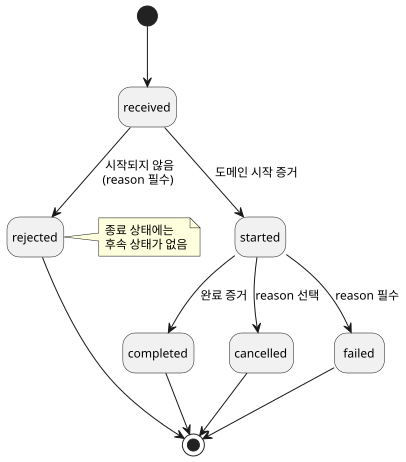
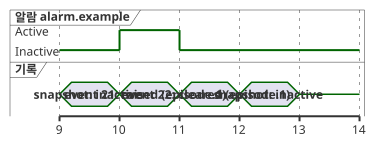

<!-- translation-source: docs/INTERACTION-STREAM-CONTRACT.md -->
[영문 원문](INTERACTION-STREAM-CONTRACT.md)

# Interaction 스트림 계약 설계

이 문서는 [#74](https://github.com/callin2/ghostflow-language/issues/74)의 설계입니다.

이 문서는 호스트와 코어가 관측을 보고하는 방식에 대한 **규범적** 계약을 정의하며, 향후 채택을 목표로 합니다. "규범적"이라는 말은 아래 규칙이 이 형식을 채택하는 모든 생산자와 소비자에게 요구 사항(~해야 합니다/~해서는 안 됩니다)이라는 뜻입니다.

이 문서가 하지 **않는** 일:

- 생산자, 전송, 보존, 렌더링을 구현하지 않습니다.
- 새 소스 문법을 추가하지 않습니다.

기존 작업과의 관계:

- Reference [§5.3](reference/05-settings-and-observation.md#53-cabinet-view-독립-관찰-모델)이 계속 언어 경계입니다. 그곳의 생명주기 표기는 기존 레코드 enum이 아닙니다.
- 설정(#70)과 제한된 [알람 전용 생산자](../contracts/alarm-v1/README.ko.md)(#287)는 이미 구현되어 있습니다.
- Command descriptor와 아래에서 설명하는 통합 스트림은 **향후 작업**입니다.
- 알람 v1은 별도의 닫힌 descriptor/report schema를 가집니다. Rust에서 확정된 scalar Bool 상태 전이를 기록합니다. 여기서 제안하는 통합 스트림 형식을 구현했다고 주장하지 않습니다.
- 기존 [v0 계약](../contracts/interaction-v0/README.ko.md)은 그대로 유지합니다.

이 문서의 구성:

1. [의미와 책임](#의미와-책임) — 네 가지 레코드 종류와 각 주체가 소유하는 것
2. [별도의 향후 형식](#별도의-향후-형식) — 제안하는 두 형식과 예시 레코드
3. [정규 필드 계약](#정규-필드-계약) — 필드별 검증 규칙
4. [명령 생명주기](#명령-생명주기) — 명령 상태와 전이
5. [알람 episode와 놓친 갱신](#알람-episode와-놓친-갱신) — 스냅샷만으로는 알람을 놓치는 이유
6. [순서, 보존, 재연결](#순서-보존-재연결) — 커서, 제한된 저장소, 공백과 단절
7. [거부와 채택 게이트](#거부와-채택-게이트) — 유효하지 않은 입력에 대해 요구되는 결과

## 의미와 책임

레코드는 네 종류입니다. 각각 서로 다른 질문에 답합니다.

| 레코드 | 답하는 질문 | 식별자 |
| --- | --- | --- |
| 완료 스냅샷 | 지금 무엇을 관측할 수 있는가? | 정확한 schema/module/source, run과 완료 scan |
| 순서 있는 이벤트 | 이 실행에서 무엇이 발생했는가? | 정확한 contract/module/source, run, stream, sequence |
| 명령 결과 | 이 요청을 어떻게 처리했는가? | 이벤트 식별자 + command ID와 request digest |
| 알람 이벤트 | 선언된 어떤 조건이 발생하거나 해제되었는가? | 이벤트 식별자 + descriptor와 episode ID |

책임은 다음과 같이 나뉩니다.

| 주체 | 소유하는 것 |
| --- | --- |
| Rust 코어 | 공통 생명주기와 실행 식별자. 관측 hook을 호출하기 **전에** 사실을 기록합니다. |
| 작성된 프로그램 | 도메인 의미. |
| 호스트 | 레코드 내보내기와 장기 이력 보관. |
| 렌더러 (예: cabinet view) | 증거 소비. |

이는 승인된 프런트엔드 [ADR-002, revision `8f95786`](https://github.com/callin2/farm_studio_frontend/blob/8f95786/docs/adr-002-runtime-command-lifecycle-and-host-hooks.md)을 따릅니다. 구현은 별도의 채택 작업입니다.

명령 완료는 **실행 결과**이지 물리적 확인이 아닙니다. [§4.7](reference/04-sensors-constraints-control.md#47-requested-safe-applied-confirmed)은 requested, safe, applied, 그리고 피드백으로 confirmed된 증거를 서로 구별합니다.

**Descriptor 계약.** 의미는 명시적이고 별도로 버전 관리되는 외부 *descriptor 계약*에서 나옵니다. 이 계약은 다음을 이 정확한 소스와 모듈에 연결해야 합니다.

- typed 요청 입력
- 요청 형태와 권한
- 도메인 시작과 완료 증거
- 알람 조건, 발생(raise)과 해제(clear)의 의미

각 command 또는 alarm 정의는 공개 `id`, `kind`, 소스 노드 provenance(출처)와 의도 앵커를 가집니다.

알람 severity는 그 계약에서 선언하는 메타데이터입니다. severity 어휘와 그 의미도 계약에서 선언합니다. 공통 제품 severity를 강제하지 않습니다.

의미는 이름, Bool 값, callback 이름, 출력 의도로부터 절대 추론하지 않습니다. 새 `command`, `alarm`, severity 소스 키워드는 없습니다. Descriptor 계약은 메타데이터이며, 두 번째 실행 가능한 제어 프로그램이 아닙니다.

## 별도의 향후 형식

두 형식을 제안하며, 각각 `version: 1`입니다.

- `GhostFlow/interaction-descriptor-contract-v1`
- `GhostFlow/interaction-stream-v1`

이는 설계용 이름입니다. 현재 수용하는 형식이 **아닙니다**.

스트림 레코드는 서로 다른 두 가지를 연결하며, 어느 digest도 다른 쪽을 대신하지 않습니다.

- `descriptorContract`는 정확한 외부 정의를 연결합니다.
- `schema`는 기존 정적 스냅샷 schema를 연결합니다.

Digest는 v0 README의 정확하고 엄격한 canonical JSON UTF-8 규칙을 따릅니다.

- 배열은 순서를 유지하고, 객체 키는 정렬합니다.
- 잘못된 Unicode는 거부합니다.
- 정수는 safe integer이고, 숫자는 유한해야 합니다.
- sparse array는 허용하지 않습니다.
- 최대 깊이는 64입니다.

Descriptor digest는 descriptor 문서 전체(자체 digest 필드는 없음)를 대상으로 합니다. 요청 digest는 typed 요청 객체 전체를 대상으로 합니다.

아래 JSON은 가상의 예입니다. 0으로 채운 digest와 소스 노드는 자리 표시자입니다. 컴파일된 artifact나 검증된 소스 증명이 아닙니다.

```json
{
  "format": "GhostFlow/interaction-stream-v1", "version": 1,
  "context": {
    "schema": {"format":"GhostFlow/interaction-schema-v0","version":"0.1","sha256":"0000000000000000000000000000000000000000000000000000000000000000"},
    "descriptorContract": {"format":"GhostFlow/interaction-descriptor-contract-v1","version":1,"sha256":"0000000000000000000000000000000000000000000000000000000000000000"},
    "module": {"id":"example.control","moduleFingerprint":"0000000000000000","bytecodeSha256":"0000000000000000000000000000000000000000000000000000000000000000"},
    "source": {"documentId":"example.document","revisionId":"example.revision","format":"GhostFlow/source-document-v1","kind":"literate","sha256":"0000000000000000000000000000000000000000000000000000000000000000"},
    "runId":"example.run", "streamId":"example.stream"
  },
  "sequence": 21, "logicalTimeMs": 1000,
  "position": {"kind":"completed-scan","scanId":10},
  "descriptorId":"alarm.example",
  "provenance": {"sourceNodeId":7,"intentAnchorIds":["example.intent"]},
  "payload": {"kind":"alarm","transition":"raised","episodeId":"episode.1"}
}
```

채택 규칙:

- 컴파일된 canonical 소스 identity가 지정하는 정확한 소스 형식을 사용합니다.
- 참조하는 각 형식은 자기 버전 타입을 유지합니다(예: schema는 `"0.1"`, descriptor 계약은 `1`).
- 모든 객체는 **닫힌** 필드 집합을 가집니다. 알 수 없는 필드, 중복 JSON 키, 지원하지 않는 형식이나 버전, 누락되었거나 타입이 틀린 필수 필드는 거부합니다. 어떤 확장도 조용히 무시되지 않습니다.
- 어떤 생산자든 이 형식을 주장하기 전에 기계가 읽을 수 있는 schema와 적합성 테스트가 공개되어야 합니다.

## 정규 필드 계약

스트림 레코드의 각 필드에는 요구되는 의미와 검증 규칙이 있습니다.

| 필드 | 요구되는 의미와 검증 |
| --- | --- |
| `context.schema` | 기존 schema format/version/SHA-256. 제공된 정적 schema와 대조해 검증합니다. |
| `context.descriptorContract` | 지원하는 format/version/SHA-256. 제공된 정의와 그 정확한 module/source 연결에 대조해 검증합니다. |
| `context.module` | 정확한 공개 ID, 16자리 소문자 hex fingerprint, 64자리 소문자 hex 바이트코드 digest. 의미는 v0와 같습니다. |
| `context.source` | 정확한 document/revision/format/kind/SHA-256. canonical 문서형 소스와 v0 의미를 가집니다. |
| `runId`, `streamId` | 비어 있지 않은 불투명 공개 식별자. 둘이 함께 하나의 순서 있는 실행 스트림을 식별합니다. |
| `sequence` | 음이 아닌 safe integer. 0에서 시작하며, 보존 여부와 관계없이 원래 생산된 발생마다 1씩 증가합니다. 보존 처리로 번호를 다시 매기지 않으며, 순환하거나 재사용하지 않습니다. |
| `logicalTimeMs` | 음이 아닌 safe integer. 스트림 안에서 감소하지 않습니다. 시간이 같다고 같은 발생인 것은 아닙니다. |
| `position` | 정확히 `{"kind":"completed-scan","scanId":N}` 또는 `{"kind":"execution-boundary","boundaryId":"opaque.id"}`. Scan ID는 음이 아닌 safe integer이고, boundary ID는 비어 있지 않으며 run 안에서만 유효합니다. |
| `descriptorId` | 정확한 descriptor 계약에 있고 payload kind가 일치하는 공개 ID. |
| `provenance` | 정확히 양의 safe integer인 `sourceNodeId`와, 비어 있지 않고 서로 다른 공개 `intentAnchorIds`. 둘 다 이 정확한 소스 revision과 descriptor에 대조해 검증합니다. |
| `payload` | 아래의 닫힌 command/alarm 변형 중 정확히 하나. |

**두 종류의 위치:**

- **execution-boundary** 발생은 scan이 완료되기 전에 일어날 수 있습니다. 예를 들어 요청이 거부되는 경우입니다. 이때 완료된 scan을 지어내서는 안 됩니다. 진행 중인 scan을 완료 증거로 사용해서도 안 됩니다.
- **completed-scan** 발생은 실제로 확정된 scan을 가리킵니다. 그 논리 시간은 해당 scan의 완료 시점과 일치합니다.

**식별자 규칙:**

- 공개 ID는 예약된 `__gf_` 접두사를 사용해서는 안 됩니다.
- 소비자가 다른 식별자를 기대했다면 그 레코드는 **stale(오래된 값)**입니다.
- 레코드 안에서 식별자나 provenance가 스스로 모순되면 **검증 오류**입니다.
- 레코드는 표시 이름을 기준으로 revision 사이에 결합하지 않습니다.

## 명령 생명주기

가상의 `received` 레코드도 같은 전체 envelope를 사용합니다.

```json
{"format":"GhostFlow/interaction-stream-v1","version":1,
 "context":{
  "schema":{"format":"GhostFlow/interaction-schema-v0","version":"0.1","sha256":"0000000000000000000000000000000000000000000000000000000000000000"},
  "descriptorContract":{"format":"GhostFlow/interaction-descriptor-contract-v1","version":1,"sha256":"0000000000000000000000000000000000000000000000000000000000000000"},
  "module":{"id":"example.control","moduleFingerprint":"0000000000000000","bytecodeSha256":"0000000000000000000000000000000000000000000000000000000000000000"},
  "source":{"documentId":"example.document","revisionId":"example.revision","format":"GhostFlow/source-document-v1","kind":"literate","sha256":"0000000000000000000000000000000000000000000000000000000000000000"},
  "runId":"example.run","streamId":"example.stream"},
 "sequence":23,"logicalTimeMs":1100,
 "position":{"kind":"execution-boundary","boundaryId":"request.1"},
 "descriptorId":"command.example","provenance":{"sourceNodeId":8,"intentAnchorIds":["example.intent"]},
 "payload":{"kind":"command","commandId":"command.1","requestSha256":"0000000000000000000000000000000000000000000000000000000000000000","state":"received"}}
```

Command payload는 정확히 다음 필드를 가집니다.

| 필드 | 규칙 |
| --- | --- |
| `kind` | 항상 `"command"`. |
| `commandId` | 비어 있지 않으며 run 안에서만 유효합니다. |
| `requestSha256` | descriptor가 연결한 canonical typed 요청의 소문자 SHA-256. |
| `state` | 생명주기 상태(아래 참고). |
| `reason` | 허용되는 경우에만. 정확히 `{"code":"public.code","message":"human-readable detail"}`이며 두 문자열 모두 비어 있지 않아야 합니다. Reason code는 descriptor 계약이 선언합니다. |

허용되는 전이:

```text
received -> rejected
received -> started -> completed | cancelled | failed
```

아래 상태 다이어그램은 같은 전이와 `reason`이 필수인 위치를 보여 줍니다.



이 전이는 여기서 제안하는 관측 레코드 계약에 대해 규범적입니다. 승인된 소스 언어 변경은 아닙니다.

각 상태의 의미:

| 상태 | 의미 | `reason` |
| --- | --- | --- |
| `received` | 모든 결과보다 먼저 옵니다. | 금지 |
| `rejected` | 실행이 시작되지 않았습니다. | 필수 |
| `started` | descriptor가 선언한 도메인 시작 증거. | 금지 |
| `completed` | 선언된 완료 증거. | 금지 |
| `cancelled` | 시작 이후의 종료 결과. | 선택 (명시적) |
| `failed` | 시작 이후의 종료 결과로, `cancelled`와 구별됩니다. | 필수 |

추가 규칙:

- 실행이 시작되기 **전에** execution boundary에서 실패하면, 명시적 reason과 함께 `rejected`로 기록합니다. `started` 레코드를 절대 지어내지 않습니다.
- 종료 상태에는 후속 상태가 없습니다.
- 하나의 command ID를 다른 요청이나 descriptor에 재사용할 수 없습니다.
- 같은 ID와 digest로 재시도하면 **같은** 실행을 식별합니다. 그 실행을 다시 시작해서는 안 됩니다.
- 현재 명령 상태는 마지막으로 유효했던 생명주기 상태를 원래의 sequence와 provenance와 함께 유지합니다. 이는 새 생명주기 발생이 아닙니다.

**이력과 공백:**

- 생산자는 `received`부터 시작하는 전체 사슬을 기록해야 합니다.
- 명시적 공백 이후에는 소비자가 앞 단계 없이 `started`나 종료 결과를 볼 수 있습니다. 소비자는 그 결과를 불완전한 이력으로 보관하며, 빠진 단계를 지어내지 않습니다.
- 소비자는 검증된 커버리지가 해당 이력이 완전함을 증명할 때에만 전이를 거부할 수 있습니다.

**재연결에 걸친 범위.** 명령 중복 제거와 현재 상태의 범위는 **run**입니다. 같은 run 안에서의 재연결과 수집 스트림 재생성 이후에도 유지되어야 합니다. 이를 복구할 수 없다면 호스트는 새 run 정책에 따라 새 run ID를 시작해야 합니다. 새 stream ID만으로는 충분하지 않습니다.

## 알람 episode와 놓친 갱신

알람 payload는 정확히 다음을 가집니다.

- `kind: "alarm"`
- `transition: "raised" | "cleared"`
- 비어 있지 않고 run 안에서만 유효한 `episodeId`

*Episode*는 알람이 활성 상태인 하나의 기간입니다.

- 하나의 descriptor에서 비활성에서 활성으로 새로 전이할 때마다 새 episode ID가 만들어집니다.
- 이에 대응하는 해제는 같은 ID를 사용합니다. 다른 episode를 해제할 수 없습니다.
- 활성 상태가 반복해서 관측되어도 새 발생(raise)을 만들지 않습니다.
- 알람의 선언된 현재 상태와 순서 있는 전이는 별개의 관측입니다.

예: 스냅샷만 보는 관측자가 놓치는 짧은 알람.

| 관측 | 알람 상태 또는 레코드 |
| --- | --- |
| 스냅샷, 완료 scan 9 | 비활성 |
| 이벤트, sequence 21, 완료 scan 10 | `raised`, descriptor `alarm.example`, episode `episode.1` |
| 이벤트, sequence 22, 완료 scan 11 | `cleared`, 같은 descriptor와 episode |
| 스냅샷, 완료 scan 12 | 비활성 |

아래 타이밍 다이어그램은 같은 표를 완료 scan ID에 따라 그린 것입니다. 두 스냅샷은 모두 "inactive"를 봅니다. episode는 두 이벤트에서만 드러납니다.



scan 9와 12의 스냅샷으로는 이 episode를 알 수 없습니다. 보존된 이벤트는 두 전이를 모두 보여야 합니다. 이벤트가 유실되었다면 exporter는 명시적 공백을 보고해야 합니다. 어떤 타임스탬프나 비활성 스냅샷도 빠진 이력을 재구성할 수 없습니다.

이 표는 향후 알람을 지원하는 관측을 보여 주는 예입니다. v0에 알람 descriptor를 추가하지 않습니다.

## 순서, 보존, 재연결

**커서와 순서.**

- 커서는 정확히 `(runId, streamId, sequence)`입니다.
- 순서는 오직 `sequence`로만 정의합니다. 도착 순서나 타임스탬프로 정하지 않습니다.
- 같은 sequence가 동일한 canonical 레코드 바이트로 다시 전달되면 멱등적인(무해한) 재전달입니다. 같은 sequence에 다른 바이트가 오면 오류입니다.
- 소비자는 순서가 뒤바뀐 전달을 버퍼링할 수 있습니다. 빠진 sequence는 그 발생이나 명시적 유실 증거를 받기 전까지 완료된 것으로 취급해서는 안 됩니다.

**코어의 제한된 보존 (향후).** 코어는 다음을 보관합니다.

- 최근 레코드의 제한된 링 버퍼
- 현재 명령 상태
- 명령 클래스별 최신 결과(클래스는 외부 descriptor 계약이 정의)

현재 상태 슬롯과 요청 중복 제거 저장소에도 선언된 유한 예산이 있습니다. 요청별로 무제한으로 커지는 맵은 허용되지 않습니다. 안전한 식별자 중복 제거나 보호 상태를 예산 안에 넣을 수 없으면 admission(수용)은 명시적으로 실패해야 합니다.

**보존 정책.** 호스트는 코어가 레코드를 회수하기 전에 레코드를 내보냅니다. 선언된 유한 정책은 다음을 명시합니다.

- 레코드 수와 바이트 예산
- 치명적 fault와 최신 실패 결과에 대한 우선 보호
- 축출 순서
- admission 동작

보호가 무제한 이력을 약속하는 것은 아닙니다. 약속한 보장을 지킬 수 없을 때, 코어는 선언된 정책에 따라 admission을 거부하거나 명시적 유실을 보고합니다. 장기간 내보낸 이력은 호스트의 몫입니다.

- 클래스별로 보호되는 current/latest-failed 상태는 자신만의 별도 예산 안에 있어야 합니다. 보존할 수 없으면 admission이 실패해야 합니다. 조용한 축출은 허용되지 않습니다.
- 이력을 축출하면 우선 보호 대상인 치명적 이력이라도 **항상** 공백을 보고합니다.
- latest/current 레코드는 "지금 상태가 어떤가?"에 답하는 데 도움이 됩니다. 발생 이력을 대신하지는 않습니다.

**유실 보고.** 유실 보고는 별도의 전송 메타데이터입니다. sequence가 매겨지는 도메인 발생이 아닙니다. 닫힌 보고 종류는 세 가지입니다.

| 보고 | 필드 | 용도 |
| --- | --- | --- |
| `coverage` | `kind: "coverage"`, `runId`, `streamId`, `latestSequence`, `availableRanges` | 이 exporter가 아직 가지고 있는 sequence. |
| `gap` | `kind: "gap"`, `runId`, `streamId`, `fromSequence`, `toSequence`, `reason` | 사용할 수 없는 sequence의 정확히 알려진 범위. |
| `discontinuity` | `kind: "discontinuity"`, `previousRunId`, `previousStreamId`, `runId`, `streamId`, `reason` | 이력이 유실되었고 유실 범위를 알 수 없음. |

*Coverage 보고 규칙:*

- 아직 생산된 발생이 없으면 `latestSequence`는 `null`입니다. 그렇지 않으면 음이 아닌 safe integer입니다.
- 각 범위는 정확히 `{fromSequence,toSequence}`이며 양끝을 포함합니다. 경계는 음이 아닌 safe integer이고 `from <= to <= latestSequence`입니다.
- 범위는 정렬되어 있고 서로 겹치지 않습니다. `latestSequence`가 `null`이면 `availableRanges`는 비어 있어야 합니다.
- 생산된 이력은 `0..latestSequence`입니다. 사용할 수 없는 모든 구멍에는 스트림이 지금 조용하더라도 정확한 gap 보고가 필요합니다.
- Coverage는 exporter가 보유한 것을 설명하며, 중간에 보존된 치명적 레코드도 포함합니다. 생산된 모든 이력이 아직 사용 가능하다고 주장하지 않습니다.

*Gap 보고 규칙:*

- 경계는 음이 아닌 safe integer이며 `from <= to`입니다.
- 구간은 양끝을 포함하며 정확합니다. 그 안의 모든 sequence를 이 exporter에서 사용할 수 없습니다.
- 인접한 알려진 구간은 합칠 수 있지만, 알려진 보존 레코드를 가로질러 합쳐서는 안 됩니다.
- 내보내기 전에 레코드를 버리면 gap 보고가 필요합니다.
- 정책상 보존 범위는 중간의 구멍을 구간으로 드러내야 합니다. 연속된 커버리지를 암시해서는 안 됩니다.

*Discontinuity 보고.* 유실 범위를 알 수 없으면 이 별도의 닫힌 보고를 사용합니다.
`{"kind":"discontinuity","previousRunId":"old.run","previousStreamId":"old.stream","runId":"new.run","streamId":"new.stream","reason":"history-unavailable"}`.
모든 식별자와 reason은 비어 있지 않은 문자열입니다. 숫자 경계를 지어내지 않습니다.

**재연결과 재시작.**

| 사건 | 효과 |
| --- | --- |
| 같은 run과 stream으로 재연결 | 마지막으로 수락한 커서부터 재개합니다. 정확히 알려진 공백을 내보냅니다. |
| 리셋 또는 재시작 | Run ID가 바뀝니다. |
| 복구 가능한 순서 없이 스트림 재생성 | Stream ID가 바뀝니다. |

Run ID나 stream ID가 바뀌면 새 커서가 시작되며 명시적 discontinuity가 필요합니다. 새 epoch의 sequence 0이나 scan 0은 이어지는 것이 **아닙니다**. 어떤 명령이나 알람 episode도 그 경계를 넘어 조용히 결합되지 않습니다.

## 거부와 채택 게이트

아래 각 경우에는 요구되는 결과가 하나씩 있습니다.

| 경우 | 요구되는 결과 |
| --- | --- |
| 알 수 없는 필드/버전, 안전하지 않은 정수, 잘못된 digest | 레코드 거부. |
| v0 schema/snapshot에 새 command/alarm kind 삽입 | 기존 v0 검증기가 거부. 호환성 완화 없음. |
| descriptor/module/source 불일치 또는 유효하지 않은 앵커 | 검증 오류. 이름 기반 fallback 없음. |
| 기대한 run/source가 유효한 레코드와 다름 | stale 식별자 결과. 적절한 경우 명시적으로 새 커서 시작. |
| 바뀐 중복 sequence, 또는 요청이 바뀐 채 재사용된 command ID | 식별자 충돌로 거부. |
| 완전함이 증명된 커버리지에서 `received -> completed` 또는 종료 상태의 후속 상태, reason 없는 실패 | 생명주기 위반으로 거부. |
| 명시적 이력 공백 이후 관측된 started 또는 종료 명령 | 관측 결과를 불완전한 이력으로 보존. 빠진 단계를 절대 지어내지 않음. |
| 명시적 공백 이후 알려진 발생 없는 해제 | 해제를 증거로 보존. episode 이력을 불완전으로 표시하고 발생을 절대 지어내지 않음. |
| 완전히 검증된 이력에서 발생 없는 해제 | episode 전이 거부. |
| 재연결/재시작으로 알 수 없는 이력 유실 | 명시적 discontinuity. 정확한 gap을 지어내지 않음. |

향후 채택 시에는 다음을 명시해야 합니다.

- 외부 descriptor의 직렬화와 검증
- 코어 기록과 제한된 보존
- 호스트 내보내기와 복구
- 위의 모든 게이트, 모든 종료 명령 경로, 짧은 알람 episode, 재시작에 대한 적합성 사례

**기존 증거의 범위.** 기존 완료 스냅샷과 브라우저 증거는 그 기존 경로만 입증합니다. 프런트엔드 [#161 수락](https://github.com/callin2/farm_studio_frontend/issues/161#issuecomment-5679111790)은 기존 Worker/WASM 경로에 대한 증거일 뿐입니다. 이 새 생산자나 어떤 물리적 동작도 입증하지 않습니다. 이 설계는 런타임 스트림 생산자도, 보존 구현도 제공하지 않습니다.
