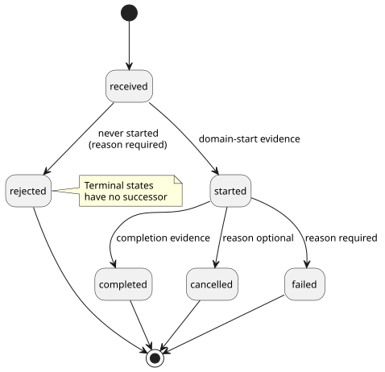
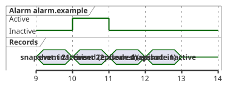

# Interaction stream contract design

[한국어](INTERACTION-STREAM-CONTRACT.ko.md)

This is the design for [#74](https://github.com/callin2/ghostflow-language/issues/74).

It specifies a **normative** contract for how the host and the core report observations, intended for future adoption. "Normative" means the rules below are requirements (must/must not) for any producer or consumer that adopts the format.

What this document does **not** do:

- It does not implement producers, transport, retention or rendering.
- It does not add new source grammar.

How it relates to existing work:

- Reference [§5.3](reference/05-settings-and-observation.en.md#53-cabinet-view-independent-observation-model) remains the language boundary. Its lifecycle notation is not an existing record enum.
- Settings (#70) and the bounded [alarm-only producer](../contracts/alarm-v1/README.md) (#287) are already implemented.
- Command descriptors and the combined stream described below are **future work**.
- Alarm v1 has its own closed descriptor and report schemas. It records committed scalar Bool-state transitions in Rust. It does not claim the combined stream format proposed here.
- The existing [v0 contract](../contracts/interaction-v0/README.md) stays unchanged.

In this document:

1. [Meaning and ownership](#meaning-and-ownership) — the four record types and who owns what.
2. [Separate future formats](#separate-future-formats) — the two proposed formats and an example record.
3. [Canonical field contracts](#canonical-field-contracts) — field-by-field validation rules.
4. [Command lifecycle](#command-lifecycle) — command states and transitions.
5. [Alarm episodes and missed refreshes](#alarm-episodes-and-missed-refreshes) — why snapshots alone miss alarms.
6. [Ordering, retention and reconnect](#ordering-retention-and-reconnect) — cursors, bounded storage, gaps and discontinuities.
7. [Rejection and adoption gates](#rejection-and-adoption-gates) — required outcomes for invalid input.

## Meaning and ownership

There are four kinds of record. Each answers a different question.

| Record | Question answered | Identity |
| --- | --- | --- |
| Completed snapshot | What is observable now? | Exact schema/module/source, run and completed scan |
| Ordered event | What occurred in this execution? | Exact contract/module/source, run, stream and sequence |
| Command result | How was this request handled? | Event identity plus command ID and request digest |
| Alarm event | Which declared condition arose or cleared? | Event identity plus descriptor and episode ID |

Responsibilities are split as follows:

| Party | Owns |
| --- | --- |
| Rust core | Common lifecycle and execution identity. It records facts **before** invoking observation hooks. |
| Authored program | Domain meaning. |
| Host | Exporting records and keeping long history. |
| Renderers (for example, cabinet view) | Consuming evidence. |

This follows the accepted frontend [ADR-002 at revision `8f95786`](https://github.com/callin2/farm_studio_frontend/blob/8f95786/docs/adr-002-runtime-command-lifecycle-and-host-hooks.md). Implementing it is a separate adoption task.

Command completion is an **execution outcome**, not a physical acknowledgement. [§4.7](reference/04-sensors-constraints-control.en.md#47-requested-safe-applied-confirmed) keeps requested, safe, applied and feedback-confirmed evidence separate.

**The descriptor contract.** Meaning comes from an explicit, separately versioned external *descriptor contract*. It must bind the following to this exact source and module:

- typed request inputs;
- request shape and permission;
- domain start and completion evidence;
- alarm condition, raise and clear meaning.

Each command or alarm definition has a public `id`, a `kind`, source-node provenance and intent anchors.

Alarm severity is metadata declared in that contract. The contract also declares the severity vocabulary and its meaning. No universal product severity is imposed.

Meaning is never inferred from names, Bool values, callback names or output intent. There is no new `command`, `alarm` or severity source keyword. The descriptor contract is metadata; it is not a second executable control program.

## Separate future formats

Two formats are proposed, each with `version: 1`:

- `GhostFlow/interaction-descriptor-contract-v1`
- `GhostFlow/interaction-stream-v1`

These are design labels. They are **not** currently accepted formats.

A stream record binds two different things, and neither digest substitutes for the other:

- `descriptorContract` binds the exact external definitions.
- `schema` binds the existing static snapshot schema.

Digests follow the exact strict canonical JSON UTF-8 rules of the v0 README:

- arrays keep their order, and object keys are sorted;
- malformed Unicode is rejected;
- integers are safe integers, and numbers are finite;
- sparse arrays are not allowed;
- maximum depth is 64.

The descriptor digest covers the whole descriptor document (which has no self-digest field). A request digest covers the whole typed request object.

The JSON below is fictional. The zero digests and the source nodes are placeholders. It is not a compiled artifact or a verified source proof.

```json
{
  "format": "GhostFlow/interaction-stream-v1", "version": 1,
  "context": {
    "schema": {"format":"GhostFlow/interaction-schema-v0","version":"0.1","sha256":"0000000000000000000000000000000000000000000000000000000000000000"},
    "descriptorContract": {"format":"GhostFlow/interaction-descriptor-contract-v1","version":1,"sha256":"0000000000000000000000000000000000000000000000000000000000000000"},
    "module": {"id":"example.control","moduleFingerprint":"0000000000000000","bytecodeSha256":"0000000000000000000000000000000000000000000000000000000000000000"},
    "source": {"documentId":"example.document","revisionId":"example.revision","format":"GhostFlow/source-document-v1","kind":"literate","sha256":"0000000000000000000000000000000000000000000000000000000000000000"},
    "runId":"example.run", "streamId":"example.stream"
  },
  "sequence": 21, "logicalTimeMs": 1000,
  "position": {"kind":"completed-scan","scanId":10},
  "descriptorId":"alarm.example",
  "provenance": {"sourceNodeId":7,"intentAnchorIds":["example.intent"]},
  "payload": {"kind":"alarm","transition":"raised","episodeId":"episode.1"}
}
```

Rules for adoption:

- Use the exact source format given by the compiled canonical source identity.
- Each referenced format keeps its own version type (for example, `"0.1"` for the schema and `1` for the descriptor contract).
- Every object has a **closed** field set. Reject unknown fields, duplicate JSON keys, unsupported formats or versions, and missing or wrongly typed required fields. No extension is ever silently ignored.
- Before any producer claims this format, a machine-readable schema and conformance tests must be published.

## Canonical field contracts

Each field of a stream record has a required meaning and validation rule.

| Field | Required meaning and validation |
| --- | --- |
| `context.schema` | Existing schema format/version/SHA-256; verify against the supplied static schema. |
| `context.descriptorContract` | Supported format/version/SHA-256; verify against supplied definitions and their exact module/source binding. |
| `context.module` | Exact public ID, 16 lowercase hex fingerprint, 64 lowercase hex bytecode digest, with v0 meaning. |
| `context.source` | Exact document/revision/format/kind/SHA-256, with canonical literate source and v0 meaning. |
| `runId`, `streamId` | Nonempty opaque public identities; together identify one ordered execution stream. |
| `sequence` | Nonnegative safe integer, starting at zero and increasing by one per originally produced occurrence regardless of retention. Retention never renumbers; never wrap or reuse. |
| `logicalTimeMs` | Nonnegative safe integer, nondecreasing within the stream; equal times do not imply equal occurrences. |
| `position` | Exactly `{"kind":"completed-scan","scanId":N}` or `{"kind":"execution-boundary","boundaryId":"opaque.id"}`. Scan IDs are nonnegative safe integers; boundary IDs are nonempty and run-local. |
| `descriptorId` | Public ID found in the exact descriptor contract with matching payload kind. |
| `provenance` | Exactly positive safe-integer `sourceNodeId` and nonempty distinct public `intentAnchorIds`; verify both against this exact source revision and descriptor. |
| `payload` | Exactly one of the closed command/alarm variants below. |

**Two kinds of position:**

- An **execution-boundary** occurrence can happen before a scan completes — for example, when a request is rejected. It must not invent a completed scan. It must not use a pending scan as completion evidence.
- A **completed-scan** occurrence refers to a scan that was actually committed. Its logical time matches that scan's completion.

**Identity rules:**

- Public IDs must not use the reserved `__gf_` prefix.
- If a consumer expected a different identity, the record is **stale**.
- If identity or provenance contradicts itself inside the record, that is a **validation error**.
- Records are never joined across revisions by display name.

## Command lifecycle

A fictional `received` record uses the same full envelope:

```json
{"format":"GhostFlow/interaction-stream-v1","version":1,
 "context":{
  "schema":{"format":"GhostFlow/interaction-schema-v0","version":"0.1","sha256":"0000000000000000000000000000000000000000000000000000000000000000"},
  "descriptorContract":{"format":"GhostFlow/interaction-descriptor-contract-v1","version":1,"sha256":"0000000000000000000000000000000000000000000000000000000000000000"},
  "module":{"id":"example.control","moduleFingerprint":"0000000000000000","bytecodeSha256":"0000000000000000000000000000000000000000000000000000000000000000"},
  "source":{"documentId":"example.document","revisionId":"example.revision","format":"GhostFlow/source-document-v1","kind":"literate","sha256":"0000000000000000000000000000000000000000000000000000000000000000"},
  "runId":"example.run","streamId":"example.stream"},
 "sequence":23,"logicalTimeMs":1100,
 "position":{"kind":"execution-boundary","boundaryId":"request.1"},
 "descriptorId":"command.example","provenance":{"sourceNodeId":8,"intentAnchorIds":["example.intent"]},
 "payload":{"kind":"command","commandId":"command.1","requestSha256":"0000000000000000000000000000000000000000000000000000000000000000","state":"received"}}
```

A command payload has exactly these fields:

| Field | Rule |
| --- | --- |
| `kind` | Always `"command"`. |
| `commandId` | Nonempty and run-local. |
| `requestSha256` | Lowercase SHA-256 of the canonical typed request bound by the descriptor. |
| `state` | A lifecycle state (see below). |
| `reason` | Only where allowed. Exactly `{"code":"public.code","message":"human-readable detail"}`, both strings nonempty. Reason codes are declared by the descriptor contract. |

Allowed transitions:

```text
received -> rejected
received -> started -> completed | cancelled | failed
```

The state diagram below shows the same transitions and where `reason` is required.



These transitions are normative for this proposed observation record contract. They are not an accepted source-language change.

What each state means:

| State | Meaning | `reason` |
| --- | --- | --- |
| `received` | Comes before every outcome. | Forbidden |
| `rejected` | Execution never started. | Required |
| `started` | Domain-start evidence, as declared by the descriptor. | Forbidden |
| `completed` | Declared completion evidence. | Forbidden |
| `cancelled` | Terminal outcome after starting. | Optional (explicit) |
| `failed` | Terminal outcome after starting, distinct from `cancelled`. | Required |

Additional rules:

- If execution fails at an execution boundary **before** starting, record it as `rejected` with an explicit reason. Never invent a `started` record.
- A terminal state has no successor.
- One command ID cannot be reused for a different request or descriptor.
- A retry with the same ID and digest identifies the **same** execution. It must not start that execution again.
- Current command state keeps the last valid lifecycle state, with its original sequence and provenance. It is not a new lifecycle occurrence.

**History and gaps:**

- The producer must record the full chain, starting with `received`.
- After an explicit gap, a consumer may see a `started` or terminal result without the earlier steps. It keeps that result as incomplete history and does not invent the missing steps.
- A consumer may reject a transition only when validated coverage proves the relevant history is complete.

**Scope across reconnects.** Command deduplication and current state are scoped to the **run**. They must survive a reconnect within the same run, and survive recreation of the collection stream. If they cannot be recovered, the host must start a fresh run ID under its new-run policy. A new stream ID alone is not enough.

## Alarm episodes and missed refreshes

An alarm payload has exactly:

- `kind: "alarm"`;
- `transition: "raised" | "cleared"`;
- a nonempty, run-local `episodeId`.

An *episode* is one period during which an alarm is active.

- Each new inactive-to-active transition of one descriptor creates a fresh episode ID.
- The matching clear uses that same ID. It cannot clear a different episode.
- Repeated active observations do not create new raises.
- The alarm's declared current state and its ordered transitions are separate observations.

Example: a brief alarm that a snapshot-only observer would miss.

| Observation | Alarm state or record |
| --- | --- |
| Snapshot, completed scan 9 | Inactive |
| Event, sequence 21, completed scan 10 | `raised`, descriptor `alarm.example`, episode `episode.1` |
| Event, sequence 22, completed scan 11 | `cleared`, same descriptor and episode |
| Snapshot, completed scan 12 | Inactive |

The timing diagram below plots the same table against completed scan IDs. Both snapshots see "inactive"; only the two events show the episode.



The snapshots at scans 9 and 12 cannot reveal this episode. Retained events must show both transitions. If the events were lost, the exporter must report an explicit gap. No timestamp and no inactive snapshot can rebuild the missing history.

This table illustrates a future alarm-capable observation. It does not add alarm descriptors to v0.

## Ordering, retention and reconnect

**Cursor and order.**

- A cursor is exactly `(runId, streamId, sequence)`.
- Order is defined by `sequence` only — never by arrival order or timestamps.
- The same sequence delivered again with identical canonical record bytes is an idempotent (harmless) redelivery. Different bytes at the same sequence are an error.
- A consumer may buffer out-of-order deliveries. It must not treat a missing sequence as complete until it receives either that occurrence or explicit loss evidence.

**Bounded retention in the core (future).** The core keeps:

- a bounded ring of recent records;
- current command state;
- the latest result per command class (classes are defined by the external descriptor contract).

Current-state slots and request-deduplication storage also have declared, finite budgets. An unbounded per-request map is not permitted. If safe identity deduplication or protected state cannot fit the budget, admission must fail explicitly.

**Retention policy.** The host exports records before the core reclaims them. A declared, finite policy states:

- record and byte budgets;
- priority protection for critical faults and the latest failed result;
- eviction order;
- admission behavior.

Protection does not promise unlimited history. When a promised guarantee cannot be honored, the core either rejects admission or reports explicit loss under the declared policy. Long exported history belongs to the host.

- Protected current/latest-failed state per class must stay within its own separate budget. If it cannot be preserved, admission must fail. Silent eviction is not allowed.
- Evicting history **always** reports a gap, even for prioritized critical history.
- Latest/current records help answer "what is the status now?". They never replace occurrence history.

**Loss reports.** Loss reports are separate transport metadata. They are not sequenced domain occurrences. There are three closed report kinds:

| Report | Fields | Use |
| --- | --- | --- |
| `coverage` | `kind: "coverage"`, `runId`, `streamId`, `latestSequence`, `availableRanges` | Which sequences this exporter still has. |
| `gap` | `kind: "gap"`, `runId`, `streamId`, `fromSequence`, `toSequence`, `reason` | An exact, known range of unavailable sequences. |
| `discontinuity` | `kind: "discontinuity"`, `previousRunId`, `previousStreamId`, `runId`, `streamId`, `reason` | History was lost and the lost range is unknown. |

*Coverage report rules:*

- `latestSequence` is `null` if no occurrence has been produced yet. Otherwise it is a nonnegative safe integer.
- Each range is exactly `{fromSequence,toSequence}`, inclusive, with nonnegative safe bounds `from <= to <= latestSequence`.
- Ranges are sorted and disjoint. If `latestSequence` is `null`, `availableRanges` must be empty.
- Produced history is `0..latestSequence`. Every hole that is unavailable requires an exact gap report, even if the stream is now quiet.
- Coverage describes what the exporter holds, including retained interior critical records. It does not claim that all produced history is still available.

*Gap report rules:*

- Bounds are nonnegative safe integers with `from <= to`.
- The interval is inclusive and exact: every sequence in it is unavailable from this exporter.
- Adjacent known intervals may be merged, but never across known retained records.
- Discarding records before export requires a gap report.
- A policy's retained range must expose interior holes as intervals. It must not imply continuous coverage.

*Discontinuity report.* If the lost range is unknown, use this separate closed report:
`{"kind":"discontinuity","previousRunId":"old.run","previousStreamId":"old.stream","runId":"new.run","streamId":"new.stream","reason":"history-unavailable"}`.
All identities and the reason are nonempty strings. Do not invent numeric bounds.

**Reconnect and restart.**

| Event | Effect |
| --- | --- |
| Reconnect with the same run and stream | Resume from the last accepted cursor; export exact known gaps. |
| Reset or restart | Run ID changes. |
| Stream recreated without recoverable ordering | Stream ID changes. |

A run ID or stream ID change starts a new cursor and requires an explicit discontinuity. Sequence zero or scan zero in the new epoch is **not** a continuation. No command and no alarm episode is silently joined across that boundary.

## Rejection and adoption gates

Each case below has one required result.

| Case | Required result |
| --- | --- |
| Unknown field/version, unsafe integer, malformed digest | Reject record. |
| New command/alarm kind inserted into v0 schema/snapshot | Existing v0 validator rejects; no compatibility relaxation. |
| Descriptor/module/source mismatch or invalid anchor | Validation error; no name-based fallback. |
| Expected run/source differs from valid record | Stale identity result; start explicit new cursor when appropriate. |
| Changed duplicate sequence or reused command ID with changed request | Reject as identity conflict. |
| `received -> completed` or terminal successor with proven complete coverage; failure without reason | Reject lifecycle violation. |
| Started or terminal command observed after explicit history gap | Preserve observed result as incomplete history; never fabricate missing steps. |
| Clear without known raise after an explicit gap | Preserve clear as evidence; mark episode history incomplete, never fabricate raise. |
| Clear without raise in a complete validated history | Reject episode transition. |
| Reconnect/restart loses unknown history | Explicit discontinuity; no fabricated exact gap. |

Future adoption must specify:

- serialization and validation of the external descriptor;
- core recording and bounded retention;
- host export and recovery;
- conformance cases for every gate above, for all terminal command paths, for brief alarm episodes, and for restart.

**Scope of existing evidence.** Existing completed-snapshot and browser evidence establishes only that existing path. Frontend [#161 acceptance](https://github.com/callin2/farm_studio_frontend/issues/161#issuecomment-5679111790) is evidence for the existing Worker/WASM path only. It does not establish these new producers or any physical behavior. This design delivers no runtime stream producer and no retention implementation.
