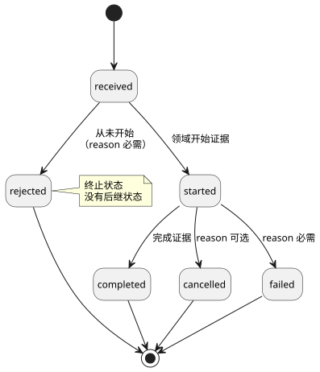
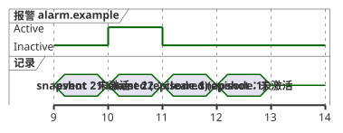

<!-- translation-source: docs/INTERACTION-STREAM-CONTRACT.md -->
[英文原文](INTERACTION-STREAM-CONTRACT.md)

# 交互流契约设计

[한국어](INTERACTION-STREAM-CONTRACT.ko.md)

这是 [#74](https://github.com/callin2/ghostflow-language/issues/74) 的设计。

它规定了一份**规范性**契约，描述宿主和核心如何报告观测，供今后采纳。“规范性”指下面的规则是对采用该格式的任何生产方或使用方的要求（必须/不得）。

本文**不**做的事：

- 不实现生产方、传输、保留或渲染。
- 不新增源语法。

与现有工作的关系：

- 参考手册 [§5.3](reference/05-settings-and-observation.zh.md#53-renderer-independent-observation-model) 仍是语言边界。其中的生命周期表示法并不是现有的记录枚举。
- 设置（#70）和有界的[仅报警生产方](../contracts/alarm-v1/README.md)（#287）已经实现。
- 命令描述符以及下文描述的组合流属于**未来工作**。
- Alarm v1 有自己封闭的描述符和报告模式。它在 Rust 中记录已提交的标量 Bool 状态转换。它并不声称采用本文提议的组合流格式。
- 现有的 [v0 契约](../contracts/interaction-v0/README.md)保持不变。

本文内容：

1. [含义与所有权](#含义与所有权)——四种记录类型以及各方负责什么。
2. [独立的未来格式](#独立的未来格式)——两种提议的格式和一个示例记录。
3. [规范字段契约](#规范字段契约)——逐字段的校验规则。
4. [命令生命周期](#命令生命周期)——命令状态及其转换。
5. [报警周期与错过的刷新](#报警周期与错过的刷新)——为什么仅靠快照会漏掉报警。
6. [排序、保留与重连](#排序保留与重连)——游标、有界存储、间隙和不连续。
7. [拒绝与采纳关卡](#拒绝与采纳关卡)——对无效输入要求的处理结果。

## 含义与所有权

记录有四种。每种回答一个不同的问题。

| 记录 | 回答的问题 | 身份标识 |
| --- | --- | --- |
| 已完成快照 | 现在可以观测到什么？ | 确切的模式/模块/源、运行（run）和已完成的扫描 |
| 有序事件 | 本次执行中发生了什么？ | 确切的契约/模块/源、运行、流和序号 |
| 命令结果 | 这个请求是如何处理的？ | 事件身份标识加上命令 ID 和请求摘要 |
| 报警事件 | 哪个已声明的条件出现或解除了？ | 事件身份标识加上描述符和周期 ID |

职责划分如下：

| 参与方 | 负责 |
| --- | --- |
| Rust 核心 | 通用生命周期和执行身份标识。它在调用观测钩子**之前**记录事实。 |
| 编写的程序 | 领域含义。 |
| 宿主 | 导出记录并保存长期历史。 |
| 渲染器（例如 cabinet view） | 使用证据。 |

这遵循已被接受的前端 [ADR-002（修订版 `8f95786`）](https://github.com/callin2/farm_studio_frontend/blob/8f95786/docs/adr-002-runtime-command-lifecycle-and-host-hooks.md)。实现它是另一项独立的采纳任务。

命令完成是一个**执行结果**，而不是物理确认。[§4.7](reference/04-sensors-constraints-control.zh.md#47-requestedsafeappliedconfirmed) 将 requested、safe、applied 和经反馈确认（confirmed）的证据分开。

**描述符契约。** 含义来自一份显式的、单独版本化的外部*描述符契约*。它必须把以下内容绑定到这份确切的源和模块：

- 带类型的请求输入；
- 请求形状和权限；
- 领域的开始与完成证据；
- 报警条件，以及出现和解除的含义。

每个命令或报警定义都有公开的 `id`、`kind`、源节点来源和意图锚点。

报警严重级别是在该契约中声明的元数据。契约还声明严重级别的词汇及其含义。不强加任何通用的产品严重级别。

含义绝不会从名称、Bool 值、回调名称或输出意图中推断。不存在新的 `command`、`alarm` 或严重级别源关键字。描述符契约是元数据；它不是第二个可执行的控制程序。

## 独立的未来格式

提议两种格式，均为 `version: 1`：

- `GhostFlow/interaction-descriptor-contract-v1`
- `GhostFlow/interaction-stream-v1`

这些是设计标签。它们目前**不是**被接受的格式。

一条流记录绑定两样不同的东西，两个摘要不能互相替代：

- `descriptorContract` 绑定确切的外部定义。
- `schema` 绑定现有的静态快照模式。

摘要遵循 v0 README 中确切的严格规范 JSON UTF-8 规则：

- 数组保持顺序，对象键排序；
- 格式错误的 Unicode 被拒绝；
- 整数为安全整数，数为有限值；
- 不允许稀疏数组；
- 最大深度为 64。

描述符摘要覆盖整个描述符文档（该文档没有自摘要字段）。请求摘要覆盖整个带类型的请求对象。

下面的 JSON 是虚构的。全零摘要和源节点都是占位符。它不是编译产物，也不是经过验证的源证明。

```json
{
  "format": "GhostFlow/interaction-stream-v1", "version": 1,
  "context": {
    "schema": {"format":"GhostFlow/interaction-schema-v0","version":"0.1","sha256":"0000000000000000000000000000000000000000000000000000000000000000"},
    "descriptorContract": {"format":"GhostFlow/interaction-descriptor-contract-v1","version":1,"sha256":"0000000000000000000000000000000000000000000000000000000000000000"},
    "module": {"id":"example.control","moduleFingerprint":"0000000000000000","bytecodeSha256":"0000000000000000000000000000000000000000000000000000000000000000"},
    "source": {"documentId":"example.document","revisionId":"example.revision","format":"GhostFlow/source-document-v1","kind":"literate","sha256":"0000000000000000000000000000000000000000000000000000000000000000"},
    "runId":"example.run", "streamId":"example.stream"
  },
  "sequence": 21, "logicalTimeMs": 1000,
  "position": {"kind":"completed-scan","scanId":10},
  "descriptorId":"alarm.example",
  "provenance": {"sourceNodeId":7,"intentAnchorIds":["example.intent"]},
  "payload": {"kind":"alarm","transition":"raised","episodeId":"episode.1"}
}
```

采纳规则：

- 使用编译后规范源身份标识所给出的确切源格式。
- 每个被引用的格式保持自己的版本类型（例如模式为 `"0.1"`，描述符契约为 `1`）。
- 每个对象都有**封闭**的字段集。拒绝未知字段、重复的 JSON 键、不支持的格式或版本，以及缺失或类型错误的必需字段。任何扩展都绝不会被静默忽略。
- 在任何生产方声称采用此格式之前，必须先发布机器可读的模式和一致性测试。

## 规范字段契约

流记录的每个字段都有其必需的含义和校验规则。

| 字段 | 必需的含义与校验 |
| --- | --- |
| `context.schema` | 现有模式的 format/version/SHA-256；对照所提供的静态模式进行验证。 |
| `context.descriptorContract` | 受支持的 format/version/SHA-256；对照所提供的定义及其确切的模块/源绑定进行验证。 |
| `context.module` | 确切的公开 ID、16 位小写十六进制指纹、64 位小写十六进制字节码摘要，含义同 v0。 |
| `context.source` | 确切的 document/revision/format/kind/SHA-256，使用规范 literate 源，含义同 v0。 |
| `runId`、`streamId` | 非空的不透明公开身份标识；两者合起来标识一个有序的执行流。 |
| `sequence` | 非负安全整数，从零开始，每个最初产生的事件实例加一，与保留无关。保留绝不重新编号；绝不回绕或复用。 |
| `logicalTimeMs` | 非负安全整数，在流内非递减；时间相同并不意味着是同一事件实例。 |
| `position` | 恰好为 `{"kind":"completed-scan","scanId":N}` 或 `{"kind":"execution-boundary","boundaryId":"opaque.id"}`。扫描 ID 为非负安全整数；边界 ID 非空且仅在运行内有效。 |
| `descriptorId` | 在确切描述符契约中存在、且 payload 种类匹配的公开 ID。 |
| `provenance` | 恰好由正安全整数 `sourceNodeId` 和非空、互不相同的公开 `intentAnchorIds` 组成；两者都要对照这份确切的源修订版和描述符进行验证。 |
| `payload` | 恰好是下文封闭的 command/alarm 变体之一。 |

**两种位置：**

- **execution-boundary**（执行边界）事件实例可以在扫描完成之前发生——例如请求被拒绝时。它不得虚构一个已完成的扫描。它不得把待定的扫描当作完成证据。
- **completed-scan**（已完成扫描）事件实例指向一个真正已提交的扫描。其逻辑时间与该扫描的完成时间一致。

**身份标识规则：**

- 公开 ID 不得使用保留前缀 `__gf_`。
- 如果使用方期望的是另一个身份标识，该记录即为**陈旧**（stale）。
- 如果身份标识或来源在记录内部自相矛盾，则属于**校验错误**。
- 绝不按显示名称跨修订版关联记录。

## 命令生命周期

一条虚构的 `received` 记录使用同样完整的信封：

```json
{"format":"GhostFlow/interaction-stream-v1","version":1,
 "context":{
  "schema":{"format":"GhostFlow/interaction-schema-v0","version":"0.1","sha256":"0000000000000000000000000000000000000000000000000000000000000000"},
  "descriptorContract":{"format":"GhostFlow/interaction-descriptor-contract-v1","version":1,"sha256":"0000000000000000000000000000000000000000000000000000000000000000"},
  "module":{"id":"example.control","moduleFingerprint":"0000000000000000","bytecodeSha256":"0000000000000000000000000000000000000000000000000000000000000000"},
  "source":{"documentId":"example.document","revisionId":"example.revision","format":"GhostFlow/source-document-v1","kind":"literate","sha256":"0000000000000000000000000000000000000000000000000000000000000000"},
  "runId":"example.run","streamId":"example.stream"},
 "sequence":23,"logicalTimeMs":1100,
 "position":{"kind":"execution-boundary","boundaryId":"request.1"},
 "descriptorId":"command.example","provenance":{"sourceNodeId":8,"intentAnchorIds":["example.intent"]},
 "payload":{"kind":"command","commandId":"command.1","requestSha256":"0000000000000000000000000000000000000000000000000000000000000000","state":"received"}}
```

命令 payload 恰好包含以下字段：

| 字段 | 规则 |
| --- | --- |
| `kind` | 始终为 `"command"`。 |
| `commandId` | 非空，仅在运行内有效。 |
| `requestSha256` | 描述符所绑定的规范带类型请求的小写 SHA-256。 |
| `state` | 一个生命周期状态（见下文）。 |
| `reason` | 仅在允许处出现。恰好为 `{"code":"public.code","message":"human-readable detail"}`，两个字符串均非空。原因代码由描述符契约声明。 |

允许的转换：

```text
received -> rejected
received -> started -> completed | cancelled | failed
```

下面的状态图展示了同样的转换，以及哪些地方必须提供 `reason`。



这些转换对本提议的观测记录契约具有规范性。它们不是已被接受的源语言变更。

各状态的含义：

| 状态 | 含义 | `reason` |
| --- | --- | --- |
| `received` | 出现在每个结果之前。 | 禁止 |
| `rejected` | 执行从未开始。 | 必需 |
| `started` | 描述符声明的领域开始证据。 | 禁止 |
| `completed` | 声明的完成证据。 | 禁止 |
| `cancelled` | 开始之后的终止结果。 | 可选（显式） |
| `failed` | 开始之后的终止结果，与 `cancelled` 不同。 | 必需 |

附加规则：

- 如果执行在开始**之前**于执行边界处失败，应将其记录为带显式原因的 `rejected`。绝不虚构 `started` 记录。
- 终止状态没有后继状态。
- 一个命令 ID 不能复用于不同的请求或描述符。
- 使用相同 ID 和摘要的重试标识的是**同一个**执行。它不得再次启动该执行。
- 当前命令状态保留最后一个有效的生命周期状态，以及其原始序号和来源。它不是一个新的生命周期事件实例。

**历史与间隙：**

- 生产方必须记录从 `received` 开始的完整链条。
- 在显式间隙之后，使用方可能会看到没有前序步骤的 `started` 或终止结果。它将该结果作为不完整的历史保留，并且不虚构缺失的步骤。
- 只有当经过校验的覆盖范围证明相关历史是完整的时，使用方才可以拒绝某个转换。

**跨重连的范围。** 命令去重和当前状态的范围是**运行**（run）。它们必须在同一运行内的重连后保持，并在收集流重建后保持。如果无法恢复它们，宿主必须按照其新运行策略启用一个新的运行 ID。仅仅更换流 ID 是不够的。

## 报警周期与错过的刷新

报警 payload 恰好包含：

- `kind: "alarm"`；
- `transition: "raised" | "cleared"`；
- 一个非空、仅在运行内有效的 `episodeId`。

*周期*（episode）是指报警处于激活状态的一段时间。

- 同一描述符每发生一次从未激活到激活的转换，就创建一个新的周期 ID。
- 与之对应的解除使用同一个 ID。它不能解除另一个周期。
- 重复的激活观测不会产生新的出现（raise）记录。
- 报警声明的当前状态与其有序转换是相互独立的观测。

示例：仅依赖快照的观测者会漏掉的短暂报警。

| 观测 | 报警状态或记录 |
| --- | --- |
| 快照，已完成扫描 9 | 未激活 |
| 事件，序号 21，已完成扫描 10 | `raised`，描述符 `alarm.example`，周期 `episode.1` |
| 事件，序号 22，已完成扫描 11 | `cleared`，相同的描述符和周期 |
| 快照，已完成扫描 12 | 未激活 |

下面的时序图按已完成扫描 ID 绘制了同一张表。两个快照看到的都是“未激活”；只有两个事件显示出该周期。



扫描 9 和 12 的快照无法揭示这个周期。保留的事件必须显示两次转换。如果事件丢失，导出方必须报告一个显式间隙。任何时间戳或未激活快照都无法重建缺失的历史。

此表展示的是未来支持报警的观测。它不会向 v0 添加报警描述符。

## 排序、保留与重连

**游标与顺序。**

- 游标恰好是 `(runId, streamId, sequence)`。
- 顺序仅由 `sequence` 定义——绝不由到达顺序或时间戳定义。
- 以完全相同的规范记录字节再次送达的同一序号属于幂等（无害）的重复投递。同一序号下字节不同则是错误。
- 使用方可以缓冲乱序送达的记录。在收到该事件实例或显式的丢失证据之前，它不得把缺失的序号视为已完整。

**核心中的有界保留（未来）。** 核心保留：

- 一个有界的近期记录环形缓冲区；
- 当前命令状态；
- 每个命令类别的最新结果（类别由外部描述符契约定义）。

当前状态槽和请求去重存储也有已声明的有限预算。不允许使用无界的按请求映射。如果安全的身份标识去重或受保护状态无法放进预算，准入（admission）必须显式失败。

**保留策略。** 宿主在核心回收记录之前导出它们。一份已声明的有限策略说明：

- 记录数和字节预算；
- 对关键故障和最新失败结果的优先保护；
- 驱逐顺序；
- 准入行为。

保护并不承诺无限的历史。当承诺的保证无法兑现时，核心要么拒绝准入，要么按照已声明的策略报告显式丢失。长期导出的历史归宿主负责。

- 每个类别受保护的当前/最新失败状态必须保持在其自身独立的预算之内。如果无法保存它，准入必须失败。不允许静默驱逐。
- 驱逐历史**总是**会报告一个间隙，即使是被优先保护的关键历史也是如此。
- 最新/当前记录有助于回答“现在的状态是什么？”。它们绝不能取代事件实例历史。

**丢失报告。** 丢失报告是独立的传输元数据。它们不是带序号的领域事件实例。共有三种封闭的报告：

| 报告 | 字段 | 用途 |
| --- | --- | --- |
| `coverage` | `kind: "coverage"`、`runId`、`streamId`、`latestSequence`、`availableRanges` | 此导出方仍持有哪些序号。 |
| `gap` | `kind: "gap"`、`runId`、`streamId`、`fromSequence`、`toSequence`、`reason` | 一段确切的、已知不可用的序号范围。 |
| `discontinuity` | `kind: "discontinuity"`、`previousRunId`、`previousStreamId`、`runId`、`streamId`、`reason` | 历史已丢失，且丢失范围未知。 |

*覆盖报告规则：*

- 如果尚未产生任何事件实例，`latestSequence` 为 `null`。否则它是一个非负安全整数。
- 每个范围恰好为 `{fromSequence,toSequence}`，闭区间，边界为非负安全整数，且 `from <= to <= latestSequence`。
- 范围有序且互不相交。如果 `latestSequence` 为 `null`，`availableRanges` 必须为空。
- 已产生的历史为 `0..latestSequence`。每个不可用的空洞都需要一份确切的间隙报告，即使流现在已经安静下来。
- 覆盖描述的是导出方持有的内容，包括保留下来的中间关键记录。它并不声称所有已产生的历史仍然可用。

*间隙报告规则：*

- 边界为非负安全整数，且 `from <= to`。
- 区间是闭区间且精确：其中每个序号在此导出方都不可用。
- 相邻的已知区间可以合并，但绝不能跨越已知的保留记录。
- 在导出之前丢弃记录需要一份间隙报告。
- 策略的保留范围必须以区间形式暴露其中的空洞。它不得暗示连续覆盖。

*不连续报告。* 如果丢失范围未知，使用这份独立的封闭报告：
`{"kind":"discontinuity","previousRunId":"old.run","previousStreamId":"old.stream","runId":"new.run","streamId":"new.stream","reason":"history-unavailable"}`。
所有身份标识和原因都是非空字符串。不要虚构数字边界。

**重连与重启。**

| 事件 | 效果 |
| --- | --- |
| 以相同的运行和流重连 | 从最后接受的游标继续；导出确切的已知间隙。 |
| 复位或重启 | 运行 ID 改变。 |
| 流在无法恢复顺序的情况下重建 | 流 ID 改变。 |

运行 ID 或流 ID 的改变会开启一个新游标，并且需要一次显式的不连续报告。新纪元中的序号零或扫描零**不是**延续。任何命令或报警周期都不会被静默地跨越该边界关联起来。

## 拒绝与采纳关卡

下面每种情况都有一个要求的结果。

| 情况 | 要求的结果 |
| --- | --- |
| 未知字段/版本、不安全整数、格式错误的摘要 | 拒绝记录。 |
| 向 v0 模式/快照插入新的 command/alarm 种类 | 现有 v0 校验器拒绝；不放宽兼容性。 |
| 描述符/模块/源不匹配或锚点无效 | 校验错误；不按名称回退。 |
| 期望的运行/源与有效记录不同 | 陈旧身份标识结果；在适当时开启显式的新游标。 |
| 重复序号内容改变，或命令 ID 被复用但请求已改变 | 作为身份标识冲突拒绝。 |
| 在已证明覆盖完整的情况下出现 `received -> completed` 或终止状态有后继；失败但没有原因 | 拒绝生命周期违规。 |
| 在显式历史间隙之后观测到已开始或已终止的命令 | 将观测到的结果作为不完整历史保留；绝不伪造缺失的步骤。 |
| 显式间隙之后出现没有已知 raise 的 clear | 将 clear 作为证据保留；把周期历史标记为不完整，绝不伪造 raise。 |
| 在完整且经过校验的历史中出现没有 raise 的 clear | 拒绝该周期转换。 |
| 重连/重启丢失了未知的历史 | 显式不连续；不伪造确切的间隙。 |

未来的采纳必须规定：

- 外部描述符的序列化与校验；
- 核心记录与有界保留；
- 宿主导出与恢复；
- 针对上述每个关卡、所有命令终止路径、短暂报警周期以及重启的一致性测试用例。

**现有证据的范围。** 现有的已完成快照和浏览器证据只证明了现有路径。前端 [#161 验收](https://github.com/callin2/farm_studio_frontend/issues/161#issuecomment-5679111790)仅是现有 Worker/WASM 路径的证据。它并不证明这些新的生产方或任何物理行为。本设计不交付任何运行时流生产方，也不交付任何保留实现。
