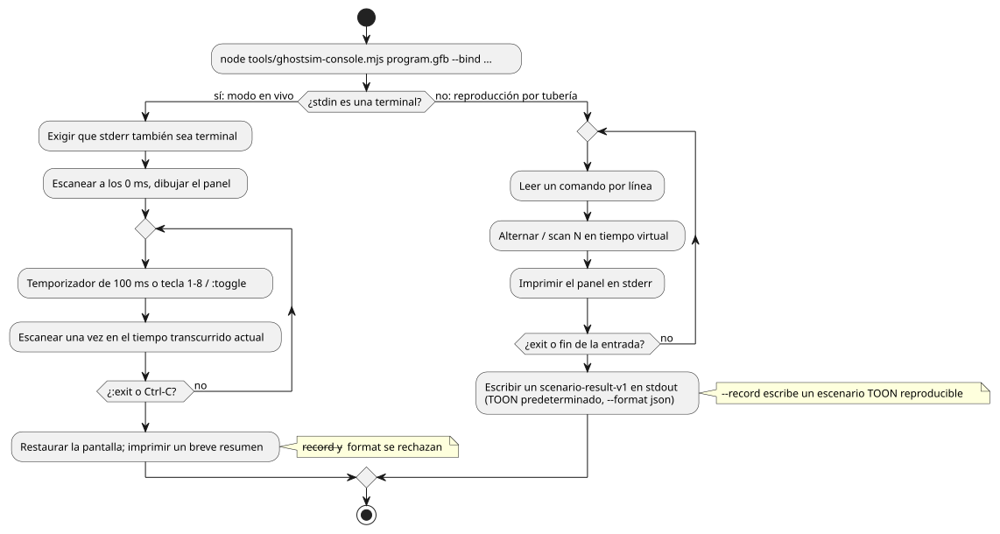

<!-- translation-source: docs/KEYBOARD-HOST.md -->
[Original en inglés](KEYBOARD-HOST.md)

# Host de teclado en tiempo real

Esta página describe dos formas de controlar un programa GFB compilado desde el teclado, sin ningún hardware real:

- el ejemplo nativo de Rust `keyboard` (esta sección);
- la consola ASCII en vivo `ghostsim-console` ([Consola ASCII en vivo](#consola-ascii-en-vivo)).

El ejemplo nativo `keyboard` ejecuta un GFB compilado con entrada de terminal virtual. No accede a GPIO, puerto serie, MQTT ni ningún dispositivo de red.

```sh
cargo run --locked --offline -p ghostflow-core --example keyboard -- \
  build/program.gfb \
  --key 1=start --key 2=stop \
  --record build/keyboard-events.csv
```

Cómo se comporta:

- Mientras el proceso se ejecuta, la terminal está en modo raw. Se restaura al salir normalmente.
- Pulse `Ctrl-C` para salir.
- Una tecla numérica del `1` al `8` alterna la entrada correspondiente y produce un tick (paso de decisión lógica) del runtime.

Cómo se asignan las teclas a las entradas:

- El asignador mantiene un estado booleano por cada entrada configurada.
- Cada pulsación de un número vinculado alterna esa entrada entre `true` y `false`. No se necesita ningún evento de liberación de tecla.
- Las teclas no vinculadas se ignoran.
- Cada pulsación ejecuta un tick del runtime con el estado booleano actual completo (todas las entradas, no solo la que cambió).

`--record` escribe registros de eventos reproducibles con esta cabecera:

```csv
logical_time_ms,key,event
```

El ejecutor CSV `run` existente no cambia. El CSV de eventos registrado es un flujo de auditoría para un adaptador de host. **No** se acepta como la matriz de entradas ordinaria que usa `run`.

## Consola ASCII en vivo

`ghostsim-console` ejecuta un programa GFB en un runtime virtual de GhostFlow y dibuja sus entradas y salidas como un panel de texto. Tiene dos modos:

- **Modo en vivo**: cuando stdin es una terminal. Un temporizador de reloj de pared impulsa los escaneos, y las entradas se alternan con teclas.
- **Modo de reproducción por tubería**: cuando los comandos llegan por stdin. Reproduce una lista acotada de comandos y escribe un resultado de escenario.

El diagrama de flujo siguiente resume cómo se ejecutan los dos modos. Los detalles vienen a continuación.



**Modo en vivo.** En una terminal interactiva, `ghostsim-console` inicia un runtime virtual persistente de GhostFlow.

- Escanea a los 0 ms y dibuja de inmediato el primer panel a pantalla completa, antes de que se pulse ninguna tecla.
- Un temporizador de reloj de pared de 100 ms aporta un nuevo escaneo por tick.
- El tiempo lógico es el tiempo monotónico transcurrido desde el arranque. Si una devolución de llamada del temporizador llega tarde, la consola escanea una vez en el tiempo transcurrido actual. No reproduce los ticks perdidos.
- Cada fila muestra la entrada reciente, la intención de salida solicitada y la intención de salida segura como trazas ASCII.
- La visualización usa la pantalla alternativa de la terminal. Al terminar, restaura la pantalla, el cursor y el modo de teclado raw.
- Nunca abre un Driver físico.
- Tanto stdin como stderr deben ser terminales para esta vista en vivo.

```sh
node tools/ghostsim-console.mjs build/program.gfb \
  --bind DI1=start --bind DI2=stop --bind RO1=pump --bind RO2=valve
```

**Disposición predeterminada.** Sin `--profile`, la disposición es una **Waveshare 8DI/8RO virtual** con canales Bool `DI1`–`DI8` y `RO1`–`RO8`.

- Un nombre de canal predeterminado se vincula automáticamente solo a un puerto lógico del manifiesto con exactamente el mismo nombre y tipo.
- Cualquier otro puerto lógico necesita una asignación explícita `--bind CHANNEL=port`.
- Esta disposición no dice nada sobre números de pin, hardware instalado ni aprobación del sitio.
- Cada salida lógica necesita una vinculación.
- Una entrada lógica no vinculada necesita un valor inicial explícito, `--input port=value`. No se puede alternar desde el panel.
- Los canales del perfil no utilizados muestran `(unbound)`.

**Perfil de placa.** Un descriptor seleccionado puede usar el esquema existente `GhostFlow/board-profile-v1`. Sus campos son `schema`, `id`, `revision`, `boardModel` y un objeto `endpoints`.

- Cada clave de endpoint es su ID de canal.
- Cada valor de endpoint tiene `direction` (`input` u `output`), `type`, `driver`, `address`, `activeLevel` y `safeLevel`.
- La consola enumera los ID de endpoint en el orden en que aparecen en el archivo JSON, por separado para entradas y salidas.
- Usa `direction` y `type` para validar las vinculaciones.
- Nunca abre el driver indicado y nunca trata una dirección como un pin confirmado.
- Todas las vinculaciones de puertos lógicos siguen siendo explícitas con `--bind`.

Antes de que su identidad se muestre o se someta a hash, el perfil de placa debe cumplir exactamente el contrato de integración:

- conjuntos de campos exactos;
- campos de texto no vacíos;
- valores válidos de dirección y nivel de los endpoints;
- pares `driver`/`address` únicos.

**Perfil de consola.** El JSON alternativo `GhostFlow/console-profile-v1` siguiente es un descriptor de canales solo de presentación. Su `id`, sus canales ordenados, sus etiquetas y sus tipos determinan el panel virtual. No contiene ninguna asignación de instalación física.

```json
{
  "format": "GhostFlow/console-profile-v1",
  "id": "example-2DI-4RO",
  "inputs": [
    { "name": "A", "label": "Input A", "type": "Bool" },
    { "name": "B", "label": "Input B", "type": "Bool" }
  ],
  "outputs": [
    { "name": "R1", "label": "Relay 1", "type": "Bool" },
    { "name": "R2", "label": "Relay 2", "type": "Bool" },
    { "name": "R3", "label": "Relay 3", "type": "Bool" },
    { "name": "R4", "label": "Relay 4", "type": "Bool" }
  ]
}
```

```sh
node tools/ghostsim-console.mjs build/program.gfb \
  --profile build/profile.json --bind A=start --bind B=stop \
  --bind R1=pump --bind R2=valve
```

**Teclas y comandos en vivo:**

| Entrada | Efecto |
|---|---|
| `1` … `8` | Alterna la entrada Bool vinculada y escanea de inmediato. No hace falta pulsar Enter. |
| `:` seguido de un comando y luego Enter | Ejecuta un comando de consola. |
| `:toggle CHANNEL` | Alterna un canal posterior, por ejemplo `:toggle DI9`. |
| `:exit` o Ctrl-C | Termina la sesión. |

- El panel empieza en el escaneo 0. Al salir se imprime un breve resumen legible.
- `--record` y `--format` se rechazan en el modo TTY en vivo. Una ejecución en vivo no acotada no cabe en el contrato de grabación acotado `GhostFlow/scenario-v1`.
- Si falta `target/wasm32-unknown-unknown/release/ghostflow_wasm.wasm`, compile primero el runtime WASM con `npm run build:wasm`.
- `:scan N` es un comando de reproducción por tubería. En el modo en vivo el reloj avanza automáticamente.

**Modo de reproducción por tubería.** Cuando los comandos se pasan por stdin mediante una tubería, omita los `:` y escriba un comando por línea.

- Este modo de reproducción acotada ejecuta el ejecutor de escenarios `ghostsim`.
- Escribe en stdout un único documento `GhostFlow/scenario-result-v1` completo. El formato predeterminado es TOON; `--format json` selecciona JSON.
- El panel se imprime en stderr después de cada escaneo.
- Cada alternancia registra un flanco de tecla o una acción de entrada tipada y luego escanea una vez en el tiempo virtual actual.
- El tiempo empieza en 0 ms y no puede retroceder.
- Si no hubo comandos, la salida registra un escaneo inicial a los 0 ms.

**Entradas no Bool (ambos modos).** Para una entrada del manifiesto que no sea Bool, aporte un valor inicial tipado con `--input port=value`. Un canal no Bool puede aparecer en el descriptor, pero su estado en el panel es `unsupported` y no tiene atajo para alternarlo.

**Lectura del panel:**

- Las filas alinean las listas de entradas y salidas por índice. Si una lista es más corta, sus celdas sobrantes quedan vacías.
- Los valores Bool se muestran como ON u OFF. Las observaciones ausentes se muestran como `unobserved`.
- Las columnas de salida muestran por separado la intención virtual solicitada y la segura.
- El panel informa de la identidad del descriptor de perfil/canales, el ID de escaneo, el tiempo virtual, el estado/error y `physical: unconfirmed`.
- El panel en vivo conserva una traza móvil acotada de los últimos 120 escaneos.
- La reproducción por tubería imprime las vinculaciones exactas.

**Grabación y reproducción.** En el modo de reproducción por tubería, `--record` escribe el escenario TOON exacto y reproducible. Por ejemplo:

```sh
printf '1\nscan 100\nexit\n' | node tools/ghostsim-console.mjs build/program.gfb \
  --bind DI1=start --bind DI2=stop --bind RO1=pump --bind RO2=valve \
  --record build/session.toon
```

Reprodúzcalo con
`node tools/ghostsim.mjs build/program.gfb build/session.toon --format toon`.

**Errores durante la reproducción.**

| Situación | Resultado |
|---|---|
| Se rechaza un comando o un tiempo de escaneo después de que se completaran algunos escaneos | Fallo de la sesión de consola: `outcome: command-error`, un error `command` y las filas de los escaneos completados. |
| El ejecutor rechaza su entrada | `outcome: rejected`, sin escaneos. |

- El escenario grabado contiene solo las acciones y los escaneos aceptados. Se reproduce con las mismas filas de escaneo y la misma identidad de escenario. El intento rechazado se excluye.
- Si no se completó ningún escaneo, no se graba ningún escenario reproducible.

**El campo `console`.** El resultado final incluye un campo `console` con el ID del perfil seleccionado, la revisión (si existe), un digest, las vinculaciones y el estado físico. El digest se calcula así:

- para un perfil de placa: el SHA-256 del JSON canónico del contrato de integración;
- para un descriptor de consola: un hash de los bytes exactos del archivo JSON.

La reproducción tiene escaneos, resultado, identidad de artefacto/fuente y digest de escenario equivalentes. `ghostsim` no añade los metadatos de presentación de la consola.

**Conversión de grabaciones de teclado antiguas.** El CSV `logical_time_ms,key,event` del ejemplo de teclado más antiguo no puede reproducirse directamente con `ghostsim`. Primero debe convertirse explícitamente en entradas iniciales, vinculaciones de teclas y acciones ordenadas de tecla/escaneo de `GhostFlow/scenario-v1`.
