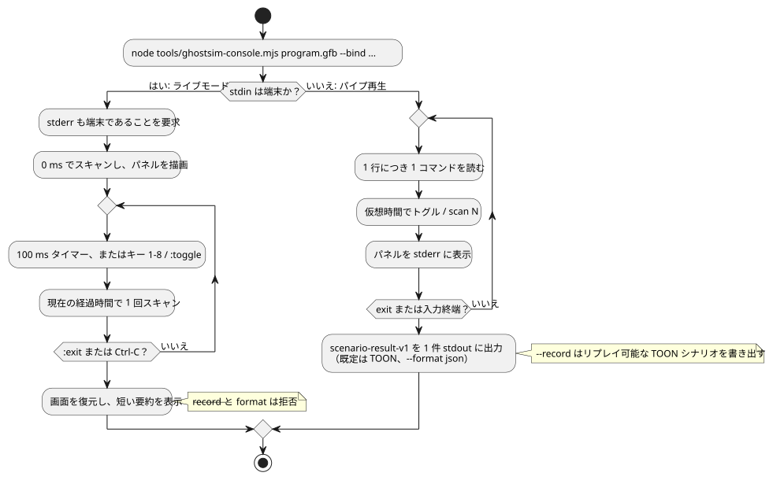

<!-- translation-source: docs/KEYBOARD-HOST.md -->
[英語の原文](KEYBOARD-HOST.md)

# リアルタイムキーボードホスト

このページでは、実際のハードウェアを使わずに、コンパイル済みの GFB プログラムをキーボードから操作する 2 つの方法を説明します。

- ネイティブの Rust `keyboard` サンプル（このセクション）
- `ghostsim-console` のライブ ASCII コンソール（[ライブ ASCII コンソール](#ライブ-ascii-コンソール)）

ネイティブの `keyboard` サンプルは、仮想端末入力を使ってコンパイル済みの GFB を実行します。GPIO、シリアル、MQTT、その他のネットワークデバイスにはアクセスしません。

```sh
cargo run --locked --offline -p ghostflow-core --example keyboard -- \
  build/program.gfb \
  --key 1=start --key 2=stop \
  --record build/keyboard-events.csv
```

動作：

- プロセスの実行中、端末は raw モードになります。正常終了時には元に戻されます。
- 終了するには `Ctrl-C` を押します。
- 数字キー `1`〜`8` を押すと、対応する入力がトグルされ、ランタイムの tick（論理判断の単位）が 1 回実行されます。

キーと入力の対応：

- マッパーは、設定された入力ごとに 1 つの真偽値の状態を保持します。
- 割り当てられた数字キーを押すたびに、その入力が `true` と `false` の間でトグルされます。キーアップイベントは必要ありません。
- 割り当てのないキーは無視されます。
- キーを押すたびに、現在の真偽値の状態全体（変化した入力だけでなく、すべての入力）でランタイムの tick が実行されます。

`--record` は、次のヘッダーを持つリプレイ可能なイベントレコードを書き出します。

```csv
logical_time_ms,key,event
```

既存の `run` CSV ランナーは変更されていません。記録されたイベント CSV は、ホストアダプタのための監査ストリームです。`run` が使う通常の入力マトリクスとしては受け付けられ**ません**。

## ライブ ASCII コンソール

`ghostsim-console` は、仮想の GhostFlow ランタイム上で GFB プログラムを実行し、その入力と出力をテキストパネルとして描画します。モードは 2 つあります。

- **ライブモード** — stdin が端末の場合。壁時計のタイマーがスキャンを駆動し、キーで入力をトグルします。
- **パイプ再生モード** — コマンドが stdin から渡される場合。有界のコマンドリストをリプレイし、シナリオ結果を書き出します。

次のフローチャートは、2 つのモードの実行の流れをまとめたものです。詳細はその後に続きます。



**ライブモード。** 対話型の端末では、`ghostsim-console` は永続的な仮想 GhostFlow ランタイムを起動します。

- 0 ms でスキャンし、キーが押される前に、最初の全画面パネルをすぐに描画します。
- 100 ms の壁時計タイマーが、tick ごとに新しいスキャンを 1 回供給します。
- 論理時間は、起動から経過した単調時間です。タイマーのコールバックが遅れた場合、コンソールは現在の経過時間で 1 回だけスキャンします。取りこぼした tick はリプレイしません。
- 各行には、最近の入力、要求された出力意図、安全な出力意図が ASCII トレースとして表示されます。
- 表示には端末の代替画面を使います。終了時には、画面、カーソル、raw キーボードモードを元に戻します。
- 物理的な Driver を開くことは決してありません。
- このライブビューでは、stdin と stderr の両方が端末でなければなりません。

```sh
node tools/ghostsim-console.mjs build/program.gfb \
  --bind DI1=start --bind DI2=stop --bind RO1=pump --bind RO2=valve
```

**既定のレイアウト。** `--profile` を指定しない場合、レイアウトは Bool チャネル `DI1`〜`DI8` と `RO1`〜`RO8` を持つ**仮想 Waveshare 8DI/8RO** です。

- 既定のチャネル名が自動的にバインドされるのは、名前と型がまったく同じマニフェストの論理ポートだけです。
- それ以外の論理ポートには、明示的な `--bind CHANNEL=port` の割り当てが必要です。
- このレイアウトは、ピン番号、設置済みのハードウェア、現場の承認については何も示しません。
- すべての論理出力にバインディングが必要です。
- バインドされていない論理入力には、明示的な初期値 `--input port=value` が必要です。パネルからトグルすることはできません。
- 使われていないプロファイルのチャネルは `(unbound)` と表示されます。

**ボードプロファイル。** 選択されたディスクリプタは、既存の `GhostFlow/board-profile-v1` スキーマを使うことができます。そのフィールドは `schema`、`id`、`revision`、`boardModel`、および `endpoints` オブジェクトです。

- 各エンドポイントのキーはそのチャネル ID です。
- 各エンドポイントの値は、`direction`（`input` または `output`）、`type`、`driver`、`address`、`activeLevel`、`safeLevel` を持ちます。
- コンソールは、エンドポイント ID を JSON ファイルに現れる順に、入力と出力で別々に一覧表示します。
- バインディングの検証には `direction` と `type` を使います。
- 指定されたドライバを開くことはなく、アドレスを確認済みのピンとして扱うことも決してありません。
- 論理ポートのバインディングは、すべて `--bind` による明示的なものです。

同一性を表示またはハッシュ化する前に、ボードプロファイルは統合契約を厳密に満たしていなければなりません。

- 厳密なフィールド集合
- 空でないテキストフィールド
- 有効なエンドポイントの方向とレベルの値
- 一意な `driver`/`address` の組

**コンソールプロファイル。** 以下の代替の `GhostFlow/console-profile-v1` JSON は、表示専用のチャネルディスクリプタです。その `id`、順序付きのチャネル、ラベル、型が仮想パネルを決めます。物理的な設置のマッピングは持ちません。

```json
{
  "format": "GhostFlow/console-profile-v1",
  "id": "example-2DI-4RO",
  "inputs": [
    { "name": "A", "label": "Input A", "type": "Bool" },
    { "name": "B", "label": "Input B", "type": "Bool" }
  ],
  "outputs": [
    { "name": "R1", "label": "Relay 1", "type": "Bool" },
    { "name": "R2", "label": "Relay 2", "type": "Bool" },
    { "name": "R3", "label": "Relay 3", "type": "Bool" },
    { "name": "R4", "label": "Relay 4", "type": "Bool" }
  ]
}
```

```sh
node tools/ghostsim-console.mjs build/program.gfb \
  --profile build/profile.json --bind A=start --bind B=stop \
  --bind R1=pump --bind R2=valve
```

**ライブモードのキーとコマンド：**

| 入力 | 効果 |
|---|---|
| `1` … `8` | バインドされた Bool 入力をトグルし、すぐにスキャンします。Enter は不要です。 |
| `:` に続けてコマンド、そして Enter | コンソールコマンドを実行します。 |
| `:toggle CHANNEL` | 9 番目以降のチャネルをトグルします。たとえば `:toggle DI9`。 |
| `:exit` または Ctrl-C | セッションを終了します。 |

- パネルはスキャン 0 から始まります。終了後には、人が読める短い要約が表示されます。
- ライブ TTY モードでは、`--record` と `--format` は拒否されます。無制限のライブ実行は、有界の `GhostFlow/scenario-v1` 記録契約に収まらないためです。
- `target/wasm32-unknown-unknown/release/ghostflow_wasm.wasm` がない場合は、先に `npm run build:wasm` で WASM ランタイムをビルドしてください。
- `:scan N` はパイプ再生用のコマンドです。ライブモードでは時計が自動的に進みます。

**パイプ再生モード。** コマンドを stdin からパイプで渡す場合は、`:` を省略し、1 行に 1 コマンドを書きます。

- この有界の再生モードは、`ghostsim` のシナリオランナーを実行します。
- 完全な `GhostFlow/scenario-result-v1` 文書を 1 つ stdout に書き出します。既定は TOON で、`--format json` を指定すると JSON になります。
- 各スキャンの後に、パネルが stderr に表示されます。
- トグルのたびに、キーのエッジまたは型付きの入力アクションが記録され、現在の仮想時間で 1 回スキャンされます。
- 時間は 0 ms から始まり、逆戻りすることはできません。
- コマンドが 1 つもなかった場合、exit は 0 ms での初期スキャンを 1 回記録します。

**Bool 以外の入力（両モード共通）。** Bool 以外のマニフェスト入力には、`--input port=value` で型付きの初期値を指定してください。Bool 以外のチャネルはディスクリプタに現れてもかまいませんが、そのパネル上の状態は `unsupported` となり、トグルのショートカットはありません。

**パネルの読み方：**

- 行は、入力リストと出力リストをインデックスで揃えます。一方のリストが短い場合、余ったセルは空のままです。
- Bool 値は ON または OFF と表示されます。観測がない場合は `unobserved` と表示されます。
- 出力の列には、要求された仮想意図と安全な仮想意図が別々に表示されます。
- パネルには、プロファイル/チャネルディスクリプタの同一性、スキャン ID、仮想時間、ステータス/エラー、`physical: unconfirmed` が表示されます。
- ライブパネルは、直近 120 スキャン分の有界のローリングトレースを保持します。
- パイプ再生では、厳密なバインディングが表示されます。

**記録とリプレイ。** パイプ再生モードでは、`--record` が厳密にリプレイ可能な TOON シナリオを書き出します。例：

```sh
printf '1\nscan 100\nexit\n' | node tools/ghostsim-console.mjs build/program.gfb \
  --bind DI1=start --bind DI2=stop --bind RO1=pump --bind RO2=valve \
  --record build/session.toon
```

リプレイするには
`node tools/ghostsim.mjs build/program.gfb build/session.toon --format toon` を実行します。

**再生中のエラー。**

| 状況 | 結果 |
|---|---|
| いくつかのスキャンが完了した後で、コマンドまたはスキャン時刻が拒否された | コンソールセッションの失敗：`outcome: command-error`、`command` エラー、および完了したスキャン行。 |
| ランナーが入力を拒否した | `outcome: rejected`。スキャンはありません。 |

- 記録されたシナリオには、受け付けられたアクションとスキャンだけが含まれます。リプレイすると、同じスキャン行と同じシナリオの同一性が得られます。拒否された試行は除外されます。
- 完了したスキャンが 1 つもない場合、リプレイ可能なシナリオは記録されません。

**`console` フィールド。** 最終結果には `console` フィールドが含まれます。そこには、選択されたプロファイル ID、リビジョン（ある場合）、ダイジェスト、バインディング、物理ステータスが入ります。ダイジェストは次のように計算されます。

- ボードプロファイルの場合：統合契約の正規 JSON の SHA-256
- コンソールディスクリプタの場合：JSON ファイルの厳密なバイト列のハッシュ

リプレイでは、スキャン、結果、成果物/ソースの同一性、シナリオダイジェストが等価になります。`ghostsim` はコンソールの表示用メタデータを追加しません。

**古いキーボード記録の変換。** 以前のキーボードサンプルの `logical_time_ms,key,event` CSV は、`ghostsim` で直接リプレイすることはできません。まず、`GhostFlow/scenario-v1` の初期入力、キーバインディング、順序付きのキー/スキャンアクションに明示的に変換しなければなりません。
