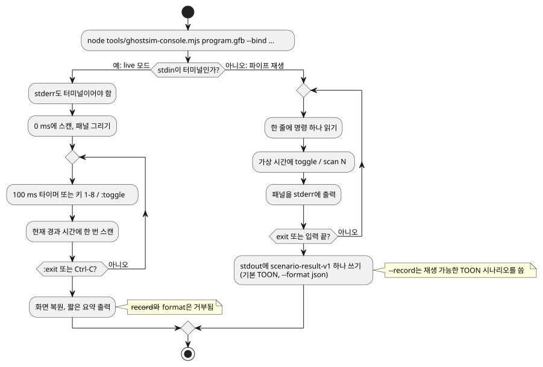

<!-- translation-source: docs/KEYBOARD-HOST.md -->
[영문 원문](KEYBOARD-HOST.md)

# 실시간 키보드 호스트

이 문서는 실제 하드웨어 없이 키보드로 컴파일된 GFB 프로그램을 구동하는 두 가지 방법을 설명합니다.

- 네이티브 Rust `keyboard` 예제(이 절)
- `ghostsim-console` 실시간 ASCII 콘솔([실시간 ASCII 콘솔](#실시간-ascii-콘솔))

네이티브 `keyboard` 예제는 가상 터미널 입력으로 컴파일된 GFB를 실행합니다. GPIO, 직렬 포트, MQTT, 그 밖의 어떤 네트워크 장치에도 접근하지 않습니다.

```sh
cargo run --locked --offline -p ghostflow-core --example keyboard -- \
  build/program.gfb \
  --key 1=start --key 2=stop \
  --record build/keyboard-events.csv
```

동작 방식:

- 프로세스가 실행되는 동안 터미널은 raw 모드가 됩니다. 정상 종료하면 복원됩니다.
- 종료하려면 `Ctrl-C`를 누릅니다.
- 숫자 키 `1`부터 `8`까지는 대응하는 입력을 전환하고 런타임 tick(논리 판단 단위)을 하나 만듭니다.

키와 입력의 대응:

- 매퍼는 설정된 입력마다 불리언 상태를 하나씩 유지합니다.
- 바인딩된 숫자를 누를 때마다 해당 입력이 `true`와 `false` 사이에서 바뀝니다. keyup 이벤트는 필요하지 않습니다.
- 바인딩되지 않은 키는 무시합니다.
- 키를 누를 때마다 현재의 완전한 불리언 상태(바뀐 입력 하나가 아니라 모든 입력)로 런타임을 tick합니다.

`--record`는 다음 헤더를 가진 재생 가능한 이벤트 레코드를 씁니다.

```csv
logical_time_ms,key,event
```

기존 `run` CSV 실행기는 바뀌지 않습니다. 기록된 이벤트 CSV는 호스트 어댑터를 위한 감사 스트림입니다. `run`이 사용하는 일반 입력 행렬로는 받아들여지지 **않습니다**.

## 실시간 ASCII 콘솔

`ghostsim-console`은 가상 GhostFlow 런타임에서 GFB 프로그램을 실행하고, 그 입력과 출력을 텍스트 패널로 그립니다. 두 가지 모드가 있습니다.

- **Live 모드** — stdin이 터미널일 때. 벽시계 타이머가 스캔을 구동하고, 키로 입력을 전환합니다.
- **파이프 재생 모드** — 명령이 stdin으로 들어올 때. 제한된 명령 목록을 재생하고 시나리오 결과를 씁니다.

아래 흐름도는 두 모드가 실행되는 방식을 요약합니다. 자세한 내용은 그 뒤에 이어집니다.



**Live 모드.** 대화형 터미널에서 `ghostsim-console`은 지속형 가상 GhostFlow 런타임을 시작합니다.

- 0 ms에 스캔하고, 키를 누르기 전에도 첫 전체 화면 패널을 즉시 그립니다.
- 100 ms 벽시계 타이머가 tick마다 새 스캔을 하나씩 공급합니다.
- 논리 시간은 시작 이후 경과한 단조 시간입니다. 타이머 콜백이 늦으면 콘솔은 현재 경과 시간에 한 번 스캔합니다. 놓친 tick을 재생하지 않습니다.
- 각 행은 최근 입력, 요청 출력 의도, 안전 출력 의도를 ASCII 추적으로 보여 줍니다.
- 화면은 터미널의 대체 화면을 사용합니다. 종료할 때 화면, 커서, raw 키보드 모드를 복원합니다.
- 물리 Driver를 절대 열지 않습니다.
- 이 live 화면을 쓰려면 stdin과 stderr가 모두 터미널이어야 합니다.

```sh
node tools/ghostsim-console.mjs build/program.gfb \
  --bind DI1=start --bind DI2=stop --bind RO1=pump --bind RO2=valve
```

**기본 레이아웃.** `--profile`이 없으면 레이아웃은 Bool 채널 `DI1`–`DI8`과 `RO1`–`RO8`을 가진 **가상 Waveshare 8DI/8RO**입니다.

- 기본 채널 이름은 이름과 타입이 정확히 같은 manifest 논리 포트에만 자동으로 바인딩됩니다.
- 그 밖의 논리 포트에는 명시적인 `--bind CHANNEL=port` 할당이 필요합니다.
- 이 레이아웃은 핀 번호, 설치된 하드웨어, 현장 승인에 대해 아무것도 말하지 않습니다.
- 모든 논리 출력에는 바인딩이 필요합니다.
- 바인딩되지 않은 논리 입력에는 명시적 시작값 `--input port=value`가 필요합니다. 패널에서 전환할 수 없습니다.
- 사용하지 않는 프로필 채널은 `(unbound)`로 표시됩니다.

**보드 프로필.** 선택한 descriptor는 기존 `GhostFlow/board-profile-v1` schema를 사용할 수 있습니다. 필드는 `schema`, `id`, `revision`, `boardModel`, 그리고 `endpoints` 객체입니다.

- 각 endpoint 키는 채널 ID입니다.
- 각 endpoint 값은 `direction`(`input` 또는 `output`), `type`, `driver`, `address`, `activeLevel`, `safeLevel`을 가집니다.
- 콘솔은 endpoint ID를 JSON 파일에 나타나는 순서대로, 입력과 출력을 따로 나열합니다.
- `direction`과 `type`으로 바인딩을 검증합니다.
- 이름이 붙은 드라이버를 절대 열지 않으며, address를 확인된 핀으로 취급하지 않습니다.
- 모든 논리 포트 바인딩은 `--bind`로 명시적으로 지정합니다.

보드 프로필은 그 identity가 표시되거나 해시되기 전에 통합 계약을 정확히 만족해야 합니다.

- 정확한 필드 집합
- 비어 있지 않은 텍스트 필드
- 유효한 endpoint direction과 level 값
- 고유한 `driver`/`address` 쌍

**콘솔 프로필.** 아래의 대안 `GhostFlow/console-profile-v1` JSON은 표시 전용 채널 descriptor입니다. `id`, 순서 있는 채널, 라벨, 타입이 가상 패널을 구성합니다. 물리 설치 매핑은 담지 않습니다.

```json
{
  "format": "GhostFlow/console-profile-v1",
  "id": "example-2DI-4RO",
  "inputs": [
    { "name": "A", "label": "Input A", "type": "Bool" },
    { "name": "B", "label": "Input B", "type": "Bool" }
  ],
  "outputs": [
    { "name": "R1", "label": "Relay 1", "type": "Bool" },
    { "name": "R2", "label": "Relay 2", "type": "Bool" },
    { "name": "R3", "label": "Relay 3", "type": "Bool" },
    { "name": "R4", "label": "Relay 4", "type": "Bool" }
  ]
}
```

```sh
node tools/ghostsim-console.mjs build/program.gfb \
  --profile build/profile.json --bind A=start --bind B=stop \
  --bind R1=pump --bind R2=valve
```

**Live 키와 명령:**

| 입력 | 효과 |
|---|---|
| `1` … `8` | 바인딩된 Bool 입력을 전환하고 즉시 스캔합니다. Enter는 필요 없습니다. |
| `:` 다음 명령, 그리고 Enter | 콘솔 명령을 실행합니다. |
| `:toggle CHANNEL` | 뒤쪽 채널을 전환합니다. 예: `:toggle DI9`. |
| `:exit` 또는 Ctrl-C | 세션을 끝냅니다. |

- 패널은 scan 0에서 시작합니다. 종료 후 사람이 읽을 수 있는 짧은 요약을 출력합니다.
- Live TTY 모드에서는 `--record`와 `--format`이 거부됩니다. 끝이 정해지지 않은 live 실행은 제한된 `GhostFlow/scenario-v1` 기록 계약에 맞을 수 없기 때문입니다.
- `target/wasm32-unknown-unknown/release/ghostflow_wasm.wasm`이 없으면 먼저 `npm run build:wasm`으로 WASM 런타임을 빌드하십시오.
- `:scan N`은 파이프 재생 명령입니다. Live 모드에서는 시계가 자동으로 흐릅니다.

**파이프 재생 모드.** 명령을 stdin으로 파이프할 때는 `:`를 빼고 한 줄에 명령 하나씩 씁니다.

- 이 제한된 재생 모드는 `ghostsim` 시나리오 실행기를 사용합니다.
- 완전한 `GhostFlow/scenario-result-v1` 문서 하나를 stdout에 씁니다. 기본은 TOON이고, `--format json`을 주면 JSON입니다.
- 스캔할 때마다 패널을 stderr에 출력합니다.
- 각 toggle은 키 에지 또는 typed 입력 동작을 기록한 다음, 현재 가상 시간에 한 번 스캔합니다.
- 시간은 0 ms에서 시작하며 뒤로 갈 수 없습니다.
- 명령이 하나도 없었다면 exit가 0 ms의 초기 스캔 하나를 기록합니다.

**Bool이 아닌 입력 (두 모드 공통).** Bool이 아닌 manifest 입력에는 `--input port=value`로 타입이 맞는 초기값을 제공합니다. Bool이 아닌 채널은 descriptor에 나타날 수 있지만, 패널 상태는 `unsupported`이고 toggle 단축키가 없습니다.

**패널 읽기:**

- 행은 입력 목록과 출력 목록을 인덱스 기준으로 맞춥니다. 한쪽 목록이 짧으면 남는 칸은 비워 둡니다.
- Bool 값은 ON 또는 OFF로 표시합니다. 관측이 없으면 `unobserved`로 표시합니다.
- 출력 열은 요청 가상 의도와 안전 가상 의도를 따로 보여 줍니다.
- 패널은 프로필/채널 descriptor identity, scan ID, 가상 시간, 상태/오류, 그리고 `physical: unconfirmed`를 보고합니다.
- Live 패널은 최근 120개 스캔의 제한된 rolling 추적을 유지합니다.
- 파이프 재생은 정확한 바인딩을 출력합니다.

**기록과 재생.** 파이프 재생 모드에서 `--record`는 재생 가능한 정확한 TOON 시나리오를 씁니다. 예:

```sh
printf '1\nscan 100\nexit\n' | node tools/ghostsim-console.mjs build/program.gfb \
  --bind DI1=start --bind DI2=stop --bind RO1=pump --bind RO2=valve \
  --record build/session.toon
```

다음 명령으로 재생합니다.
`node tools/ghostsim.mjs build/program.gfb build/session.toon --format toon`.

**재생 중 오류.**

| 상황 | 결과 |
|---|---|
| 일부 스캔이 완료된 뒤 명령이나 스캔 시간이 거부됨 | 콘솔 세션 실패: `outcome: command-error`, `command` 오류, 그리고 완료된 스캔 행. |
| 실행기가 입력을 거부함 | 스캔 없이 `outcome: rejected`. |

- 기록된 시나리오에는 수락된 동작과 스캔만 들어 있습니다. 같은 스캔 행과 같은 시나리오 identity로 재생됩니다. 거부된 시도는 제외됩니다.
- 완료된 스캔이 없으면 재생 가능한 시나리오를 기록하지 않습니다.

**`console` 필드.** 최종 결과에는 선택한 프로필 ID, revision(있는 경우), digest, 바인딩, 물리 상태를 담은 `console` 필드가 포함됩니다. Digest는 다음과 같이 계산합니다.

- 보드 프로필: 통합 계약의 canonical JSON SHA-256
- 콘솔 descriptor: JSON 파일 바이트 그대로의 해시

재생 결과는 스캔, outcome, artifact/source identity, 시나리오 digest가 동등합니다. `ghostsim`은 콘솔 표시 메타데이터를 추가하지 않습니다.

**이전 키보드 기록 변환.** 이전 키보드 예제의 `logical_time_ms,key,event` CSV는 `ghostsim`으로 바로 재생할 수 없습니다. 먼저 `GhostFlow/scenario-v1`의 초기 입력, 키 바인딩, 순서 있는 키/스캔 동작으로 명시적으로 변환해야 합니다.
