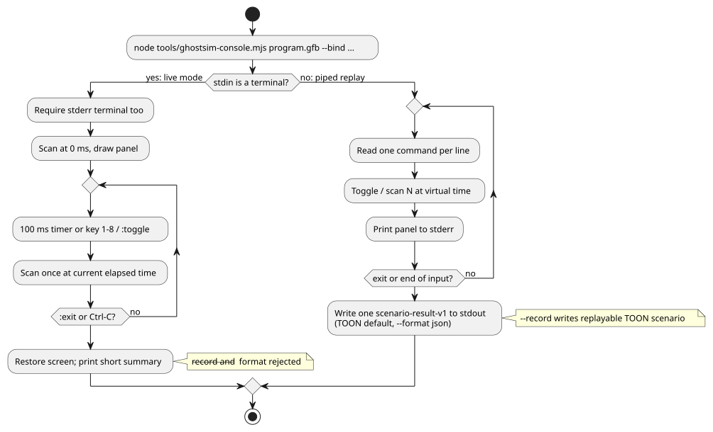

# Real-time keyboard host

This page describes two ways to drive a compiled GFB program from the keyboard, without any real hardware:

- the native Rust `keyboard` example (this section);
- the `ghostsim-console` live ASCII console ([Live ASCII console](#live-ascii-console)).

The native `keyboard` example runs a compiled GFB with virtual terminal input. It does not access GPIO, serial, MQTT, or any network device.

```sh
cargo run --locked --offline -p ghostflow-core --example keyboard -- \
  build/program.gfb \
  --key 1=start --key 2=stop \
  --record build/keyboard-events.csv
```

How it behaves:

- While the process runs, the terminal is in raw mode. It is restored on normal exit.
- Press `Ctrl-C` to exit.
- A number key `1` through `8` toggles the matching input and produces one runtime tick.

How keys map to inputs:

- The mapper holds one boolean state per configured input.
- Each press of a bound number toggles that input between `true` and `false`. No keyup event is needed.
- Unbound keys are ignored.
- Every press ticks the runtime with the complete current boolean state (all inputs, not just the one that changed).

`--record` writes replayable event records with this header:

```csv
logical_time_ms,key,event
```

The existing `run` CSV runner is unchanged. The recorded event CSV is an audit stream for a host adapter. It is **not** accepted as the ordinary input matrix used by `run`.

## Live ASCII console

`ghostsim-console` runs a GFB program on a virtual GhostFlow runtime and draws its inputs and outputs as a text panel. It has two modes:

- **Live mode** — when stdin is a terminal. A wall-clock timer drives scans, and you toggle inputs with keys.
- **Piped replay mode** — when commands come through stdin. It replays a bounded command list and writes a scenario result.

The flowchart below summarizes how the two modes run. Details follow.



**Live mode.** In an interactive terminal, `ghostsim-console` starts a persistent virtual GhostFlow runtime.

- It scans at 0 ms and draws the first full-screen panel immediately, before any key is pressed.
- A 100 ms wall-clock timer supplies one new scan per tick.
- Logical time is the monotonic time elapsed since startup. If a timer callback is late, the console scans once at the current elapsed time. It does not replay missed ticks.
- Each row shows recent input, requested output intent and safe output intent as ASCII traces.
- The display uses the terminal's alternate screen. When it ends, it restores the screen, the cursor and raw keyboard mode.
- It never opens a physical Driver.
- Both stdin and stderr must be terminals for this live view.

```sh
node tools/ghostsim-console.mjs build/program.gfb \
  --bind DI1=start --bind DI2=stop --bind RO1=pump --bind RO2=valve
```

**Default layout.** Without `--profile`, the layout is a **virtual Waveshare 8DI/8RO** with Bool channels `DI1`–`DI8` and `RO1`–`RO8`.

- A default channel name binds automatically only to a manifest logical port with exactly the same name and type.
- Any other logical port needs an explicit `--bind CHANNEL=port` assignment.
- This layout says nothing about pin numbers, installed hardware or site approval.
- Every logical output needs a binding.
- An unbound logical input needs an explicit starting value, `--input port=value`. It cannot be toggled from the panel.
- Unused profile channels display `(unbound)`.

**Board profile.** A selected descriptor may use the existing `GhostFlow/board-profile-v1` schema. Its fields are `schema`, `id`, `revision`, `boardModel`, and an `endpoints` object.

- Each endpoint key is its channel ID.
- Each endpoint value has `direction` (`input` or `output`), `type`, `driver`, `address`, `activeLevel`, and `safeLevel`.
- The console lists endpoint IDs in the order they appear in the JSON file, separately for inputs and outputs.
- It uses `direction` and `type` to validate bindings.
- It never opens the named driver, and it never treats an address as a confirmed pin.
- All logical port bindings stay explicit with `--bind`.

Before its identity is shown or hashed, the board profile must satisfy the integration contract exactly:

- exact field sets;
- nonempty text fields;
- valid endpoint direction and level values;
- unique `driver`/`address` pairs.

**Console profile.** The alternative `GhostFlow/console-profile-v1` JSON below is a presentation-only channel descriptor. Its `id`, ordered channels, labels and types drive the virtual panel. It carries no physical installation mapping.

```json
{
  "format": "GhostFlow/console-profile-v1",
  "id": "example-2DI-4RO",
  "inputs": [
    { "name": "A", "label": "Input A", "type": "Bool" },
    { "name": "B", "label": "Input B", "type": "Bool" }
  ],
  "outputs": [
    { "name": "R1", "label": "Relay 1", "type": "Bool" },
    { "name": "R2", "label": "Relay 2", "type": "Bool" },
    { "name": "R3", "label": "Relay 3", "type": "Bool" },
    { "name": "R4", "label": "Relay 4", "type": "Bool" }
  ]
}
```

```sh
node tools/ghostsim-console.mjs build/program.gfb \
  --profile build/profile.json --bind A=start --bind B=stop \
  --bind R1=pump --bind R2=valve
```

**Live keys and commands:**

| Input | Effect |
|---|---|
| `1` … `8` | Toggle the bound Bool input and scan immediately. Enter is not needed. |
| `:` then a command, then Enter | Run a console command. |
| `:toggle CHANNEL` | Toggle a later channel, for example `:toggle DI9`. |
| `:exit` or Ctrl-C | End the session. |

- The panel starts at scan 0. A short human-readable summary is printed after exit.
- `--record` and `--format` are rejected in live TTY mode. An unbounded live run cannot fit the bounded `GhostFlow/scenario-v1` recording contract.
- If `target/wasm32-unknown-unknown/release/ghostflow_wasm.wasm` is missing, build the WASM runtime first with `npm run build:wasm`.
- `:scan N` is a piped replay command. In live mode the clock runs automatically.

**Piped replay mode.** When commands are piped through stdin, omit the `:` and write one command per line.

- This bounded replay mode runs the `ghostsim` scenario runner.
- It writes one complete `GhostFlow/scenario-result-v1` document to stdout. The default is TOON; `--format json` selects JSON.
- The panel is printed to stderr after each scan.
- Each toggle records a key edge or a typed input action, then scans once at the current virtual time.
- Time starts at 0 ms and cannot move backward.
- If there were no commands, exit records one initial scan at 0 ms.

**Non-Bool inputs (both modes).** For a non-Bool manifest input, supply a typed initial value with `--input port=value`. A non-Bool channel may appear in the descriptor, but its panel state is `unsupported` and it has no toggle shortcut.

**Reading the panel:**

- Rows align the input and output lists by index. If one list is shorter, its extra cells stay empty.
- Bool values display ON or OFF. Missing observations display `unobserved`.
- Output columns show requested and safe virtual intent separately.
- The panel reports the profile/channel descriptor identity, scan ID, virtual time, status/error, and `physical: unconfirmed`.
- The live panel keeps a bounded rolling trace of the latest 120 scans.
- Piped replay prints the exact bindings.

**Recording and replay.** In piped replay mode, `--record` writes the exact replayable TOON scenario. For example:

```sh
printf '1\nscan 100\nexit\n' | node tools/ghostsim-console.mjs build/program.gfb \
  --bind DI1=start --bind DI2=stop --bind RO1=pump --bind RO2=valve \
  --record build/session.toon
```

Replay it with
`node tools/ghostsim.mjs build/program.gfb build/session.toon --format toon`.

**Errors during replay.**

| Situation | Result |
|---|---|
| A command or scan time is rejected after some scans completed | Console session failure: `outcome: command-error`, a `command` error, and the completed scan rows. |
| The runner rejects its input | `outcome: rejected`, with no scans. |

- The recorded scenario contains only the accepted actions and scans. It replays to the same scan rows and the same scenario identity. The rejected attempt is excluded.
- If no scan completed, no replayable scenario is recorded.

**The `console` field.** The final result includes a `console` field with the selected profile ID, the revision (when present), a digest, the bindings and the physical status. The digest is computed as follows:

- for a board profile: the integration contract's canonical JSON SHA-256;
- for a console descriptor: a hash of the exact JSON file bytes.

The replay has equivalent scans, outcome, artifact/source identity and scenario digest. `ghostsim` does not add the console presentation metadata.

**Converting old keyboard recordings.** The older keyboard example's `logical_time_ms,key,event` CSV cannot be replayed by `ghostsim` directly. It must first be explicitly converted into `GhostFlow/scenario-v1` initial inputs, key bindings, and ordered key/scan actions.
