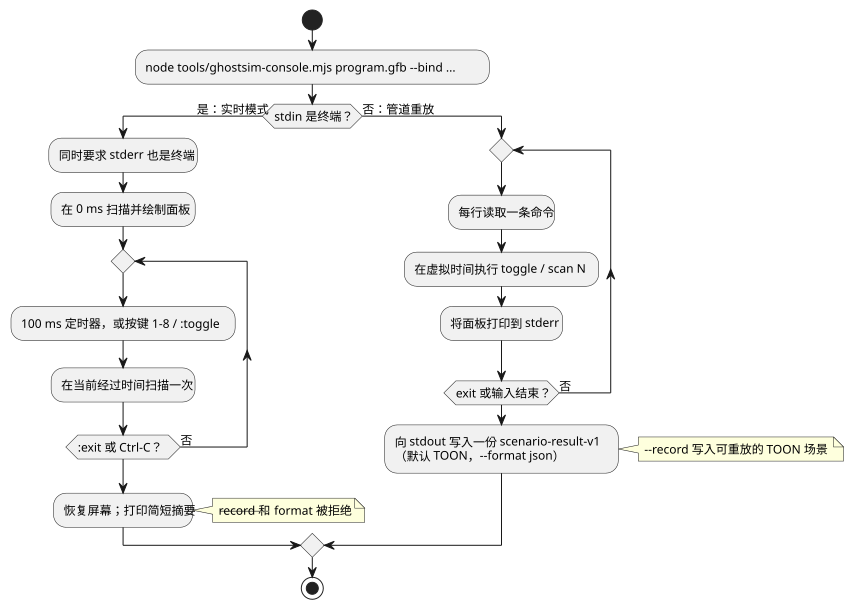

<!-- translation-source: docs/KEYBOARD-HOST.md -->
[英文原文](KEYBOARD-HOST.md)

# 实时键盘宿主

本页介绍两种无需任何真实硬件、用键盘驱动已编译 GFB 程序的方法：

- 原生 Rust `keyboard` 示例（本节）；
- `ghostsim-console` 实时 ASCII 控制台（[实时 ASCII 控制台](#实时-ascii-控制台)）。

原生 `keyboard` 示例使用虚拟终端输入运行已编译的 GFB。它不访问 GPIO、串口、MQTT 或任何网络设备。

```sh
cargo run --locked --offline -p ghostflow-core --example keyboard -- \
  build/program.gfb \
  --key 1=start --key 2=stop \
  --record build/keyboard-events.csv
```

其行为如下：

- 进程运行期间，终端处于原始（raw）模式。正常退出时会恢复。
- 按 `Ctrl-C` 退出。
- 数字键 `1` 到 `8` 会切换对应的输入，并产生一次运行时 tick（逻辑决策步）。

按键如何映射到输入：

- 映射器为每个已配置的输入保存一个布尔状态。
- 每按一次已绑定的数字键，就在 `true` 和 `false` 之间切换该输入。不需要按键抬起事件。
- 未绑定的按键会被忽略。
- 每次按键都会用完整的当前布尔状态（所有输入，而不只是发生变化的那个）驱动运行时执行一次 tick。

`--record` 写入可重放的事件记录，表头如下：

```csv
logical_time_ms,key,event
```

现有的 `run` CSV 运行器保持不变。记录下来的事件 CSV 是供宿主适配器使用的审计流。它**不**被接受为 `run` 所使用的普通输入矩阵。

## 实时 ASCII 控制台

`ghostsim-console` 在虚拟 GhostFlow 运行时上运行 GFB 程序，并以文本面板的形式绘制其输入和输出。它有两种模式：

- **实时模式**——当 stdin 是终端时。由墙钟定时器驱动扫描，你用按键切换输入。
- **管道重放模式**——当命令通过 stdin 传入时。它重放一个有界的命令列表，并写出场景结果。

下面的流程图概括了两种模式的运行方式。详细说明见后文。



**实时模式。** 在交互式终端中，`ghostsim-console` 会启动一个持久的虚拟 GhostFlow 运行时。

- 它在 0 ms 时扫描，并在按下任何键之前立即绘制第一个全屏面板。
- 一个 100 ms 的墙钟定时器每个 tick 提供一次新的扫描。
- 逻辑时间是自启动以来经过的单调时间。如果定时器回调延迟，控制台会在当前经过时间扫描一次。它不会重放错过的 tick。
- 每一行以 ASCII 轨迹的形式显示近期的输入、请求的输出意图和安全的输出意图。
- 显示使用终端的备用屏幕。结束时，它会恢复屏幕、光标和原始键盘模式。
- 它绝不会打开物理驱动程序（Driver）。
- 要使用此实时视图，stdin 和 stderr 都必须是终端。

```sh
node tools/ghostsim-console.mjs build/program.gfb \
  --bind DI1=start --bind DI2=stop --bind RO1=pump --bind RO2=valve
```

**默认布局。** 不带 `--profile` 时，布局为**虚拟 Waveshare 8DI/8RO**，具有 Bool 通道 `DI1`–`DI8` 和 `RO1`–`RO8`。

- 默认通道名只会自动绑定到名称和类型完全相同的清单逻辑端口。
- 其他任何逻辑端口都需要显式的 `--bind CHANNEL=port` 赋值。
- 此布局不涉及引脚编号、已安装的硬件或现场批准。
- 每个逻辑输出都需要一个绑定。
- 未绑定的逻辑输入需要一个显式的初始值 `--input port=value`。它不能从面板上切换。
- 未使用的 profile 通道显示为 `(unbound)`。

**板卡 profile。** 所选描述符可以使用现有的 `GhostFlow/board-profile-v1` 模式。其字段为 `schema`、`id`、`revision`、`boardModel` 和一个 `endpoints` 对象。

- 每个端点的键是其通道 ID。
- 每个端点的值包含 `direction`（`input` 或 `output`）、`type`、`driver`、`address`、`activeLevel` 和 `safeLevel`。
- 控制台按端点 ID 在 JSON 文件中出现的顺序列出它们，输入和输出分开列出。
- 它使用 `direction` 和 `type` 校验绑定。
- 它绝不会打开所指定的驱动程序，也绝不会把地址当作已确认的引脚。
- 所有逻辑端口绑定都通过 `--bind` 保持显式。

在显示其身份标识或计算哈希之前，板卡 profile 必须严格满足集成契约：

- 字段集完全一致；
- 文本字段非空；
- 端点方向和电平值有效；
- `driver`/`address` 组合唯一。

**控制台 profile。** 下面另一种 `GhostFlow/console-profile-v1` JSON 是仅用于展示的通道描述符。它的 `id`、有序通道、标签和类型驱动虚拟面板。它不携带任何物理安装映射。

```json
{
  "format": "GhostFlow/console-profile-v1",
  "id": "example-2DI-4RO",
  "inputs": [
    { "name": "A", "label": "Input A", "type": "Bool" },
    { "name": "B", "label": "Input B", "type": "Bool" }
  ],
  "outputs": [
    { "name": "R1", "label": "Relay 1", "type": "Bool" },
    { "name": "R2", "label": "Relay 2", "type": "Bool" },
    { "name": "R3", "label": "Relay 3", "type": "Bool" },
    { "name": "R4", "label": "Relay 4", "type": "Bool" }
  ]
}
```

```sh
node tools/ghostsim-console.mjs build/program.gfb \
  --profile build/profile.json --bind A=start --bind B=stop \
  --bind R1=pump --bind R2=valve
```

**实时按键与命令：**

| 输入 | 效果 |
|---|---|
| `1` … `8` | 切换已绑定的 Bool 输入并立即扫描。不需要按 Enter。 |
| `:`，然后输入命令，再按 Enter | 运行控制台命令。 |
| `:toggle CHANNEL` | 切换编号更靠后的通道，例如 `:toggle DI9`。 |
| `:exit` 或 Ctrl-C | 结束会话。 |

- 面板从扫描 0 开始。退出后会打印一份简短的可读摘要。
- 在实时 TTY 模式下，`--record` 和 `--format` 会被拒绝。无界的实时运行无法放进有界的 `GhostFlow/scenario-v1` 记录契约。
- 如果缺少 `target/wasm32-unknown-unknown/release/ghostflow_wasm.wasm`，请先用 `npm run build:wasm` 构建 WASM 运行时。
- `:scan N` 是管道重放命令。在实时模式下，时钟自动运行。

**管道重放模式。** 通过 stdin 管道传入命令时，省略 `:`，每行写一条命令。

- 这种有界重放模式运行 `ghostsim` 场景运行器。
- 它向 stdout 写入一份完整的 `GhostFlow/scenario-result-v1` 文档。默认为 TOON；`--format json` 选择 JSON。
- 每次扫描后，面板会打印到 stderr。
- 每次切换都会记录一个按键沿或一个带类型的输入动作，然后在当前虚拟时间扫描一次。
- 时间从 0 ms 开始，不能倒退。
- 如果没有任何命令，退出时会在 0 ms 记录一次初始扫描。

**非 Bool 输入（两种模式）。** 对于非 Bool 的清单输入，请用 `--input port=value` 提供一个带类型的初始值。非 Bool 通道可以出现在描述符中，但其面板状态为 `unsupported`，并且没有切换快捷键。

**阅读面板：**

- 各行按索引对齐输入列表和输出列表。如果一个列表较短，多出的单元格保持为空。
- Bool 值显示为 ON 或 OFF。缺失的观测显示为 `unobserved`。
- 输出列分别显示请求的虚拟意图和安全的虚拟意图。
- 面板报告 profile/通道描述符的身份标识、扫描 ID、虚拟时间、状态/错误，以及 `physical: unconfirmed`。
- 实时面板保留最近 120 次扫描的有界滚动轨迹。
- 管道重放会打印确切的绑定。

**记录与重放。** 在管道重放模式下，`--record` 写出确切的、可重放的 TOON 场景。例如：

```sh
printf '1\nscan 100\nexit\n' | node tools/ghostsim-console.mjs build/program.gfb \
  --bind DI1=start --bind DI2=stop --bind RO1=pump --bind RO2=valve \
  --record build/session.toon
```

用以下命令重放：
`node tools/ghostsim.mjs build/program.gfb build/session.toon --format toon`。

**重放期间的错误。**

| 情形 | 结果 |
|---|---|
| 已完成若干次扫描后，某条命令或扫描时间被拒绝 | 控制台会话失败：`outcome: command-error`、一个 `command` 错误，以及已完成的扫描行。 |
| 运行器拒绝其输入 | `outcome: rejected`，没有任何扫描。 |

- 记录下来的场景只包含已接受的动作和扫描。重放它会得到相同的扫描行和相同的场景身份标识。被拒绝的尝试不包括在内。
- 如果没有完成任何扫描，就不会记录可重放的场景。

**`console` 字段。** 最终结果包含一个 `console` 字段，其中有所选 profile ID、修订版（如果存在）、摘要、绑定和物理状态。摘要的计算方式如下：

- 对于板卡 profile：集成契约的规范 JSON SHA-256；
- 对于控制台描述符：确切 JSON 文件字节的哈希。

重放具有等价的扫描、结果、产物/源身份标识和场景摘要。`ghostsim` 不会添加控制台的展示元数据。

**转换旧的键盘记录。** 旧版键盘示例的 `logical_time_ms,key,event` CSV 不能被 `ghostsim` 直接重放。必须先将其显式转换为 `GhostFlow/scenario-v1` 的初始输入、按键绑定以及有序的按键/扫描动作。
