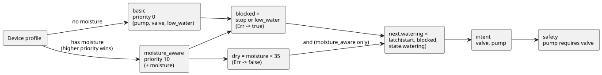

<!-- translation-source: docs/LANGUAGE-EXAMPLES.md -->
[Korean original](LANGUAGE-EXAMPLES.md)

# GhostFlow syntax alternatives: three versions of the same watering program

2026-09-05 · For design comparison only. The code below proposes **new** syntax and cannot run with the current `ghostc`.

This document records the initial comparison of three syntax alternatives, A, B and C. It is kept as design history.

- The syntax and literate format chosen in later discussion are described in [control syntax](LANGUAGE-SURFACE.en.md) and [LITERATE.en.md](LITERATE.en.md).
- The runnable MVP example is [irrigation.ghost.md](../examples/irrigation.ghost.md).
- Shared semantics follow the [language specification](LANGUAGE.en.md). The reasoning behind style preferences is in the [design notes](DESIGN-NOTES.md).

## Behavior being compared

All three programs express the same behavior, with the same inputs, state, strategies and outputs:

1. A start input begins watering. The program *latches* (holds itself on) using its previous state, so watering continues after the start input goes low.
2. Stop has priority: if stop or low-water is true, watering stops. A low-water sensor error also blocks watering.
3. A configuration without a moisture sensor selects the `basic` strategy.
4. A configuration with a moisture sensor selects `moisture_aware`. Watering starts and continues only while moisture is below 35. It stops at 35 or above, or on a sensor error.
5. The same watering intent goes to both the valve and the pump, and `pump requires valve` is applied.

Input details:

- `start` and `stop` are bool samples taken every tick. They are not edge events.
- `low_water` is a mandatory sensor shared by both strategies.
- The `moisture` input is declared only inside the enhanced strategy. A configuration without a moisture sensor therefore never needs a made-up moisture value.

About the threshold:

- 35 is a threshold on a moisture index that the driver has already normalized. Physical-unit types are a separate extension.
- In the existing MVP example, the start signal bypasses the moisture threshold. These comparison examples deliberately apply the threshold at start too.

The diagram below shows the shared behavior: the device profile selects a strategy, and both strategies feed the same latch, intent and safety rule.



## Alternative A — YAML-centered declarative syntax

Declarations are laid out as YAML, with a short expression in each field. Device queries are block strings.

```yaml
module: irrigation
version: 1

input:
  start: bool
  stop: bool
  low_water: Result<bool, SensorFault>

state:
  watering: {type: bool, initial: false}

functions:
  latch: (start, stop, held) -> not stop and (start or held)
  is_dry: map(below(35)) >> recover(false)

strategies:
  basic:
    priority: 0
    device: |
      match (pump:actuator<bool>), (valve:actuator<bool>),
            (low_water:sensor<bool>)
    let:
      blocked: input.stop or (input.low_water |> recover(true))
    next:
      watering: latch(input.start, blocked, state.watering)
    intent:
      valve: next.watering
      pump: next.watering

  moisture_aware:
    priority: 10
    device: |
      match (pump:actuator<bool>), (valve:actuator<bool>),
            (low_water:sensor<bool>), (moisture:sensor<number>)
    input:
      moisture: Result<number, SensorFault>
    let:
      blocked: input.stop or (input.low_water |> recover(true))
      dry: input.moisture |> is_dry
    next:
      watering: dry and latch(input.start, blocked, state.watering)
    intent:
      valve: next.watering
      pump: next.watering

safety:
  requires:
    - [pump, valve]
```

How it is processed:

- After the YAML is read, the values of `functions`, `let`, `next` and `intent` are parsed as GhostFlow expressions.
- No arbitrary code is executed.
- `state.initial` is a literal that matches its type.

Strengths and weaknesses:

- **Good for:** editing device lists and settings, and round-tripping with a form UI.
- **Weak for:** longer logic, which starts to look like a nested configuration document. Errors can come from two stages — YAML parsing and expression parsing — and both locations must be shown together.

Having the same data shape does not by itself make code and data mean the same thing. The shared type graph is what connects them.

## Alternative B — Literate CoffeeScript-centered flow syntax

Explanation comes first, then code. An editor can attach current values and timelines below each code block. In this proposal, the whole outer Markdown below is a single document-form source. (The prose inside the example is in Korean, as in the original proposal.)

````markdown
# 관수

시작하면 자기유지한다. 정지·저수위·저수위 센서 오류는 시작보다 우선한다.

```ghost
module irrigation
version 1

input
  start: bool
  stop: bool
  low_water: Result<bool, SensorFault>

state
  watering: bool = false

latch = (start, stop, held) -> not stop and (start or held)
is_dry = map(below(35)) >> recover(false)
```

수분 센서가 없으면 시작·정지와 저수위 보호로 운전한다.

```ghost
strategy basic priority 0
  device
    match (pump:actuator<bool>), (valve:actuator<bool>),
          (low_water:sensor<bool>)

  let
    blocked = input.stop or (input.low_water |> recover(true))

  next
    watering = latch(input.start, blocked, state.watering)

  intent
    valve = next.watering
    pump = next.watering
```

수분 센서가 있으면 같은 의도를 수분 조건으로 강화한다.

```ghost
strategy moisture_aware priority 10
  device
    match (pump:actuator<bool>), (valve:actuator<bool>),
          (low_water:sensor<bool>), (moisture:sensor<number>)

  input
    moisture: Result<number, SensorFault>

  let
    blocked = input.stop or (input.low_water |> recover(true))
    dry = input.moisture |> is_dry

  next
    watering = dry and latch(input.start, blocked, state.watering)

  intent
    valve = next.watering
    pump = next.watering
```

출력 의도에는 다음 공통 제약을 적용한다.

```ghost
safety
  pump requires valve
```
````

Ordinary (non-literate) source uses the same code without the explanations and fences.

Strengths:

- Function composition and intermediate signals are directly visible.
- It is easy to connect code, explanation and execution results.
- It absorbs YAML-style `name: type` declarations and Cypher-style `match`.

Design notes:

- The syntax borrows the feel of CoffeeScript but follows GhostFlow's type and tick rules.
- Call parentheses are kept and indentation rules are fixed, so expression boundaries are clear.
- Document-form source needs a source map that links back to the original Markdown.

## Alternative C — Cypher-centered query syntax

Each strategy reads as a sequence of clauses: `match → where → with → next → emit`. Device conditions, intermediate computations, state transitions and outputs appear in that order.

```ghost
module irrigation version 1

input start: bool, stop: bool, low_water: Result<bool, SensorFault>
state watering: bool = false

let latch = (start, stop, held) -> not stop and (start or held)
let is_dry = map(below(35)) >> recover(false)

strategy basic priority 0
match (pump:actuator<bool>), (valve:actuator<bool>),
      (low_water:sensor<bool>)
with input.stop or (input.low_water |> recover(true)) as blocked
next watering = latch(input.start, blocked, state.watering)
emit valve = next.watering, pump = next.watering
end

strategy moisture_aware priority 10
match (pump:actuator<bool>), (valve:actuator<bool>),
      (low_water:sensor<bool>), (moisture:sensor)
where moisture.type is number
input moisture: Result<number, SensorFault>
with input.stop or (input.low_water |> recover(true)) as blocked,
     input.moisture |> is_dry as dry
next watering = dry and latch(input.start, blocked, state.watering)
emit valve = next.watering, pump = next.watering
end

safety
  requires pump, valve
end
```

What the clauses mean:

| Clause | Meaning |
|---|---|
| `where moisture.type is number` | Spells out the type condition of `(moisture:sensor<number>)`. It checks the device profile, **not** the sensor's current value. |
| `with` | A pure computation for one tick. |
| `next` | Defines the next state. |
| `emit` | Same as `intent` in the other alternatives. |
| `end` | Closes strategy and safety blocks. |

This code does not run as Cypher or Lua. It is also not a database query that updates multiple rows. In this draft, `match` only checks that the named capabilities are present.

Strengths and weaknesses:

- **Good for:** reading around device queries and graphs.
- **Weak for:** long transition expressions, which need more clauses. Readers must also understand that device selection and per-tick computation run at different times.

## Where does Meta Lua syntax extension fit?

All three alternatives lower their AST into a shared type graph. So syntax extension does not have to belong to any single alternative.

Below is a separate extension sketch, written in alternative B notation. The complete examples above use the ordinary `latch` function and do not need this extension.

```ghost
syntax hold(start: Expr<bool>, stop: Expr<bool>, held: Expr<bool>)
  quote
    not $(stop) and ($(start) or $(held))

# strategy 안의 next 블록에서 사용
next
  watering = @hold(input.start, blocked, state.watering)
```

How it works:

- `quote` builds syntax. `$(...)` inserts syntax passed in as an argument.
- `@hold(...)` expands at compile time.
- This notation is a GhostFlow proposal. It does not copy Metalua's original syntax.
- For simple reuse, the plain function shown earlier is enough. Macros are for generating new domain notation or structure.

Safety rules for expansion:

- Expansion finishes inside the host compiler. The expanded code must pass type, cycle and resource validation again.
- Generated names do not capture the caller's names (the expansion is hygienic).
- The compiler shows the original and the expanded code together.
- No parser is loaded into the runtime, and no dynamic `eval` is executed.

## Behavior comparison criteria

The expected values below are specification scenarios that apply to all of A, B and C. They have **not** yet been verified by running a parser for each syntax.

How to read the table:

- `L` is the low-water input and `M` is the moisture input.
- Each row is independent and explicitly injects the previous state.
- `—` means the field is not in the basic strategy's input schema.

| Strategy | Previous state | start | stop | L | M | next.watering | valve / pump intent |
|---|---|---|---|---|---|---|---|
| basic | false | true | false | Ok(false) | — | true | true / true |
| basic | true | false | false | Ok(false) | — | true | true / true |
| basic | true | true | true | Ok(false) | — | false | false / false |
| basic | true | false | false | Ok(true) | — | false | false / false |
| basic | true | false | false | Err(Disconnected) | — | false | false / false |
| moisture_aware | false | true | false | Ok(false) | Ok(20) | true | true / true |
| moisture_aware | true | false | false | Ok(false) | Ok(20) | true | true / true |
| moisture_aware | true | true | false | Ok(false) | Ok(35) | false | false / false |
| moisture_aware | true | false | false | Ok(false) | Err(Stale) | false | false / false |
| moisture_aware | false | false | false | Ok(false) | Ok(20) | false | false / false |

**Errors and restart.**

- An `Err` input stays recorded as a fault in the journal, even after a recovery value is used.
- Suppose a sensor error released watering. If start is false, the latched state does **not** come back automatically when the sensor recovers.
- If start stays true, watering can restart once conditions recover.
- To require a fresh button press before restarting, you need a separate edge/rearming policy.

**Strategy selection.**

- The basic device profile provides pump, valve and low_water.
- When moisture is added, both strategies match, and the strategy with priority 10 is selected.
- A missing mandatory low_water is an activation error.
- If moisture fails while the enhanced strategy runs, its `Err` input stops watering. Switching to the basic strategy follows a separate profile-change procedure.

**Constraints.**

- In the watering example the two outputs are always equal, so `requires` never intervenes.
- To verify the constraint independently: a request of `pump=true, valve=false` must make pump false.
- Interlocks are compared with a separate `mutex forward, reverse` constraint. When both requests are true, both final outputs must be false.
- A valve-open command does not prove the valve actually opened. Devices that need real feedback require separate inputs and constraints.

## Selection proposal

| Comparison | A: YAML declarative | B: Literate flow | C: Cypher query |
|---|---|---|---|
| What appears first | Configuration and fields | Explanation and computation flow | Device conditions and execution clauses |
| Function composition | Inside expression strings | At the center of code | Inside with expressions |
| Visual editing connection | Suited to forms/configuration editing | Suited to notebooks/timelines | Suited to device graphs |
| Reading burden | Deep nesting | Indentation and document boundaries | Clause roles and execution timing |
| Recommended use | Declarations and interchange format | Default authoring syntax | Device-selection expressions |

Outcome:

- The initial recommendation was to make B the default, adopting A's declaration style and C's device queries.
- Meta Lua-style code extension belongs in the shared compilation layer.
- There was no decision to build all three parsers as products.
- Later, a control syntax centered on expressions and output connections was chosen as the basic direction. This comparison is kept as design history.
