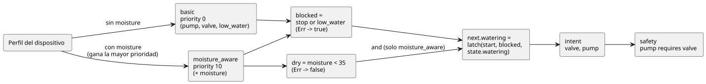

<!-- translation-source: docs/LANGUAGE-EXAMPLES.en.md -->
[Original en inglés](LANGUAGE-EXAMPLES.en.md)

# Alternativas de sintaxis de GhostFlow: tres versiones del mismo programa de riego

2026-09-05 · Solo para comparación de diseño. El código siguiente propone una sintaxis **nueva** y no puede ejecutarse con el `ghostc` actual.

Este documento registra la comparación inicial de tres alternativas de sintaxis: A, B y C. Se conserva como historial de diseño.

- La sintaxis y el formato literario elegidos en debates posteriores se describen en [sintaxis de control](LANGUAGE-SURFACE.es.md) y en [LITERATE.es.md](LITERATE.es.md).
- El ejemplo ejecutable del MVP es [irrigation.ghost.md](../examples/irrigation.ghost.md).
- La semántica común sigue la [especificación del lenguaje](LANGUAGE.es.md). El razonamiento detrás de las preferencias de estilo está en las [notas de diseño](DESIGN-NOTES.es.md).

## Comportamiento que se compara

Los tres programas expresan el mismo comportamiento, con las mismas entradas, el mismo estado, las mismas estrategias y las mismas salidas:

1. Una entrada de arranque inicia el riego. El programa hace *latch* (se mantiene activado a sí mismo) usando su estado anterior, de modo que el riego continúa después de que la entrada de arranque pase a nivel bajo.
2. La parada tiene prioridad: si stop o el nivel de agua bajo son verdaderos, el riego se detiene. Un error del sensor de nivel de agua bajo también bloquea el riego.
3. Una configuración sin sensor de humedad selecciona la estrategia `basic`.
4. Una configuración con sensor de humedad selecciona `moisture_aware`. El riego empieza y continúa solo mientras la humedad esté por debajo de 35. Se detiene en 35 o más, o ante un error del sensor.
5. La misma intención de riego va tanto a la válvula como a la bomba, y se aplica `pump requires valve`.

Detalles de las entradas:

- `start` y `stop` son muestras bool tomadas en cada tick (paso de decisión lógica). No son eventos de flanco.
- `low_water` es un sensor obligatorio compartido por ambas estrategias.
- La entrada `moisture` se declara solo dentro de la estrategia mejorada. Por lo tanto, una configuración sin sensor de humedad nunca necesita un valor de humedad inventado.

Sobre el umbral:

- 35 es un umbral sobre un índice de humedad que el driver ya ha normalizado. Los tipos con unidades físicas son una extensión aparte.
- En el ejemplo existente del MVP, la señal de arranque omite el umbral de humedad. Estos ejemplos de comparación aplican deliberadamente el umbral también al arrancar.

El diagrama siguiente muestra el comportamiento común: el perfil del dispositivo selecciona una estrategia, y ambas estrategias alimentan el mismo latch, la misma intención y la misma regla de seguridad.



## Alternativa A: sintaxis declarativa centrada en YAML

Las declaraciones se disponen como YAML, con una expresión corta en cada campo. Las consultas de dispositivos son cadenas de bloque.

```yaml
module: irrigation
version: 1

input:
  start: bool
  stop: bool
  low_water: Result<bool, SensorFault>

state:
  watering: {type: bool, initial: false}

functions:
  latch: (start, stop, held) -> not stop and (start or held)
  is_dry: map(below(35)) >> recover(false)

strategies:
  basic:
    priority: 0
    device: |
      match (pump:actuator<bool>), (valve:actuator<bool>),
            (low_water:sensor<bool>)
    let:
      blocked: input.stop or (input.low_water |> recover(true))
    next:
      watering: latch(input.start, blocked, state.watering)
    intent:
      valve: next.watering
      pump: next.watering

  moisture_aware:
    priority: 10
    device: |
      match (pump:actuator<bool>), (valve:actuator<bool>),
            (low_water:sensor<bool>), (moisture:sensor<number>)
    input:
      moisture: Result<number, SensorFault>
    let:
      blocked: input.stop or (input.low_water |> recover(true))
      dry: input.moisture |> is_dry
    next:
      watering: dry and latch(input.start, blocked, state.watering)
    intent:
      valve: next.watering
      pump: next.watering

safety:
  requires:
    - [pump, valve]
```

Cómo se procesa:

- Después de leer el YAML, los valores de `functions`, `let`, `next` e `intent` se analizan como expresiones de GhostFlow.
- No se ejecuta código arbitrario.
- `state.initial` es un literal que coincide con su tipo.

Puntos fuertes y débiles:

- **Adecuada para:** editar listas de dispositivos y ajustes, y hacer viajes de ida y vuelta con una interfaz de formularios.
- **Débil para:** la lógica más larga, que empieza a parecer un documento de configuración anidado. Los errores pueden venir de dos etapas —el análisis del YAML y el análisis de las expresiones—, y ambas ubicaciones deben mostrarse juntas.

Tener la misma forma de datos no hace, por sí solo, que el código y los datos signifiquen lo mismo. Lo que los conecta es el grafo de tipos compartido.

## Alternativa B: sintaxis de flujo centrada en Literate CoffeeScript

Primero va la explicación y luego el código. Un editor puede adjuntar valores actuales y líneas de tiempo debajo de cada bloque de código. En esta propuesta, todo el Markdown exterior siguiente es una única fuente en forma de documento. (La prosa dentro del ejemplo está en coreano, como en la propuesta original).

````markdown
# 관수

시작하면 자기유지한다. 정지·저수위·저수위 센서 오류는 시작보다 우선한다.

```ghost
module irrigation
version 1

input
  start: bool
  stop: bool
  low_water: Result<bool, SensorFault>

state
  watering: bool = false

latch = (start, stop, held) -> not stop and (start or held)
is_dry = map(below(35)) >> recover(false)
```

수분 센서가 없으면 시작·정지와 저수위 보호로 운전한다.

```ghost
strategy basic priority 0
  device
    match (pump:actuator<bool>), (valve:actuator<bool>),
          (low_water:sensor<bool>)

  let
    blocked = input.stop or (input.low_water |> recover(true))

  next
    watering = latch(input.start, blocked, state.watering)

  intent
    valve = next.watering
    pump = next.watering
```

수분 센서가 있으면 같은 의도를 수분 조건으로 강화한다.

```ghost
strategy moisture_aware priority 10
  device
    match (pump:actuator<bool>), (valve:actuator<bool>),
          (low_water:sensor<bool>), (moisture:sensor<number>)

  input
    moisture: Result<number, SensorFault>

  let
    blocked = input.stop or (input.low_water |> recover(true))
    dry = input.moisture |> is_dry

  next
    watering = dry and latch(input.start, blocked, state.watering)

  intent
    valve = next.watering
    pump = next.watering
```

출력 의도에는 다음 공통 제약을 적용한다.

```ghost
safety
  pump requires valve
```
````

La fuente ordinaria (no literaria) usa el mismo código sin las explicaciones ni los bloques delimitados.

Puntos fuertes:

- La composición de funciones y las señales intermedias son directamente visibles.
- Es fácil conectar el código, la explicación y los resultados de la ejecución.
- Absorbe las declaraciones `name: type` al estilo YAML y el `match` al estilo Cypher.

Notas de diseño:

- La sintaxis toma prestada la sensación de CoffeeScript, pero sigue las reglas de tipos y de tick de GhostFlow.
- Se conservan los paréntesis de llamada y las reglas de sangría son fijas, de modo que los límites de las expresiones son claros.
- La fuente en forma de documento necesita un mapa de fuente que enlace con el Markdown original.

## Alternativa C: sintaxis de consulta centrada en Cypher

Cada estrategia se lee como una secuencia de cláusulas: `match → where → with → next → emit`. Las condiciones de los dispositivos, los cálculos intermedios, las transiciones de estado y las salidas aparecen en ese orden.

```ghost
module irrigation version 1

input start: bool, stop: bool, low_water: Result<bool, SensorFault>
state watering: bool = false

let latch = (start, stop, held) -> not stop and (start or held)
let is_dry = map(below(35)) >> recover(false)

strategy basic priority 0
match (pump:actuator<bool>), (valve:actuator<bool>),
      (low_water:sensor<bool>)
with input.stop or (input.low_water |> recover(true)) as blocked
next watering = latch(input.start, blocked, state.watering)
emit valve = next.watering, pump = next.watering
end

strategy moisture_aware priority 10
match (pump:actuator<bool>), (valve:actuator<bool>),
      (low_water:sensor<bool>), (moisture:sensor)
where moisture.type is number
input moisture: Result<number, SensorFault>
with input.stop or (input.low_water |> recover(true)) as blocked,
     input.moisture |> is_dry as dry
next watering = dry and latch(input.start, blocked, state.watering)
emit valve = next.watering, pump = next.watering
end

safety
  requires pump, valve
end
```

Qué significan las cláusulas:

| Cláusula | Significado |
|---|---|
| `where moisture.type is number` | Explicita la condición de tipo de `(moisture:sensor<number>)`. Comprueba el perfil del dispositivo, **no** el valor actual del sensor. |
| `with` | Un cálculo puro para un tick. |
| `next` | Define el estado siguiente. |
| `emit` | Igual que `intent` en las demás alternativas. |
| `end` | Cierra los bloques de estrategia y de seguridad. |

Este código no se ejecuta como Cypher ni como Lua. Tampoco es una consulta de base de datos que actualice varias filas. En este borrador, `match` solo comprueba que las capacidades indicadas estén presentes.

Puntos fuertes y débiles:

- **Adecuada para:** leer en torno a consultas de dispositivos y grafos.
- **Débil para:** expresiones de transición largas, que necesitan más cláusulas. Además, quien lee debe entender que la selección de dispositivos y el cálculo por tick se ejecutan en momentos distintos.

## ¿Dónde encaja la extensión sintáctica al estilo Meta Lua?

Las tres alternativas reducen su AST a un grafo de tipos compartido. Por eso, la extensión sintáctica no tiene por qué pertenecer a ninguna alternativa concreta.

A continuación se muestra un esbozo de extensión aparte, escrito en la notación de la alternativa B. Los ejemplos completos anteriores usan la función ordinaria `latch` y no necesitan esta extensión.

```ghost
syntax hold(start: Expr<bool>, stop: Expr<bool>, held: Expr<bool>)
  quote
    not $(stop) and ($(start) or $(held))

# strategy 안의 next 블록에서 사용
next
  watering = @hold(input.start, blocked, state.watering)
```

Cómo funciona:

- `quote` construye sintaxis. `$(...)` inserta la sintaxis pasada como argumento.
- `@hold(...)` se expande en tiempo de compilación.
- Esta notación es una propuesta de GhostFlow. No copia la sintaxis original de Metalua.
- Para una reutilización sencilla, basta con la función simple mostrada antes. Las macros sirven para generar nueva notación o estructura del dominio.

Reglas de seguridad de la expansión:

- La expansión termina dentro del compilador del host. El código expandido debe superar de nuevo la validación de tipos, ciclos y recursos.
- Los nombres generados no capturan los nombres de quien llama (la expansión es higiénica).
- El compilador muestra juntos el código original y el expandido.
- No se carga ningún analizador en el runtime y no se ejecuta ningún `eval` dinámico.

## Criterios de comparación del comportamiento

Los valores esperados siguientes son escenarios de especificación que se aplican a A, B y C. **Todavía no** se han verificado ejecutando un analizador para cada sintaxis.

Cómo leer la tabla:

- `L` es la entrada de nivel de agua bajo y `M` es la entrada de humedad.
- Cada fila es independiente e inyecta explícitamente el estado anterior.
- `—` significa que el campo no está en el esquema de entradas de la estrategia básica.

| Estrategia | Estado anterior | start | stop | L | M | next.watering | Intención de valve / pump |
|---|---|---|---|---|---|---|---|
| basic | false | true | false | Ok(false) | — | true | true / true |
| basic | true | false | false | Ok(false) | — | true | true / true |
| basic | true | true | true | Ok(false) | — | false | false / false |
| basic | true | false | false | Ok(true) | — | false | false / false |
| basic | true | false | false | Err(Disconnected) | — | false | false / false |
| moisture_aware | false | true | false | Ok(false) | Ok(20) | true | true / true |
| moisture_aware | true | false | false | Ok(false) | Ok(20) | true | true / true |
| moisture_aware | true | true | false | Ok(false) | Ok(35) | false | false / false |
| moisture_aware | true | false | false | Ok(false) | Err(Stale) | false | false / false |
| moisture_aware | false | false | false | Ok(false) | Ok(20) | false | false / false |

**Errores y rearranque.**

- Una entrada `Err` queda registrada como fallo en el registro (journal), incluso después de usar un valor de recuperación.
- Supongamos que un error del sensor liberó el riego. Si start es false, el estado retenido por el latch **no** vuelve automáticamente cuando el sensor se recupera.
- Si start sigue siendo true, el riego puede volver a arrancar una vez que las condiciones se recuperen.
- Para exigir una nueva pulsación del botón antes de rearrancar, se necesita una política aparte de flanco/rearme.

**Selección de estrategia.**

- El perfil básico del dispositivo proporciona pump, valve y low_water.
- Cuando se añade moisture, ambas estrategias coinciden y se selecciona la estrategia con prioridad 10.
- La ausencia del low_water obligatorio es un error de activación.
- Si moisture falla mientras se ejecuta la estrategia mejorada, su entrada `Err` detiene el riego. El cambio a la estrategia básica sigue un procedimiento aparte de cambio de perfil.

**Restricciones.**

- En el ejemplo de riego las dos salidas son siempre iguales, por lo que `requires` nunca interviene.
- Para verificar la restricción de forma independiente: una solicitud `pump=true, valve=false` debe hacer que pump sea false.
- Los enclavamientos se comparan con una restricción aparte `mutex forward, reverse`. Cuando ambas solicitudes son true, ambas salidas finales deben ser false.
- Un comando de apertura de válvula no demuestra que la válvula se haya abierto realmente. Los dispositivos que necesitan retroalimentación real requieren entradas y restricciones aparte.

## Propuesta de selección

| Comparación | A: declarativa YAML | B: flujo literario | C: consulta Cypher |
|---|---|---|---|
| Qué aparece primero | Configuración y campos | Explicación y flujo de cálculo | Condiciones de dispositivos y cláusulas de ejecución |
| Composición de funciones | Dentro de cadenas de expresión | En el centro del código | Dentro de expresiones with |
| Conexión con la edición visual | Adecuada para la edición de formularios/configuración | Adecuada para cuadernos/líneas de tiempo | Adecuada para grafos de dispositivos |
| Carga de lectura | Anidamiento profundo | Sangría y límites del documento | Funciones de las cláusulas y momento de ejecución |
| Uso recomendado | Declaraciones y formato de intercambio | Sintaxis de autoría predeterminada | Expresiones de selección de dispositivos |

Resultado:

- La recomendación inicial fue hacer de B la opción predeterminada, adoptando el estilo de declaraciones de A y las consultas de dispositivos de C.
- La extensión de código al estilo Meta Lua pertenece a la capa de compilación compartida.
- No se decidió construir los tres analizadores como productos.
- Más adelante, se eligió como dirección básica una sintaxis de control centrada en expresiones y conexiones de salida. Esta comparación se conserva como historial de diseño.
