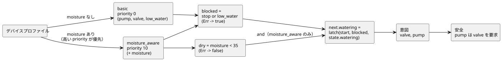

<!-- translation-source: docs/LANGUAGE-EXAMPLES.en.md -->
[英語の原文](LANGUAGE-EXAMPLES.en.md)

# GhostFlow 構文の代替案：同じ灌水プログラムの 3 つの版

2026-09-05 · 設計比較専用。以下のコードは**新しい**構文を提案するもので、現在の `ghostc` では実行できません。

この文書は、A、B、C の 3 つの構文代替案を最初に比較した記録です。設計の履歴として残しています。

- その後の議論で選ばれた構文と文芸的（literate）フォーマットは、[制御構文](LANGUAGE-SURFACE.ja.md)と [LITERATE.ja.md](LITERATE.ja.md) で説明しています。
- 実行可能な MVP の例は [irrigation.ghost.md](../examples/irrigation.ghost.ja.md) です。
- 共通の意味論は[言語仕様](LANGUAGE.ja.md)に従います。スタイルの好みの背後にある考え方は[設計ノート](DESIGN-NOTES.ja.md)にあります。

## 比較する振る舞い

3 つのプログラムはいずれも、同じ入力、状態、戦略、出力によって同じ振る舞いを表現します。

1. start 入力で灌水が始まります。プログラムは前状態を使って*自己保持*（ラッチ）するので、start 入力が low になった後も灌水は続きます。
2. 停止が優先されます。stop または低水位が true なら、灌水は止まります。低水位センサのエラーも灌水をブロックします。
3. 水分センサのない構成では、`basic` 戦略が選択されます。
4. 水分センサのある構成では、`moisture_aware` が選択されます。灌水は、水分が 35 未満の間だけ始まり、続きます。35 以上になるか、センサエラーが起きると止まります。
5. 同じ灌水の意図がバルブとポンプの両方に送られ、`pump requires valve` が適用されます。

入力の詳細：

- `start` と `stop` は、tick（論理判断の単位）ごとに取得される bool のサンプルです。エッジイベントではありません。
- `low_water` は、両方の戦略が共有する必須のセンサです。
- `moisture` 入力は、強化版の戦略の中でだけ宣言されます。そのため、水分センサのない構成で、架空の水分値が必要になることは決してありません。

しきい値について：

- 35 は、ドライバがすでに正規化した水分指数に対するしきい値です。物理単位の型は別の拡張です。
- 既存の MVP の例では、start 信号は水分のしきい値を迂回します。これらの比較例では、意図的に start 時にもしきい値を適用しています。

次の図は共通の振る舞いを示しています。デバイスプロファイルが戦略を選択し、どちらの戦略も同じラッチ、意図、安全規則に流れ込みます。



## 代替案 A — YAML 中心の宣言的構文

宣言を YAML として並べ、各フィールドに短い式を書きます。デバイス照会はブロック文字列です。

```yaml
module: irrigation
version: 1

input:
  start: bool
  stop: bool
  low_water: Result<bool, SensorFault>

state:
  watering: {type: bool, initial: false}

functions:
  latch: (start, stop, held) -> not stop and (start or held)
  is_dry: map(below(35)) >> recover(false)

strategies:
  basic:
    priority: 0
    device: |
      match (pump:actuator<bool>), (valve:actuator<bool>),
            (low_water:sensor<bool>)
    let:
      blocked: input.stop or (input.low_water |> recover(true))
    next:
      watering: latch(input.start, blocked, state.watering)
    intent:
      valve: next.watering
      pump: next.watering

  moisture_aware:
    priority: 10
    device: |
      match (pump:actuator<bool>), (valve:actuator<bool>),
            (low_water:sensor<bool>), (moisture:sensor<number>)
    input:
      moisture: Result<number, SensorFault>
    let:
      blocked: input.stop or (input.low_water |> recover(true))
      dry: input.moisture |> is_dry
    next:
      watering: dry and latch(input.start, blocked, state.watering)
    intent:
      valve: next.watering
      pump: next.watering

safety:
  requires:
    - [pump, valve]
```

処理の仕方：

- YAML を読み込んだ後、`functions`、`let`、`next`、`intent` の値が GhostFlow の式として構文解析されます。
- 任意のコードは実行されません。
- `state.initial` は、その型に合ったリテラルです。

長所と短所：

- **向いている用途：** デバイス一覧や設定の編集、フォーム UI との往復変換。
- **苦手な用途：** 長めのロジックは、入れ子になった設定文書のように見え始めます。エラーは YAML の構文解析と式の構文解析という 2 つの段階から生じうるので、両方の位置を一緒に示す必要があります。

データの形が同じだからといって、それだけでコードとデータが同じ意味になるわけではありません。両者を結び付けるのは共通の型グラフです。

## 代替案 B — Literate CoffeeScript 中心のフロー構文

説明が先にあり、その後にコードが続きます。エディタは、各コードブロックの下に現在値やタイムラインを添えることができます。この提案では、下の外側の Markdown 全体が 1 つの文書形式のソースです。（例の中の文章は、元の提案と同じく韓国語です。）

````markdown
# 관수

시작하면 자기유지한다. 정지·저수위·저수위 센서 오류는 시작보다 우선한다.

```ghost
module irrigation
version 1

input
  start: bool
  stop: bool
  low_water: Result<bool, SensorFault>

state
  watering: bool = false

latch = (start, stop, held) -> not stop and (start or held)
is_dry = map(below(35)) >> recover(false)
```

수분 센서가 없으면 시작·정지와 저수위 보호로 운전한다.

```ghost
strategy basic priority 0
  device
    match (pump:actuator<bool>), (valve:actuator<bool>),
          (low_water:sensor<bool>)

  let
    blocked = input.stop or (input.low_water |> recover(true))

  next
    watering = latch(input.start, blocked, state.watering)

  intent
    valve = next.watering
    pump = next.watering
```

수분 센서가 있으면 같은 의도를 수분 조건으로 강화한다.

```ghost
strategy moisture_aware priority 10
  device
    match (pump:actuator<bool>), (valve:actuator<bool>),
          (low_water:sensor<bool>), (moisture:sensor<number>)

  input
    moisture: Result<number, SensorFault>

  let
    blocked = input.stop or (input.low_water |> recover(true))
    dry = input.moisture |> is_dry

  next
    watering = dry and latch(input.start, blocked, state.watering)

  intent
    valve = next.watering
    pump = next.watering
```

출력 의도에는 다음 공통 제약을 적용한다.

```ghost
safety
  pump requires valve
```
````

通常の（文芸的でない）ソースでは、説明とフェンスを除いた同じコードを使います。

長所：

- 関数合成と中間信号がそのまま見えます。
- コード、説明、実行結果を結び付けやすくなります。
- YAML 風の `name: type` 宣言や Cypher 風の `match` を取り込めます。

設計上の注意：

- 構文は CoffeeScript の雰囲気を借りていますが、GhostFlow の型と tick の規則に従います。
- 呼び出しの括弧を残し、インデントの規則を固定しているので、式の境界は明確です。
- 文書形式のソースには、元の Markdown へ遡れるソースマップが必要です。

## 代替案 C — Cypher 中心のクエリ構文

各戦略は、`match → where → with → next → emit` という句の並びとして読みます。デバイスの条件、中間計算、状態遷移、出力がこの順に現れます。

```ghost
module irrigation version 1

input start: bool, stop: bool, low_water: Result<bool, SensorFault>
state watering: bool = false

let latch = (start, stop, held) -> not stop and (start or held)
let is_dry = map(below(35)) >> recover(false)

strategy basic priority 0
match (pump:actuator<bool>), (valve:actuator<bool>),
      (low_water:sensor<bool>)
with input.stop or (input.low_water |> recover(true)) as blocked
next watering = latch(input.start, blocked, state.watering)
emit valve = next.watering, pump = next.watering
end

strategy moisture_aware priority 10
match (pump:actuator<bool>), (valve:actuator<bool>),
      (low_water:sensor<bool>), (moisture:sensor)
where moisture.type is number
input moisture: Result<number, SensorFault>
with input.stop or (input.low_water |> recover(true)) as blocked,
     input.moisture |> is_dry as dry
next watering = dry and latch(input.start, blocked, state.watering)
emit valve = next.watering, pump = next.watering
end

safety
  requires pump, valve
end
```

各句の意味：

| 句 | 意味 |
|---|---|
| `where moisture.type is number` | `(moisture:sensor<number>)` の型条件を書き下したものです。センサの現在値では**なく**、デバイスプロファイルを検査します。 |
| `with` | 1 tick 分の純粋な計算です。 |
| `next` | 次状態を定義します。 |
| `emit` | 他の代替案の `intent` と同じです。 |
| `end` | 戦略ブロックと安全ブロックを閉じます。 |

このコードは Cypher や Lua としては実行されません。複数の行を更新するデータベースクエリでもありません。この草案では、`match` は指定されたケイパビリティが存在することを検査するだけです。

長所と短所：

- **向いている用途：** デバイス照会やグラフを中心とした読解。
- **苦手な用途：** 長い遷移式では、より多くの句が必要になります。また読み手は、デバイスの選択と tick ごとの計算が異なるタイミングで実行されることを理解しておかなければなりません。

## Meta Lua の構文拡張はどこに位置づけられるか？

3 つの代替案はいずれも、AST を共通の型グラフへと下ろします。そのため、構文拡張がどれか 1 つの代替案に属する必要はありません。

以下は、代替案 B の記法で書いた別個の拡張のスケッチです。上の完全な例は通常の `latch` 関数を使っているので、この拡張は必要ありません。

```ghost
syntax hold(start: Expr<bool>, stop: Expr<bool>, held: Expr<bool>)
  quote
    not $(stop) and ($(start) or $(held))

# strategy 안의 next 블록에서 사용
next
  watering = @hold(input.start, blocked, state.watering)
```

仕組み：

- `quote` は構文を組み立てます。`$(...)` は引数として渡された構文を挿入します。
- `@hold(...)` はコンパイル時に展開されます。
- この記法は GhostFlow の提案です。Metalua の元の構文をそのまま写したものではありません。
- 単純な再利用であれば、先に示した通常の関数で十分です。マクロは、新しいドメイン記法や構造を生成するためのものです。

展開に関する安全規則：

- 展開はホストのコンパイラ内で完結します。展開されたコードは、型、循環、リソースの検証を再び通過しなければなりません。
- 生成された名前が呼び出し側の名前を捕捉することはありません（展開は衛生的です）。
- コンパイラは元のコードと展開後のコードを一緒に示します。
- ランタイムにパーサーが読み込まれることはなく、動的な `eval` も実行されません。

## 振る舞いの比較基準

以下の期待値は、A、B、C のすべてに適用される仕様シナリオです。各構文のパーサーを実行して検証したものでは、まだ**ありません**。

表の読み方：

- `L` は低水位の入力、`M` は水分の入力です。
- 各行は独立しており、前状態を明示的に注入します。
- `—` は、そのフィールドが basic 戦略の入力スキーマにないことを意味します。

| 戦略 | 前状態 | start | stop | L | M | next.watering | valve / pump の意図 |
|---|---|---|---|---|---|---|---|
| basic | false | true | false | Ok(false) | — | true | true / true |
| basic | true | false | false | Ok(false) | — | true | true / true |
| basic | true | true | true | Ok(false) | — | false | false / false |
| basic | true | false | false | Ok(true) | — | false | false / false |
| basic | true | false | false | Err(Disconnected) | — | false | false / false |
| moisture_aware | false | true | false | Ok(false) | Ok(20) | true | true / true |
| moisture_aware | true | false | false | Ok(false) | Ok(20) | true | true / true |
| moisture_aware | true | true | false | Ok(false) | Ok(35) | false | false / false |
| moisture_aware | true | false | false | Ok(false) | Err(Stale) | false | false / false |
| moisture_aware | false | false | false | Ok(false) | Ok(20) | false | false / false |

**エラーと再始動。**

- `Err` 入力は、復旧値が使われた後も、ジャーナルに故障として記録されたままです。
- センサエラーによって灌水が解除されたとします。start が false なら、センサが復旧しても、自己保持された状態は自動的には戻り**ません**。
- start が true のままなら、条件が回復した時点で灌水が再開することがあります。
- 再開の前にボタンを新たに押すことを求めたい場合は、別途エッジ/再アーム（rearming）のポリシーが必要です。

**戦略選択。**

- basic のデバイスプロファイルは、pump、valve、low_water を提供します。
- moisture が加わると両方の戦略が一致し、priority 10 の戦略が選択されます。
- 必須の low_water が欠けている場合は、起動（activation）エラーです。
- 強化版の戦略の実行中に moisture が故障した場合、その `Err` 入力によって灌水が止まります。basic 戦略への切り替えは、別のプロファイル変更手順に従います。

**制約。**

- 灌水の例では 2 つの出力が常に等しいので、`requires` が介入することはありません。
- 制約を単独で検証するには：`pump=true, valve=false` という要求で、pump が false にならなければなりません。
- インターロックは、別の `mutex forward, reverse` 制約で比較します。両方の要求が true のとき、最終的な出力は両方とも false でなければなりません。
- バルブを開くコマンドは、バルブが実際に開いたことを証明しません。実際のフィードバックが必要なデバイスには、別の入力と制約が必要です。

## 選定の提案

| 比較項目 | A：YAML 宣言型 | B：文芸的フロー | C：Cypher クエリ |
|---|---|---|---|
| 最初に目に入るもの | 設定とフィールド | 説明と計算の流れ | デバイス条件と実行句 |
| 関数合成 | 式の文字列の中 | コードの中心 | with 式の中 |
| ビジュアル編集との接続 | フォーム/設定の編集に適する | ノートブック/タイムラインに適する | デバイスグラフに適する |
| 読む負担 | 深い入れ子 | インデントと文書の境界 | 句の役割と実行タイミング |
| 推奨される用途 | 宣言と交換フォーマット | 既定のオーサリング構文 | デバイス選択の式 |

結論：

- 当初の推奨は、B を既定とし、A の宣言スタイルと C のデバイス照会を取り入れることでした。
- Meta Lua 風のコード拡張は、共通のコンパイル層に属します。
- 3 つのパーサーすべてを製品として作るという決定はありませんでした。
- その後、式と出力接続を中心とした制御構文が基本方針として選ばれました。この比較は設計の履歴として残しています。
