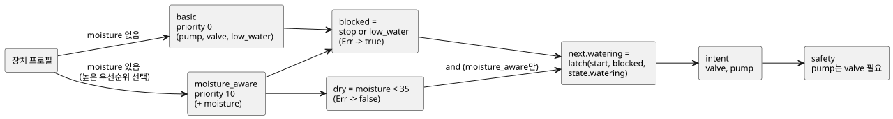

<!-- translation-source: docs/LANGUAGE-EXAMPLES.en.md -->
[영문 원문](LANGUAGE-EXAMPLES.en.md)

# GhostFlow 문법 대안: 같은 관수 프로그램 세 가지

2026-09-05 · 설계 비교용입니다. 아래 코드는 **새** 문법 제안이며 현재 `ghostc`로 실행할 수 없습니다.

이 문서는 세 가지 문법 대안 A, B, C를 처음 비교한 기록입니다. 설계 이력으로 남겨 둡니다.

- 후속 논의에서 선택한 문법과 literate 형식은 [control 문법](LANGUAGE-SURFACE.md)과 [LITERATE.md](LITERATE.md)에서 설명합니다.
- 실행 가능한 MVP 예제는 [irrigation.ghost.md](../examples/irrigation.ghost.md)입니다.
- 공통 의미는 [언어 사양](LANGUAGE.md)을 따릅니다. 스타일 선호의 근거는 [설계 노트](DESIGN-NOTES.ko.md)에 있습니다.

## 비교할 동작

세 프로그램은 같은 입력, 상태, 전략, 출력으로 같은 동작을 표현합니다.

1. 시작 입력으로 관수를 시작합니다. 프로그램은 이전 상태를 이용해 *자기유지*(스스로 켜진 상태를 유지)하므로, 시작 입력이 내려가도 관수가 계속됩니다.
2. 정지가 우선합니다. 정지 또는 저수위가 참이면 관수를 멈춥니다. 저수위 센서 오류도 관수를 차단합니다.
3. 수분 센서가 없는 구성은 `basic` 전략을 선택합니다.
4. 수분 센서가 있는 구성은 `moisture_aware`를 선택합니다. 수분이 35 미만일 때만 관수를 시작하고 유지합니다. 35 이상이 되거나 센서 오류가 나면 멈춥니다.
5. 밸브와 펌프에 같은 관수 의도를 보내고, `pump requires valve`를 적용합니다.

입력 세부 사항:

- `start`와 `stop`은 매 tick 취하는 bool 샘플입니다. 에지 이벤트가 아닙니다.
- `low_water`는 두 전략이 공유하는 필수 센서입니다.
- `moisture` 입력은 향상 전략 안에서만 선언합니다. 그래서 수분 센서가 없는 구성에는 가짜 수분값이 전혀 필요하지 않습니다.

임계값에 대해:

- 35는 드라이버가 이미 정규화한 수분 지표에 대한 임계값입니다. 물리 단위 타입은 별도 확장입니다.
- 기존 MVP 예제에서는 시작 신호가 수분 임계값을 우회합니다. 이 비교 예제들은 시작할 때에도 임계값을 적용하도록 의도적으로 바꿨습니다.

아래 그림은 공통 동작을 보여 줍니다. 장치 프로필이 전략을 선택하고, 두 전략 모두 같은 래치, 의도, 안전 규칙으로 이어집니다.



## A안 — YAML 중심 선언형

선언을 YAML로 펼쳐 놓고 각 필드에 짧은 표현식을 넣습니다. 장치 질의는 블록 문자열입니다.

```yaml
module: irrigation
version: 1

input:
  start: bool
  stop: bool
  low_water: Result<bool, SensorFault>

state:
  watering: {type: bool, initial: false}

functions:
  latch: (start, stop, held) -> not stop and (start or held)
  is_dry: map(below(35)) >> recover(false)

strategies:
  basic:
    priority: 0
    device: |
      match (pump:actuator<bool>), (valve:actuator<bool>),
            (low_water:sensor<bool>)
    let:
      blocked: input.stop or (input.low_water |> recover(true))
    next:
      watering: latch(input.start, blocked, state.watering)
    intent:
      valve: next.watering
      pump: next.watering

  moisture_aware:
    priority: 10
    device: |
      match (pump:actuator<bool>), (valve:actuator<bool>),
            (low_water:sensor<bool>), (moisture:sensor<number>)
    input:
      moisture: Result<number, SensorFault>
    let:
      blocked: input.stop or (input.low_water |> recover(true))
      dry: input.moisture |> is_dry
    next:
      watering: dry and latch(input.start, blocked, state.watering)
    intent:
      valve: next.watering
      pump: next.watering

safety:
  requires:
    - [pump, valve]
```

처리 방식:

- YAML을 읽은 뒤 `functions`, `let`, `next`, `intent` 값을 GhostFlow 표현식으로 파싱합니다.
- 임의 코드는 실행하지 않습니다.
- `state.initial`은 타입에 맞는 리터럴입니다.

강점과 약점:

- **적합한 곳:** 장치 목록과 설정 편집, 폼 UI와의 왕복.
- **약한 곳:** 로직이 길어지면 중첩된 설정 문서처럼 보입니다. 오류가 YAML 파싱과 표현식 파싱의 두 단계에서 나올 수 있으므로 두 위치를 함께 보여 줘야 합니다.

데이터 모양이 같다는 것만으로 코드와 데이터의 의미가 같아지지는 않습니다. 둘을 연결하는 것은 공통 타입 그래프입니다.

## B안 — Literate CoffeeScript 중심 흐름형

설명이 먼저 나오고 그다음에 코드가 나옵니다. 편집기는 각 코드 블록 아래에 현재 값과 타임라인을 붙일 수 있습니다. 이 제안에서는 아래 바깥쪽 Markdown 전체가 하나의 문서형 소스입니다. (예제 안의 설명문은 원래 제안 그대로 한국어입니다.)

````markdown
# 관수

시작하면 자기유지한다. 정지·저수위·저수위 센서 오류는 시작보다 우선한다.

```ghost
module irrigation
version 1

input
  start: bool
  stop: bool
  low_water: Result<bool, SensorFault>

state
  watering: bool = false

latch = (start, stop, held) -> not stop and (start or held)
is_dry = map(below(35)) >> recover(false)
```

수분 센서가 없으면 시작·정지와 저수위 보호로 운전한다.

```ghost
strategy basic priority 0
  device
    match (pump:actuator<bool>), (valve:actuator<bool>),
          (low_water:sensor<bool>)

  let
    blocked = input.stop or (input.low_water |> recover(true))

  next
    watering = latch(input.start, blocked, state.watering)

  intent
    valve = next.watering
    pump = next.watering
```

수분 센서가 있으면 같은 의도를 수분 조건으로 강화한다.

```ghost
strategy moisture_aware priority 10
  device
    match (pump:actuator<bool>), (valve:actuator<bool>),
          (low_water:sensor<bool>), (moisture:sensor<number>)

  input
    moisture: Result<number, SensorFault>

  let
    blocked = input.stop or (input.low_water |> recover(true))
    dry = input.moisture |> is_dry

  next
    watering = dry and latch(input.start, blocked, state.watering)

  intent
    valve = next.watering
    pump = next.watering
```

출력 의도에는 다음 공통 제약을 적용한다.

```ghost
safety
  pump requires valve
```
````

일반(문서형이 아닌) 소스에서는 설명과 fence를 빼고 같은 코드를 씁니다.

강점:

- 함수 조합과 중간 신호가 직접 보입니다.
- 코드, 설명, 실행 결과를 연결하기 쉽습니다.
- YAML식 `name: type` 선언과 Cypher식 `match`를 이 문법 안에 담을 수 있습니다.

설계 메모:

- 문법 감각은 CoffeeScript에서 가져오지만 GhostFlow의 타입과 tick 규칙을 따릅니다.
- 호출 괄호를 유지하고 들여쓰기 규칙을 고정하므로 식의 경계가 명확합니다.
- 문서형 소스를 다루려면 원본 Markdown까지 연결되는 소스맵이 필요합니다.

## C안 — Cypher 중심 질의형

각 전략을 `match → where → with → next → emit` 절의 연속으로 읽습니다. 장치 조건, 중간 계산, 상태 전이, 출력이 이 순서대로 나타납니다.

```ghost
module irrigation version 1

input start: bool, stop: bool, low_water: Result<bool, SensorFault>
state watering: bool = false

let latch = (start, stop, held) -> not stop and (start or held)
let is_dry = map(below(35)) >> recover(false)

strategy basic priority 0
match (pump:actuator<bool>), (valve:actuator<bool>),
      (low_water:sensor<bool>)
with input.stop or (input.low_water |> recover(true)) as blocked
next watering = latch(input.start, blocked, state.watering)
emit valve = next.watering, pump = next.watering
end

strategy moisture_aware priority 10
match (pump:actuator<bool>), (valve:actuator<bool>),
      (low_water:sensor<bool>), (moisture:sensor)
where moisture.type is number
input moisture: Result<number, SensorFault>
with input.stop or (input.low_water |> recover(true)) as blocked,
     input.moisture |> is_dry as dry
next watering = dry and latch(input.start, blocked, state.watering)
emit valve = next.watering, pump = next.watering
end

safety
  requires pump, valve
end
```

각 절의 의미:

| 절 | 의미 |
|---|---|
| `where moisture.type is number` | `(moisture:sensor<number>)`의 타입 조건을 풀어 쓴 것입니다. 장치 프로필을 검사하며, 센서의 현재 값은 검사하지 **않습니다**. |
| `with` | 한 tick 동안의 순수 계산입니다. |
| `next` | 다음 상태를 정의합니다. |
| `emit` | 다른 안의 `intent`와 같습니다. |
| `end` | 전략과 안전 블록을 닫습니다. |

이 코드는 Cypher나 Lua에서 그대로 실행되지 않습니다. 여러 행을 갱신하는 데이터베이스 쿼리도 아닙니다. 이 초안에서 `match`는 이름이 지정된 capability가 있는지만 검사합니다.

강점과 약점:

- **적합한 곳:** 장치 질의와 그래프를 중심으로 읽기.
- **약한 곳:** 긴 전이식은 절이 늘어납니다. 또한 장치 선택과 매 tick 계산이 서로 다른 시점에 실행된다는 점을 독자가 이해해야 합니다.

## Meta Lua의 구문 확장은 어디에 들어가나?

세 안 모두 AST를 공통 타입 그래프로 낮춥니다. 따라서 구문 확장이 특정 안에 속할 필요는 없습니다.

아래는 B안 표기로 쓴 별도의 확장 스케치입니다. 위의 완전한 예제들은 일반 함수 `latch`를 사용하며 이 확장을 필요로 하지 않습니다.

```ghost
syntax hold(start: Expr<bool>, stop: Expr<bool>, held: Expr<bool>)
  quote
    not $(stop) and ($(start) or $(held))

# strategy 안의 next 블록에서 사용
next
  watering = @hold(input.start, blocked, state.watering)
```

동작 방식:

- `quote`는 구문을 만듭니다. `$(...)`는 인자로 전달된 구문을 끼워 넣습니다.
- `@hold(...)`는 컴파일 시점에 확장됩니다.
- 이 표기는 GhostFlow 제안입니다. Metalua의 원래 문법을 복제하지 않습니다.
- 단순한 재사용에는 앞에서 본 일반 함수로 충분합니다. 매크로는 새 도메인 표기나 구조를 생성할 때 씁니다.

확장의 안전 규칙:

- 확장은 호스트 컴파일러 안에서 끝납니다. 확장된 코드는 타입, 순환, 자원 검증을 다시 통과해야 합니다.
- 생성된 이름은 호출자의 이름을 포획하지 않습니다(위생적 확장).
- 컴파일러는 원래 코드와 확장된 코드를 함께 보여 줍니다.
- 런타임에 파서를 올리지 않으며, 동적 `eval`을 실행하지 않습니다.

## 동작 비교 기준

아래 기대값은 A, B, C 모두에 적용되는 사양 시나리오입니다. 각 문법의 파서를 실행해 검증한 결과는 **아직** 아닙니다.

표 읽는 법:

- `L`은 저수위 입력, `M`은 수분 입력입니다.
- 각 행은 독립적이며 이전 상태를 명시적으로 주입합니다.
- `—`는 기본 전략의 입력 스키마에 해당 필드가 없다는 뜻입니다.

| 전략 | 이전 상태 | start | stop | L | M | next.watering | valve / pump 의도 |
|---|---|---|---|---|---|---|---|
| basic | false | true | false | Ok(false) | — | true | true / true |
| basic | true | false | false | Ok(false) | — | true | true / true |
| basic | true | true | true | Ok(false) | — | false | false / false |
| basic | true | false | false | Ok(true) | — | false | false / false |
| basic | true | false | false | Err(Disconnected) | — | false | false / false |
| moisture_aware | false | true | false | Ok(false) | Ok(20) | true | true / true |
| moisture_aware | true | false | false | Ok(false) | Ok(20) | true | true / true |
| moisture_aware | true | true | false | Ok(false) | Ok(35) | false | false / false |
| moisture_aware | true | false | false | Ok(false) | Err(Stale) | false | false / false |
| moisture_aware | false | false | false | Ok(false) | Ok(20) | false | false / false |

**오류와 재시작.**

- `Err`인 입력은 복구값을 사용한 뒤에도 journal에 fault로 기록되어 남습니다.
- 센서 오류로 관수가 해제되었다고 합시다. start가 false이면 센서가 복구되어도 자기유지 상태가 자동으로 돌아오지 **않습니다**.
- start가 계속 true이면 조건이 회복되었을 때 관수를 다시 시작할 수 있습니다.
- 버튼을 새로 눌러야만 다시 시작하도록 하려면 별도의 에지/재무장 정책이 필요합니다.

**전략 선택.**

- 기본 장치 프로필은 pump, valve, low_water를 제공합니다.
- 여기에 moisture가 추가되면 두 전략이 모두 일치하며, 우선순위 10인 전략이 선택됩니다.
- 필수인 low_water가 없으면 활성화 오류입니다.
- 향상 전략이 실행되는 중에 moisture가 고장 나면 그 `Err` 입력이 관수를 멈춥니다. 기본 전략으로의 전환은 별도의 프로필 변경 절차를 따릅니다.

**제약.**

- 관수 예제에서는 두 출력이 항상 같으므로 `requires`가 개입하지 않습니다.
- 제약을 독립적으로 검증하려면: `pump=true, valve=false` 요청에서 pump가 false가 되어야 합니다.
- 인터록은 별도의 `mutex forward, reverse` 제약으로 비교합니다. 두 요청이 모두 true이면 두 최종 출력이 모두 false여야 합니다.
- 밸브 개방 명령은 밸브가 실제로 열렸음을 입증하지 않습니다. 실제 피드백이 필요한 장치에는 별도의 입력과 제약이 필요합니다.

## 선택에 대한 제안

| 비교 항목 | A: YAML 선언형 | B: Literate 흐름형 | C: Cypher 질의형 |
|---|---|---|---|
| 먼저 보이는 것 | 구성과 필드 | 설명과 계산 흐름 | 장치 조건과 실행 절 |
| 함수 조합 | 표현식 문자열 안 | 코드의 중심 | with 표현식 안 |
| 시각 편집과의 연결 | 폼/설정 편집에 적합 | 노트북/타임라인에 적합 | 장치 그래프에 적합 |
| 읽기 부담 | 깊은 중첩 | 들여쓰기와 문서 경계 | 절의 역할과 실행 시점 |
| 권장 용도 | 선언과 교환 형식 | 기본 작성 문법 | 장치 선택 표현 |

결과:

- 초기 추천은 B를 기본으로 두고, A의 선언 방식과 C의 장치 질의를 받아들이는 것이었습니다.
- Meta Lua 방식의 코드 확장은 공통 컴파일 계층에 둡니다.
- 세 파서를 모두 제품으로 만들기로 결정한 것은 아닙니다.
- 이후 식과 출력 연결을 중심으로 한 control 문법이 기본 방향으로 선택되었습니다. 이 비교는 설계 이력으로 남겨 둡니다.
