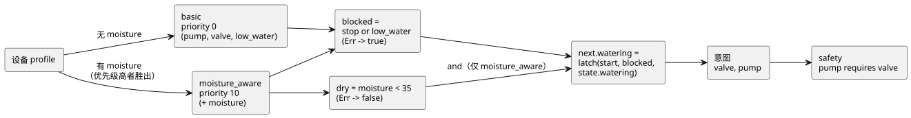

<!-- translation-source: docs/LANGUAGE-EXAMPLES.en.md -->
[英文原文](LANGUAGE-EXAMPLES.en.md)

# GhostFlow 语法备选方案：同一灌溉程序的三个版本

2026-09-05 · 仅用于设计比较。下面的代码提议的是**新**语法，无法用当前的 `ghostc` 运行。

本文记录了对 A、B、C 三种语法备选方案的最初比较，作为设计历史保留。

- 后续讨论中选定的语法和 literate 格式，见[控制语法](LANGUAGE-SURFACE.zh.md)和 [LITERATE.zh.md](LITERATE.zh.md)。
- 可运行的 MVP 示例是 [irrigation.ghost.md](../examples/irrigation.ghost.md)。
- 共同的语义遵循[语言规范](LANGUAGE.zh.md)。风格偏好背后的理由见[设计笔记](DESIGN-NOTES.zh.md)。

## 被比较的行为

三个程序表达的是同一行为，具有相同的输入、状态、策略和输出：

1. 启动输入开始浇水。程序利用其前一状态进行*锁存*（自锁保持），因此启动输入变为低电平后浇水仍会继续。
2. 停止优先：如果 stop 或 low-water（低水位）为真，浇水停止。低水位传感器出错同样会阻止浇水。
3. 没有湿度传感器的配置选择 `basic` 策略。
4. 有湿度传感器的配置选择 `moisture_aware`。只有当湿度低于 35 时，浇水才会开始并持续。湿度达到 35 或以上，或传感器出错时，浇水停止。
5. 同一个浇水意图同时送往阀门和泵，并应用 `pump requires valve`。

输入细节：

- `start` 和 `stop` 是每个 tick 采集一次的 bool 样本。它们不是沿事件。
- `low_water` 是两种策略共享的必需传感器。
- `moisture` 输入只在增强策略内部声明。因此，没有湿度传感器的配置永远不需要一个虚构的湿度值。

关于阈值：

- 35 是针对驱动程序已经归一化的湿度指数的阈值。物理单位类型是另一项独立的扩展。
- 在现有的 MVP 示例中，启动信号会绕过湿度阈值。这些比较示例则有意在启动时也应用该阈值。

下图展示了共同的行为：设备 profile 选择策略，两种策略都汇入同一个锁存、意图和安全规则。



## 备选方案 A——以 YAML 为中心的声明式语法

声明以 YAML 形式排列，每个字段中写一个简短的表达式。设备查询使用块字符串。

```yaml
module: irrigation
version: 1

input:
  start: bool
  stop: bool
  low_water: Result<bool, SensorFault>

state:
  watering: {type: bool, initial: false}

functions:
  latch: (start, stop, held) -> not stop and (start or held)
  is_dry: map(below(35)) >> recover(false)

strategies:
  basic:
    priority: 0
    device: |
      match (pump:actuator<bool>), (valve:actuator<bool>),
            (low_water:sensor<bool>)
    let:
      blocked: input.stop or (input.low_water |> recover(true))
    next:
      watering: latch(input.start, blocked, state.watering)
    intent:
      valve: next.watering
      pump: next.watering

  moisture_aware:
    priority: 10
    device: |
      match (pump:actuator<bool>), (valve:actuator<bool>),
            (low_water:sensor<bool>), (moisture:sensor<number>)
    input:
      moisture: Result<number, SensorFault>
    let:
      blocked: input.stop or (input.low_water |> recover(true))
      dry: input.moisture |> is_dry
    next:
      watering: dry and latch(input.start, blocked, state.watering)
    intent:
      valve: next.watering
      pump: next.watering

safety:
  requires:
    - [pump, valve]
```

处理方式：

- 读取 YAML 之后，`functions`、`let`、`next` 和 `intent` 的值会被当作 GhostFlow 表达式解析。
- 不执行任何任意代码。
- `state.initial` 是与其类型匹配的字面量。

优点与缺点：

- **适合：**编辑设备列表和设置，以及与表单 UI 往返转换。
- **不适合：**较长的逻辑，它会开始看起来像嵌套的配置文档。错误可能来自两个阶段——YAML 解析和表达式解析——两处位置必须一起显示。

数据形状相同本身并不会让代码和数据含义相同。连接两者的是共享的类型图。

## 备选方案 B——以 Literate CoffeeScript 为中心的流式语法

先写说明，再写代码。编辑器可以在每个代码块下方附上当前值和时间线。在这项提议中，下面整个外层 Markdown 是一个文档形式的源。（示例内部的正文与原始提议一样使用韩语。）

````markdown
# 관수

시작하면 자기유지한다. 정지·저수위·저수위 센서 오류는 시작보다 우선한다.

```ghost
module irrigation
version 1

input
  start: bool
  stop: bool
  low_water: Result<bool, SensorFault>

state
  watering: bool = false

latch = (start, stop, held) -> not stop and (start or held)
is_dry = map(below(35)) >> recover(false)
```

수분 센서가 없으면 시작·정지와 저수위 보호로 운전한다.

```ghost
strategy basic priority 0
  device
    match (pump:actuator<bool>), (valve:actuator<bool>),
          (low_water:sensor<bool>)

  let
    blocked = input.stop or (input.low_water |> recover(true))

  next
    watering = latch(input.start, blocked, state.watering)

  intent
    valve = next.watering
    pump = next.watering
```

수분 센서가 있으면 같은 의도를 수분 조건으로 강화한다.

```ghost
strategy moisture_aware priority 10
  device
    match (pump:actuator<bool>), (valve:actuator<bool>),
          (low_water:sensor<bool>), (moisture:sensor<number>)

  input
    moisture: Result<number, SensorFault>

  let
    blocked = input.stop or (input.low_water |> recover(true))
    dry = input.moisture |> is_dry

  next
    watering = dry and latch(input.start, blocked, state.watering)

  intent
    valve = next.watering
    pump = next.watering
```

출력 의도에는 다음 공통 제약을 적용한다.

```ghost
safety
  pump requires valve
```
````

普通（非 literate）源使用同样的代码，只是去掉说明和围栏。

优点：

- 函数组合和中间信号一目了然。
- 很容易把代码、说明和执行结果联系起来。
- 它吸收了 YAML 风格的 `name: type` 声明和 Cypher 风格的 `match`。

设计说明：

- 该语法借鉴了 CoffeeScript 的感觉，但遵循 GhostFlow 的类型和 tick 规则。
- 保留调用括号，并固定缩进规则，因此表达式的边界很清晰。
- 文档形式的源需要一个能链接回原始 Markdown 的源映射。

## 备选方案 C——以 Cypher 为中心的查询语法

每个策略读起来是一串子句：`match → where → with → next → emit`。设备条件、中间计算、状态转换和输出按此顺序出现。

```ghost
module irrigation version 1

input start: bool, stop: bool, low_water: Result<bool, SensorFault>
state watering: bool = false

let latch = (start, stop, held) -> not stop and (start or held)
let is_dry = map(below(35)) >> recover(false)

strategy basic priority 0
match (pump:actuator<bool>), (valve:actuator<bool>),
      (low_water:sensor<bool>)
with input.stop or (input.low_water |> recover(true)) as blocked
next watering = latch(input.start, blocked, state.watering)
emit valve = next.watering, pump = next.watering
end

strategy moisture_aware priority 10
match (pump:actuator<bool>), (valve:actuator<bool>),
      (low_water:sensor<bool>), (moisture:sensor)
where moisture.type is number
input moisture: Result<number, SensorFault>
with input.stop or (input.low_water |> recover(true)) as blocked,
     input.moisture |> is_dry as dry
next watering = dry and latch(input.start, blocked, state.watering)
emit valve = next.watering, pump = next.watering
end

safety
  requires pump, valve
end
```

各子句的含义：

| 子句 | 含义 |
|---|---|
| `where moisture.type is number` | 明确写出 `(moisture:sensor<number>)` 的类型条件。它检查的是设备 profile，**而不是**传感器的当前值。 |
| `with` | 一个 tick 内的纯计算。 |
| `next` | 定义下一状态。 |
| `emit` | 等同于其他备选方案中的 `intent`。 |
| `end` | 结束 strategy 块和 safety 块。 |

这段代码不会作为 Cypher 或 Lua 运行。它也不是会更新多行的数据库查询。在这份草案中，`match` 只检查所指名的能力（capability）是否存在。

优点与缺点：

- **适合：**围绕设备查询和图来阅读。
- **不适合：**较长的转换表达式，它们需要更多子句。读者还必须理解设备选择和每个 tick 的计算是在不同时间运行的。

## Meta Lua 语法扩展放在哪里？

三种备选方案都会把各自的 AST 降低为一个共享的类型图。因此，语法扩展不必属于任何单一备选方案。

下面是一个单独的扩展草图，使用备选方案 B 的写法。上面的完整示例使用的是普通的 `latch` 函数，不需要这项扩展。

```ghost
syntax hold(start: Expr<bool>, stop: Expr<bool>, held: Expr<bool>)
  quote
    not $(stop) and ($(start) or $(held))

# strategy 안의 next 블록에서 사용
next
  watering = @hold(input.start, blocked, state.watering)
```

工作方式：

- `quote` 构造语法。`$(...)` 插入作为参数传入的语法。
- `@hold(...)` 在编译时展开。
- 这种写法是 GhostFlow 的提议，并不照搬 Metalua 的原始语法。
- 对于简单的复用，前面展示的普通函数就足够了。宏用于生成新的领域写法或结构。

展开的安全规则：

- 展开在宿主编译器内部完成。展开后的代码必须再次通过类型、环路和资源校验。
- 生成的名称不会捕获调用方的名称（展开是卫生的）。
- 编译器会同时显示原始代码和展开后的代码。
- 运行时中不加载任何解析器，也不执行任何动态 `eval`。

## 行为比较准则

下面的预期值是适用于 A、B、C 全部三种方案的规范场景。它们**尚未**通过为每种语法运行解析器来验证。

如何阅读此表：

- `L` 是低水位输入，`M` 是湿度输入。
- 每一行相互独立，并显式注入前一状态。
- `—` 表示该字段不在 basic 策略的输入模式中。

| 策略 | 前一状态 | start | stop | L | M | next.watering | valve / pump 意图 |
|---|---|---|---|---|---|---|---|
| basic | false | true | false | Ok(false) | — | true | true / true |
| basic | true | false | false | Ok(false) | — | true | true / true |
| basic | true | true | true | Ok(false) | — | false | false / false |
| basic | true | false | false | Ok(true) | — | false | false / false |
| basic | true | false | false | Err(Disconnected) | — | false | false / false |
| moisture_aware | false | true | false | Ok(false) | Ok(20) | true | true / true |
| moisture_aware | true | false | false | Ok(false) | Ok(20) | true | true / true |
| moisture_aware | true | true | false | Ok(false) | Ok(35) | false | false / false |
| moisture_aware | true | false | false | Ok(false) | Err(Stale) | false | false / false |
| moisture_aware | false | false | false | Ok(false) | Ok(20) | false | false / false |

**错误与重启。**

- 即使使用了恢复值，`Err` 输入仍会作为故障记录在日志（journal）中。
- 假设传感器错误解除了浇水。如果 start 为 false，传感器恢复时锁存状态**不会**自动恢复。
- 如果 start 一直为 true，条件恢复后浇水可以重新开始。
- 若要求重新启动前必须再按一次按钮，需要单独的沿/重新预备策略。

**策略选择。**

- basic 设备 profile 提供 pump、valve 和 low_water。
- 加入 moisture 后，两种策略都匹配，选择优先级为 10 的策略。
- 缺少必需的 low_water 属于激活错误。
- 如果增强策略运行期间 moisture 发生故障，其 `Err` 输入会停止浇水。切换到 basic 策略需遵循单独的 profile 变更流程。

**约束。**

- 在灌溉示例中，两个输出始终相等，因此 `requires` 从不介入。
- 要单独验证该约束：`pump=true, valve=false` 的请求必须使 pump 变为 false。
- 互锁通过单独的 `mutex forward, reverse` 约束来比较。当两个请求都为 true 时，两个最终输出都必须为 false。
- 阀门打开命令并不能证明阀门真的打开了。需要真实反馈的设备需要单独的输入和约束。

## 选择提议

| 比较项 | A：YAML 声明式 | B：Literate 流式 | C：Cypher 查询 |
|---|---|---|---|
| 最先呈现的内容 | 配置和字段 | 说明和计算流程 | 设备条件和执行子句 |
| 函数组合 | 位于表达式字符串内 | 位于代码中心 | 位于 with 表达式内 |
| 与可视化编辑的衔接 | 适合表单/配置编辑 | 适合笔记本/时间线 | 适合设备图 |
| 阅读负担 | 深层嵌套 | 缩进和文档边界 | 子句的作用和执行时机 |
| 推荐用途 | 声明和交换格式 | 默认编写语法 | 设备选择表达式 |

结论：

- 最初的建议是以 B 为默认方案，同时采用 A 的声明风格和 C 的设备查询。
- Meta Lua 风格的代码扩展属于共享的编译层。
- 并没有决定把三种解析器都做成产品。
- 后来，以表达式和输出连接为中心的控制语法被选为基本方向。本比较作为设计历史保留。
