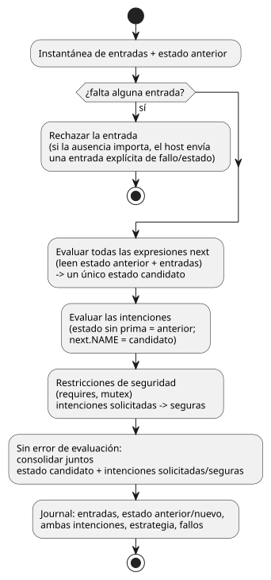

<!-- translation-source: docs/LANGUAGE-MVP-0.1.md -->
[Original en inglés](LANGUAGE-MVP-0.1.md)

# Contrato del lenguaje GhostFlow, MVP 0.1

Este documento es el contrato de la primera versión mínima (MVP 0.1) del lenguaje GhostFlow. Enumera las reglas de diseño que todo programa y todo runtime deben respetar, los elementos del programa y cómo funcionan la selección de dispositivos, los ticks, la reproducción (replay), el reemplazo en caliente y los errores.

## Invariantes de diseño

Estas reglas se cumplen siempre:

1. El hardware se direcciona por capacidad semántica (lo que puede hacer), no por placa, pin ni producto.
2. Un tick —un paso de evaluación del programa— es determinista y atómico.
3. La retroalimentación atraviesa un límite de estado explícito.
4. Todo efecto es una intención. Un renderizador del host y el núcleo de seguridad la interpretan.
5. Toda estrategia activa se selecciona de forma única a partir de un perfil de dispositivo.
6. Todo módulo aceptado tiene un coste de estado y de expresiones acotado estáticamente.
7. La reproducción nunca invoca un sumidero de efectos físicos.

## Elementos del programa

- `module`: identidad estable del módulo.
- `version`: versión del esquema sin signo.
- `input`: una muestra con nombre de un flujo booleano o numérico.
- `state`: un booleano o número con nombre que se conserva entre ticks.
- `strategy`: una consulta de dispositivos más transiciones de estado e intenciones.
- `next`: una expresión de transición de estado; todas se evalúan simultáneamente.
- `intent`: la salida deseada del actuador, después de calcular las transiciones.
- `requires`, `mutex`: restricciones de seguridad nativas.

Reglas de nombres:

- Los nombres son identificadores ASCII que contienen letras, dígitos, `_`, `-` y `.`.
- Los nombres duplicados son errores.
- Las referencias se comprueban dos veces: en el compilador y de nuevo en el verificador de bytecode.

## Semántica de las consultas de dispositivos

Un perfil de dispositivo es un conjunto de capacidades `(kind, name, type)`. Una estrategia coincide cuando su consulta se evalúa como verdadera.

Reglas de selección:

| Situación | Resultado |
|---|---|
| Coinciden una o más estrategias | Se selecciona la estrategia coincidente con la mayor prioridad entera. |
| Ninguna estrategia coincide | Error de activación. |
| Varias estrategias coinciden con la prioridad ganadora | Error de ambigüedad. |

La selección es estable durante un tick. Añadir o quitar un dispositivo, o que este falle o se recupere, crea un *perfil candidato*. El candidato debe activarse en un límite seguro. El host puede ejecutar el candidato en modo sombra antes de consolidarlo.

Esto toma prestada deliberadamente la *mejora progresiva* de las media queries de CSS. No toma prestada la cascada de CSS ni la precedencia por orden en el código fuente.

## Semántica del tick

Cada tick sigue estos pasos:

1. Las entradas ausentes se rechazan. Si la ausencia tiene significado, el host debe enviar una entrada explícita de fallo/estado.
2. Todas las expresiones `next` leen el mismo estado anterior y la misma instantánea de entradas.
3. Juntas, todas las expresiones de estado siguiente producen un único estado candidato. Ninguna de ellas se consolida antes de tiempo.
4. En las expresiones de intención, el estado sin prima lee la instantánea anterior. Las referencias explícitas al estado siguiente leen el estado candidato.
5. Las restricciones de seguridad transforman las intenciones solicitadas en salidas seguras.
6. Si la evaluación termina sin error, el estado candidato y las intenciones solicitadas/seguras se consolidan juntos, incluso si las restricciones bloquean una salida. El registro (journal) guarda la entrada, el estado anterior y el nuevo, ambas intenciones, la estrategia y los fallos.

El diagrama de flujo siguiente muestra los mismos pasos en orden.

`next.NAME` (escrito `NAME'` en la sintaxis moderna) solo es válido en expresiones de intención. Así se evita que el orden en que se escriben las transiciones se filtre a su significado. Consulte la [Referencia §2.8](reference/02-types-expressions-state.es.md).

## Viaje en el tiempo y ejecución fantasma

El registro (journal) almacena el estado inicial y un conjunto acotado de registros de ticks. Con él se puede:

- **Rebobinar**: restaurar un estado registrado anterior, sin ejecutar ninguna intención.
- **Reproducir**: crear una VM aislada, alimentarla con las instantáneas de entradas registradas y capturar una traza en sombra.
- **Comparar ramas**: reproducir con un módulo o un perfil de dispositivo de reemplazo.

El tiempo de reloj de pared es un dato de entrada ordinario. El runtime ordena los ticks mediante números de tick lógicos monotónicamente crecientes, de modo que una corrección del reloj no puede reescribir el orden causal.

## Reemplazo en caliente

`Runtime::hot_swap` reemplaza un módulo en ejecución de forma transaccional:

1. Analizar y verificar el módulo candidato.
2. Seleccionar una estrategia única para el perfil de capacidades actual.
3. Migrar el estado compatible.
4. Consolidar.

Reglas de migración del estado:

| Cambio | Resultado |
|---|---|
| Mismo nombre y mismo tipo | El valor se migra automáticamente. |
| Estado nuevo | Recibe su valor predeterminado declarado. |
| Estado eliminado | Desaparece. |
| Tipo cambiado | El MVP lo rechaza. En el futuro se requerirá un módulo de migración explícito. |

## Modelo de errores

La VM no lanza excepciones del lenguaje. Las operaciones públicas devuelven un estado y un diagnóstico.

En revisiones futuras, los fallos de hardware, los datos obsoletos, los tiempos de espera agotados y los sensores desconectados deben representarse mediante entradas tipadas. El MVP los representa con entradas de estado booleanas explícitas.
