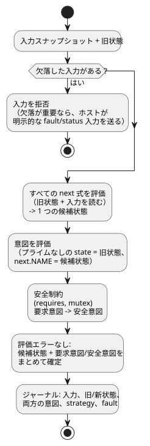

<!-- translation-source: docs/LANGUAGE-MVP-0.1.md -->
[英語の原文](LANGUAGE-MVP-0.1.md)

# GhostFlow 言語契約 MVP 0.1

この文書は、GhostFlow 言語の最初の最小版（MVP 0.1）の契約です。すべてのプログラムとランタイムが守らなければならない設計規則、プログラムの要素、そしてデバイス選択、tick、リプレイ、ホット置換、エラーの仕組みを示します。

## 設計上の不変条件

次の規則は常に成り立ちます。

1. ハードウェアは、ボード、ピン、製品ではなく、意味的なケイパビリティ（何ができるか）によって指定されます。
2. tick（プログラムの 1 回の評価ステップ。論理判断の単位）は、決定的かつアトミックです。
3. フィードバックは、明示的な状態境界を越えて伝わります。
4. すべての効果は意図です。ホストのレンダラーと安全カーネルがそれを解釈します。
5. アクティブな戦略は、どれもデバイスプロファイルから一意に選択されます。
6. 受け入れられるすべてのモジュールは、状態と式のコストが静的に有界です。
7. リプレイが物理的な効果の出力先を呼び出すことは決してありません。

## プログラムの要素

- `module`：安定したモジュールの同一性。
- `version`：符号なしのスキーマバージョン。
- `input`：名前付きの真偽値または数値のストリームサンプル。
- `state`：tick の間で保持される、名前付きの真偽値または数値。
- `strategy`：デバイス照会と、状態遷移および意図の組。
- `next`：状態遷移の式。すべての `next` 式は同時に評価されます。
- `intent`：遷移の計算後に求められる、アクチュエータの望ましい出力。
- `requires`、`mutex`：ネイティブの安全制約。

命名規則：

- 名前は、英字、数字、`_`、`-`、`.` からなる ASCII の識別子です。
- 名前の重複はエラーです。
- 参照は 2 回検査されます。コンパイラによって 1 回、バイトコードベリファイアによってもう 1 回です。

## デバイス照会の意味論

デバイスプロファイルは、`(kind, name, type)` のケイパビリティの集合です。戦略は、その照会が true に評価されたときに一致します。

選択の規則：

| 状況 | 結果 |
|---|---|
| 1 つ以上の戦略が一致する | 一致した戦略のうち、整数の priority が最大のものが選択されます。 |
| 一致する戦略がない | 起動（activation）エラー。 |
| 最高の priority で複数の戦略が一致する | 曖昧性エラー。 |

選択は tick の間は変わりません。デバイスの追加、削除、故障、復旧によって*候補プロファイル*が作られます。候補は安全な境界で起動しなければなりません。ホストは、確定する前に候補をシャドー実行してもかまいません。

これは、CSS メディアクエリから*プログレッシブエンハンスメント*の考え方を意図的に借りています。CSS のカスケードやソース順による優先順位は借りていません。

## tick の意味論

すべての tick は次のステップに従います。

1. 欠落した入力は拒否されます。欠落に意味がある場合、ホストは明示的な fault/status 入力を送らなければなりません。
2. すべての `next` 式は、同じ旧状態と同じ入力スナップショットを読みます。
3. すべての次状態の式が合わさって、1 つの候補状態を生成します。どれも先に確定することはありません。
4. 意図の式では、プライムのない state は旧スナップショットを読みます。明示的な次状態の参照は候補状態を読みます。
5. 安全制約が、要求意図を安全な出力に変換します。
6. 評価がエラーなしで終われば、制約によって出力がブロックされた場合でも、候補状態と要求意図/安全意図はまとめて確定します。ジャーナルには、入力、旧状態と新状態、両方の意図、戦略、故障が記録されます。

次のフローチャートは、同じステップを順に示したものです。

`next.NAME`（現代の構文では `NAME'` と書きます）は、意図の式の中でだけ有効です。これにより、遷移を書いた順序がその意味に漏れ出すことを防ぎます。[リファレンス §2.8](reference/02-types-expressions-state.ja.md#28-tickと状態スナップショット) を参照してください。

## タイムトラベルとゴースト実行

ジャーナルは、初期状態と有界の tick レコードの集合を保存します。これを使って次のことができます。

- **巻き戻し** — 意図を一切実行せずに、以前に記録された状態を復元します。
- **リプレイ** — 隔離された VM を作り、記録された入力スナップショットを与えて、シャドートレースを取得します。
- **ブランチの比較** — 置き換え用のモジュールやデバイスプロファイルでリプレイします。

壁時計の時刻は通常の入力データです。ランタイムは単調増加する論理 tick 番号で tick を順序付けるので、時計の補正が因果の順序を書き換えることはありません。

## ホット置換

`Runtime::hot_swap` は、実行中のモジュールをトランザクションとして置き換えます。

1. 候補モジュールを構文解析し、検証します。
2. 現在のケイパビリティプロファイルに対して、一意の戦略を選択します。
3. 互換性のある状態を移行します。
4. 確定します。

状態の移行規則：

| 変更 | 結果 |
|---|---|
| 名前も型も同じ | 値は自動的に移行されます。 |
| 新しい状態 | 宣言された既定値を受け取ります。 |
| 削除された状態 | 消えます。 |
| 型が変わった | MVP では拒否されます。将来は明示的な移行モジュールが必要になります。 |

## エラーモデル

VM は言語レベルの例外をスローしません。公開操作は、ステータスと診断を返します。

ハードウェアの故障、古いデータ、タイムアウト、切断されたセンサは、将来のリビジョンでは型付きの入力で表現しなければなりません。MVP では、それらを明示的な真偽値のステータス入力で表現します。
