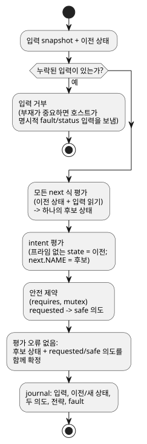

<!-- translation-source: docs/LANGUAGE-MVP-0.1.md -->
[영문 원문](LANGUAGE-MVP-0.1.md)

# GhostFlow 언어 계약, MVP 0.1

이 문서는 GhostFlow 언어의 첫 최소 버전(MVP 0.1)에 대한 계약입니다. 모든 프로그램과 런타임이 지켜야 하는 설계 규칙, 프로그램 요소, 그리고 장치 선택, tick, 재생(replay), 실행 중 교체(hot replacement), 오류가 동작하는 방식을 정리합니다.

## 설계 불변 조건

다음 규칙은 항상 성립합니다.

1. 하드웨어는 보드, 핀, 제품이 아니라 의미적 capability(무엇을 할 수 있는가)로 지정합니다.
2. tick, 즉 프로그램의 평가 한 단계는 결정적이고 원자적입니다.
3. 피드백은 명시적 상태 경계를 거쳐 전달됩니다.
4. 모든 효과는 의도입니다. 호스트 렌더러와 안전 커널이 이를 해석합니다.
5. 모든 활성 전략은 장치 프로필로부터 유일하게 선택됩니다.
6. 수용된 모든 모듈은 정적으로 제한된 상태와 식 비용을 가집니다.
7. 재생은 물리적 효과 싱크를 절대 호출하지 않습니다.

## 프로그램 요소

- `module`: 안정적인 모듈 식별자.
- `version`: 부호 없는 스키마 버전.
- `input`: 이름이 붙은 불리언 또는 숫자 스트림 샘플.
- `state`: tick 사이에 유지되는, 이름이 붙은 불리언 또는 숫자.
- `strategy`: 장치 질의와 상태 전이 및 의도.
- `next`: 상태 전이 식. 모든 `next` 식은 동시에 평가됩니다.
- `intent`: 전이를 계산한 뒤의, 원하는 액추에이터 출력.
- `requires`, `mutex`: 네이티브 안전 제약.

이름 규칙:

- 이름은 문자, 숫자, `_`, `-`, `.`로 이루어진 ASCII 식별자입니다.
- 중복된 이름은 오류입니다.
- 참조는 두 번 검사합니다. 컴파일러가 한 번, 바이트코드 검증기가 다시 한 번 검사합니다.

## 장치 질의 의미

장치 프로필은 `(kind, name, type)` capability의 집합입니다. 전략은 그 질의가 참으로 평가되면 일치합니다.

선택 규칙:

| 상황 | 결과 |
|---|---|
| 하나 이상의 전략이 일치 | 일치하는 전략 중 정수 우선순위가 가장 큰 전략을 선택합니다. |
| 일치하는 전략이 없음 | 활성화 오류. |
| 최고 우선순위에서 여러 전략이 일치 | 모호성 오류. |

선택은 한 tick 동안 바뀌지 않습니다. 장치를 추가, 제거하거나 장치가 고장 나거나 복구되면 *후보 프로필*이 생깁니다. 후보 프로필은 안전한 경계에서 활성화해야 합니다. 호스트는 후보를 확정하기 전에 그림자 실행(shadow-run)해 볼 수 있습니다.

이는 CSS 미디어 질의의 *점진적 향상(progressive enhancement)* 개념을 의도적으로 빌려 온 것입니다. CSS 캐스케이드나 소스 순서에 따른 우선권은 빌려 오지 않습니다.

## Tick 의미

모든 tick은 다음 단계를 따릅니다.

1. 누락된 입력은 거부합니다. 부재가 의미를 가진다면 호스트는 명시적인 fault/상태 입력을 제출해야 합니다.
2. 모든 `next` 식은 같은 이전 상태와 같은 입력 snapshot을 읽습니다.
3. 모든 다음 상태 식이 함께 하나의 후보 상태를 만듭니다. 어느 것도 먼저 확정되지 않습니다.
4. 의도 식에서 프라임이 없는 상태는 이전 snapshot을 읽습니다. 명시적인 다음 상태 참조는 후보 상태를 읽습니다.
5. 안전 제약이 요청 의도를 안전 출력으로 변환합니다.
6. 평가가 오류 없이 끝나면, 제약이 출력을 막더라도 후보 상태와 요청/안전 의도를 함께 확정합니다. journal에는 입력, 이전/새 상태, 두 의도, 전략, fault를 기록합니다.

아래 흐름도는 같은 단계를 순서대로 보여 줍니다.

`next.NAME`(현대 문법에서는 `NAME'`)은 의도 식에서만 유효합니다. 이렇게 하면 전이를 작성한 순서가 의미에 새어 들어가지 않습니다. [Reference §2.8](reference/02-types-expressions-state.md#28-tick과-상태-snapshot)을 참고하십시오.

## 시간 이동과 ghost 실행

journal은 초기 상태와 제한된 수의 tick 기록을 저장합니다. 이를 이용해 다음을 할 수 있습니다.

- **되감기** — 의도를 하나도 실행하지 않고 이전에 기록된 상태를 복원합니다.
- **재생** — 격리된 VM을 만들어 기록된 입력 snapshot을 공급하고 그림자 추적(shadow trace)을 캡처합니다.
- **분기 비교** — 대체 모듈이나 장치 프로필로 재생합니다.

벽시계 시간은 일반 입력 데이터입니다. 런타임은 단조 증가하는 논리 tick 번호로 tick의 순서를 정하므로, 시계를 보정해도 인과 순서를 다시 쓸 수 없습니다.

## 실행 중 교체

`Runtime::hot_swap`은 실행 중인 모듈을 트랜잭션 방식으로 교체합니다.

1. 후보 모듈을 파싱하고 검증합니다.
2. 현재 capability 프로필에서 유일한 전략을 선택합니다.
3. 호환되는 상태를 이전합니다.
4. 확정합니다.

상태 이전 규칙:

| 변경 | 결과 |
|---|---|
| 이름과 타입이 같음 | 값이 자동으로 이전됩니다. |
| 새 상태 | 선언된 기본값을 받습니다. |
| 제거된 상태 | 사라집니다. |
| 타입 변경 | MVP에서는 거부합니다. 앞으로는 명시적 이전 모듈이 필요합니다. |

## 오류 모델

VM은 언어 예외를 던지지 않습니다. 공개 연산은 상태와 진단을 반환합니다.

하드웨어 고장, 오래된(stale) 데이터, 타임아웃, 센서 연결 끊김은 향후 개정판에서 타입이 있는 입력으로 표현해야 합니다. MVP에서는 명시적인 불리언 상태 입력으로 표현합니다.
