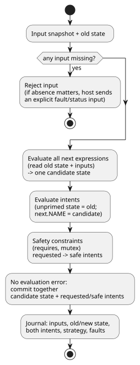

# GhostFlow language contract, MVP 0.1

This document is the contract for the first minimal version (MVP 0.1) of the GhostFlow language. It lists the design rules every program and runtime must respect, the program elements, and how device selection, ticks, replay, hot replacement and errors work.

## Design invariants

These rules always hold:

1. Hardware is addressed by semantic capability (what it can do), not by board, pin, or product.
2. A tick — one evaluation step of the program — is deterministic and atomic.
3. Feedback crosses an explicit state boundary.
4. Every effect is an intent. A host renderer and the safety kernel interpret it.
5. Every active strategy is uniquely selected from a device profile.
6. Every accepted module has statically bounded state and expression cost.
7. Replay never invokes a physical effect sink.

## Program elements

- `module`: stable module identity.
- `version`: unsigned schema version.
- `input`: a named boolean or number stream sample.
- `state`: a named boolean or number retained between ticks.
- `strategy`: a device query plus state transitions and intents.
- `next`: a state transition expression; all of them are evaluated simultaneously.
- `intent`: the desired actuator output, after transitions are computed.
- `requires`, `mutex`: native safety constraints.

Naming rules:

- Names are ASCII identifiers containing letters, digits, `_`, `-`, and `.`.
- Duplicate names are errors.
- References are checked twice: by the compiler, and again by the bytecode verifier.

## Device-query semantics

A device profile is a set of `(kind, name, type)` capabilities. A strategy matches when its query evaluates true.

Selection rules:

| Situation | Result |
|---|---|
| One or more strategies match | The matching strategy with the greatest integer priority is selected. |
| No strategy matches | Activation error. |
| Several strategies match at the winning priority | Ambiguity error. |

Selection is stable during a tick. Adding, removing, failing, or recovering a device creates a *candidate profile*. The candidate must be activated at a safe boundary. The host may shadow-run the candidate before committing it.

This deliberately borrows *progressive enhancement* from CSS media queries. It does not borrow the CSS cascade or source-order precedence.

## Tick semantics

Every tick follows these steps:

1. Missing inputs are rejected. If absence is meaningful, the host must submit an explicit fault/status input.
2. All `next` expressions read the same old state and the same input snapshot.
3. Together, all next-state expressions produce one candidate state. None of them commits early.
4. In intent expressions, unprimed state reads the old snapshot, and explicit next-state references read candidate state.
5. Safety constraints transform the requested intents into safe outputs.
6. If evaluation finishes without error, the candidate state and the requested/safe intents commit together — even if constraints block an output. The journal records the input, old and new state, both intents, the strategy, and faults.

The flowchart below shows the same steps in order.

`next.NAME` (written `NAME'` in modern syntax) is valid only in intent expressions. This keeps the order in which transitions are written from leaking into their meaning. See [Reference §2.8](reference/02-types-expressions-state.en.md#28-tick-and-state-snapshot).

## Time travel and ghost execution

The journal stores the initial state and a bounded set of tick records. With it you can:

- **Rewind** — restore an earlier recorded state, without executing any intents.
- **Replay** — create an isolated VM, feed it the recorded input snapshots, and capture a shadow trace.
- **Compare branches** — replay with a replacement module or device profile.

Wall-clock time is ordinary input data. The runtime orders ticks by monotonically increasing logical tick numbers, so a clock correction cannot rewrite causal order.

## Hot replacement

`Runtime::hot_swap` replaces a running module transactionally:

1. Parse and verify the candidate module.
2. Select a unique strategy for the current capability profile.
3. Migrate compatible state.
4. Commit.

State migration rules:

| Change | Result |
|---|---|
| Same name and same type | Value migrates automatically. |
| New state | Receives its declared default. |
| Removed state | Disappears. |
| Type changed | Rejected by the MVP. A future explicit migration module will be required. |

## Error model

The VM does not throw language exceptions. Public operations return a status and a diagnostic.

Hardware failure, stale data, timeouts and disconnected sensors must be represented by typed inputs in future revisions. The MVP represents them with explicit boolean status inputs.
