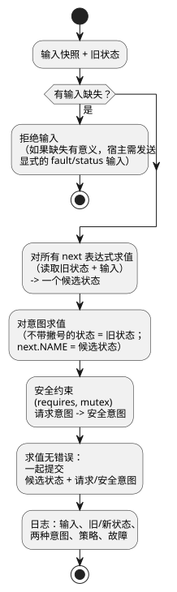

<!-- translation-source: docs/LANGUAGE-MVP-0.1.md -->
[英文原文](LANGUAGE-MVP-0.1.md)

# GhostFlow 语言契约，MVP 0.1

本文是 GhostFlow 语言第一个最小版本（MVP 0.1）的契约。它列出了每个程序和运行时都必须遵守的设计规则、程序元素，以及设备选择、tick（逻辑决策步）、重放、热替换和错误的工作方式。

## 设计不变量

以下规则始终成立：

1. 硬件按语义能力（它能做什么）来寻址，而不是按板卡、引脚或产品。
2. 一个 tick——程序的一个求值步骤——是确定性的且原子的。
3. 反馈穿过一个显式的状态边界。
4. 每个效果都是一个意图。由宿主渲染器和安全内核来解释它。
5. 每个活动策略都从设备 profile 中被唯一地选出。
6. 每个被接受的模块都具有静态有界的状态和表达式开销。
7. 重放绝不调用物理效果接收端。

## 程序元素

- `module`：稳定的模块身份标识。
- `version`：无符号的模式版本。
- `input`：一个具名的布尔或数值流样本。
- `state`：一个在 tick 之间保留的具名布尔值或数值。
- `strategy`：一个设备查询，加上状态转换和意图。
- `next`：一个状态转换表达式；所有状态转换表达式同时求值。
- `intent`：在计算完转换之后，期望的执行器输出。
- `requires`、`mutex`：原生安全约束。

命名规则：

- 名称是由字母、数字、`_`、`-` 和 `.` 组成的 ASCII 标识符。
- 重复的名称是错误。
- 引用会被检查两次：先由编译器检查，再由字节码校验器检查。

## 设备查询语义

设备 profile 是一组 `(kind, name, type)` 能力。当某个策略的查询求值为真时，该策略匹配。

选择规则：

| 情形 | 结果 |
|---|---|
| 有一个或多个策略匹配 | 选择匹配策略中整数优先级最大的那个。 |
| 没有策略匹配 | 激活错误。 |
| 在胜出的优先级上有多个策略匹配 | 歧义错误。 |

在一个 tick 内，选择是稳定的。添加、移除设备，或设备故障、恢复，都会产生一个*候选 profile*。候选 profile 必须在安全边界上激活。宿主可以在提交候选 profile 之前对其进行影子运行。

这有意借鉴了 CSS 媒体查询中的*渐进增强*。它并不借鉴 CSS 层叠或源顺序优先级。

## tick 语义

每个 tick 都遵循以下步骤：

1. 缺失的输入会被拒绝。如果缺失本身有意义，宿主必须提交一个显式的 fault/status 输入。
2. 所有 `next` 表达式读取同一个旧状态和同一个输入快照。
3. 所有下一状态表达式共同产生一个候选状态。它们中没有任何一个会提前提交。
4. 在意图表达式中，不带撇号的状态读取旧快照。显式的下一状态引用读取候选状态。
5. 安全约束把请求的意图转换为安全输出。
6. 如果求值无错误地完成，候选状态与请求/安全意图会一起提交——即使约束阻止了某个输出也是如此。日志记录输入、旧状态和新状态、两种意图、策略和故障。

下面的流程图按顺序展示了同样的步骤。

`next.NAME`（在现代语法中写作 `NAME'`）只在意图表达式中有效。这样可以避免转换的书写顺序渗入其含义。见[参考手册 §2.8](reference/02-types-expressions-state.zh.md#28-tick-与状态快照)。

## 时间旅行与 ghost 执行

日志保存初始状态和一组有界的 tick 记录。借助它，你可以：

- **倒带**——恢复某个较早记录的状态，而不执行任何意图。
- **重放**——创建一个隔离的 VM，向其输入记录下来的输入快照，并捕获一条影子轨迹。
- **比较分支**——使用替换模块或替换设备 profile 进行重放。

墙钟时间是普通的输入数据。运行时按单调递增的逻辑 tick 编号对 tick 排序，因此时钟校正无法改写因果顺序。

## 热替换

`Runtime::hot_swap` 以事务方式替换正在运行的模块：

1. 解析并校验候选模块。
2. 为当前能力 profile 选出唯一的策略。
3. 迁移兼容的状态。
4. 提交。

状态迁移规则：

| 变更 | 结果 |
|---|---|
| 名称相同且类型相同 | 值自动迁移。 |
| 新状态 | 获得其声明的默认值。 |
| 被移除的状态 | 消失。 |
| 类型改变 | 被 MVP 拒绝。今后将需要一个显式的迁移模块。 |

## 错误模型

VM 不抛出语言异常。公开操作返回一个状态和一个诊断。

硬件故障、陈旧数据、超时和断线的传感器，在今后的修订中必须用带类型的输入来表示。MVP 用显式的布尔状态输入来表示它们。
