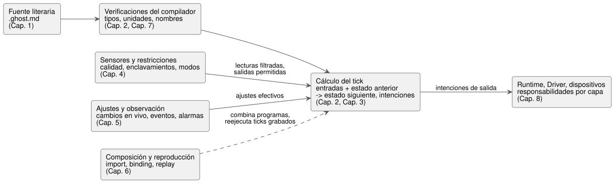

<!-- translation-source: docs/LANGUAGE-REFERENCE.en.md -->
[Original en inglés](LANGUAGE-REFERENCE.en.md)

# Referencia del lenguaje GhostFlow

GhostFlow es un lenguaje de control reactivo. A partir de lecturas de sensores y entradas del usuario, un programa GhostFlow describe **cómo cambia el estado y qué salidas pretende enviar a los dispositivos**.

Esta referencia es la fuente de verdad común del lenguaje. Abarca la filosofía de diseño, la sintaxis, la semántica, las reglas de tipos y las restricciones de uso, y explica por qué existe cada característica. Los demás documentos se apoyan en ella; en [Convenciones de lectura](#convenciones-de-lectura) se explica cómo resolver los conflictos entre documentos.

Cómo usar esta página:

- **¿Busca una característica?** Elija un capítulo en la [tabla de contenido](#contenido-completo) que aparece más abajo.
- **¿Busca una notación o un símbolo?** Use el [§7.5, índice de declaraciones y notaciones](reference/07-semantic-rules-and-index.es.md).
- **¿Quiere saber quién implementa un requisito** (lenguaje, compilador, runtime, Driver, vinculación o interfaz de usuario)? Consulte la [§8.3, tabla de responsabilidades de las FAQ](reference/08-language-runtime-and-device-boundaries.es.md).
- **¿Quiere ejemplos funcionales organizados por comportamiento?** Consulte las [preguntas frecuentes de programación en GhostFlow](language_faq.es.md).
- **¿Quiere saber por qué el lenguaje tiene la forma que tiene?** Lea la [filosofía de diseño](#filosofía-de-diseño).

## Contenido completo

La referencia tiene ocho capítulos. Cada capítulo forma parte de este único documento; lea directamente el capítulo que necesite.

| Capítulo | Contenido |
|---|---|
| [1. Fuente y sintaxis](reference/01-source-and-syntax.es.md) | Fuente literaria, bloques de código, anclas y enlaces de intención, vocabulario, nombres, ámbito, estructura de las declaraciones |
| [2. Tipos, expresiones y estado](reference/02-types-expressions-state.es.md) | Literales, enteros, unidades, operadores y precedencia, funciones y ramificación, tick, estado, salida |
| [3. Tiempo y programaciones](reference/03-time-and-schedules.es.md) | Hora de reloj y tiempo transcurrido, temporizadores, DailySlots, Solar, Cron, Periodic, calendarios, eventos naturales, respaldo (fallback) |
| [4. Sensores, restricciones y control](reference/04-sensors-constraints-control.es.md) | Calidad, filtros, histéresis, capacidades de los dispositivos y adaptación, recursos compartidos, modos, presupuestos de tiempo, control continuo |
| [5. Ajustes y observación](reference/05-settings-and-observation.es.md) | Ajustes tipados y formularios de entrada automáticos, cambios en vivo, valores temporales, instantánea (snapshot), event, comando, alarma, explicación |
| [6. Composición y reproducción](reference/06-composition-and-replay.es.md) | Composición de comportamientos, import, instance, puerto, vinculación, DAG semántico, extensiones sintácticas, reproducción (replay), ghost, reemplazo |
| [7. Reglas de preservación semántica e índice](reference/07-semantic-rules-and-index.es.md) | Distinción de errores, equivalencia de transformaciones, índices de todas las notaciones, símbolos, términos y documentos originales |
| [8. Requisitos de las FAQ y responsabilidades por capa](reference/08-language-runtime-and-device-boundaries.es.md) | Responsabilidades del lenguaje, el compilador, el runtime, el entorno, el Driver, la vinculación y la interfaz de usuario a lo largo de las FAQ; ciclos de vida y contratos requeridos |

El diagrama siguiente muestra dónde encaja cada capítulo en el recorrido que va desde un documento fuente hasta las salidas de los dispositivos. Es un mapa de lectura, no un modelo de ejecución completo; las reglas exactas las definen los capítulos.

En resumen: usted escribe un documento literario `.ghost.md` (capítulo 1). El compilador verifica tipos, unidades y nombres, y rechaza los programas no válidos (capítulos 2 y 7). En cada tick (paso de decisión lógica), el programa calcula el estado siguiente y las intenciones de salida a partir de las entradas y del estado anterior, incluidos los valores basados en el tiempo (capítulos 2 y 3). La calidad de los sensores y las restricciones determinan qué se puede enviar a la salida (capítulo 4), y los ajustes del operador entran como valores efectivos (capítulo 5). Los programas pueden componerse y los ticks grabados pueden reproducirse (capítulo 6). El runtime, los Drivers y los dispositivos producen los efectos reales (capítulo 8).

Para encontrar cualquier notación, use el [índice de sintaxis (§7.5)](reference/07-semantic-rules-and-index.es.md). Para ver qué debe aportar cada capa a fin de cumplir los requisitos de las FAQ, consulte la [tabla de responsabilidades del capítulo 8 (§8.3)](reference/08-language-runtime-and-device-boundaries.es.md).

## Convenciones de lectura

Cada capítulo etiqueta su material con estos términos:

| Etiqueta | Qué significa |
|---|---|
| **Sintaxis** | La notación que se usa en la fuente y su significado. |
| **Notación de diseño** | Un concepto tomado de documentos y discusiones de diseño. No lo mezcle libremente con la notación ya establecida. |
| **Reglas** | El significado de los tipos, el ámbito, la evaluación, los errores, el tiempo y el estado. |
| **Por qué** | Por qué se necesita la característica y qué principios del lenguaje preserva. |
| **Fragmento** | Un ejemplo que omite las declaraciones circundantes por brevedad. No es un ejemplo de documento completo. |

Las decisiones técnicas de sintaxis y semántica siguen las reglas de cada capítulo. Las decisiones operativas que se toman en sitio siguen siendo argumentos explícitos; el lenguaje nunca las completa con una política oculta.

**Cómo se resuelven los conflictos:**

- La consolidación de la política de sintaxis del 2026-09-22 es una decisión normativa de esta Referencia. Donde los bocetos y notaciones de diseño anteriores entren en conflicto con ella, siga las reglas precisas de tipos, sintaxis y evaluación de este documento. La [§8.6](reference/08-language-runtime-and-device-boundaries.es.md) separa los valores operativos que eligen los usuarios de las responsabilidades que quedan fuera del lenguaje.
- Cuando documentos de distintas épocas entren en conflicto, siga la decisión posterior que modifica explícitamente ese alcance. Por ejemplo, los ajustes operativos entran en vigor con la semántica de un **evento en vivo atómico dentro del mismo programa y la misma ejecución**, según se decidió en [#105](https://github.com/callin2/ghostflow-language/issues/105) y [#110](https://github.com/callin2/ghostflow-language/issues/110). Esa decisión no cambia el significado de las transiciones de modo de la instalación ni de las escrituras arbitrarias de estado.

## Filosofía de diseño

Imagine que una bomba se ha detenido a las cuatro de la madrugada. No se puede localizar a quien escribió el programa, y alguien en sitio tiene que encontrar la causa.

Esa persona necesita un programa que le ayude a entender por qué se detuvo el equipo, dónde buscar y qué puede cambiar. Si alguien tiene que recordar detalles que el código por sí solo no puede contar, al final habrá que volver a llamar a esa persona.

Hay un criterio al que volví una y otra vez mientras diseñaba GhostFlow.

**Incluso a las cuatro de la madrugada, debería poder leerse y corregirse en sitio.**

Al principio quería que el trabajo de control que venía haciendo con PLC fuera un poco más fácil en MCU económicos. Pero lograr que un relé se active al pulsar un interruptor no bastaba. Seguía siendo necesario entender las razones del comportamiento a lo largo del tiempo, seguir aprovechando el trabajo existente cuando cambiaba el equipo y permitir que otra persona tomara el relevo aunque el autor original no estuviera.

Los principios siguientes son decisiones que surgieron de ese proceso.

### 1. Mantener la razón del código junto al código

«Abrir la válvula y, tres segundos después, encender la bomba».

Eso puede ser lo que dice el código. Pero ¿por qué esperar tres segundos? ¿Es lo que tarda la válvula en abrirse, un margen para la tubería o solo un número que alguien puso para probar? Sin saberlo, es difícil juzgar si esos tres segundos pueden reducirse a uno.

Por eso GhostFlow reúne la explicación y el código en un único documento `.ghost.md`. Junto a lo que hace el código, se deja constancia de por qué se eligió ese comportamiento y de qué equipo y condiciones supone, vinculada al código correspondiente. Al hacer cambios más adelante, también debería poder rastrearse en qué explicación se basó el código y qué cambió en cada revisión.

Cuanto más código escribe la IA, más importante se vuelve esta distinción. Lo que un usuario pidió realmente es distinto de una suposición que la IA hizo para llenar un hueco. Un supuesto no confirmado debe seguir siendo un supuesto. Añadirle una explicación verosímil no lo convierte en la intención del usuario.

### 2. Decidir encender una bomba no es lo mismo que saber que se encendió

Aunque un programa indique que se encienda una bomba, puede que la bomba no funcione si la alimentación está desconectada o el dispositivo tiene un problema. Cuando una pantalla muestra ON, hay que distinguir una solicitud de encendido de la confirmación de que realmente está funcionando.

GhostFlow toma entradas y calcula qué acciones solicitar. No controla el hardware por sí mismo. La configuración de conexión, llamada *vinculación* (binding), indica a qué puertos y dispositivos van esas solicitudes. Los drivers de entrada suministran los hechos, y los renderizadores (renderers) de salida aplican las salidas reales de hardware. Una regla como «detener la bomba si no hay suficiente agua» no necesita mezclar los números de pin de una placa concreta.

Con estas responsabilidades separadas, se pueden probar las mismas reglas con interruptores y lámparas virtuales y conectarlas después a dispositivos reales. También se pueden diseñar ejecuciones que comparen el comportamiento sin enviar ninguna salida real. Pero una solicitud producida en una ejecución virtual y un equipo que funciona correctamente en campo siguen siendo cosas distintas que hay que verificar en todo momento.

### 3. Debe poder verse qué se recuerda y cómo cambia a continuación

Para que un motor siga funcionando después de soltar el botón de arranque, algo tiene que recordar que el botón se pulsó. Un programa que abre válvulas en secuencia también necesita saber qué válvula está usando en ese momento.

Esa memoria pertenece a `state`. Las funciones calculan solo a partir de los valores que reciben; el estado conserva la memoria necesaria de un tick al siguiente. Llamar a una función nunca debería cambiar en secreto un valor en otro lugar.

Lo que me importa es **una estructura en la que el estado siguiente pueda leerse directamente a partir del estado actual y de las entradas**. Si quien lee tiene que recorrer mentalmente el orden de ejecución varias veces solo para entenderlo, corregirlo en sitio será todavía más difícil. Cuando un resultado calculado se realimenta en una decisión, también debe quedar claro el estado por el que pasa antes del siguiente cálculo.

### 4. Debe poder comprobarse hoy la decisión de ayer

«¿Por qué pidió encender la bomba ayer a las tres de la tarde?»

Si se registraron las entradas, el estado anterior, los ajustes efectivos y las condiciones de tiempo de ese momento, debería poder obtenerse la misma decisión en las mismas condiciones. Eso permite investigar la causa sin depender solo de la memoria o de conjeturas. Después de modificar el programa, también se pueden suministrar las mismas condiciones y comparar qué cambia.

Para que esto sea posible, un *tick* (un cálculo de control) usa el mismo conjunto de entradas y el mismo estado anterior de principio a fin. Todos los estados siguientes se consolidan juntos cuando termina el cálculo. El resultado no debería depender de qué línea de código se ejecutó primero ni de si una función leyó el reloj en secreto. También debería poder saberse a partir de qué cálculo entró en vigor un cambio de ajustes.

La IA puede ayudar a escribir un programa, pero no quiero que cada decisión operativa dependa de una nueva respuesta de la IA. En sitio, el equipo debe seguir reglas verificadas bajo condiciones de ejecución definidas, y debemos poder reconstruir esas decisiones más tarde. El dispositivo también debería poder seguir ejecutando localmente su control básico sin esperar a internet ni a una respuesta de la IA.

### 5. No obligar a adivinar las unidades cada vez que se lee un número

Si un ajuste dice solo `10`, hay que revisar el código circundante para averiguar si significa diez veces, diez segundos o diez por ciento. Un significado que parecía obvio al escribirlo puede ser difícil de recordar unos meses después.

GhostFlow trata los conteos, el tiempo, los porcentajes y las magnitudes físicas como cosas distintas. También distingue los conteos que necesitan enteros exactos de los números que manejan valores aproximados, como las mediciones. La idea es dejar que el lenguaje verifique lo que significan los valores en lugar de depender solo de los nombres de las variables.

Al convertir unidades o convertir un valor decimal en entero, deben quedar visibles la conversión, el punto en que se produjo el redondeo y lo que se descartó. Me gustaría que el lenguaje detectara algunos de los errores que, de otro modo, solo una lectura cuidadosa puede evitar.

### 6. Las decisiones deben continuar durante esos diez minutos de riego

«Regar a las 6 a. m.», «regar durante diez minutos» y «mantener el tiempo total de riego de hoy dentro de treinta minutos» son requisitos distintos. Si se agrupan en un solo temporizador solo porque todos tienen que ver con el tiempo, las interpretaciones pueden empezar a divergir en cuanto se detiene a mitad de camino y se vuelve a empezar.

GhostFlow distingue el momento de inicio, el tiempo transcurrido de forma continua, el tiempo de uso acumulado y los periodos recurrentes. También necesita registrar qué ocurrencia de la programación se produjo, de modo que recibir de nuevo la misma ocurrencia pueda distinguirse de una nueva. La hora que muestra un reloj y la base para medir el tiempo transcurrido también son cosas separadas.

Sobre todo, esperar diez minutos no debe significar que el programa deje de tomar otras decisiones. Tiene que seguir comprobando si se ha pulsado el botón de paro o si el agua se ha agotado. Condiciones como «una hora después del amanecer» también deberían poder expresarse, pero qué hacer cuando no se puede obtener la hora del amanecer debe especificarse por separado.

### 7. Si un valor es desconocido, mantener ese hecho visible

Una temperatura de cero grados es distinta de no poder leer el sensor de temperatura. Tener un último valor leído también es distinto de poder confiar en ese valor y usarlo ahora.

Distinguimos de un valor normal un valor que todavía no está disponible, un valor demasiado antiguo o una lectura fallida. Tampoco debe tratarse la imposibilidad de obtener la hora del amanecer como «la hora programada todavía no ha llegado». Si una situación desconocida se convierte sin más en cero o en falso, las decisiones posteriores no tienen forma de saber qué salió mal.

La regla de respaldo (fallback) para una situación así debe ser explícita y adecuada a las condiciones de la instalación. Aunque el cálculo continúe con un valor sustituto, hay que conservar un registro de qué información faltaba originalmente, por qué se eligió este enfoque y cuándo volvió todo a la normalidad.

### 8. Distinguir lo que se quiere hacer de lo que está permitido hacer

Un programa de riego podría querer encender una bomba mientras el depósito de agua está vacío. Dos programas podrían querer usar la misma bomba, o un dispositivo podría tener salidas de giro directo e inverso que no deben activarse a la vez.

Copiar estas condiciones en distintos lugares de cada programa facilita omitir una o cambiar más tarde solo una de las copias. Por eso tratamos las solicitudes de cada programa por separado de las condiciones que rigen lo que la instalación en su conjunto permite. Deben ser visibles las salidas que no pueden estar activas a la vez, las reglas de los recursos compartidos, lo que permite cada modo y los límites de tiempo de operación. Cuando se bloquea una solicitud, debería poder saberse qué condición la bloqueó.

Mostrar al usuario solo «bomba OFF» no basta. Debería poder seguir la explicación hasta llegar a «era hora de regar, pero la bomba no se encendió por la entrada de nivel bajo de agua». Por eso quiero que incluso quienes no son especialistas puedan preguntar con sus propias palabras por las razones del comportamiento y comprobar las respuestas. Las explicaciones deben seguir la evidencia de la ejecución, en lugar de añadir después una historia verosímil.

Por supuesto, las restricciones de un programa no sustituyen a los dispositivos físicos de seguridad. Las responsabilidades que corresponden al hardware, como las paradas de emergencia y la protección eléctrica, siguen siendo independientes.

### 9. No debería ser necesario reescribir un programa solo para cambiar el tiempo de riego

Con un programa que «riega diez minutos cada hora», quizá se quiera reducirlo hoy a siete minutos. Si para eso también hay que cambiar el código de control, no resultará cómodo en el uso diario.

Los valores que pueden ajustarse durante la operación se declaran por separado como ajustes. Registramos juntos sus nombres, tipos, valores predeterminados, rangos permitidos y permisos, y dejamos claro cuándo entran en vigor los valores modificados. Cambiar ajustes, cambiar las propias reglas de control y sobrescribir a la fuerza el estado interno son cosas distintas.

Las pantallas también deberían poder usar esta información. Para un ajuste de tiempo, eso podría significar crear una herramienta de entrada de tiempo y ayudar a mantenerse dentro del rango permitido. Me gustan las pantallas que dan la sensación de que los interruptores y diales de un armario de control existente se han trasladado a ellas, pero no tienen por qué verse así. Los mismos ajustes podrían presentarse de otra forma en un teléfono. **Aunque la pantalla se vea distinta, los controles deben conservar el mismo significado.**

### 10. Si se han encontrado dos buenos ejemplos, deberían poder usarse juntos

Hay un ejemplo de control de riego y un ejemplo de control de un ventilador. Cada uno funciona bien por sí solo. Pero si usarlos juntos en una misma placa implica desmontar ambos programas y reescribirlos, alguien que no se siente cómodo programando puede quedarse atascado justo ahí.

Esto me resultaba especialmente frustrante. Si el riego necesita dos entradas y tres salidas, y la ventilación necesita cuatro salidas, quería poder tomar cada programa y usarlo conectando dispositivos a las entradas y salidas que necesita.

Eso no significa que baste con que coincida el número de entradas y salidas. Hay que comprobar si los programas comparten recursos, si sus restricciones entran en conflicto y si sus estados se mantienen separados. También debería poder rastrearse el código original y su revisión, junto con los dispositivos conectados actualmente.

También intento tener presente que estos programas se ejecutarán en MCU pequeños. Una combinación puede parecer sencilla, pero sería un problema si su cálculo nunca terminara o si los valores que necesita recordar no dejaran de crecer. Incluso después de la composición, debería poder evaluarse cuánta memoria y cuánto cálculo necesita. Quiero tanto la comodidad de reutilizar el trabajo de otra persona como las condiciones que permiten asumir la responsabilidad de ejecutarlo en el propio equipo.

## Perspectivas que influyeron en el diseño

GhostFlow tiene influencias de herramientas que he disfrutado usando. En lugar de copiar su sintaxis, intenté trasladar lo que las hacía cómodas y fáciles de entender.

Lo que me gustaba de **Literate CoffeeScript** era leer la explicación y el código en un solo documento. Se puede describir cómo debe comportarse el equipo y colocar el código donde se necesita. En lugar de exigir un manual aparte y bien redactado, quería que la explicación y el código estuvieran juntos desde el principio.

**ObservableHQ** me influyó no solo por la forma en que los cálculos y las visualizaciones conectados se actualizan cuando cambia un valor, sino también por la posibilidad de tomar el cuaderno de otra persona y usarlo como parte del propio trabajo. Lo importante era poder usar un buen resultado como material para el siguiente trabajo, en lugar de limitarse a mirarlo. Al observar **marimo y D3.js**, también valoré mantener juntos el código y los resultados y ver las relaciones entre los valores y los cambios.

De la **programación funcional** tomé la idea de componer cálculos pequeños sin ocultar la memoria ni los efectos secundarios. De **Cycle.js** tomé la perspectiva de separar la recepción de entradas, la producción de solicitudes de salida y el renderizador que crea los efectos reales. Estas ideas se conectan con las decisiones de mantener separados el estado, el cálculo y el hardware.

**Elm y Rust** influyeron en el enfoque de usar verificaciones de tipos y de ramas para detectar problemas antes de que aparezcan en tiempo de ejecución. Lo que valoré en la **programación orientada a ferrocarriles** (railway-oriented programming) era similar: en el código deben poder leerse tanto los caminos de fallo como los resultados normales.

De **YAML** tomé las declaraciones que exponen la estructura de los nombres y los ajustes. De **Cypher** tomé la selección de cosas por sus propiedades y capacidades en lugar de por su ubicación. Lo que me interesó de **Meta Lua** fue la posibilidad de tratar el código como datos y extenderlo. Aun así, incluso al extender las formas de expresión, debe seguir siendo posible comprobar qué significa el código y hasta dónde llegan sus efectos.

Al final, todas estas preferencias apuntan en la misma dirección. **No quiero que lo que entendimos al construir algo se pierda cuando lo corregimos o lo entregamos a otra persona.** Ya sea que lo escriba una persona o que ayude la IA, quien queda en sitio tiene que poder leer el programa y formarse un juicio.

Esta sección describe los criterios de diseño a los que aspira GhostFlow. Cuánto de cada característica se ha implementado y qué se ha verificado en dispositivos reales debe comprobarse por separado.

## Reglas para mantener esta referencia

- Cuando cambie la semántica del lenguaje, actualice juntos la **sintaxis, las reglas, los ejemplos y el Por qué** del capítulo correspondiente.
- Cuando se añada un nuevo requisito a las FAQ, conéctelo con la [tabla de responsabilidades y los límites de contrato del capítulo 8](reference/08-language-runtime-and-device-boundaries.es.md).
- Vincule el fundamento del diseño con la sección correspondiente y con el [índice de documentos originales (§7.8)](reference/07-semantic-rules-and-index.es.md).
- Esta referencia es un único conjunto de documentos. No divida su significado creando copias mantenidas de forma independiente en otros proyectos.
