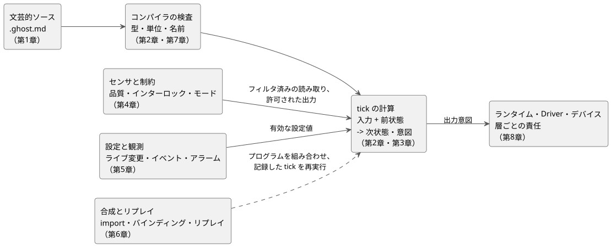

<!-- translation-source: docs/LANGUAGE-REFERENCE.en.md -->
[英語の原文](LANGUAGE-REFERENCE.en.md)

# GhostFlow 言語リファレンス

GhostFlow はリアクティブな制御言語です。GhostFlow のプログラムは、センサの読み取り値やユーザー入力をもとに、**状態がどう変わり、デバイスに対してどの出力を意図するか**を記述します。

このリファレンスは、言語に関する共通の基準となる文書です。設計思想、構文、意味論、型規則、使用上の制約を扱い、それぞれの機能がなぜ存在するのかも説明します。ほかの文書はこのリファレンスを土台にしています。文書間で食い違いがあるときの扱いは[読み方の約束事](#読み方の約束事)で説明します。

このページの使い方:

- **機能を探している場合**は、下の[目次](#全体の目次)から章を選んでください。
- **表記や記号を探している場合**は、[§7.5 宣言と表記の索引](reference/07-semantic-rules-and-index.ja.md)を使ってください。
- **ある要件を誰が実装するのか**（言語、コンパイラ、ランタイム、Driver、バインディング、UI）を知りたい場合は、[§8.3 FAQ 責任表](reference/08-language-runtime-and-device-boundaries.ja.md)を参照してください。
- **振る舞いごとの動く例を見たい場合**は、[GhostFlow コーディング FAQ](language_faq.ja.md)を参照してください。
- **言語がなぜこの形をしているのかを知りたい場合**は、[設計思想](#設計思想)を読んでください。

## 全体の目次

リファレンスは 8 つの章で構成されています。各章はこの 1 つの文書の一部です。必要な章を直接読んでください。

| 章 | 内容 |
|---|---|
| [1. ソースと構文](reference/01-source-and-syntax.ja.md) | 文芸的ソース、コードブロック、意図アンカー/リンク、語彙、名前、スコープ、宣言の構造 |
| [2. 型、式、状態](reference/02-types-expressions-state.ja.md) | リテラル、整数、単位、演算子と優先順位、関数と分岐、tick、状態、出力 |
| [3. 時間とスケジュール](reference/03-time-and-schedules.ja.md) | 時計の時刻と経過時間、タイマー、DailySlots、Solar、Cron、Periodic、カレンダー、自然現象のイベント、フォールバック |
| [4. センサ、制約、制御](reference/04-sensors-constraints-control.ja.md) | 品質、フィルタ、ヒステリシス、デバイスのケイパビリティと適応、共有リソース、モード、時間予算、連続制御 |
| [5. 設定と観測](reference/05-settings-and-observation.ja.md) | 型付きの設定と入力フォームの自動生成、ライブ変更、一時値、スナップショット、イベント、コマンド、アラーム、説明 |
| [6. 合成とリプレイ](reference/06-composition-and-replay.ja.md) | 振る舞いの合成、import、instance、ポート、バインディング、意味 DAG、構文拡張、リプレイ、ゴースト、置換 |
| [7. 意味保存の規則と索引](reference/07-semantic-rules-and-index.ja.md) | エラーの区別、変換の等価性、すべての表記・記号・用語・原文書の索引 |
| [8. FAQ の要件と層ごとの責任](reference/08-language-runtime-and-device-boundaries.ja.md) | FAQ 全体にわたる言語、コンパイラ、ランタイム、環境、Driver、バインディング、UI の責任、ライフサイクルと必要な契約 |

次の図は、ソース文書からデバイス出力までの流れの中で、各章がどこに位置するかを示しています。これは読むための地図であり、完全な実行モデルではありません。厳密な規則は各章で定義します。

要約すると次のとおりです。まず文芸的な `.ghost.md` 文書を書きます（第 1 章）。コンパイラは型、単位、名前を検査し、不正なプログラムを拒否します（第 2 章と第 7 章）。各 tick（論理判断の単位）で、プログラムは入力と前状態から、時間に基づく値も含めて次状態と出力意図を計算します（第 2 章と第 3 章）。センサの品質と制約によって何を出力してよいかが決まり（第 4 章）、オペレーターの設定は有効値として入ってきます（第 5 章）。プログラムは合成でき、記録した tick はリプレイできます（第 6 章）。実際の効果はランタイム、Driver、デバイスが担います（第 8 章）。

表記を探すには[構文索引（§7.5）](reference/07-semantic-rules-and-index.ja.md)を使ってください。FAQ の要件を支えるために各層が何を提供しなければならないかは、[第 8 章の責任表（§8.3）](reference/08-language-runtime-and-device-boundaries.ja.md)を参照してください。

## 読み方の約束事

各章は、次のラベルで内容を区別しています。

| ラベル | 意味 |
|---|---|
| **構文** | ソースで使う表記と、その意味。 |
| **設計表記** | 設計文書や議論から持ち込んだ概念。確定した表記と自由に混ぜて使わないでください。 |
| **規則** | 型、スコープ、評価、エラー、時間、状態の意味。 |
| **理由** | その機能がなぜ必要で、どの言語原則を守るのか。 |
| **断片** | 簡潔さのために周囲の宣言を省いた例。完全な文書の例ではありません。 |

技術的な構文と意味論上の決定は、各章の規則に従います。現場で行う運用上の選択は明示的な引数として残ります。言語がそれを隠れたポリシーで埋めることは決してありません。

**食い違いの解決方法:**

- 2026-09-22 の構文方針の統合は、このリファレンスの規範的な決定です。それ以前の設計スケッチや表記がこれと食い違う場合は、この文書の厳密な型、構文、評価の規則に従ってください。[§8.6](reference/08-language-runtime-and-device-boundaries.ja.md)では、ユーザーが選ぶ運用値と、言語の外側にある責任とを区別しています。
- 時期の異なる文書どうしが食い違う場合は、その範囲を明示的に変更した後の決定に従ってください。たとえば運用設定は、[#105](https://github.com/callin2/ghostflow-language/issues/105) と [#110](https://github.com/callin2/ghostflow-language/issues/110) で決まったとおり、**同じプログラム・同じ実行の中でのアトミックなライブイベント**という意味論で反映されます。この決定は、設備のモード遷移や任意の状態書き込みの意味を変えるものではありません。

## 設計思想

朝の 4 時にポンプが止まったとします。プログラムを書いた人とは連絡が取れず、現場の誰かが原因を突き止めなければなりません。

その人に必要なのは、設備がなぜ止まったのか、どこを見ればよいのか、何を変えてよいのかを理解する助けになるプログラムです。コードだけではわからない細部を誰かが覚えていなければならないなら、結局またその人に電話することになります。

GhostFlow を設計しながら、私が何度も立ち返った基準があります。

**朝の 4 時でも、現場で読んで直せること。**

最初は、PLC でやってきた制御の仕事を、安価な MCU で少し楽にしたいと考えていました。しかし、スイッチを押したらリレーがオンになる、というだけでは足りませんでした。時間の経過に沿った振る舞いの理由を理解できること、設備が変わっても既存の成果を使い続けられること、元の作者がいなくても別の人が引き継げることが必要でした。

以下の原則は、その過程から生まれた選択です。

### 1. コードの理由をコードのそばに残す

「バルブを開け、その 3 秒後にポンプをオンにする。」

コードにはそう書いてあるかもしれません。でも、なぜ 3 秒待つのでしょうか。バルブが開くのにかかる時間なのか、配管のための余裕なのか、それとも誰かが試しに入れただけの数字なのか。それがわからなければ、その 3 秒を 1 秒に縮めてよいかを判断するのは難しくなります。

だから GhostFlow では、説明とコードを 1 つの `.ghost.md` 文書に置きます。コードが何をするかとあわせて、なぜその振る舞いを選んだのか、どんな設備と条件を前提にしているのかを、関係するコードと結び付けて記録しておきます。後で変更するときには、コードがどの説明に基づいていたのか、どのリビジョンで何が変わったのかもたどれるべきです。

AI が書くコードが増えるほど、この区別は重要になります。ユーザーが実際に求めたことと、AI がすき間を埋めるために行った推測とは別物です。確認されていない仮定は、仮定のままにしておくべきです。もっともらしい説明を付け加えても、それがユーザーの意図に変わるわけではありません。

### 2. ポンプをオンにすると判断することと、オンになったと知ることは違う

プログラムがポンプをオンにすると言っても、電源が切れていたりデバイスに問題があったりすれば、ポンプは動かないかもしれません。画面に ON と表示されているとき、オンにしてほしいという要求と、実際に動いていることの確認とは区別する必要があります。

GhostFlow は入力を受け取り、どの動作を要求するかを計算します。ハードウェアを自分で駆動することはありません。それらの要求がどのポートやデバイスに届くかは、*バインディング*と呼ばれる接続構成が決めます。入力ドライバが事実を供給し、出力レンダラーが実際のハードウェア出力を適用します。「水が足りなければポンプを止める」といった規則に、特定のボードのピン番号を混ぜ込む必要はありません。

このように責任を分けておけば、同じ規則を仮想のスイッチやランプで試し、後から実際のデバイスにつなげることができます。実際の出力を一切送らずに振る舞いを比較する実行を設計することもできます。ただし、仮想の実行で生まれた要求と、現場で設備が正しく動作することとは、最後まで別々に検証すべき事柄です。

### 3. 何が記憶され、次にどう変わるかが見えること

起動ボタンを離した後もモーターが回り続けるには、ボタンが押されたことを何かが覚えていなければなりません。バルブを順番に開けるプログラムも、いまどのバルブを使っているのかを知っている必要があります。

その記憶は `state` に置きます。関数は受け取った値だけから計算し、ある tick から次の tick へ持ち越す必要のある記憶は状態が運びます。関数を呼んだことで、どこか別の場所の値がこっそり変わることがあってはなりません。

私が大切にしているのは、**現在の状態と入力から次の状態を直接読み取れる構造**です。理解するためだけに実行順序を頭の中で何度もたどらなければならないなら、現場で直すのはもっと難しくなります。計算結果が判断にフィードバックされる場合も、次の計算の前にどの状態を経由するのかが明確であるべきです。

### 4. 昨日の判断を今日もう一度確かめられること

「なぜ昨日の午後 3 時にポンプをオンにするよう要求したのか？」

その時点の入力、前状態、有効な設定、時間条件を記録しておけば、同じ条件のもとで同じ判断が得られるべきです。そうすれば、記憶や推測だけに頼らずに原因を調べられます。プログラムを変更した後に、同じ条件を与えて何が変わるかを比べることもできます。

これを可能にするため、*tick*（1 回の制御計算）は最初から最後まで同じ入力の組と同じ前状態を使います。すべての次状態は、計算が終わった後にまとめて確定します。結果が、どのコード行が先に実行されたか、関数がこっそり時計を読んだかどうかに左右されてはなりません。設定の変更がどの計算から反映されたのかもわかるべきです。

AI はプログラムを書く手助けはできますが、運用上の判断の一つひとつを AI の新しい回答に頼らせたくはありません。現場では、設備は定められた実行条件のもとで検証済みの規則に従うべきであり、後からその判断をたどり直せるべきです。デバイスは、インターネットや AI の応答を待たずに、基本的な制御をローカルで続けられるべきでもあります。

### 5. 数字を読むたびに単位を推測させない

設定に `10` とだけ書いてあると、それが 10 回なのか 10 秒なのか 10 パーセントなのかを知るために、周りのコードを掘り返さなければなりません。書いたときには明らかだと思えた意味も、数か月後には思い出しにくいかもしれません。

GhostFlow は、回数、時間、パーセント、物理量を区別して扱います。厳密な整数が必要な回数と、測定値のような近似値を扱う数値も区別します。変数名だけに頼るのではなく、値の意味を言語に検査させようという考えです。

単位を変換するときや小数を整数に変換するときには、その変換、丸めが起きた箇所、切り捨てられたものがすべて見えるべきです。注意深く読むことでしか防げない間違いの一部を、言語が捕まえてくれるようにしたいと考えています。

### 6. 10 分間の灌水中も判断を続ける必要がある

「朝 6 時に灌水する」「10 分間灌水する」「今日の合計灌水時間を 30 分以内に収める」は、それぞれ別の要件です。どれも時間に関することだからといって 1 つのタイマーにまとめてしまうと、途中で止めて再開した途端に解釈が食い違い始めることがあります。

GhostFlow は、開始する時刻、連続した経過時間、累積の使用時間、繰り返しの周期を区別します。また、どのスケジュールの発生（occurrence）が起きたのかを記録して、同じ発生をもう一度受け取ったことと新しい発生とを区別できるようにする必要があります。時計が示す時刻と、経過時間を測る基準も別のものです。

何よりも、10 分待つことが、プログラムがほかの判断をやめることを意味してはなりません。停止ボタンが押されていないか、水が少なくなっていないかを確かめ続ける必要があります。「日の出の 1 時間後」のような条件も表現できるべきですが、日の出の時刻が得られないときに何をするかは別に指定する必要があります。

### 7. 値がわからないなら、その事実を見えるようにしておく

温度が 0 度であることと、温度センサを読めないことは違います。最後に読んだ値を持っていることと、その値をいま信頼して使えることも違います。

まだ得られていない値、古すぎる値、読み取りに失敗した値は、正常な値と区別します。日の出の時刻が得られないことを「予定時刻はまだ来ていない」と扱ってもなりません。わからない状況を単に 0 や false に変えてしまうと、後の判断では何が問題だったのかを知るすべがありません。

そのような状況でのフォールバック規則は、明示的で、設備の条件に合ったものである必要があります。代わりの値で計算を続ける場合でも、本来どの情報が欠けていたのか、なぜその方法を選んだのか、いつ正常に戻ったのかを記録しておく必要があります。

### 8. やりたいことと、やってよいことを区別する

灌水プログラムは、水槽が空のときにポンプをオンにしたがるかもしれません。2 つのプログラムが同じポンプを使いたがることもあれば、正転と逆転の出力を同時にオンにしてはならないデバイスもあります。

こうした条件を各プログラムのあちこちにコピーしていると、どこかで書き漏らしたり、後で片方のコピーだけを変えたりしがちです。だから私たちは、各プログラムの要求と、設備全体として何を許すかを決める条件とを分けて扱います。同時にオンにできない出力、共有リソースの規則、各モードで許されること、運転時間の上限は見えるようになっているべきです。要求がブロックされたときには、どの条件がブロックしたのかがわかるべきです。

ユーザーに「ポンプ OFF」とだけ見せるのでは不十分です。「灌水の時刻になったが、低水位入力のためにポンプはオンにならなかった」というところまで、説明をたどれるべきです。だからこそ、専門家でない人でも、振る舞いの理由を自分の言葉で尋ね、その答えを確かめられるようにしたいのです。説明は、後からもっともらしい話を付け加えるのではなく、実行時の証拠に従うべきです。

もちろん、プログラム内の制約が物理的な安全装置の代わりになるわけではありません。非常停止や電気的な保護のように、ハードウェアが担うべき責任は別に残ります。

### 9. 灌水時間を変えるだけでプログラムを書き直さなくてよいこと

「1 時間ごとに 10 分間灌水する」プログラムで、今日は 7 分に減らしたいことがあるかもしれません。そのたびに制御コードまで変えなければならないなら、日常の運用では不便です。

運用中に調整できる値は、設定として別に宣言します。その名前、型、既定値、許容範囲、権限をまとめて記録し、変更した値がいつ反映されるのかを明確にします。設定を変えること、制御規則そのものを変えること、内部状態を強制的に上書きすることは、それぞれ別のことです。

画面もこの情報を使えるべきです。時間の設定であれば、時刻の入力ツールを作り、許容範囲に収まるよう手助けすることが考えられます。既存の制御盤のスイッチやダイヤルをそのまま画面に移したような見た目は好きですが、必ずしもそうである必要はありません。同じ設定をスマートフォンでは別の形で見せてもかまいません。**画面の見た目が違っても、操作の意味は同じであるべきです。**

### 10. よい例を 2 つ見つけたら、それを一緒に使えること

灌水制御の例と、換気ファン制御の例があるとします。それぞれ単独ではうまく動きます。しかし、1 枚のボードで両方を使うために 2 つのプログラムを分解して書き直さなければならないなら、コードに慣れていない人はそこで行き詰まってしまいます。

私はこれを特にもどかしく感じていました。灌水に 2 つの入力と 3 つの出力が必要で、換気に 4 つの出力が必要なら、それぞれのプログラムを取ってきて、必要な入出力にデバイスをつなぐだけで使えるようにしたかったのです。

とはいえ、入出力の数が合えば十分というわけではありません。プログラムどうしがリソースを共有していないか、制約が衝突していないか、状態が分かれたままになっているかを確かめる必要があります。元のコードとそのリビジョン、そしていまつながっているデバイスもたどれるべきです。

また、これらのプログラムが小さな MCU で動くことも念頭に置くようにしています。組み合わせが単純に見えても、計算が終わらなかったり、覚えておく必要のある値が増え続けたりすれば問題です。合成した後でも、どれだけのメモリと計算が必要かを見積もれるべきです。他人の成果を再利用できる便利さと、それを自分の設備で動かす責任を負えるための条件の両方がほしいのです。

## 設計に影響を与えた視点

GhostFlow には、私が楽しく使ってきたツールからの影響が込められています。その構文をまねるのではなく、それらを便利でわかりやすくしていたものを持ち込もうとしました。

**Literate CoffeeScript** で気に入っていたのは、説明とコードを 1 つの文書で読めることでした。設備がどう振る舞うべきかを書き、必要な場所にコードを置けます。よく書かれた別のマニュアルを求めるのではなく、最初から説明とコードが一緒にあるようにしたかったのです。

**ObservableHQ** からは、値が変わるとつながった計算や表示が更新される仕組みだけでなく、他人のノートブックを取ってきて自分の作業の一部として使える点にも影響を受けました。大切なのは、よくできた成果をただ眺めるのではなく、次の作業の材料として使えることでした。**marimo と D3.js** を見て、コードと結果を一緒に置き、値と変化の関係を見られることも大事にしました。

**関数型プログラミング**からは、記憶や副作用を隠さずに小さな計算を組み合わせるという考えを取り入れました。**Cycle.js** からは、入力を受け取ること、出力の要求を作ること、実際の効果を生み出すレンダラーとを分ける視点を取り入れました。これらは、状態、計算、ハードウェアを区別しておくという選択につながっています。

**Elm と Rust** は、型と分岐の検査によって問題が実行時に現れる前に捕まえるという方針に影響を与えました。**railway-oriented programming** で大切にしたことも似ています。正常な結果だけでなく、失敗の経路もコードから読み取れるべきだということです。

**YAML** からは、名前や設定の構造を見せる宣言を参考にしました。**Cypher** からは、場所ではなく性質やケイパビリティでものを選ぶことを参考にしました。**Meta Lua** で興味を引かれたのは、コードをデータとして扱い、拡張できる可能性でした。ただし、表現の形を拡張する場合でも、そのコードが何を意味し、その影響がどこまで及ぶのかは確認できるべきです。

結局のところ、これらの好みはすべて同じ方向を向いています。**作っている間に理解したことが、直したり引き継いだりするときに失われてほしくない**のです。人が書くにせよ AI が手伝うにせよ、現場に残った人がプログラムを読んで判断できる必要があります。

この節は、GhostFlow が目指す設計の基準を説明しています。各機能がどこまで実装されているか、実際のデバイスで何が検証されているかは、別途確認する必要があります。

## このリファレンスの保守規則

- 言語の意味論が変わったときは、該当する章の**構文、規則、例、理由**をまとめて更新してください。
- FAQ に新しい要件が加わったときは、それを[第 8 章の責任表と契約の境界](reference/08-language-runtime-and-device-boundaries.ja.md)に結び付けてください。
- 設計の根拠は、該当する節と[原文書の索引（§7.8）](reference/07-semantic-rules-and-index.ja.md)にリンクしてください。
- このリファレンスは 1 つの文書セットです。ほかのプロジェクトで独立して保守されるコピーを作り、その意味を分裂させないでください。
