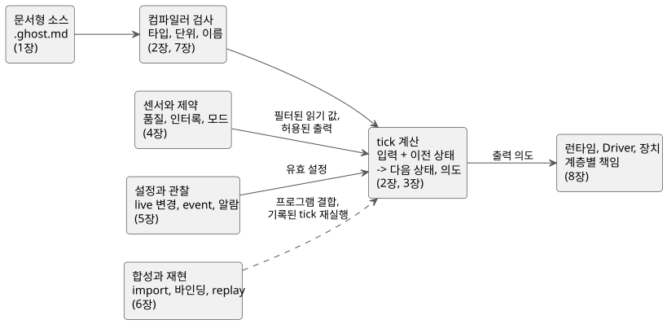

<!-- translation-source: docs/LANGUAGE-REFERENCE.en.md -->
[영문 원문](LANGUAGE-REFERENCE.en.md)

# GhostFlow Language Reference

GhostFlow는 반응형 제어 언어입니다. GhostFlow 프로그램은 센서 값과 사용자 입력으로부터 **상태가 어떻게 변하고, 장치에 어떤 출력을 의도하는지**를 기술합니다.

이 reference는 언어의 공통 기준 문서입니다. 설계 철학, 문법, 의미, 타입 규칙, 사용 제약을 다루고, 각 기능이 왜 존재하는지도 설명합니다. 다른 문서들은 이 문서를 바탕으로 하며, 문서끼리 충돌할 때 어떻게 판단하는지는 [읽는 규칙](#읽는-규칙)에서 설명합니다.

이 페이지를 사용하는 방법:

- **특정 기능을 찾고 있다면** 아래 [전체 목차](#전체-목차)에서 장을 고르세요.
- **표기나 기호를 찾고 있다면** [§7.5 선언과 표기 찾아보기](reference/07-semantic-rules-and-index.md#75-선언과-표기-찾아보기)를 사용하세요.
- **어떤 요구를 누가 구현하는지**(언어, 컴파일러, 런타임, Driver, 바인딩, UI) 궁금하다면 [§8.3 FAQ 전체 책임표](reference/08-language-runtime-and-device-boundaries.md#83-faq-전체-책임표)를 보세요.
- **동작별 실제 예제가 필요하다면** [GhostFlow Coding FAQ](language_faq.md)를 보세요.
- **언어가 왜 이런 모습인지 알고 싶다면** [설계 철학](#설계-철학)을 읽어보세요.

## 전체 목차

reference는 여덟 개의 장으로 이루어져 있습니다. 각 장은 이 하나의 문서의 일부이며, 필요한 장을 바로 읽으면 됩니다.

| 장 | 내용 |
|---|---|
| [1. 소스와 문법](reference/01-source-and-syntax.md) | 문서형 소스, 코드 블록, 의도 anchor/link, 어휘·이름·범위·선언 구조 |
| [2. 타입·표현식·상태](reference/02-types-expressions-state.md) | 리터럴·정수·단위, 연산자·우선순위, 함수·분기, tick·상태·출력 |
| [3. 시간과 예약](reference/03-time-and-schedules.md) | 시각·경과 시간, 타이머, DailySlots·Solar·Cron·Periodic, 달력·자연 사건·fallback |
| [4. 센서·제약·제어](reference/04-sensors-constraints-control.md) | 품질·필터·히스테리시스, 장치 능력·적응, 공유 자원·모드·시간 예산, 연속 제어 |
| [5. 설정과 관찰](reference/05-settings-and-observation.md) | typed 설정과 자동 입력창, live 변경, 임시값, snapshot·event·command·alarm·설명 |
| [6. 합성과 재현](reference/06-composition-and-replay.md) | 동작 합성·import·instance·port·binding, 의미 DAG, 구문 확장, replay·ghost·교체 |
| [7. 의미 보존 규칙과 색인](reference/07-semantic-rules-and-index.md) | 오류의 구분, 변환의 동등성, 전체 표기·기호·용어·원문별 찾아보기 |
| [8. FAQ 요구와 계층별 책임](reference/08-language-runtime-and-device-boundaries.md) | FAQ 전체의 언어·컴파일러·런타임·환경·Driver·binding·UI 책임, 생명주기와 필요한 계약 |

아래 그림은 소스 문서에서 장치 출력에 이르는 경로에서 각 장이 어디에 해당하는지 보여줍니다. 읽기 위한 지도일 뿐 완전한 실행 모델은 아니며, 정확한 규칙은 각 장에서 정의합니다.

요약하면 이렇습니다. 문서형 `.ghost.md` 문서를 작성합니다(1장). 컴파일러가 타입, 단위, 이름을 검사하고 잘못된 프로그램을 거부합니다(2장, 7장). 매 tick마다 프로그램은 시간 기반 값을 포함한 입력과 이전 상태로부터 다음 상태와 출력 의도를 계산합니다(2장, 3장). 센서 품질과 제약은 무엇을 출력해도 되는지를 결정하고(4장), 운영자 설정은 유효값으로 반영됩니다(5장). 프로그램은 합성할 수 있고, 기록된 tick은 재생(replay)할 수 있습니다(6장). 실제 효과는 런타임, Driver, 장치가 수행합니다(8장).

모든 표기를 찾으려면 [문법 색인(§7.5)](reference/07-semantic-rules-and-index.md#75-선언과-표기-찾아보기)을 사용하세요. FAQ의 요구를 지원하려면 각 계층이 무엇을 제공해야 하는지는 [8장 책임표(§8.3)](reference/08-language-runtime-and-device-boundaries.md#83-faq-전체-책임표)를 참조하세요.

## 읽는 규칙

각 장은 내용을 다음 용어로 구분합니다.

| 구분 | 의미 |
|---|---|
| **문법** | 소스에서 사용하는 표기와 그 의미입니다. |
| **설계 표기** | 설계 문서·논의에서 가져온 개념입니다. 확정된 표기와 임의로 섞어 쓰지 않습니다. |
| **규칙** | 타입, 범위, 평가, 오류, 시간과 상태의 의미입니다. |
| **Why** | 해당 기능이 필요한 이유와 지키려는 언어 원칙입니다. |
| **단편** | 간결하게 보이려고 주변 선언을 생략한 예제입니다. 완전한 문서 예제가 아닙니다. |

기술적인 문법·의미 결정은 각 장의 규칙을 따릅니다. 현장에서 정하는 운전 선택은 명시적 인자로 남기며, 언어가 숨은 정책으로 채우지 않습니다.

**충돌을 해결하는 방법:**

- 2026-09-22의 문법 정책 정리는 이 Reference의 규범적 결정입니다. 이전 설계 스케치와 표기가 이와 충돌하면 이 문서의 정확한 타입·문법·평가 규칙을 따릅니다. 사용자가 정하는 운전 값과 언어 밖에 있는 책임은 [§8.6](reference/08-language-runtime-and-device-boundaries.md#86-언어-결정과-작성자가-정하는-정책)에서 구분합니다.
- 서로 다른 시기의 문서가 충돌하면 해당 범위를 명시적으로 변경한 후속 결정을 따릅니다. 예를 들어 운영 설정은 [#105](https://github.com/callin2/ghostflow-language/issues/105)와 [#110](https://github.com/callin2/ghostflow-language/issues/110)에서 결정한 대로 **동일 프로그램·동일 실행 안의 원자적(atomic) live event** 의미로 적용됩니다. 이 결정이 설비의 모드 전환이나 임의 상태 쓰기의 의미까지 바꾸지는 않습니다.

## 설계 철학

새벽 네 시에 펌프가 멈췄다고 해볼게요. 프로그램을 만든 사람은 연락이 안 되고, 현장에 있는 사람이 원인을 찾아야 해요.

그 사람에게 필요한 건 지금 이 장비가 왜 멈췄는지, 어디를 확인해야 하는지, 무엇을 바꿔도 되는지 알 수 있는 프로그램이에요. 코드만 보고는 알 수 없는 사정을 누군가 기억하고 있어야 한다면, 결국 그 사람에게 다시 전화를 걸 수밖에 없죠.

GhostFlow를 설계하면서 자주 떠올린 기준이 있어요.

**새벽 네 시에도, 현장에서 읽고 고칠 수 있어야 한다.**

처음에는 PLC로 하던 제어를 저렴한 MCU에서 좀 더 편하게 만들고 싶었어요. 그런데 스위치를 누르면 릴레이가 켜지게 하는 것만으로는 부족하더라고요. 시간이 지나도 동작의 이유를 알 수 있어야 하고, 장비가 바뀌어도 기존 작업을 살릴 수 있어야 하고, 만든 사람이 없어도 다른 사람이 이어받을 수 있어야 했어요.

아래의 원칙들은 그 과정에서 나온 선택이에요.

### 1. 코드와 함께, 그 코드를 쓴 이유도 남겨요

“밸브를 열고 3초 뒤에 펌프를 켠다.”

코드에는 이렇게 적혀 있을 수 있어요. 그런데 왜 3초를 기다릴까요? 밸브가 열리는 데 필요한 시간일까요, 배관 때문에 둔 여유일까요, 아니면 시험 삼아 넣어둔 숫자일까요? 이걸 모르면 3초를 1초로 줄여도 되는지 판단하기 어려워요.

그래서 GhostFlow는 설명과 코드를 하나의 `.ghost.md` 문서에 적어요. 코드가 무엇을 하는지뿐 아니라 왜 그렇게 정했는지, 어떤 장비와 조건을 전제로 했는지를 관련 코드에 연결해 남기는 거예요. 나중에 수정할 때도 어느 설명에 근거한 코드인지, 어떤 판본에서 무엇이 바뀌었는지 따라갈 수 있어야 해요.

AI가 코드를 작성할수록 이 구분은 더 중요해져요. 사용자가 실제로 말한 요구와 AI가 빈칸을 채우려고 한 추측은 다르잖아요. 확인하지 않은 가정은 가정으로 남겨야 해요. 그럴듯한 설명을 붙였다고 사용자의 의도가 되는 건 아니니까요.

### 2. 펌프를 켜라는 판단과, 펌프가 켜졌다는 사실은 달라요

프로그램이 펌프를 켜라고 했어도 전원이 끊겨 있거나 장치에 문제가 있으면 펌프는 돌지 않을 수 있어요. 화면에 ON이라고 표시할 때도, 켜라는 요청인지 실제로 돌고 있음을 확인한 것인지 구분해야 하죠.

GhostFlow는 입력을 받아 어떤 동작을 요청할지 계산해요. 하드웨어를 직접 구동하지는 않아요. 그 요청을 어느 포트와 장치로 보낼지는 *바인딩*(binding)이라는 연결 설정에 적고, 입력 driver는 사실을 공급하고 출력 renderer는 실제 하드웨어 출력을 적용해요. “물이 부족하면 펌프를 멈춘다” 같은 규칙 안에 특정 보드의 핀 번호까지 섞어 넣을 필요가 없는 거예요.

이렇게 책임을 나누면 같은 규칙을 가상 스위치와 램프로 시험해보고, 나중에 실제 장치에 연결할 수 있어요. 실제 출력을 내보내지 않은 채 동작을 비교하는 실행도 설계할 수 있고요. 다만 가상 실행에서 요청이 나왔다는 것과 현장의 장비가 제대로 움직였다는 것은 끝까지 별개로 확인해야 할 일로 남겨요.

### 3. 무엇을 기억하고, 다음에 어떻게 바뀌는지가 보여야 해요

시작 버튼에서 손을 떼도 모터가 계속 돌려면, 시작 버튼을 눌렀다는 사실을 무언가가 기억해야 해요. 순서대로 밸브를 여는 프로그램이라면 지금 몇 번째 밸브를 쓰고 있는지도 알아야 하고요.

이런 기억은 `state`에 둬요. 함수는 받은 값으로만 계산하고, 상태는 한 tick에서 다음 tick으로 이어갈 기억을 맡아요. 함수를 불렀더니 어딘가의 값이 몰래 바뀌어 있는 일은 없어야 해요.

제가 중요하게 보는 건 **지금 상태와 입력을 보고, 다음 상태를 바로 읽을 수 있는 구조**예요. 읽는 사람이 실행 순서를 머릿속으로 여러 번 돌려봐야 겨우 알아낼 수 있다면, 현장에서 고치기는 더 어렵겠죠. 계산 결과를 다시 판단에 사용할 때도 다음 계산으로 넘어가기 전에 어느 상태를 거치는지 분명하게 드러나야 해요.

### 4. 어제의 판단을 오늘 다시 확인할 수 있어야 해요

“어제 오후 세 시에 왜 펌프를 켜라고 했을까?”

그때의 입력, 이전 상태, 적용된 설정과 시간 조건을 기록해뒀다면 같은 조건으로 같은 판단을 얻을 수 있어야 해요. 그래야 기억이나 짐작에만 기대지 않고 원인을 살펴볼 수 있죠. 프로그램을 수정한 뒤에도 같은 조건을 넣어 무엇이 달라지는지 비교할 수 있고요.

이를 위해 *tick*(한 번의 제어 계산)은 처음부터 끝까지 같은 입력 묶음과 같은 이전 상태를 사용해요. 다음 상태들은 계산을 마친 뒤 함께 확정해요. 코드의 어느 줄이 먼저 실행됐는지, 함수 안에서 몰래 시계를 읽었는지에 따라 결과가 달라져서는 안 돼요. 설정 변경도 어느 계산부터 적용됐는지 알 수 있어야 해요.

AI가 프로그램 작성을 도와줄 수는 있지만, 운전 중의 판단이 매번 AI의 새로운 답변에 달려 있기를 바라지는 않아요. 현장에서는 확인한 규칙을 정해진 실행 조건에 따라 수행하고, 나중에도 그 판단을 되짚을 수 있어야 해요. 인터넷이나 AI의 응답을 기다리지 않아도, 장치가 맡은 기본 제어는 현장에서 계속할 수 있어야 하고요.

### 5. 숫자를 읽을 때마다 단위를 추측하게 두지 않아요

설정에 `10`이라고만 적혀 있으면 열 번인지, 10초인지, 10퍼센트인지 주변 코드를 뒤져봐야 해요. 작성할 때는 당연했던 뜻도 몇 달 뒤에는 기억나지 않을 수 있죠.

GhostFlow는 횟수, 시간, 백분율, 물리량을 구분해서 다뤄요. 정확한 정수가 필요한 횟수와 측정값처럼 근사값을 다루는 숫자도 구분하고요. 변수 이름에만 기대지 않고 언어가 값의 의미를 확인할 수 있게 하는 거예요.

단위를 바꾸거나 소수를 정수로 바꿀 때도 어떤 변환을 했는지, 어디서 반올림했고 무엇을 버렸는지 드러나야 해요. 사람이 꼼꼼하게 읽어야만 막을 수 있는 실수 중 일부를 언어가 먼저 잡아줬으면 해요.

### 6. 물을 주는 10분 동안에도 판단은 계속돼야 해요

“오전 6시에 물을 준다”, “10분 동안 물을 준다”, “오늘 물 준 시간을 합쳐 30분을 넘기지 않는다”는 서로 다른 요구예요. 전부 시간에 관한 이야기라고 하나의 타이머로 뭉뚱그리면, 중간에 멈췄다가 다시 시작하는 순간부터 해석이 갈리기 쉬워요.

GhostFlow에서는 시작할 시각, 연속해서 흐른 시간, 누적 사용 시간과 반복 주기를 구분해요. 같은 예약 발생이 다시 전달됐을 때 새 발생과 구분할 수 있도록, 어떤 예약이 발생한 것인지도 남겨야 해요. 시계가 가리키는 시각과 경과 시간을 재는 기준 역시 나눠요.

무엇보다 10분을 기다리는 동안 프로그램까지 다른 판단을 멈추면 안 돼요. 정지 버튼이 눌렸는지, 물이 부족해졌는지 계속 확인해야 하니까요. “해 뜨고 한 시간 뒤” 같은 조건도 표현할 수 있어야 하지만, 일출 시각을 구할 수 없을 때 어떻게 할지는 별도로 정해둬야 해요.

### 7. 값을 모르면, 모른다는 사실을 남겨요

온도가 0도인 것과 온도 센서의 값을 읽지 못한 것은 달라요. 마지막으로 읽은 값이 있다는 것과 그 값을 지금도 믿고 써도 된다는 것도 다르고요.

값이 아직 없는지, 너무 오래됐는지, 읽는 데 실패했는지를 정상값과 구분해서 다뤄요. 일출 시각을 구하지 못했다는 이유로 “예약 시간이 아직 오지 않았다”고 처리해서도 안 되고요. 알 수 없는 상황을 그냥 0이나 거짓으로 바꿔버리면, 이후의 판단에서는 무엇이 잘못됐는지 알아낼 방법이 없어져요.

그럴 때 어떤 대체 규칙을 쓸지는 설비의 조건에 맞게 명시해야 해요. 대체값으로 계산을 계속하더라도 원래 어떤 정보가 없었는지, 왜 이 방법을 선택했는지, 언제 정상으로 돌아왔는지는 남겨야 하고요.

### 8. 하고 싶은 동작과, 해도 되는 동작을 구분해요

관수 프로그램은 펌프를 켜려고 하는데 물탱크가 비어 있을 수 있어요. 프로그램 두 개가 같은 펌프를 쓰려고 할 수도 있고, 정방향과 역방향 출력을 함께 켜서는 안 되는 장치도 있겠죠.

이런 조건을 각 프로그램의 여기저기에 복사해두면 하나를 빠뜨리거나, 나중에 한쪽만 고치기 쉬워요. 그래서 각 프로그램의 요청과, 설비 전체가 무엇을 허용하는지 정하는 조건을 나눠서 다뤄요. 함께 켤 수 없는 출력, 공유 자원의 사용 규칙, 모드별 허용 범위와 운전 시간 한도가 드러나야 하고, 요청을 막았을 때는 어느 조건 때문인지 알 수 있어야 해요.

사용자에게 “펌프 OFF”만 보여주는 건 충분하지 않아요. “예약 시간이 되어 물을 주려고 했지만, 저수위 입력 때문에 펌프를 켜지 않았다”까지 따라갈 수 있어야 하죠. 비전문가도 자기 말로 동작의 이유를 물어보고 확인할 수 있게 하고 싶은 이유예요. 설명은 실행 근거를 따라가야지, 나중에 그럴듯한 이야기를 만들어 붙이는 방식이어서는 안 돼요.

물론 프로그램 안의 제약이 물리적인 안전장치를 대신하는 건 아니에요. 비상정지나 전기적 보호처럼 하드웨어에서 맡아야 하는 책임은 별도로 남아요.

### 9. 물 주는 시간을 바꾸려고 프로그램을 다시 짤 필요는 없잖아요

“한 시간마다 10분씩 물을 준다”는 프로그램에서, 오늘은 7분으로 줄이고 싶을 수 있어요. 이때 제어 코드까지 수정해야 한다면 평소에 쓰기에는 불편하겠죠.

운영 중에 조절할 값은 설정으로 따로 선언해요. 이름과 타입, 기본값, 바꿀 수 있는 범위와 권한을 함께 적고, 변경된 값이 언제부터 적용되는지도 분명하게 해요. 설정을 바꾸는 일과 제어 규칙 자체를 바꾸는 일, 내부 상태를 강제로 덮어쓰는 일은 서로 다른 일이에요.

화면도 이 정보를 활용할 수 있어야 해요. 시간 설정이면 시간을 입력하는 도구를 만들고, 정해진 범위를 벗어나지 않게 안내하는 식이죠. 제가 좋아하는 건 기존 제어함의 스위치와 다이얼을 옮겨놓은 듯한 화면이지만, 꼭 그 모습이어야 하는 건 아니에요. 같은 설정을 휴대폰에서는 다른 형태로 보여줄 수도 있어요. **화면의 모양이 달라져도 조작의 의미는 같아야 해요.**

### 10. 잘 만든 예제 두 개를 가져왔으면, 함께 쓸 수 있어야죠

관수 제어 예제도 있고 환풍기 제어 예제도 있어요. 둘 다 따로 실행하면 잘 돼요. 그런데 한 보드에서 같이 쓰려는 순간 두 프로그램을 뜯어서 다시 짜야 한다면, 코딩에 익숙하지 않은 사람에게는 거기서 길이 끊겨요.

저는 이 부분이 특히 아쉬웠어요. 관수에 입력 두 개와 출력 세 개가 필요하고, 환풍기에 출력 네 개가 필요하다면, 각각의 프로그램을 가져와 필요한 입출력에 장치를 연결해서 쓸 수 있었으면 했거든요.

그렇다고 입출력 개수만 맞으면 된다는 뜻은 아니에요. 같은 자원을 함께 쓰는지, 제약이 충돌하지 않는지, 각 프로그램의 상태가 서로 섞이지 않는지 확인해야 해요. 가져온 코드의 원본과 판본, 현재 연결된 장치도 따라갈 수 있어야 하고요.

작은 MCU에서 돌아갈 프로그램이라는 점도 잊지 않으려고 해요. 겉보기에는 간단한 조합인데 안에서는 계산이 끝나지 않거나 기억해야 할 값이 계속 늘어나서는 곤란하죠. 조합한 뒤에도 필요한 메모리와 계산량을 따져볼 수 있어야 해요. 다른 사람이 만든 기능을 가져다 쓰는 편리함과, 그 기능을 내 장비에서 책임지고 운전할 수 있는 조건을 함께 갖추려는 거예요.

## 설계에 영향을 준 관점

GhostFlow에는 제가 쓰면서 좋아했던 도구들의 영향이 들어 있어요. 문법을 그대로 옮기기보다는, 그 도구에서 무엇이 편했고 왜 이해하기 쉬웠는지를 가져오려고 했어요.

**Literate CoffeeScript**에서는 설명과 코드를 한 문서에서 읽는 방식이 좋았어요. 장비가 어떻게 움직여야 하는지 설명하다가 필요한 자리에 코드를 놓을 수 있잖아요. 설명서를 따로 잘 써야 한다는 요구보다, 설명과 코드가 처음부터 함께 있는 쪽을 택하고 싶었어요.

**ObservableHQ**에서는 값이 바뀌면 연결된 계산과 화면이 따라 바뀌는 방식뿐 아니라, 다른 사람이 만든 노트북을 가져와 내 작업의 일부로 쓰는 방식에 영향을 받았어요. 잘 만든 결과물을 구경하는 데서 끝나지 않고 다음 작업의 재료로 쓸 수 있다는 점이 중요했어요. **marimo와 D3.js**를 보며 중요하게 생각한 것도 코드와 결과를 떨어뜨리지 않고, 값과 변화의 관계를 눈으로 확인하는 일이에요.

**함수형 프로그래밍**에서는 작은 계산을 조합하되 기억과 부작용을 숨기지 않는 방식을, **Cycle.js**에서는 입력을 받는 일과 출력 요청을 만드는 일, 실제 효과를 내는 renderer를 나누는 관점을 가져왔어요. 상태와 계산, 하드웨어를 구분해두려는 선택들이 여기에 연결돼요.

**Elm과 Rust**에서는 실행하고 나서야 드러날 문제를 타입과 분기 검사로 미리 확인하려는 태도에 영향을 받았어요. **Railway-oriented programming**에서 중요하게 본 것도 비슷해요. 정상적인 결과뿐 아니라 실패했을 때의 경로도 코드에서 읽을 수 있어야 한다는 거예요.

**YAML**에서는 이름과 설정의 구조가 드러나는 선언 방식을, **Cypher**에서는 대상의 위치보다 어떤 특성과 능력을 가졌는지로 선택하는 관점을 참고했어요. **Meta Lua**에서 관심을 가진 건 코드를 데이터처럼 다루며 확장하는 가능성이었고요. 다만 표현을 확장하더라도 그 코드가 무슨 뜻인지, 어디까지 영향을 미치는지는 검사할 수 있어야 해요.

결국 이런 취향들이 향하는 곳은 같아요. **만들 때 이해한 내용을, 고치고 이어받을 때도 잃어버리지 않았으면 해요.** 사람이 작성하든 AI가 도와주든, 현장에 남은 사람이 그 프로그램을 읽고 판단할 수 있어야 하니까요.

이 절은 GhostFlow가 지향하는 설계 기준이에요. 각 기능이 어디까지 구현됐는지, 실제 장치에서 무엇을 검증했는지는 별도로 확인해야 해요.

## 이 reference를 유지하는 규칙

- 언어 의미를 변경하면 해당 장의 **문법·규칙·예제·Why**를 함께 갱신합니다.
- FAQ에 새로운 요구를 추가하면 [8장 책임표와 계약 경계](reference/08-language-runtime-and-device-boundaries.md)에도 연결합니다.
- 설계 근거는 해당 절과 [원문별 색인(§7.8)](reference/07-semantic-rules-and-index.md#78-원문에서-reference로-찾아가기)에 연결합니다.
- 이 reference는 하나의 문서 집합입니다. 다른 프로젝트에 독립적으로 관리되는 사본을 만들어 의미를 나누지 않습니다.
