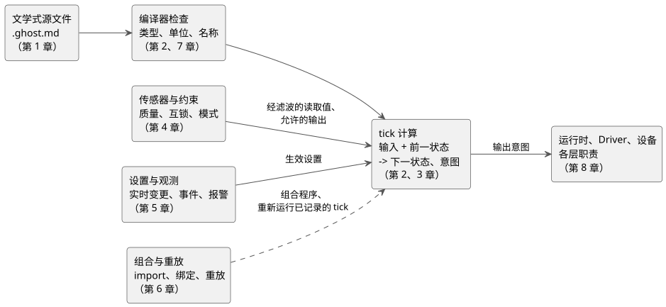

<!-- translation-source: docs/LANGUAGE-REFERENCE.en.md -->
[英文原文](LANGUAGE-REFERENCE.en.md)

# GhostFlow 语言参考

GhostFlow 是一种响应式控制语言。GhostFlow 程序根据传感器读数和用户输入，描述**状态如何变化，以及要向设备发出哪些输出意图**。

本参考是该语言的共同依据，涵盖设计理念、语法、语义、类型规则和使用约束，并说明每项功能存在的原因。其他文档都以本参考为基础；文档之间发生冲突时的处理方式，见[阅读约定](#阅读约定)。

本页的使用方法：

- **想查找某项功能？** 从下面的[目录](#完整目录)中选择一章。
- **想查找某种写法或符号？** 使用 [§7.5 声明与写法索引](reference/07-semantic-rules-and-index.zh.md)。
- **想知道某项需求由谁实现**（语言、编译器、运行时、Driver、绑定还是 UI）？参见 [§8.3 FAQ 职责表](reference/08-language-runtime-and-device-boundaries.zh.md)。
- **想按行为查看可运行的示例？** 参见 [GhostFlow 编程 FAQ](language_faq.zh.md)。
- **想了解语言为何是现在这个样子？** 阅读[设计理念](#设计理念)。

## 完整目录

本参考共有八章。每一章都是这一份文档的组成部分，直接阅读所需的章节即可。

| 章 | 内容 |
|---|---|
| [1. 源文件与语法](reference/01-source-and-syntax.zh.md) | 文学式源文件、代码块、意图锚点/链接、词汇、名称、作用域、声明结构 |
| [2. 类型、表达式与状态](reference/02-types-expressions-state.zh.md) | 字面量、整数、单位、运算符与优先级、函数与分支、tick、状态、输出 |
| [3. 时间与调度计划](reference/03-time-and-schedules.zh.md) | 时钟时间与经过时间、定时器、DailySlots、Solar、Cron、Periodic、日历、自然事件、回退（fallback） |
| [4. 传感器、约束与控制](reference/04-sensors-constraints-control.zh.md) | 质量、滤波、迟滞、设备能力与自适应、共享资源、模式、时间预算、连续控制 |
| [5. 设置与观测](reference/05-settings-and-observation.zh.md) | 带类型的设置与自动输入表单、实时变更、临时值、快照、事件、命令、报警、解释 |
| [6. 组合与重放](reference/06-composition-and-replay.zh.md) | 行为组合、import、实例、端口、绑定、语义 DAG、语法扩展、重放、ghost、替换 |
| [7. 语义保持规则与索引](reference/07-semantic-rules-and-index.zh.md) | 错误的区分、变换等价性，以及所有写法、符号、术语和原始文档的索引 |
| [8. FAQ 需求与各层职责](reference/08-language-runtime-and-device-boundaries.zh.md) | 贯穿 FAQ 的语言、编译器、运行时、环境、Driver、绑定、UI 职责，生命周期与必需的契约 |

下图展示了从源文档到设备输出的路径上，每一章所处的位置。它是一张阅读地图，而不是完整的执行模型；确切规则由各章定义。

简而言之：你编写一个文学式 `.ghost.md` 文档（第 1 章）。编译器检查类型、单位和名称，并拒绝无效程序（第 2 章和第 7 章）。在每个 tick（逻辑决策步）中，程序根据输入和前一状态（包括基于时间的值）计算下一状态和输出意图（第 2 章和第 3 章）。传感器质量和约束决定了哪些内容可以输出（第 4 章），操作员设置以生效值的形式进入计算（第 5 章）。程序可以组合，已记录的 tick 可以重放（第 6 章）。实际效果由运行时、Driver 和设备来执行（第 8 章）。

要查找任何写法，请使用[语法索引（§7.5）](reference/07-semantic-rules-and-index.zh.md)。要了解为支持 FAQ 中的需求每一层必须提供什么，请参见[第 8 章职责表（§8.3）](reference/08-language-runtime-and-device-boundaries.zh.md)。

## 阅读约定

各章用以下标签标注其内容：

| 标签 | 含义 |
|---|---|
| **语法** | 源文件中使用的写法及其含义。 |
| **设计写法** | 取自设计文档和讨论的概念。不要随意将其与已确定的写法混用。 |
| **规则** | 类型、作用域、求值、错误、时间和状态的含义。 |
| **Why** | 为什么需要该功能，以及它维护了哪些语言原则。 |
| **片段** | 为简洁起见省略了周围声明的示例。它不是完整的文档示例。 |

技术性的语法和语义决定遵循各章中的规则。现场做出的运行选择仍然作为显式参数保留；语言绝不会用隐藏的策略来替你填补。

**冲突的处理方式：**

- 2026-09-22 的语法策略整合是本参考的规范性决定。若早期的设计草案和写法与之冲突，请遵循本文档中精确的类型、语法和求值规则。[§8.6](reference/08-language-runtime-and-device-boundaries.zh.md) 将用户选择的运行值与语言之外的职责区分开来。
- 不同时期的文档发生冲突时，以明确修改该范围的较晚决定为准。例如，根据 [#105](https://github.com/callin2/ghostflow-language/issues/105) 和 [#110](https://github.com/callin2/ghostflow-language/issues/110) 的决定，运行设置以**在同一程序、同一运行内的原子实时事件**这一语义生效。该决定并不改变设施模式切换或任意状态写入的含义。

## 设计理念

设想一台泵在凌晨四点停了下来。写程序的人联系不上，现场必须有人找出原因。

这个人需要的是这样一个程序：它能帮助他理解设备为什么停下、该去哪里查看、自己可以修改什么。如果有些细节必须靠某人记住，光看代码无法得知，那么最终还是不得不再去找那个人。

在设计 GhostFlow 的过程中，有一个标准我反复回到。

**即使是凌晨四点，也应当能在现场读懂并修好它。**

起初，我只是想让过去用 PLC 做的控制工作，在廉价的 MCU 上做起来更轻松一些。但仅仅做到按下开关就让继电器吸合是不够的。你仍然需要理解随时间推移的行为背后的原因，在设备更换后继续沿用已有的工作，并且在原作者不在时也能让别人接手。

下面这些原则，就是在这一过程中做出的选择。

### 1. 让编写代码的理由与代码放在一起

“打开阀门，三秒后启动泵。”

代码可能就是这么写的。但为什么要等三秒？是阀门打开所需的时间，是为管路留出的余量，还是只是某人为了试一试随手填的数？不知道这一点，就很难判断能否把这三秒缩短到一秒。

因此，GhostFlow 把说明和代码放在同一个 `.ghost.md` 文档中。除了代码做什么之外，你还要记录为什么选择这种行为、它假设了什么样的设备和条件，并与相关代码关联起来。日后修改时，也应当能够追溯代码依据的是哪段说明，以及在哪个修订版中改了什么。

AI 编写的代码越多，这种区分就越重要。用户真正要求的内容，与 AI 为填补空白而做出的猜测是两回事。未经确认的假设应当保持为假设。加上一段看似合理的说明，并不会让它变成用户的意图。

### 2. 决定启动泵，不同于知道泵已经启动

即使程序说要启动泵，如果电源断开或设备出了问题，泵也可能不会运转。当屏幕显示 ON 时，我们需要区分“请求启动”与“确认它确实在运转”。

GhostFlow 接收输入并计算要请求哪些动作，它本身并不驱动硬件。名为*绑定*（binding）的连接配置说明这些请求发往哪些端口和设备。输入驱动程序提供事实，输出渲染器执行实际的硬件输出。像“水不够就停泵”这样的规则，不需要掺入某块特定电路板的引脚编号。

职责这样分离之后，你可以先用虚拟的开关和指示灯测试同一套规则，之后再连接到真实设备。你也可以设计不发送任何真实输出、只比较行为的运行。但在整个过程中，虚拟运行中产生的请求与设备在现场正确运行，始终是需要分别验证的两件事。

### 3. 应当能看到记住了什么，以及它接下来如何变化

要让电机在松开启动按钮后继续运转，就必须有东西记住按钮曾被按下。一个按顺序打开阀门的程序，也需要知道当前正在使用哪个阀门。

这种记忆应当放在 `state` 中。函数只根据收到的值进行计算；状态承载从一个 tick 到下一个 tick 所需的记忆。调用函数绝不应在暗中改变别处的值。

我看重的是**一种能够直接从当前状态和输入读出下一状态的结构**。如果读者必须在脑子里把执行顺序过好几遍才能理解，那么在现场修改就会更难。当计算结果被反馈到判定中时，它在下一次计算之前所经过的状态也应当清晰可见。

### 4. 今天应当能够重新检验昨天的判定

“昨天下午三点，它为什么请求启动泵？”

如果你记录了那一刻的输入、前一状态、生效设置和时间条件，那么在相同条件下应当能得到相同的判定。这样你就可以调查原因，而不必只依赖记忆或猜测。修改程序之后，你也可以提供相同的条件，比较哪些地方发生了变化。

为了做到这一点，一个 *tick*（一次控制计算）从头到尾使用同一组输入和同一个前一状态。所有下一状态在计算结束后一并提交。结果不应取决于哪一行代码先执行，也不应取决于某个函数是否暗中读取了时钟。你还应当能够分辨某次设置变更是从哪一次计算开始生效的。

AI 可以帮助编写程序，但我不希望每一个运行判定都依赖 AI 给出的新答案。在现场，设备应当在明确的执行条件下遵循经过验证的规则，而我们日后应当能够回溯这些判定。设备还应当能够在本地持续执行其基本控制，而无需等待互联网或 AI 的响应。

### 5. 不要让人每次读到数字时都去猜单位

如果一个设置只写着 `10`，你就得翻遍周围的代码，才能弄清它指的是十次、十秒还是百分之十。写的时候看似显而易见的含义，几个月后可能就很难记起来了。

GhostFlow 将次数、时间、百分比和物理量区分对待。它还区分需要精确整数的计数与处理近似值（如测量值）的数。这样做的目的是让语言来检查值的含义，而不是只依赖变量名。

在转换单位或把小数转换为整数时，转换本身、发生舍入的位置以及舍弃了什么，都应当可见。我希望语言能够捕获一部分原本只能靠仔细阅读才能避免的错误。

### 6. 浇水的那十分钟里，判定也必须继续

“早上 6 点浇水”“浇水十分钟”“今天的浇水总时间不超过三十分钟”是不同的需求。如果仅仅因为它们都与时间有关就把它们塞进一个定时器，那么一旦中途停止再重新开始，解释就可能开始出现分歧。

GhostFlow 区分开始的时间、连续经过的时间、累计使用时间和循环周期。它还需要记录发生的是哪一次调度计划的触发实例（occurrence），以便将再次收到同一触发实例与新的触发实例区分开。时钟显示的时间与测量经过时间的基准也是分开的。

最重要的是，等待十分钟绝不意味着程序停止做出其他判定。它需要持续检查停止按钮是否被按下、水是否不足。“日出后一小时”这样的条件也应当能够表达，但无法获取日出时间时该怎么办，需要单独规定。

### 7. 值未知时，要让这一事实保持可见

温度为零度，与无法读取温度传感器是两回事。拥有一个上次读取的值，也不同于现在可以信任并使用这个值。

我们将尚不可用的值、过于陈旧的值或读取失败与正常值区分开来。无法获取日出时间，也绝不能被当作“预定时间还没到”。如果未知的情况被简单地变成零或 false，后续的判定就无从得知出了什么问题。

针对这类情况的回退规则需要明确，并且适合设施的条件。即使用替代值继续计算，我们也需要保留记录：最初缺少了什么信息、为什么选择这种方式，以及何时恢复了正常。

### 8. 区分想做的事与被允许做的事

灌溉程序可能想在水箱空着的时候启动泵。两个程序可能想使用同一台泵，或者一台设备可能有不得同时接通的正转和反转输出。

把这些条件复制到每个程序的不同位置，很容易遗漏某一处，或者日后只改了其中一份。因此，我们把每个程序的请求，与约束整个设施允许做什么的条件分开处理。不能同时接通的输出、共享资源的规则、每种模式允许的操作以及运行时间限制都应当可见。当请求被阻止时，我们应当能够分辨是哪个条件阻止了它。

只向用户显示“泵 OFF”是不够的。他们应当能够顺着解释一路追溯到“到了浇水时间，但由于低水位输入，泵没有启动”。所以我希望即使是非专业人员，也能用自己的话询问行为背后的原因并核对答案。解释应当依据执行中的证据，而不是事后添加一个看似合理的说法。

当然，程序中的约束并不能取代物理安全装置。属于硬件的职责，例如急停和电气保护，仍然是分开的。

### 9. 不应为了修改浇水时间而重写程序

对于一个“每小时浇水十分钟”的程序，你今天可能想把它减到七分钟。如果这意味着也要修改控制代码，日常使用就不方便了。

运行期间可以调整的值，单独声明为设置。我们把它们的名称、类型、默认值、允许范围和权限一起记录下来，并明确变更后的值何时生效。修改设置、修改控制规则本身以及强行覆盖内部状态，是不同的事情。

屏幕也应当能够利用这些信息。对于时间设置，这可能意味着生成一个时间输入工具，并帮助人们保持在允许范围之内。我喜欢那种仿佛把现有控制柜上的开关和旋钮搬到屏幕上的界面，但它不必非得是那个样子。同样的设置在手机上也可以用不同方式呈现。**即使屏幕外观不同，控件的含义也应当保持不变。**

### 10. 找到两个好的示例，就应当能把它们一起使用

有一个灌溉控制示例和一个通风风扇控制示例，各自单独运行都很好。但如果要在一块电路板上同时使用它们，就得把两个程序拆开重写，那么不太擅长编程的人可能就会卡在这里。

我对此尤其感到沮丧。如果灌溉需要两个输入和三个输出，通风需要四个输出，我希望能够直接拿来每个程序，把设备连接到它所需的输入和输出上就能使用。

但这并不意味着只要输入输出的数量对得上就够了。我们需要检查这些程序是否共享资源、它们的约束是否冲突、它们的状态是否保持独立。我们还应当能够追溯原始代码及其修订版，以及当前连接到它的设备。

我也一直提醒自己，这些程序将运行在小型 MCU 上。一个组合看起来也许很简单，但如果它的计算永远完成不了，或者需要记住的值不断增长，那就成问题了。即使在组合之后，我们也应当能够评估它需要多少内存和计算量。我既想要复用他人工作成果的便利，也想要具备在自己的设备上为其运行负责的条件。

## 影响设计的观点

GhostFlow 带有一些我喜欢使用的工具的影响。我并没有照搬它们的语法，而是试图把那些让它们方便、易懂的东西带过来。

我喜欢 **Literate CoffeeScript** 的地方，是能够在一份文档中同时阅读说明和代码。你可以描述设备应当如何运行，并把代码放在需要的位置。我希望说明和代码从一开始就在一起，而不是另外要求一份写得很好的手册。

**ObservableHQ** 对我的影响，不仅在于值变化时相互关联的计算和显示会随之更新，还在于你可以拿来别人的 notebook，把它当作自己工作的一部分来使用。重要的是能够把一个做得好的成果当作下一项工作的素材，而不只是看一看。从 **marimo 和 D3.js** 中，我也看重了把代码和结果放在一起，以及看清值与变化之间的关系。

从**函数式编程**中，我借鉴了在不隐藏记忆和副作用的前提下组合小型计算的思路。从 **Cycle.js** 中，我借鉴了将接收输入、生成输出请求以及产生实际效果的渲染器三者分离的视角。这些都与将状态、计算和硬件区分开来的选择相关联。

**Elm 和 Rust** 影响了这样一种做法：利用类型检查和分支检查，在问题于运行时出现之前就捕获它们。我在 **railway-oriented programming** 中看重的东西与此类似：你应当能在代码中读出失败路径，而不只是正常结果。

从 **YAML** 中，我借鉴了能够展现名称和设置结构的声明方式。从 **Cypher** 中，我借鉴了按属性和能力而不是按位置来选择事物的方式。**Meta Lua** 让我感兴趣的，是把代码当作数据并加以扩展的可能性。不过，即使扩展了表达形式，也仍然应当能够检查代码的含义以及其影响所及的范围。

归根结底，这些偏好都指向同一个方向。**我不希望我们在构建过程中所理解的东西，在修改或交接时丢失。** 无论是人来编写还是 AI 协助，留在现场的人都需要能够读懂程序并做出判断。

本节描述的是 GhostFlow 追求的设计标准。每项功能实现到了什么程度、在实际设备上验证了哪些内容，需要另行确认。

## 本参考的维护规则

- 语言语义发生变化时，应同时更新相关章节的**语法、规则、示例和 Why**。
- 向 FAQ 添加新需求时，应将其关联到[第 8 章职责表和契约边界](reference/08-language-runtime-and-device-boundaries.zh.md)。
- 将设计依据链接到相关章节以及[原始文档索引（§7.8）](reference/07-semantic-rules-and-index.zh.md)。
- 本参考是一个文档集合。不要在其他项目中创建独立维护的副本，从而割裂其含义。
