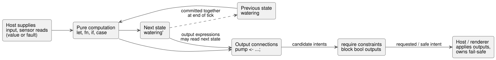
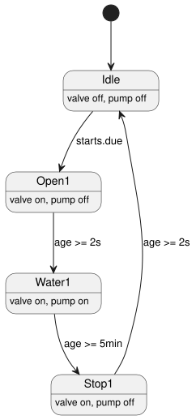

<!-- translation-source: docs/LANGUAGE-SURFACE.md -->
[Korean original](LANGUAGE-SURFACE.md)

# GhostFlow selected syntax · control

This page is a compact tour of the **selected GhostFlow surface syntax**: the `control` form built around braces, expressions, and output connections. It shows the core notation, how state, sensors, and outputs behave on each tick, how time and device adaptation are expressed, and three annotated examples. The [Language Reference](LANGUAGE-REFERENCE.en.md) remains the normative source for exact rules.

**Status:** a finite subset of the selected syntax is implemented. Extension sketches such as `adapt` are **not** implemented. Read this page together with the [implementation scope](IMPLEMENTATION.md) and the [executable tutorial](TUTORIAL.md).

**Background:** after the initial [A/B/C comparison](LANGUAGE-EXAMPLES.md), the control syntax centered on braces, expressions, and output connections was chosen as the basic direction, and literate packaging (code embedded in Markdown documents) was added.

## Core notation

| Notation | Meaning |
|---|---|
| `control Name { ... }` | Scope of a control program and deployment unit |
| `input start: Bool;` | Input supplied by the host each tick |
| `sensor moisture: Percent;` | Measurement payload type; reads distinguish success from errors |
| `sensor moisture?: Percent;` | Sensor capability whose installation is optional |
| `output pump: Bool;` | Type declaration for an output intent port |
| `state watering: Bool = false;` | State retained between ticks and its initial value |
| `let name = expression;` | Stateless computation |
| `watering' = expression;` | Definition of next state |
| `pump <- watering';` | Connect computed output intent to a port |
| `require pump => valve;` | Output constraint requiring the valve to be true when the pump is true |

Lexical rules:

- Names are ASCII identifiers. Type names are written as `Bool`, `Percent`, `Duration`, and so on.
- Semicolons end declarations and expression definitions. Braces mark scope.
- Indentation is only for readability.
- Code comments use `//`. In literate form, document explanations can be written freely around the code.

Expressions:

- Computations use `!`, `&&`, `||`, comparison operators, parentheses, and ordinary function calls.
- `if condition then a else b` and `case` are expressions: they return values. A `case` must handle every case.
- `in {A, B}` tests membership in a finite set of values.

```text
fn latch(start: Bool, stop: Bool, previous: Bool) -> Bool {
  !stop && (start || previous)
}
```

Functions are pure and return their final expression. The current implementation supports:

- static inline calls, and
- `let` computations that do not depend on declaration order.

Recursion and cycles are rejected. Higher-order functions and macros are later extensions.

## State, sensors, and outputs

A *tick* is one control computation. The diagram below shows what happens in one tick: the program reads inputs and previous state, computes next state and output intents, applies `require` constraints, and hands the resulting intent to the host.



**State.** `watering` is the previous state; `watering'` is the computed next state. All state definitions are computed from the same inputs and the same previous state, and they are committed together. (They correspond to `state.watering` and `next.watering` in the earlier draft.)

At this stage, next-state references (`name'`) are allowed only in output expressions. Expressions in which state transitions read one another's next state are rejected.

```text
let water_ok = case low_water {
  ok(low)  => !low;
  fault(_) => false;
};
```

**Sensors.** A sensor's declared type is its *successful payload*. An actual read is either that value or a fault, so the program must handle both (as in the `case` above). Even when a fault is handled with a substitute value, the original input error is still recorded.

**Outputs.** Input and output names are unique within a control. An output declares only its type, and it must have exactly one connection with the same name: `name <- expression;`. That connection defines the intent computed for this tick. You cannot write an initial value in the output declaration, and you cannot omit the connection.

**Constraints.** `require` is a pure output constraint. Initial support is limited to *requires* and *mutex* relationships between bool outputs:

- `pump => (valve1 || valve2)` blocks the pump if no valve-open intent exists.
- `!(valve1 && valve2)` blocks both valves if both are requested.

When there are several constraints, each computes its blocking set from the same candidate snapshot, and they are applied repeatedly. This does not define an automatic resolution policy for arbitrary logical expressions.

The later [common constraints contract](CONSTRAINTS.md) goes further. It defines named `constraints` groups, mode-entry interlocks, shared-facility limits, duplicate-schedule prevention, and optional capacity analysis. Note that:

- The bool-output blocking algorithm above is **not** generalized to every constraint.
- Automatic, manual, and configuration modes of the same facility are mutually exclusive.
- Structural changes are applied in Configure mode, after an explicit stop.

Operator setting declarations and atomic live event semantics follow [Reference §5.1–5.2](reference/05-settings-and-observation.md). Syntax/metadata support is separate from host support for executing live events; see the [implementation scope](IMPLEMENTATION.md) for execution coverage.

Sensor median filters, hysteresis, stale monitoring, and recovery conditions are connected through the manifest and the Rust sensor runtime. Sensor quality, including `NotReady` before the sensor is ready, is recorded in host traces.

## Device adaptation and time

**Device adaptation (design, not implemented).** `adapt` selects a computation method based on a confirmed device profile. For example, the optional sensor `moisture` may be read only inside `has moisture`.

- A temporarily faulty installed sensor is treated differently from a sensor that is not installed.
- Profile replacement happens at a tick boundary.
- Priority notation for overlapping capability conditions still needs to be settled.

**Optional device information.** Supplementary device information such as pressure and flow is entirely optional; basic control and interlocks work without it. If an optional analysis `check` lacks information, its result is Unknown and it does not block operation. A successful check becomes a start condition only when the user explicitly marks that analysis as a mandatory `require`. The detailed distinction follows the [optional-information contract](CONSTRAINTS.md).

**Daily schedules.** `schedule starts: DailySlots<15min>` is a setting that selects several of the 96 daily 15-minute slots in a local time zone.

- Duplicate slots and times outside the 15-minute grid are rejected.
- `starts.due` is a bool sample that is true once, on the tick that passes a selected time.
- During ordinary time progression, the same date/slot does not fire twice.
- The example does not retroactively run schedules from before boot, and it does not store schedules that arrive while it is running.
- Stable occurrence IDs, persistent execution records across clock correction or reboot, and per-facility cumulative time limits follow the [common constraints contract](CONSTRAINTS.md). A daily limit does not replace duplicate prevention.
- Detailed slot normalization rules for DST and schedule edits will be settled before the time syntax is implemented.

**Timers.** `timer age = elapsed(phase)` is the monotonic time elapsed since the last committed change of `phase`.

- The timer resets to zero when the tick that changes `phase` commits; later ticks read the elapsed time.
- Its initial value is zero, and the timer's internal state is included in checkpoint/replay.
- The declaration creates neither a wait command nor a separate execution thread.

**Durations and phase transitions.** `2s` and `5min` are Duration literals. A phase transitions at most once per tick, advancing on the first tick that satisfies its condition. The actual delay is therefore at least the requested value; in normal operation the extra delay is bounded by the tick resolution.

## Control examples to copy and read

The latching and schedule examples below compile with `ghostc` and run on a manifest host. The final `adapt` block is an **unimplemented design example** that the compiler explicitly rejects. Names and values are kept minimal so you can see one control's inputs, state, and output connections in one place.

### Stop-priority latching control

```text
control LatchingPump {
  input start: Bool;
  input stop: Bool;
  input enabled: Bool;

  output pump, valve: Bool;
  state running: Bool = false;

  // If stop and start arrive in the same tick, stop wins.
  running' = !stop && enabled && (start || running);
  valve <- running';
  pump <- running';

  require pump => valve;
}
```

How it behaves:

- `running` is the previous tick's latched state; `running'` is the value to commit this tick.
- Even if `start` is a one-tick pulse, `running` keeps the control on from the next tick onward.
- On any tick with `stop`, with `enabled == false`, or both, `running'` and both outputs become false.
- Consequently, pressing `start` and `stop` in the same tick does not restart the control.

What it does **not** cover:

- `enabled` is only a local permission input, and the one-line `require` only relates two bool outputs. Do not read this control as implementing automatic/manual/configuration mode transitions, shared-pump ownership with other controls, or a total valve-count limit. Facility-wide interlocks and arbitration belong to the mode manager and shared-facility constraints in the [common constraints contract](CONSTRAINTS.md).
- Feedback sensors, pressure, and flow are not mandatory inputs to this basic example.

Computing output intent is a different boundary from actually starting or stopping an output, or putting it in a safe state on failure. The GhostFlow VM only computes connection expressions and safety constraints and returns the requested/safe intent. The host/renderer owns the fail-safe policy that turns all outputs OFF on boot, failure, or disconnection, and decides when it applies. Do not read the missing initial value in an `output` declaration as expressing such a policy.

### Single-valve watering example illustrating schedules and timers

The following **design example** reduces the schedule and phase-transition parts of the [literate watering example](../examples/scheduled-watering.ghost.md) to a single-valve control. The complete two-valve example is in the linked file. Here you can read the input declarations, state transitions, and output connections together.

```text
control TimedWatering {
  schedule starts: DailySlots<15min> {
    timezone = "Asia/Seoul";
    selected = [06:00, 18:45];
  }

  output pump, valve: Bool;
  type Phase = Idle | Open1 | Water1 | Stop1;

  state phase: Phase = Idle;
  timer age = elapsed(phase);

  phase' = case phase {
    Idle =>
      if starts.due then Open1 else Idle;

    Open1 =>
      if age >= 2s then Water1 else Open1;

    Water1 =>
      if age >= 5min then Stop1 else Water1;

    Stop1 =>
      if age >= 2s then Idle else Stop1;
  };

  valve <- phase' in {Open1, Water1, Stop1};
  pump  <- phase' in {Water1};
  require pump => valve;
}
```

The phases form a simple cycle. The diagram shows each transition condition and which outputs are on in each phase.



Expected behavior:

1. `Idle` changes to `Open1` only on the tick that passes a selected 06:00 or 18:45 slot.
2. When entry into `Open1` commits, `age` becomes zero. After at least 2 seconds the phase changes to `Water1`.
3. After at least another 5 minutes it changes to `Stop1`.
4. `Stop1` is held for at least 2 seconds before returning to `Idle`.

Because each phase transition happens at most once per tick, one long tick does not rush through all phases at once.

This code explains the normal schedule/timer path. It is **not** an independently safe, complete facility program. `pump` is on only in `Water1`; in `Stop1` it stays off while the valve cleanup interval elapses. External stop, shared-resource permission, duplicate-occurrence suppression, and daily limits are not built into this state machine; their scope follows the [common constraints contract](CONSTRAINTS.md).

### Optional moisture adaptation: syntax-unsettled sketch

`examples/scheduled-watering.ghost.md` contains no `adapt` notation. The block below is therefore an **extension sketch**. It shows only the intent of the `has moisture` guarded scope described above; it does not establish complete syntax or an execution contract.

```text
// Extension sketch — the actual adapt block notation and precedence are not yet settled.
// Read optional moisture only within the has moisture guarded scope.
has moisture {
  // A calculation could adjust watering time using a valid moisture value.
  // Handle a transient sensor fault separately from the sensor being absent.
}

// Without moisture, the basic schedule/timer control continues to operate unchanged.
```

In other words, moisture is an optional capability used only in profiles where the sensor is installed. Basic watering does not need it to start.

- Moisture filtering, fault, and recovery handling follow the [sensor contract](CONSTRAINTS.md). The exact `adapt` block notation is later scope.
- Supplementary information such as pressure and flow is likewise not forced into basic control.
- To make an advanced analysis a mandatory start condition, the user must explicitly add a `require`.

## Literate is document-form input for the same language

The only formal GhostFlow input is a `.ghost.md` literate document.

- One control may be split into several `ghost` blocks between explanatory paragraphs. The extracted code lowers to the same type and execution model.
- Plain `.ghost` raw files are historical evidence only. They are neither compiler input nor a fallback.
- The detailed extraction and source-map contract is in [LITERATE.md](LITERATE.md).

The [literate watering example](../examples/scheduled-watering.ghost.md) is the formal executable example. The reference implementation runs the current control syntax, time features, and literate documents using GFB1 and a manifest. Unimplemented extensions are listed in the [implementation boundary](IMPLEMENTATION.md). The principles of determinism, error recording, ghost execution, and module replacement from the [0.2 common contract](LANGUAGE.md) are inherited.
