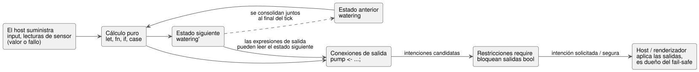
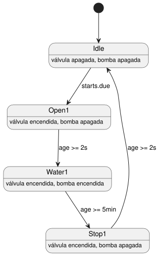

<!-- translation-source: docs/LANGUAGE-SURFACE.en.md -->
[Original en inglés](LANGUAGE-SURFACE.en.md)

# Sintaxis seleccionada de GhostFlow · control

Esta página es un recorrido compacto por la **sintaxis de superficie seleccionada de GhostFlow**: la forma `control`, construida en torno a llaves, expresiones y conexiones de salida. Muestra la notación básica, cómo se comportan el estado, los sensores y las salidas en cada tick, cómo se expresan el tiempo y la adaptación a los dispositivos, y tres ejemplos comentados. La [Referencia del lenguaje](LANGUAGE-REFERENCE.es.md) sigue siendo la fuente normativa de las reglas exactas.

**Estado:** está implementado un subconjunto finito de la sintaxis seleccionada. Los bocetos de extensión como `adapt` **no** están implementados. Lea esta página junto con el [alcance de la implementación](IMPLEMENTATION.es.md) y el [tutorial ejecutable](TUTORIAL.es.md).

**Contexto:** tras la [comparación A/B/C](LANGUAGE-EXAMPLES.es.md) inicial, se eligió como dirección básica la sintaxis de control centrada en llaves, expresiones y conexiones de salida, y se añadió el empaquetado literario (código incrustado en documentos Markdown).

## Notación básica

| Notación | Significado |
|---|---|
| `control Name { ... }` | Ámbito de un programa de control y unidad de despliegue |
| `input start: Bool;` | Entrada que el host suministra en cada tick |
| `sensor moisture: Percent;` | Tipo de la carga útil de la medición; las lecturas distinguen el éxito de los errores |
| `sensor moisture?: Percent;` | Capacidad de sensor cuya instalación es opcional |
| `output pump: Bool;` | Declaración de tipo de un puerto de intención de salida |
| `state watering: Bool = false;` | Estado que se conserva entre ticks y su valor inicial |
| `let name = expression;` | Cálculo sin estado |
| `watering' = expression;` | Definición del estado siguiente |
| `pump <- watering';` | Conecta la intención de salida calculada a un puerto |
| `require pump => valve;` | Restricción de salida que exige que la válvula sea verdadera cuando la bomba es verdadera |

Reglas léxicas:

- Los nombres son identificadores ASCII. Los nombres de tipo se escriben como `Bool`, `Percent`, `Duration`, etc.
- El punto y coma termina las declaraciones y las definiciones de expresiones. Las llaves delimitan el ámbito.
- La sangría solo sirve para la legibilidad.
- Los comentarios de código usan `//`. En la forma literaria, las explicaciones del documento pueden escribirse libremente alrededor del código.

Expresiones:

- Los cálculos usan `!`, `&&`, `||`, operadores de comparación, paréntesis y llamadas a funciones ordinarias.
- `if condition then a else b` y `case` son expresiones: devuelven valores. Un `case` debe tratar todos los casos.
- `in {A, B}` comprueba la pertenencia a un conjunto finito de valores.

```text
fn latch(start: Bool, stop: Bool, previous: Bool) -> Bool {
  !stop && (start || previous)
}
```

Las funciones son puras y devuelven su expresión final. La implementación actual admite:

- llamadas estáticas en línea, y
- cálculos `let` que no dependen del orden de declaración.

La recursión y los ciclos se rechazan. Las funciones de orden superior y las macros son extensiones posteriores.

## Estado, sensores y salidas

Un *tick* (paso de decisión lógica) es un cálculo de control. El diagrama siguiente muestra lo que ocurre en un tick: el programa lee las entradas y el estado anterior, calcula el estado siguiente y las intenciones de salida, aplica las restricciones `require` y entrega la intención resultante al host.



**Estado.** `watering` es el estado anterior; `watering'` es el estado siguiente calculado. Todas las definiciones de estado se calculan a partir de las mismas entradas y del mismo estado anterior, y se consolidan juntas. (Corresponden a `state.watering` y `next.watering` del borrador anterior).

En esta etapa, las referencias al estado siguiente (`name'`) solo se permiten en las expresiones de salida. Se rechazan las expresiones en las que las transiciones de estado leen el estado siguiente unas de otras.

```text
let water_ok = case low_water {
  ok(low)  => !low;
  fault(_) => false;
};
```

**Sensores.** El tipo declarado de un sensor es su *carga útil en caso de éxito*. Una lectura real es ese valor o un fallo, por lo que el programa debe tratar ambos casos (como en el `case` anterior). Aunque un fallo se trate con un valor sustituto, el error de entrada original sigue quedando registrado.

**Salidas.** Los nombres de entradas y salidas son únicos dentro de un control. Una salida declara solo su tipo y debe tener exactamente una conexión con el mismo nombre: `name <- expression;`. Esa conexión define la intención calculada para este tick. No se puede escribir un valor inicial en la declaración de salida ni se puede omitir la conexión.

**Restricciones.** `require` es una restricción de salida pura. El soporte inicial se limita a las relaciones de *requisito* (requires) y de *exclusión mutua* (mutex) entre salidas bool:

- `pump => (valve1 || valve2)` bloquea la bomba si no existe ninguna intención de abrir una válvula.
- `!(valve1 && valve2)` bloquea ambas válvulas si se solicitan las dos.

Cuando hay varias restricciones, cada una calcula su conjunto de bloqueo a partir de la misma instantánea candidata, y se aplican de forma repetida. Esto no define una política de resolución automática para expresiones lógicas arbitrarias.

El [contrato común de restricciones](CONSTRAINTS.es.md), posterior, va más allá. Define grupos `constraints` con nombre, enclavamientos de entrada a modo, límites de instalaciones compartidas, prevención de programaciones duplicadas y un análisis de capacidad opcional. Tenga en cuenta que:

- El algoritmo de bloqueo de salidas bool anterior **no** se generaliza a todas las restricciones.
- Los modos automático, manual y de configuración de una misma instalación son mutuamente excluyentes.
- Los cambios estructurales se aplican en el modo Configure, tras una parada explícita.

Las declaraciones de ajustes del operador y la semántica de eventos en vivo atómicos siguen la [Referencia §5.1–5.2](reference/05-settings-and-observation.es.md). El soporte de sintaxis y metadatos es independiente del soporte del host para ejecutar eventos en vivo; consulte el [alcance de la implementación](IMPLEMENTATION.es.md) para conocer la cobertura de ejecución.

Los filtros de mediana de los sensores, la histéresis, la supervisión de valores obsoletos (stale) y las condiciones de recuperación se conectan a través del manifiesto y del runtime de sensores en Rust. La calidad de los sensores, incluido `NotReady` antes de que el sensor esté listo, se registra en las trazas del host.

## Adaptación a los dispositivos y tiempo

**Adaptación a los dispositivos (diseño, no implementado).** `adapt` selecciona un método de cálculo en función de un perfil de dispositivo confirmado. Por ejemplo, el sensor opcional `moisture` solo puede leerse dentro de `has moisture`.

- Un sensor instalado con un fallo temporal se trata de forma distinta a un sensor que no está instalado.
- El reemplazo de perfil ocurre en un límite de tick.
- Todavía falta definir la notación de prioridad para condiciones de capacidad que se solapan.

**Información opcional de los dispositivos.** La información complementaria de los dispositivos, como la presión y el caudal, es completamente opcional; el control básico y los enclavamientos funcionan sin ella. Si a un análisis opcional `check` le falta información, su resultado es Unknown y no bloquea la operación. Una comprobación satisfactoria se convierte en condición de arranque solo cuando el usuario marca explícitamente ese análisis como un `require` obligatorio. La distinción detallada sigue el [contrato de información opcional](CONSTRAINTS.es.md).

**Programaciones diarias.** `schedule starts: DailySlots<15min>` es un ajuste que selecciona varias de las 96 franjas diarias de 15 minutos en una zona horaria local.

- Se rechazan las franjas duplicadas y las horas fuera de la cuadrícula de 15 minutos.
- `starts.due` es una muestra bool que es verdadera una sola vez, en el tick que pasa por una hora seleccionada.
- Durante el avance ordinario del tiempo, la misma fecha/franja no se dispara dos veces.
- El ejemplo no ejecuta retroactivamente programaciones anteriores al arranque ni almacena programaciones que lleguen mientras está en ejecución.
- Los identificadores de ocurrencia estables, los registros de ejecución persistentes ante correcciones de reloj o reinicios y los límites de tiempo acumulado por instalación siguen el [contrato común de restricciones](CONSTRAINTS.es.md). Un límite diario no sustituye a la prevención de duplicados.
- Las reglas detalladas de normalización de franjas para el horario de verano (DST) y para las ediciones de programaciones se definirán antes de implementar la sintaxis de tiempo.

**Temporizadores.** `timer age = elapsed(phase)` es el tiempo monotónico transcurrido desde el último cambio consolidado de `phase`.

- El temporizador vuelve a cero cuando se consolida el tick que cambia `phase`; los ticks posteriores leen el tiempo transcurrido.
- Su valor inicial es cero, y el estado interno del temporizador se incluye en checkpoint/replay.
- La declaración no crea ni un comando de espera ni un hilo de ejecución independiente.

**Duraciones y transiciones de fase.** `2s` y `5min` son literales Duration. Una fase cambia como máximo una vez por tick y avanza en el primer tick que cumple su condición. Por tanto, el retardo real es al menos el valor solicitado; en operación normal, el retardo adicional está acotado por la resolución del tick.

## Ejemplos de control para copiar y leer

Los ejemplos de autorretención y de programación siguientes se compilan con `ghostc` y se ejecutan en un host con manifiesto. El bloque `adapt` final es un **ejemplo de diseño no implementado** que el compilador rechaza explícitamente. Los nombres y valores se mantienen al mínimo para que se vean en un solo lugar las entradas, el estado y las conexiones de salida de un control.

### Control con autorretención y prioridad de paro

```text
control LatchingPump {
  input start: Bool;
  input stop: Bool;
  input enabled: Bool;

  output pump, valve: Bool;
  state running: Bool = false;

  // Si stop y start llegan en el mismo tick, gana stop.
  running' = !stop && enabled && (start || running);
  valve <- running';
  pump <- running';

  require pump => valve;
}
```

Cómo se comporta:

- `running` es el estado retenido del tick anterior; `running'` es el valor que se consolidará en este tick.
- Aunque `start` sea un pulso de un solo tick, `running` mantiene el control activo a partir del tick siguiente.
- En cualquier tick con `stop`, con `enabled == false` o con ambos, `running'` y las dos salidas pasan a falso.
- En consecuencia, pulsar `start` y `stop` en el mismo tick no vuelve a arrancar el control.

Lo que **no** cubre:

- `enabled` es solo una entrada de permiso local, y el `require` de una línea solo relaciona dos salidas bool. No interprete este control como una implementación de transiciones entre los modos automático, manual y de configuración, de la titularidad de una bomba compartida con otros controles ni de un límite del número total de válvulas. Los enclavamientos y el arbitraje de toda la instalación corresponden al gestor de modos y a las restricciones de instalaciones compartidas del [contrato común de restricciones](CONSTRAINTS.es.md).
- Los sensores de retroalimentación, la presión y el caudal no son entradas obligatorias de este ejemplo básico.

Calcular la intención de salida es un límite distinto de arrancar o detener realmente una salida, o de llevarla a un estado seguro ante un fallo. La VM de GhostFlow solo calcula las expresiones de conexión y las restricciones de seguridad y devuelve la intención solicitada/segura. El host/renderizador es responsable de la política a prueba de fallos (fail-safe) que pone todas las salidas en OFF al arrancar, ante un fallo o ante una desconexión, y decide cuándo se aplica. No interprete la ausencia de valor inicial en una declaración `output` como la expresión de dicha política.

### Ejemplo de riego con una sola válvula que ilustra programaciones y temporizadores

El siguiente **ejemplo de diseño** reduce las partes de programación y de transición de fases del [ejemplo literario de riego](../examples/scheduled-watering.ghost.es.md) a un control de una sola válvula. El ejemplo completo de dos válvulas está en el archivo enlazado. Aquí pueden leerse juntas las declaraciones de entrada, las transiciones de estado y las conexiones de salida.

```text
control TimedWatering {
  schedule starts: DailySlots<15min> {
    timezone = "Asia/Seoul";
    selected = [06:00, 18:45];
  }

  output pump, valve: Bool;
  type Phase = Idle | Open1 | Water1 | Stop1;

  state phase: Phase = Idle;
  timer age = elapsed(phase);

  phase' = case phase {
    Idle =>
      if starts.due then Open1 else Idle;

    Open1 =>
      if age >= 2s then Water1 else Open1;

    Water1 =>
      if age >= 5min then Stop1 else Water1;

    Stop1 =>
      if age >= 2s then Idle else Stop1;
  };

  valve <- phase' in {Open1, Water1, Stop1};
  pump  <- phase' in {Water1};
  require pump => valve;
}
```

Las fases forman un ciclo simple. El diagrama muestra la condición de cada transición y qué salidas están activas en cada fase.



Comportamiento esperado:

1. `Idle` cambia a `Open1` solo en el tick que pasa por una franja seleccionada de 06:00 o 18:45.
2. Cuando se consolida la entrada en `Open1`, `age` pasa a cero. Tras al menos 2 segundos, la fase cambia a `Water1`.
3. Tras al menos otros 5 minutos, cambia a `Stop1`.
4. `Stop1` se mantiene al menos 2 segundos antes de volver a `Idle`.

Como cada transición de fase ocurre como máximo una vez por tick, un tick largo no atraviesa de golpe todas las fases.

Este código explica el camino normal de programación y temporizador. **No** es un programa de instalación completo y seguro por sí mismo. `pump` solo está activa en `Water1`; en `Stop1` permanece apagada mientras transcurre el intervalo de cierre de la válvula. La parada externa, el permiso de recursos compartidos, la supresión de ocurrencias duplicadas y los límites diarios no están incorporados en esta máquina de estados; su alcance sigue el [contrato común de restricciones](CONSTRAINTS.es.md).

### Adaptación opcional a la humedad: boceto con sintaxis no definida

`examples/scheduled-watering.ghost.md` no contiene notación `adapt`. Por tanto, el bloque siguiente es un **boceto de extensión**. Solo muestra la intención del ámbito protegido por `has moisture` descrito anteriormente; no establece una sintaxis completa ni un contrato de ejecución.

```text
// Boceto de extensión: la notación real del bloque adapt y su precedencia aún no están definidas.
// Leer la humedad opcional solo dentro del ámbito protegido por has moisture.
has moisture {
  // Un cálculo podría ajustar el tiempo de riego con un valor de humedad válido.
  // Tratar un fallo transitorio del sensor por separado de la ausencia del sensor.
}

// Sin moisture, el control básico de programación/temporizador sigue funcionando sin cambios.
```

En otras palabras, la humedad es una capacidad opcional que solo se usa en los perfiles en los que el sensor está instalado. El riego básico no la necesita para arrancar.

- El filtrado de la humedad y el tratamiento de fallos y recuperación siguen el [contrato de sensores](CONSTRAINTS.es.md). La notación exacta del bloque `adapt` queda para un alcance posterior.
- La información complementaria, como la presión y el caudal, tampoco se impone al control básico.
- Para que un análisis avanzado sea una condición de arranque obligatoria, el usuario debe añadir explícitamente un `require`.

## Literate es una entrada en forma de documento para el mismo lenguaje

La única entrada formal de GhostFlow es un documento literario `.ghost.md`.

- Un control puede dividirse en varios bloques `ghost` entre párrafos explicativos. El código extraído se reduce al mismo modelo de tipos y de ejecución.
- Los archivos `.ghost` sin formato son solo evidencia histórica. No son ni entrada del compilador ni un respaldo (fallback).
- El contrato detallado de extracción y de mapa de fuentes está en [LITERATE.md](LITERATE.es.md).

El [ejemplo literario de riego](../examples/scheduled-watering.ghost.es.md) es el ejemplo ejecutable formal. La implementación de referencia ejecuta la sintaxis de control actual, las funciones de tiempo y los documentos literarios usando GFB1 y un manifiesto. Las extensiones no implementadas se enumeran en el [límite de la implementación](IMPLEMENTATION.es.md). Se heredan los principios de determinismo, registro de errores, ejecución ghost y reemplazo de módulos del [contrato común 0.2](LANGUAGE.es.md).
