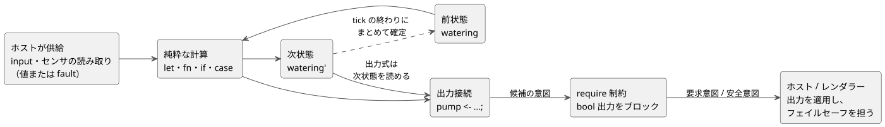
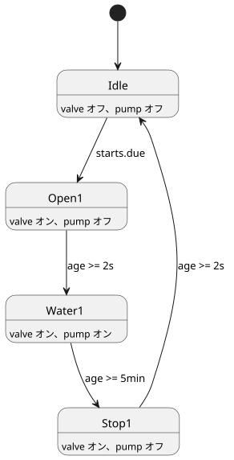

<!-- translation-source: docs/LANGUAGE-SURFACE.en.md -->
[英語の原文](LANGUAGE-SURFACE.en.md)

# GhostFlow の選定構文 · control

このページは、**選定された GhostFlow の表層構文**、つまり波かっこ、式、出力接続を軸にした `control` 形式を手短に紹介するものです。中核となる表記、各 tick（論理判断の単位）で状態・センサ・出力がどう振る舞うか、時間とデバイス適応の表し方、そして注釈付きの 3 つの例を示します。厳密な規則については、引き続き[言語リファレンス](LANGUAGE-REFERENCE.ja.md)が規範となる情報源です。

**状態:** 選定構文のうち有限のサブセットが実装されています。`adapt` のような拡張スケッチは**実装されていません**。このページは[実装範囲](IMPLEMENTATION.ja.md)と[実行可能なチュートリアル](TUTORIAL.ja.md)とあわせて読んでください。

**背景:** 最初の [A/B/C 比較](LANGUAGE-EXAMPLES.ja.md)の後、波かっこ、式、出力接続を中心とする制御構文が基本方針として選ばれ、文芸的なパッケージング（Markdown 文書に埋め込んだコード）が加えられました。

## 中核となる表記

| 表記 | 意味 |
|---|---|
| `control Name { ... }` | 制御プログラムのスコープであり、デプロイの単位 |
| `input start: Bool;` | ホストが tick ごとに供給する入力 |
| `sensor moisture: Percent;` | 測定のペイロード型。読み取りでは成功とエラーを区別する |
| `sensor moisture?: Percent;` | 設置が任意であるセンサのケイパビリティ |
| `output pump: Bool;` | 出力意図ポートの型宣言 |
| `state watering: Bool = false;` | tick をまたいで保持される状態とその初期値 |
| `let name = expression;` | 状態を持たない計算 |
| `watering' = expression;` | 次状態の定義 |
| `pump <- watering';` | 計算した出力意図をポートに接続する |
| `require pump => valve;` | pump が true のとき valve が true であることを要求する出力制約 |

字句規則:

- 名前は ASCII の識別子です。型名は `Bool`、`Percent`、`Duration` などと書きます。
- セミコロンは宣言と式の定義を終わらせます。波かっこはスコープを示します。
- インデントは読みやすさのためだけのものです。
- コードのコメントには `//` を使います。文芸的な形式では、コードの周りに文書としての説明を自由に書けます。

式:

- 計算には `!`、`&&`、`||`、比較演算子、かっこ、通常の関数呼び出しを使います。
- `if condition then a else b` と `case` は式であり、値を返します。`case` はすべての場合を扱わなければなりません。
- `in {A, B}` は、値の有限集合に含まれるかどうかを判定します。

```text
fn latch(start: Bool, stop: Bool, previous: Bool) -> Bool {
  !stop && (start || previous)
}
```

関数は純粋で、最後の式を返します。現在の実装がサポートしているのは次のものです。

- 静的なインライン呼び出し
- 宣言の順序に依存しない `let` の計算

再帰と循環は拒否されます。高階関数とマクロは後の拡張です。

## 状態、センサ、出力

*tick* は 1 回の制御計算です。次の図は 1 回の tick で起きることを示しています。プログラムは入力と前状態を読み、次状態と出力意図を計算し、`require` 制約を適用して、その結果の意図をホストに渡します。



**状態.** `watering` は前状態、`watering'` は計算された次状態です。すべての状態定義は同じ入力と同じ前状態から計算され、まとめて確定します。（以前の草案の `state.watering` と `next.watering` に相当します。）

この段階では、次状態の参照（`name'`）は出力式の中でのみ許されます。状態遷移が互いの次状態を読み合う式は拒否されます。

```text
let water_ok = case low_water {
  ok(low)  => !low;
  fault(_) => false;
};
```

**センサ.** センサの宣言型は、その*成功時のペイロード*です。実際の読み取りはその値か故障（fault）のどちらかなので、プログラムは（上の `case` のように）両方を扱わなければなりません。故障を代わりの値で処理した場合でも、元の入力エラーは記録されたまま残ります。

**出力.** 入力と出力の名前は control の中で一意です。出力は型だけを宣言し、同じ名前の接続 `name <- expression;` をちょうど 1 つ持たなければなりません。その接続が、この tick で計算される意図を定義します。出力宣言に初期値を書くことはできず、接続を省略することもできません。

**制約.** `require` は純粋な出力制約です。初期のサポートは、bool 出力どうしの *requires* 関係と *mutex* 関係に限られます。

- `pump => (valve1 || valve2)` は、バルブを開ける意図がひとつもなければポンプをブロックします。
- `!(valve1 && valve2)` は、両方のバルブが要求された場合に両方をブロックします。

制約が複数ある場合、それぞれが同じ候補スナップショットからブロック対象の集合を計算し、それらが繰り返し適用されます。これは、任意の論理式に対する自動的な解決ポリシーを定義するものではありません。

後に作られた[共通制約契約](CONSTRAINTS.ja.md)はさらに踏み込んでいます。名前付きの `constraints` グループ、モードに入るときのインターロック、共有設備の上限、スケジュールの重複防止、任意の容量分析を定義しています。次の点に注意してください。

- 上で説明した bool 出力のブロックのアルゴリズムは、すべての制約に一般化されるわけでは**ありません**。
- 同じ設備の自動、手動、構成の各モードは相互に排他的です。
- 構造の変更は、明示的に停止した後、Configure モードで適用されます。

オペレーターの設定宣言とアトミックなライブイベントの意味論は、[リファレンス §5.1–5.2](reference/05-settings-and-observation.ja.md)に従います。構文やメタデータのサポートは、ライブイベントを実行するためのホスト側のサポートとは別です。実行面のカバー範囲は[実装範囲](IMPLEMENTATION.ja.md)を参照してください。

センサの中央値フィルタ、ヒステリシス、古い値（stale）の監視、復旧条件は、マニフェストと Rust のセンサランタイムを通じて接続されています。センサが準備できる前の `NotReady` を含むセンサの品質は、ホストのトレースに記録されます。

## デバイス適応と時間

**デバイス適応（設計段階、未実装）.** `adapt` は、確定したデバイスプロファイルに基づいて計算方法を選びます。たとえば、オプションのセンサ `moisture` は `has moisture` の中でだけ読めるようにします。

- 一時的に故障している設置済みのセンサは、設置されていないセンサとは異なる扱いを受けます。
- プロファイルの置き換えは tick の境界で行われます。
- 重なり合うケイパビリティ条件の優先順位の表記は、まだ決まっていません。

**任意のデバイス情報.** 圧力や流量のような補足的なデバイス情報はすべて任意であり、基本的な制御とインターロックはそれがなくても動作します。任意の分析 `check` に必要な情報が欠けている場合、その結果は Unknown となり、運転をブロックしません。成功した check が起動条件になるのは、ユーザーがその分析を必須の `require` として明示的に指定した場合だけです。詳しい区別は[任意情報の契約](CONSTRAINTS.ja.md)に従います。

**日次スケジュール.** `schedule starts: DailySlots<15min>` は、ローカルのタイムゾーンにおける 1 日 96 個の 15 分スロットからいくつかを選ぶ設定です。

- 重複したスロットや、15 分のグリッドから外れた時刻は拒否されます。
- `starts.due` は bool のサンプルで、選ばれた時刻を通過する tick で一度だけ true になります。
- 通常の時間の進行では、同じ日付・スロットが二度発火することはありません。
- この例は、起動前のスケジュールをさかのぼって実行することはなく、実行中に到来したスケジュールを溜めておくこともありません。
- 安定した発生（occurrence）ID、時計の補正や再起動をまたいで永続化される実行記録、設備ごとの累積時間の上限は、[共通制約契約](CONSTRAINTS.ja.md)に従います。1 日あたりの上限は重複防止の代わりにはなりません。
- 夏時間（DST）やスケジュール編集時のスロット正規化の詳細な規則は、時間構文を実装する前に決める予定です。

**タイマー.** `timer age = elapsed(phase)` は、`phase` が最後に確定した変化からの単調な経過時間です。

- `phase` を変える tick が確定すると、タイマーはゼロにリセットされます。以降の tick は経過時間を読みます。
- 初期値はゼロで、タイマーの内部状態はチェックポイント/リプレイに含まれます。
- この宣言は、待機コマンドも別個の実行スレッドも作りません。

**継続時間とフェーズ遷移.** `2s` と `5min` は Duration リテラルです。フェーズは 1 tick につき最大 1 回だけ遷移し、条件を満たした最初の tick で進みます。したがって実際の遅延は少なくとも要求した値以上になり、通常の運転では余分な遅延は tick の分解能の範囲に収まります。

## コピーして読める制御の例

以下のラッチとスケジュールの例は、`ghostc` でコンパイルでき、マニフェストホスト上で動きます。最後の `adapt` ブロックは、コンパイラが明示的に拒否する**未実装の設計例**です。1 つの control の入力、状態、出力接続を一か所で見られるよう、名前と値は最小限にしてあります。

### 停止優先の自己保持制御

```text
control LatchingPump {
  input start: Bool;
  input stop: Bool;
  input enabled: Bool;

  output pump, valve: Bool;
  state running: Bool = false;

  // 同じ tick で stop と start が届いた場合は stop が優先されます。
  running' = !stop && enabled && (start || running);
  valve <- running';
  pump <- running';

  require pump => valve;
}
```

振る舞い:

- `running` は前の tick でラッチされた状態で、`running'` はこの tick で確定する値です。
- `start` が 1 tick だけのパルスであっても、`running` によって次の tick 以降も制御はオンのままになります。
- `stop` がある tick、`enabled == false` の tick、またはその両方の tick では、`running'` と両方の出力が false になります。
- その結果、同じ tick で `start` と `stop` を押しても制御は再起動しません。

この例が扱って**いない**こと:

- `enabled` はローカルな許可入力にすぎず、1 行の `require` は 2 つの bool 出力を関係付けているだけです。この control を、自動/手動/構成モードの遷移、ほかの control との共有ポンプの所有権、バルブの合計数の上限を実装したものとして読まないでください。設備全体のインターロックと調停（アービトレーション）は、[共通制約契約](CONSTRAINTS.ja.md)のモードマネージャと共有設備の制約が担います。
- フィードバックセンサ、圧力、流量は、この基本例の必須入力ではありません。

出力意図を計算することは、出力を実際に起動・停止したり、故障時に安全な状態にしたりすることとは別の境界です。GhostFlow VM は接続式と安全制約を計算し、要求意図/安全意図を返すだけです。起動時、故障時、切断時にすべての出力を OFF にするフェイルセーフのポリシーと、それをいつ適用するかの判断は、ホスト/レンダラーが担います。`output` 宣言に初期値がないことを、そのようなポリシーを表すものとして読まないでください。

### スケジュールとタイマーを示す単一バルブの灌水例

次の**設計例**は、[文芸的な灌水例](../examples/scheduled-watering.ghost.ja.md)のスケジュールとフェーズ遷移の部分を、単一バルブの制御にまで縮めたものです。2 つのバルブを使う完全な例はリンク先のファイルにあります。ここでは、入力宣言、状態遷移、出力接続を一緒に読めます。

```text
control TimedWatering {
  schedule starts: DailySlots<15min> {
    timezone = "Asia/Seoul";
    selected = [06:00, 18:45];
  }

  output pump, valve: Bool;
  type Phase = Idle | Open1 | Water1 | Stop1;

  state phase: Phase = Idle;
  timer age = elapsed(phase);

  phase' = case phase {
    Idle =>
      if starts.due then Open1 else Idle;

    Open1 =>
      if age >= 2s then Water1 else Open1;

    Water1 =>
      if age >= 5min then Stop1 else Water1;

    Stop1 =>
      if age >= 2s then Idle else Stop1;
  };

  valve <- phase' in {Open1, Water1, Stop1};
  pump  <- phase' in {Water1};
  require pump => valve;
}
```

フェーズは単純なサイクルを形作ります。図には、各遷移の条件と、各フェーズでどの出力がオンになるかを示しています。



期待される振る舞い:

1. `Idle` が `Open1` に変わるのは、選ばれた 06:00 または 18:45 のスロットを通過する tick だけです。
2. `Open1` への遷移が確定すると、`age` はゼロになります。少なくとも 2 秒後にフェーズは `Water1` に変わります。
3. さらに少なくとも 5 分後に `Stop1` に変わります。
4. `Stop1` は少なくとも 2 秒間保たれた後、`Idle` に戻ります。

各フェーズ遷移は 1 tick につき最大 1 回しか起きないので、長い tick が 1 回あってもすべてのフェーズを一気に駆け抜けることはありません。

このコードは、通常のスケジュール/タイマーの経路を説明するものです。単独で安全な完全な設備プログラムでは**ありません**。`pump` がオンになるのは `Water1` の間だけで、`Stop1` ではバルブの後処理の時間が経過する間オフのままです。外部からの停止、共有リソースの許可、重複した発生の抑止、1 日あたりの上限はこの状態機械に組み込まれていません。それらの範囲は[共通制約契約](CONSTRAINTS.ja.md)に従います。

### オプションの土壌水分による適応: 構文未確定のスケッチ

`examples/scheduled-watering.ghost.md` には `adapt` の表記は含まれていません。したがって、下のブロックは**拡張スケッチ**です。上で説明した `has moisture` のガード付きスコープの意図を示すだけで、完全な構文や実行契約を定めるものではありません。

```text
// 拡張スケッチ — 実際の adapt ブロックの表記と優先順位はまだ決まっていません。
// オプションの moisture は has moisture のガード付きスコープの中でだけ読みます。
has moisture {
  // 有効な土壌水分の値を使って灌水時間を調整する計算が考えられます。
  // 一時的なセンサの故障は、センサが存在しないこととは別に扱います。
}

// moisture がなくても、基本のスケジュール/タイマー制御はそのまま動き続けます。
```

つまり、土壌水分はセンサが設置されたプロファイルでだけ使われるオプションのケイパビリティです。基本の灌水を始めるのに土壌水分は必要ありません。

- 土壌水分のフィルタリング、故障、復旧の扱いは[センサ契約](CONSTRAINTS.ja.md)に従います。`adapt` ブロックの厳密な表記は後の範囲です。
- 圧力や流量のような補足情報も、同様に基本制御に強制されません。
- 高度な分析を必須の起動条件にするには、ユーザーが明示的に `require` を追加しなければなりません。

## literate は同じ言語の文書形式の入力

GhostFlow の正式な入力は、`.ghost.md` の文芸的（literate）文書だけです。

- 1 つの control を、説明の段落をはさんで複数の `ghost` ブロックに分けてもかまいません。抽出されたコードは、同じ型と実行モデルに変換されます。
- プレーンな `.ghost` の生ファイルは、歴史的な証拠にすぎません。コンパイラの入力でもフォールバックでもありません。
- 抽出とソースマップの詳細な契約は [LITERATE.md](LITERATE.ja.md) にあります。

[文芸的な灌水例](../examples/scheduled-watering.ghost.ja.md)が正式な実行可能な例です。参照実装は、現在の制御構文、時間機能、文芸的文書を、GFB1 とマニフェストを使って実行します。未実装の拡張は[実装の境界](IMPLEMENTATION.ja.md)に記載されています。[0.2 共通契約](LANGUAGE.ja.md)の決定性、エラーの記録、ゴースト実行、モジュール置換の原則は引き継がれています。
