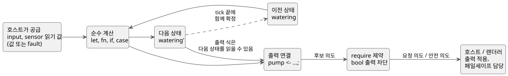
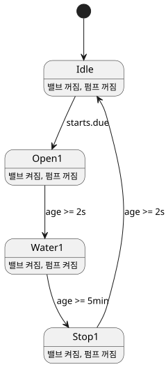

<!-- translation-source: docs/LANGUAGE-SURFACE.en.md -->
[영문 원문](LANGUAGE-SURFACE.en.md)

# GhostFlow 선택 문법 · control

이 페이지는 **선택한 GhostFlow 표면 문법**, 즉 중괄호·식·출력 연결을 중심으로 한 `control` 형식을 간단히 둘러봅니다. 핵심 표기, 매 tick에서 상태·센서·출력이 동작하는 방식, 시간과 장치 적응을 표현하는 방법, 그리고 설명을 붙인 예제 세 개를 보여줍니다. 정확한 규칙의 규범적 기준은 여전히 [Language Reference](LANGUAGE-REFERENCE.md)입니다.

**상태:** 선택한 문법의 유한 부분집합을 구현했습니다. `adapt` 같은 확장 스케치는 **구현하지 않았습니다**. 이 페이지는 [구현 범위](IMPLEMENTATION.ko.md)와 [실행 튜토리얼](TUTORIAL.ko.md)을 함께 읽으세요.

**배경:** 초기 [A/B/C 비교](LANGUAGE-EXAMPLES.md) 이후, 중괄호·식·출력 연결을 중심으로 한 control 문법을 기본 방향으로 선택했고, literate 형식(Markdown 문서 안에 코드를 넣는 방식)을 추가했습니다.

## 중심 표기

| 표기 | 의미 |
|---|---|
| `control Name { ... }` | 제어 프로그램과 배포 단위의 범위 |
| `input start: Bool;` | 호스트가 매 tick 공급하는 입력 |
| `sensor moisture: Percent;` | 측정 payload 타입. 읽기는 성공과 오류를 구분함 |
| `sensor moisture?: Percent;` | 설치가 선택적인 sensor capability |
| `output pump: Bool;` | 출력 의도 포트의 타입 선언 |
| `state watering: Bool = false;` | tick 사이에 유지되는 상태와 초기값 |
| `let name = expression;` | 상태를 갖지 않는 계산 |
| `watering' = expression;` | 다음 상태의 정의 |
| `pump <- watering';` | 계산한 출력 의도를 포트에 연결 |
| `require pump => valve;` | 펌프가 참이면 밸브도 참이어야 하는 출력 제약 |

어휘 규칙:

- 이름은 ASCII 식별자입니다. 타입 이름은 `Bool`, `Percent`, `Duration` 등으로 표기합니다.
- 세미콜론은 선언과 식 정의의 끝을 나타냅니다. 중괄호는 범위를 나타냅니다.
- 들여쓰기는 가독성을 위한 것일 뿐입니다.
- 코드 주석은 `//`를 사용합니다. literate 형식에서는 코드 주변에 문서 설명을 자유롭게 작성할 수 있습니다.

식:

- 계산에는 `!`, `&&`, `||`, 비교 연산자, 괄호, 일반 함수 호출을 사용합니다.
- `if condition then a else b`와 `case`는 식이며 값을 반환합니다. `case`는 모든 경우를 처리해야 합니다.
- `in {A, B}`는 유한한 값 집합에 포함되는지 검사합니다.

```text
fn latch(start: Bool, stop: Bool, previous: Bool) -> Bool {
  !stop && (start || previous)
}
```

함수는 순수하며 마지막 식을 반환합니다. 현재 구현은 다음을 지원합니다.

- 정적 인라인 호출
- 선언 순서에 의존하지 않는 `let` 계산

재귀와 순환은 거부합니다. 고차 함수와 매크로는 후속 확장입니다.

## 상태, 센서, 출력

*tick*은 한 번의 제어 계산입니다. 아래 그림은 한 tick에서 일어나는 일을 보여줍니다. 프로그램은 입력과 이전 상태를 읽고, 다음 상태와 출력 의도를 계산하고, `require` 제약을 적용한 뒤, 그 결과 의도를 호스트에 넘깁니다.



**상태.** `watering`은 이전 상태이고 `watering'`은 계산한 다음 상태입니다. 모든 상태 정의는 같은 입력과 같은 이전 상태에서 계산되며 함께 확정됩니다. (이전 초안의 `state.watering`과 `next.watering`에 대응합니다.)

이 단계에서는 다음 상태 참조(`name'`)를 출력식에서만 허용합니다. 상태 전이끼리 서로의 다음 상태를 읽는 식은 거부합니다.

```text
let water_ok = case low_water {
  ok(low)  => !low;
  fault(_) => false;
};
```

**센서.** sensor의 선언 타입은 *성공 시의 payload*입니다. 실제 읽기는 그 값이거나 fault이므로, 프로그램은 위의 `case`처럼 둘 다 처리해야 합니다. fault를 처리해 대체값을 사용하더라도 원래 입력 오류는 계속 기록됩니다.

**출력.** input과 output의 이름은 control 안에서 유일합니다. output은 타입만 선언하며, 같은 이름의 연결 `name <- expression;`을 정확히 하나 가져야 합니다. 이 연결이 이번 tick에 계산한 의도를 정의합니다. output 선언에 초기값을 쓸 수 없고, 연결을 생략할 수도 없습니다.

**제약.** `require`는 순수 출력 제약입니다. 초기 지원은 bool 출력 사이의 *requires*와 *mutex* 관계로 제한됩니다.

- `pump => (valve1 || valve2)`는 열린 밸브 의도가 하나도 없으면 펌프를 차단합니다.
- `!(valve1 && valve2)`는 두 밸브가 모두 요청되면 둘 다 차단합니다.

제약이 여러 개이면 각 제약은 같은 후보 snapshot에서 차단 집합을 계산하고, 이를 반복 적용합니다. 임의 논리식에 대한 자동 해결 정책까지 정의한 것은 아닙니다.

후속 [공통 제약 계약](CONSTRAINTS.md)은 더 나아갑니다. 이름 있는 `constraints` 묶음, 모드 진입 인터록, 공유 설비 한도, 중복 예약 방지, 선택적 용량 분석을 정의합니다. 다음을 유의하세요.

- 위의 bool 출력 차단 알고리즘을 모든 제약으로 일반화하지 **않습니다**.
- 같은 설비의 자동·수동·설정 모드는 서로 배타적입니다.
- 구조적 변경은 명시적으로 정지한 뒤 Configure 모드에서 적용합니다.

운영 설정 선언과 원자적 live event의 의미는 [Reference §5.1–5.2](reference/05-settings-and-observation.md)를 따릅니다. 문법·metadata 지원과 호스트의 live event 실행 지원은 별개이며, 실행 범위는 [구현 범위](IMPLEMENTATION.ko.md)를 참조하세요.

센서의 median 필터, 히스테리시스, stale 감시와 복구 조건은 manifest와 Rust 센서 런타임으로 연결됩니다. 센서가 준비되기 전의 `NotReady`를 포함한 센서 품질은 호스트 trace에 기록됩니다.

## 장치 적응과 시간

**장치 적응(설계 단계, 미구현).** `adapt`는 확인된 장치 프로필에 따라 계산 방식을 선택합니다. 예를 들어 선택적 센서 `moisture`는 `has moisture` 안에서만 읽을 수 있습니다.

- 설치된 센서의 일시적 fault는 센서가 설치되지 않은 경우와 다르게 다룹니다.
- 프로필 교체는 tick 경계에서 일어납니다.
- 여러 capability 조건이 겹칠 때의 우선순위 표기는 아직 확정해야 합니다.

**선택적 장치 정보.** 압력·유량 같은 장치 부가정보는 전부 선택 사항이며, 기본 제어와 인터록은 이 정보 없이 동작합니다. 선택적 분석 `check`에 정보가 부족하면 결과는 Unknown이고 운전을 차단하지 않습니다. 사용자가 해당 분석을 명시적으로 필수 `require`로 지정한 경우에만 검사 성공이 시작 조건이 됩니다. 세부 구분은 [선택 정보 계약](CONSTRAINTS.md)을 따릅니다.

**일일 예약.** `schedule starts: DailySlots<15min>`는 지역 시간대 기준으로 하루 96개의 15분 슬롯 중 여러 개를 선택하는 설정입니다.

- 중복 슬롯과 15분 격자를 벗어난 시각은 거부합니다.
- `starts.due`는 선택한 시각을 지나는 tick에서 한 번 참이 되는 bool 샘플입니다.
- 일반적인 시각 진행에서는 같은 날짜·슬롯이 두 번 발생하지 않습니다.
- 예제는 부팅 이전의 예약을 소급 실행하지 않으며, 운전 중 도착한 예약도 저장하지 않습니다.
- 시계 보정이나 재부팅에도 유지되는 안정적인 발생 ID와 영속 실행 기록, 설비별 누적 시간 제한은 [공통 제약 계약](CONSTRAINTS.md)을 따릅니다. 일일 한도가 중복 방지를 대신하지는 않습니다.
- DST와 예약 편집에 대한 세부 슬롯 정규화 규칙은 시간 문법을 구현하기 전에 확정합니다.

**타이머.** `timer age = elapsed(phase)`는 `phase`가 마지막으로 확정 변경된 이후의 단조 경과 시간입니다.

- `phase`를 바꾼 tick이 확정될 때 타이머가 0으로 재설정되고, 이후 tick에서 경과 시간을 읽습니다.
- 초기값은 0이며, 타이머 내부 상태도 checkpoint/replay에 포함됩니다.
- 이 선언은 대기 명령이나 별도 실행 스레드를 만들지 않습니다.

**지속 시간과 단계 전이.** `2s`와 `5min`은 Duration 리터럴입니다. 단계 전이는 tick마다 최대 한 번이며, 조건을 만족한 첫 tick에서 다음 단계로 넘어갑니다. 따라서 실제 지연은 요청값 이상이고, 정상 운전에서 추가 지연은 tick 해상도 이내로 제한됩니다.

## 복사해 읽는 control 예제

아래의 자기유지 예제와 예약 예제는 `ghostc`로 컴파일되며 manifest 호스트에서 실행됩니다. 마지막 `adapt` 블록은 컴파일러가 명시적으로 거부하는 **미구현 설계 예제**입니다. 한 control의 입력, 상태, 출력 연결을 한곳에서 볼 수 있도록 이름과 값은 최소한으로 잡았습니다.

### 정지 우선의 자기유지 control

```text
control LatchingPump {
  input start: Bool;
  input stop: Bool;
  input enabled: Bool;

  output pump, valve: Bool;
  state running: Bool = false;

  // stop과 start가 같은 tick에 오면 stop이 이긴다.
  running' = !stop && enabled && (start || running);
  valve <- running';
  pump <- running';

  require pump => valve;
}
```

동작 방식:

- `running`은 이전 tick의 자기유지 상태이고, `running'`은 이번 tick에 확정할 값입니다.
- `start`가 한 tick 펄스여도 다음 tick부터는 `running`이 control을 켠 상태로 유지합니다.
- `stop`이 있거나 `enabled == false`이거나 둘 다인 tick에서는 `running'`과 두 출력이 모두 false가 됩니다.
- 따라서 `start`와 `stop`을 같은 tick에 눌러도 다시 시작하지 않습니다.

이 예제가 다루지 **않는** 것:

- `enabled`는 지역 허가 입력일 뿐이고, 한 줄짜리 `require`는 두 bool 출력 사이의 관계만 나타냅니다. 이 control이 자동·수동·설정 모드 전환, 다른 control과의 공유 펌프 소유권, 전체 밸브 수 제한을 구현한다고 해석하지 마세요. 설비 전체의 인터록과 중재는 [공통 제약 계약](CONSTRAINTS.md)의 모드 관리자와 공유 설비 제약이 담당합니다.
- 피드백 센서, 압력, 유량은 이 기본 예제의 필수 입력이 아닙니다.

출력 의도를 계산하는 일은 실제로 출력을 시작·정지하거나 장애 시 안전 상태로 만드는 일과 다른 경계입니다. GhostFlow VM은 연결식과 안전 제약만 계산해 requested/safe 의도를 반환합니다. 부팅·장애·연결 해제 시 모든 출력을 OFF로 만드는 페일세이프 정책과 그 적용 시점은 호스트/renderer가 소유합니다. `output` 선언에 초기값이 없다는 것을 그런 정책의 표현으로 해석하지 마세요.

### 예약과 타이머를 보여주는 단일 밸브 관수 예제

다음 **설계 예제**는 [literate 관수 예제](../examples/scheduled-watering.ghost.md)의 예약과 단계 전이 부분을 단일 밸브 control로 줄인 것입니다. 두 밸브 전체 예제는 링크한 파일에 있습니다. 여기서는 입력 선언, 상태 전이, 출력 연결을 함께 읽을 수 있습니다.

```text
control TimedWatering {
  schedule starts: DailySlots<15min> {
    timezone = "Asia/Seoul";
    selected = [06:00, 18:45];
  }

  output pump, valve: Bool;
  type Phase = Idle | Open1 | Water1 | Stop1;

  state phase: Phase = Idle;
  timer age = elapsed(phase);

  phase' = case phase {
    Idle =>
      if starts.due then Open1 else Idle;

    Open1 =>
      if age >= 2s then Water1 else Open1;

    Water1 =>
      if age >= 5min then Stop1 else Water1;

    Stop1 =>
      if age >= 2s then Idle else Stop1;
  };

  valve <- phase' in {Open1, Water1, Stop1};
  pump  <- phase' in {Water1};
  require pump => valve;
}
```

단계들은 단순한 순환을 이룹니다. 그림은 각 전이 조건과 각 단계에서 켜지는 출력을 보여줍니다.



기대 동작:

1. 선택한 06:00 또는 18:45 슬롯을 지나는 tick에서만 `Idle`이 `Open1`으로 바뀝니다.
2. `Open1` 진입이 확정되면 `age`가 0이 됩니다. 최소 2초 뒤 `Water1`으로 바뀝니다.
3. 다시 최소 5분 뒤 `Stop1`으로 바뀝니다.
4. `Stop1`은 최소 2초 동안 유지된 뒤 `Idle`로 돌아갑니다.

각 단계 전이는 tick마다 최대 한 번이므로, 긴 tick 하나가 모든 단계를 한꺼번에 통과시키지 않습니다.

이 코드는 예약/타이머의 정상 운전 경로를 설명합니다. 독립적으로 안전한 완전한 설비 프로그램이 **아닙니다**. `pump`는 `Water1`에서만 켜지고, `Stop1`에서는 밸브 정리 시간이 지나는 동안 꺼진 상태를 유지합니다. 외부 정지, 공유 자원 허가, 중복 발생 억제, 일일 한도는 이 상태 기계에 들어 있지 않으며, 그 범위는 [공통 제약 계약](CONSTRAINTS.md)을 따릅니다.

### 선택적 moisture 적응: 문법 미확정 스케치

`examples/scheduled-watering.ghost.md`에는 `adapt` 표기가 없습니다. 따라서 아래 블록은 **확장 스케치**입니다. 앞에서 설명한 `has moisture` 보호 범위의 의도만 보여줄 뿐, 완전한 문법이나 실행 계약을 정하지 않습니다.

```text
// 확장 스케치 — 실제 adapt 블록의 표기와 우선순위는 아직 확정되지 않았다.
// optional moisture는 has moisture 보호 범위 안에서만 읽는다.
has moisture {
  // 유효한 moisture 값을 이용해 관수 시간을 조정하는 계산을 둘 수 있다.
  // 일시적 sensor fault는 센서가 없는 경우와 구분해 별도로 처리한다.
}

// moisture가 없으면 기본 예약/타이머 control은 그대로 동작한다.
```

즉 moisture는 센서가 설치된 프로필에서만 사용하는 선택적 capability이며, 기본 관수를 시작하는 데 필요하지 않습니다.

- moisture의 필터링, fault, 복구 처리는 [센서 계약](CONSTRAINTS.md)을 따릅니다. `adapt` 블록의 정확한 표기는 후속 범위입니다.
- 압력·유량 같은 부가정보도 마찬가지로 기본 제어에 강제하지 않습니다.
- 고급 분석을 필수 시작 조건으로 만들려면 사용자가 명시적으로 `require`를 추가해야 합니다.

## Literate는 같은 언어의 문서형 입력

GhostFlow의 유일한 정식 입력은 `.ghost.md` literate 문서입니다.

- 하나의 control을 설명 문단 사이의 여러 `ghost` 블록으로 나눌 수 있습니다. 추출된 코드는 같은 타입·실행 모델로 내려갑니다.
- 일반 `.ghost` 원자료 파일은 역사적 증거일 뿐입니다. 컴파일러 입력도, fallback도 아닙니다.
- 자세한 추출·소스맵 계약은 [LITERATE.md](LITERATE.md)에 있습니다.

[literate 관수 예제](../examples/scheduled-watering.ghost.md)가 정식 실행 예제입니다. 참조 구현은 현재 control 문법, 시간 기능, literate 문서를 GFB1과 manifest로 실행합니다. 미구현 확장은 [구현 경계](IMPLEMENTATION.ko.md)에 정리되어 있습니다. [0.2 공통 계약](LANGUAGE.md)의 결정성, 오류 기록, ghost 실행, 모듈 교체 원칙을 이어받습니다.
