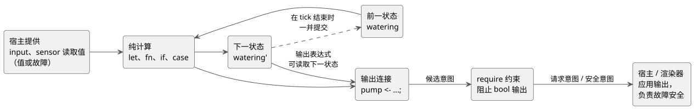
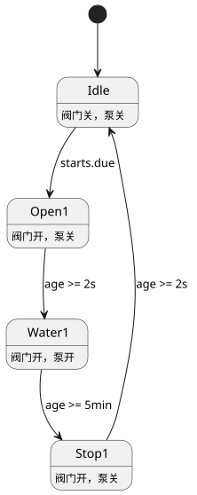

<!-- translation-source: docs/LANGUAGE-SURFACE.en.md -->
[英文原文](LANGUAGE-SURFACE.en.md)

# GhostFlow 选定语法 · control

本页简要介绍 **GhostFlow 选定的表层语法**：以花括号、表达式和输出连接为核心的 `control` 形式。内容包括核心写法、状态、传感器和输出在每个 tick（逻辑决策步）中的行为方式、时间和设备自适应的表达方式，以及三个带注解的示例。精确规则仍以[语言参考](LANGUAGE-REFERENCE.zh.md)为规范来源。

**状态：** 选定语法中有限的子集已经实现。`adapt` 之类的扩展草案**尚未**实现。请将本页与[实现范围](IMPLEMENTATION.zh.md)和[可执行教程](TUTORIAL.zh.md)一起阅读。

**背景：** 在最初的 [A/B/C 比较](LANGUAGE-EXAMPLES.zh.md)之后，以花括号、表达式和输出连接为核心的控制语法被选为基本方向，并加入了文学式（literate）封装（把代码嵌入 Markdown 文档中）。

## 核心写法

| 写法 | 含义 |
|---|---|
| `control Name { ... }` | 控制程序的作用域，也是部署单位 |
| `input start: Bool;` | 宿主在每个 tick 提供的输入 |
| `sensor moisture: Percent;` | 测量的有效载荷类型；读取时区分成功与错误 |
| `sensor moisture?: Percent;` | 安装与否可选的传感器能力 |
| `output pump: Bool;` | 输出意图端口的类型声明 |
| `state watering: Bool = false;` | 在 tick 之间保留的状态及其初始值 |
| `let name = expression;` | 无状态计算 |
| `watering' = expression;` | 下一状态的定义 |
| `pump <- watering';` | 将计算出的输出意图连接到端口 |
| `require pump => valve;` | 输出约束：pump 为 true 时要求 valve 也为 true |

词法规则：

- 名称为 ASCII 标识符。类型名写作 `Bool`、`Percent`、`Duration` 等。
- 分号结束声明和表达式定义。花括号标示作用域。
- 缩进仅用于提高可读性。
- 代码注释使用 `//`。在文学式形式中，文档说明可以自由地写在代码周围。

表达式：

- 计算使用 `!`、`&&`、`||`、比较运算符、括号和普通函数调用。
- `if condition then a else b` 和 `case` 都是表达式：它们返回值。`case` 必须处理所有情况。
- `in {A, B}` 测试某个值是否属于有限的值集合。

```text
fn latch(start: Bool, stop: Bool, previous: Bool) -> Bool {
  !stop && (start || previous)
}
```

函数是纯函数，返回其最后一个表达式。当前实现支持：

- 静态内联调用，以及
- 不依赖声明顺序的 `let` 计算。

递归和循环依赖会被拒绝。高阶函数和宏属于后续扩展。

## 状态、传感器与输出

一个 *tick* 就是一次控制计算。下图展示了一个 tick 中发生的事情：程序读取输入和前一状态，计算下一状态和输出意图，应用 `require` 约束，然后把得到的意图交给宿主。



**状态。** `watering` 是前一状态；`watering'` 是计算出的下一状态。所有状态定义都基于同一组输入和同一个前一状态计算，并一并提交。（它们对应早期草案中的 `state.watering` 和 `next.watering`。）

在现阶段，下一状态引用（`name'`）只允许出现在输出表达式中。状态转换之间相互读取对方下一状态的表达式会被拒绝。

```text
let water_ok = case low_water {
  ok(low)  => !low;
  fault(_) => false;
};
```

**传感器。** 传感器声明的类型是其*成功时的有效载荷*。实际读取的结果要么是该值，要么是故障，因此程序必须处理这两种情况（如上面的 `case` 所示）。即使用替代值处理了故障，原始的输入错误仍会被记录。

**输出。** 输入和输出的名称在一个 control 内唯一。输出只声明类型，并且必须恰好有一个同名连接：`name <- expression;`。该连接定义本 tick 计算出的意图。不能在输出声明中写初始值，也不能省略连接。

**约束。** `require` 是纯粹的输出约束。初期支持仅限于 bool 输出之间的 *requires*（前提）和 *mutex*（互斥）关系：

- `pump => (valve1 || valve2)`：如果不存在打开阀门的意图，就阻止泵。
- `!(valve1 && valve2)`：如果两个阀门都被请求，就同时阻止两者。

存在多个约束时，每个约束都基于同一个候选快照计算其阻止集合，并反复应用。这并没有为任意逻辑表达式定义自动解决策略。

后来的[通用约束契约](CONSTRAINTS.zh.md)更进一步，定义了命名的 `constraints` 组、模式进入互锁、共享设施限制、重复调度防止以及可选的容量分析。请注意：

- 上述 bool 输出阻止算法**并未**推广到所有约束。
- 同一设施的自动、手动和配置模式相互排斥。
- 结构性变更在显式停止之后，于 Configure 模式下应用。

操作员设置声明和原子实时事件语义遵循[参考 §5.1–5.2](reference/05-settings-and-observation.zh.md)。语法/元数据支持与宿主对实时事件执行的支持是分开的；执行覆盖范围请参见[实现范围](IMPLEMENTATION.zh.md)。

传感器中值滤波、迟滞、陈旧（stale）监测和恢复条件通过清单（manifest）和 Rust 传感器运行时连接。传感器质量（包括传感器就绪前的 `NotReady`）记录在宿主追踪中。

## 设备自适应与时间

**设备自适应（设计中，尚未实现）。** `adapt` 根据已确认的设备 profile（设备配置档）选择计算方法。例如，可选传感器 `moisture` 只能在 `has moisture` 内部读取。

- 已安装但暂时故障的传感器，与未安装的传感器区别对待。
- profile 的替换发生在 tick 边界。
- 能力条件重叠时的优先级写法仍有待确定。

**可选设备信息。** 压力和流量等补充设备信息完全是可选的；没有这些信息，基本控制和互锁也能工作。如果可选分析 `check` 缺少信息，其结果为 Unknown，并且不会阻止运行。只有当用户明确将该分析标记为必需的 `require` 时，成功的检查才会成为启动条件。详细区分遵循[可选信息契约](CONSTRAINTS.zh.md)。

**每日调度计划。** `schedule starts: DailySlots<15min>` 是一项设置，用于在本地时区中从每天 96 个 15 分钟时段里选择若干个。

- 重复的时段以及不在 15 分钟网格上的时间会被拒绝。
- `starts.due` 是一个 bool 样本，在经过所选时间的那个 tick 上为 true，且只为 true 一次。
- 在普通的时间推进中，同一日期/时段不会触发两次。
- 该示例不会追溯执行启动之前的调度计划，也不会存储运行期间到达的调度计划。
- 稳定的触发实例 ID、跨越时钟校正或重启的持久执行记录，以及每个设施的累计时间限制，遵循[通用约束契约](CONSTRAINTS.zh.md)。每日限制并不能取代重复防止。
- 针对夏令时（DST）和调度计划编辑的详细时段规范化规则，将在实现时间语法之前确定。

**定时器。** `timer age = elapsed(phase)` 是自 `phase` 最近一次已提交的变化以来经过的单调时间。

- 当改变 `phase` 的 tick 提交时，定时器归零；之后的 tick 读取经过时间。
- 其初始值为零，定时器的内部状态包含在检查点/重放中。
- 该声明既不会创建等待命令，也不会创建单独的执行线程。

**持续时间与阶段转换。** `2s` 和 `5min` 是 Duration 字面量。一个阶段每个 tick 最多转换一次，在第一个满足其条件的 tick 上推进。因此实际延迟至少等于请求的值；在正常运行中，额外延迟以 tick 分辨率为上界。

## 可复制阅读的控制示例

下面的自锁示例和调度示例可以用 `ghostc` 编译，并在清单宿主上运行。最后的 `adapt` 块是一个**尚未实现的设计示例**，编译器会明确拒绝它。名称和值都保持最少，以便你在一处看到一个 control 的输入、状态和输出连接。

### 停止优先的自锁控制

```text
control LatchingPump {
  input start: Bool;
  input stop: Bool;
  input enabled: Bool;

  output pump, valve: Bool;
  state running: Bool = false;

  // 如果 stop 和 start 在同一 tick 到达，stop 优先。
  running' = !stop && enabled && (start || running);
  valve <- running';
  pump <- running';

  require pump => valve;
}
```

行为方式：

- `running` 是上一个 tick 锁存的状态；`running'` 是本 tick 要提交的值。
- 即使 `start` 只是一个 tick 的脉冲，`running` 也会从下一个 tick 起保持控制接通。
- 在出现 `stop`、`enabled == false` 或两者兼有的任何 tick 上，`running'` 和两个输出都变为 false。
- 因此，在同一 tick 内同时按下 `start` 和 `stop` 不会重新启动该控制。

它**不**涵盖的内容：

- `enabled` 只是一个局部许可输入，单行的 `require` 也只关联两个 bool 输出。不要把这个 control 理解为实现了自动/手动/配置模式切换、与其他 control 的共享泵所有权，或阀门总数限制。设施范围的互锁和仲裁属于[通用约束契约](CONSTRAINTS.zh.md)中的模式管理器和共享设施约束。
- 反馈传感器、压力和流量不是这个基本示例的必需输入。

计算输出意图，与实际启动或停止输出、或在故障时将其置于安全状态，是不同的边界。GhostFlow VM 只计算连接表达式和安全约束，并返回请求意图/安全意图。在启动、故障或断开连接时将所有输出置为 OFF 的故障安全策略由宿主/渲染器负责，何时应用该策略也由其决定。不要把 `output` 声明中没有初始值理解为表达了这样的策略。

### 演示调度计划和定时器的单阀浇水示例

下面的**设计示例**将[文学式浇水示例](../examples/scheduled-watering.ghost.zh.md)中的调度计划和阶段转换部分精简为单阀控制。完整的双阀示例见链接文件。在这里，你可以把输入声明、状态转换和输出连接放在一起阅读。

```text
control TimedWatering {
  schedule starts: DailySlots<15min> {
    timezone = "Asia/Seoul";
    selected = [06:00, 18:45];
  }

  output pump, valve: Bool;
  type Phase = Idle | Open1 | Water1 | Stop1;

  state phase: Phase = Idle;
  timer age = elapsed(phase);

  phase' = case phase {
    Idle =>
      if starts.due then Open1 else Idle;

    Open1 =>
      if age >= 2s then Water1 else Open1;

    Water1 =>
      if age >= 5min then Stop1 else Water1;

    Stop1 =>
      if age >= 2s then Idle else Stop1;
  };

  valve <- phase' in {Open1, Water1, Stop1};
  pump  <- phase' in {Water1};
  require pump => valve;
}
```

这些阶段构成一个简单的循环。下图展示了每个转换条件，以及每个阶段中哪些输出接通。



预期行为：

1. `Idle` 只在经过所选的 06:00 或 18:45 时段的那个 tick 上变为 `Open1`。
2. 进入 `Open1` 提交时，`age` 归零。至少 2 秒后，阶段变为 `Water1`。
3. 再过至少 5 分钟后，变为 `Stop1`。
4. `Stop1` 至少保持 2 秒，然后回到 `Idle`。

由于每次阶段转换每个 tick 最多发生一次，一个很长的 tick 不会一下子冲过所有阶段。

这段代码说明的是正常的调度计划/定时器路径。它**不是**一个独立安全、完整的设施程序。`pump` 只在 `Water1` 中接通；在 `Stop1` 中，泵保持关闭，同时等待阀门收尾间隔过去。外部停止、共享资源许可、重复触发实例抑制和每日限制都没有内置在这个状态机中；它们的范围遵循[通用约束契约](CONSTRAINTS.zh.md)。

### 可选的湿度自适应：语法未定的草案

`examples/scheduled-watering.ghost.md` 不包含 `adapt` 写法。因此下面的代码块是一个**扩展草案**。它只展示上文所述 `has moisture` 守护作用域的意图，并不确立完整的语法或执行契约。

```text
// 扩展草案——实际的 adapt 块写法和优先级尚未确定。
// 只在 has moisture 守护作用域内读取可选的 moisture。
has moisture {
  // 计算可以利用有效的湿度值来调整浇水时间。
  // 将传感器的暂时故障与传感器不存在分开处理。
}

// 没有 moisture 时，基本的调度计划/定时器控制照常运行。
```

换言之，湿度是一种可选能力，只在安装了该传感器的 profile 中使用。基本浇水的启动并不需要它。

- 湿度的滤波、故障和恢复处理遵循[传感器契约](CONSTRAINTS.zh.md)。确切的 `adapt` 块写法属于后续范围。
- 压力和流量等补充信息同样不会被强加到基本控制中。
- 要把高级分析设为必需的启动条件，用户必须显式添加 `require`。

## 文学式是同一语言的文档形式输入

GhostFlow 唯一的正式输入是 `.ghost.md` 文学式文档。

- 一个 control 可以拆分到说明段落之间的多个 `ghost` 块中。提取出的代码会降级（lower）为相同的类型和执行模型。
- 纯 `.ghost` 原始文件只是历史证据。它们既不是编译器输入，也不是回退方案。
- 详细的提取和源映射契约见 [LITERATE.md](LITERATE.zh.md)。

[文学式浇水示例](../examples/scheduled-watering.ghost.zh.md)是正式的可执行示例。参考实现使用 GFB1 和清单来运行当前的控制语法、时间功能和文学式文档。尚未实现的扩展列在[实现边界](IMPLEMENTATION.zh.md)中。[0.2 通用契约](LANGUAGE.zh.md)中关于确定性、错误记录、ghost 执行和模块替换的原则得到继承。
