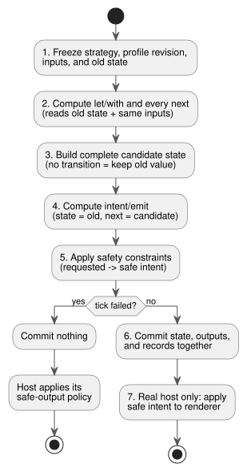
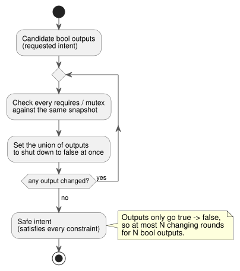

# GhostFlow language contract · design draft

Dated 2026-09-05. This document defines the **common execution contract** of the GhostFlow language: the rules every syntax and every runtime must share.

How this document relates to the others:

- **Authoring syntax.** The currently selected syntax is the [control syntax](LANGUAGE-SURFACE.md). The [literate format](LITERATE.md) lets you write the same code inside a Markdown document.
- **Constraints and sensors.** The [common constraints/sensor contract](CONSTRAINTS.md) records later design decisions on mode interlocks, optional device information, sensor processing, and time limits.
- **What runs today.** The executable implementation covers a finite subset of control/literate source, plus compatible S-expression input and GFB1 bytecode. Implementation scope and replay evidence are defined in the [implementation contract](IMPLEMENTATION.md) and [traceability](TRACEABILITY.md).
- **Bytecode.** Current bytecode follows [GFB1](BYTECODE.md).

This document still contains the common semantics and the A/B/C notations from the 0.2 design.
Precedence rules:

- Where vocabulary or source format differs, the later control/literate documents take precedence.
- For constraints and for applying operating settings, the later common constraints contract takes precedence.

Historical records:

- The [three syntax examples](LANGUAGE-EXAMPLES.md) are kept as the initial comparison record.
- The previous specification is preserved unchanged in [LANGUAGE-MVP-0.1.md](LANGUAGE-MVP-0.1.md).

Implementation status in one line: sensor ok/fault handling, static pure functions, and document-form (literate) source are implemented. General Result/ADT types, higher-order function composition, strategy-specific inputs, and macros are **not** implemented.

**In this document:** language direction (§1), program model (§2), vocabulary and types (§3), expressions (§4), streams and error flow (§5), device queries (§6), the tick (§7), output constraints (§8), literate source and observability (§9), macros (§10), time travel and ghosts (§11), module replacement and deployment (§12), implementation status (§13), and syntax references (§14).

## 1. Language direction

GhostFlow is a control language. It receives sensor inputs as streams. It combines pure computation with explicit state transitions to produce **intents**: requests for what devices should do.
A single program can contain several **strategies**. The runtime selects one according to the capabilities of the devices currently present.
Because execution is deterministic, you can re-execute identical inputs and compare behavior before and after a change.

Preferences confirmed in the original conversation, and the judgments made in this design, are recorded separately in [DESIGN-NOTES.md](DESIGN-NOTES.md).

| Preference | Reflection in language/tools |
|---|---|
| YAML | Hierarchical declarations, `name: type`, readable settings |
| Literate CoffeeScript | Indentation, concise functions, explanations combined with executable code |
| Cypher query | Capability patterns and explicit device-selection clauses |
| Meta Lua | Compile-time extension treating syntax as data |
| Functional/function-level composition | Pure functions, value piping, and function composition |
| Railway-oriented programming | Successful and error values handled in the same flow |
| Cycle.js | Input Source and output Intent separated by a Driver boundary |
| Observable·marimo·D3.js | Intermediate values, state, and changes observed beside code |
| Elm/Rust stability | Type, branch, and resource validation; a predictable execution foundation |

Three alternatives were compared:

- **A**: YAML-centered declarative syntax.
- **B**: Literate CoffeeScript-centered flow syntax.
- **C**: Cypher-centered query syntax.

Later discussion selected the **control syntax** as the basic direction. It is built around braces, expressions, next state, and output connections.
Literate is a source format layered on top of that syntax. The common execution contract below applies to this choice as well.

## 2. Program model

Each tick computes three things in order:

```text
candidate_state = transition(old_state, input_snapshot, selected_strategy)
requested       = intents(old_state, candidate_state, input_snapshot)
safe            = safety(requested, constraints)
```

If computation succeeds, `candidate_state` and the `safe` result are committed together as one **logical tick**.
The host renderer then applies the physical outputs.
Logical atomicity does **not** mean that several GPIOs change physically at the same instant.

| Element | Meaning |
|---|---|
| module / version | Stable module ID and state-schema version |
| input | Typed sample supplied each tick; semantically `Signal<T>` |
| state | Value retained between ticks and its initial default |
| Function | Pure, statically interpretable value transformation |
| strategy | Device query, strategy-specific inputs, computation, transition, intents |
| let / with | Named stateless intermediate computation |
| next | Definition of next state |
| output / intent / emit | Declare a type and request this tick's capability output intent through exactly one connection expression |
| safety | requires / mutex constraints applied to final outputs |

Structural rules:

- A combinational cycle in the expression graph is a compilation error.
- Feedback must cross an explicit boundary that reads a previous-tick value, such as state.
- A state that has no `next` definition keeps its value.
- Defining the same state or output twice in the same strategy is an error.

### Example: input → state → output in the selected syntax

Below is a complete source example in the selected control syntax.
It compiles with `ghostc` and runs on a host connected to a sensor manifest.
The example assumes that a low-water sensor is installed. It supplies no extra information such as pressure or flow.
This does **not** mean that every program must have a low-water sensor.

```ghost
fn hold(start: Bool, blocked: Bool, previous: Bool) -> Bool {
  !blocked && (start || previous)
}

control WateringDemand {
  input start, stop: Bool;
  sensor low_water: Bool;

  output pump, valve: Bool;
  state watering: Bool = false;

  let water_ok = case low_water {
    ok(low)  => !low;
    fault(_) => false;
  };

  let blocked = stop || !water_ok;
  watering' = hold(start, blocked, watering);

  valve <- watering';
  pump  <- watering';
  require pump => valve;
}
```

How to read it:

- `watering` is the memory from the previous tick.
- `watering'` is the candidate value that this tick will commit.
- `<-` connects an output to its intent.
- The function `hold` has no hidden memory.
- `start` and `stop` are Boolean samples, not edge events.

Output declarations follow these rules:

- `output name: Type;` declares only the type of an intent port.
- Every output name must have exactly one `name <- expression;` connection. An initial value in the declaration is prohibited.
- The connection expression is the logical intent that the VM requests this tick.
- Startup and fail-safe policy is owned separately by the host/renderer. That policy keeps outputs OFF, or stops applying them, on boot, on computation failure, or when the host disconnects.
- A default value on an output declaration never implicitly sets safety policy.

The table shows the expected results when the inputs are supplied in order, starting from `watering=false`.

| tick | start | stop | low_water | watering' | valve / pump intent |
|---|---|---|---|---|---|
| 1 | true | false | ok(false) | true | ON / ON |
| 2 | false | false | ok(false) | true | ON / ON |
| 3 | false | false | fault(Stale) | false | OFF / OFF |
| 4 | false | false | ok(false) | false | OFF / OFF |
| 5 | true | true | ok(false) | false | OFF / OFF |

Two behaviors to notice:

- Sensor recovery alone does not revive the latch (tick 4).
- When start and stop are both true, stop wins (tick 5).

This is a pure control-computation example.
Entering a facility mode, owning a shared pump, and staggering the physical pump/valve switching belong to the facility manager and output renderer described in the [common constraints contract](CONSTRAINTS.md). The code above does not implement all of that.

## 3. Vocabulary and types

**Identifiers.** Identifiers in the new syntax match `[A-Za-z_][A-Za-z0-9_]*` and are case-sensitive.
Dots separate paths such as `input.start`, `state.watering`, and `next.watering`.
The older name `low-water` is written `low_water` in new examples. When you migrate a real module, you must supply an explicit rename mapping.

**Names and scopes.**

- Reserved words cannot be used as names.
- Input, state, strategy, and function names must each be unique within their scope.
- A strategy input cannot shadow a common input.
- A local computation cannot shadow a function or a reserved namespace.
- A function parameter exists only inside its own function.

**Layout of the 0.2 alternatives.**

- Alternative B uses two-space indentation and rejects tabs. Indent after a block introducer.
- Alternative A parses restricted YAML.
- Alternative C separates blocks with clauses and `end`.
- All three alternatives use `#` comments and keep call parentheses.
- A line may continue inside open parentheses or after a comma.

**Scalar types.** The basic value types implemented in the 0.2 core are `bool` and finite IEEE 754 binary64 `number`. (The current reference implementation also has Percent, Duration, and enums; see §13.)

- Only `true` and `false` are bool literals. Strings and numbers have no truthiness and no implicit conversion.
- A number starts with decimal integer or fractional notation. NaN and Infinity are rejected.
- A module version is a u32 integer literal. A strategy priority is an i32 integer literal.
- The document version 0.2, the module version, and the bytecode format version are three separate identifiers.

The [exact integer contract](EXACT-INTEGER-CONTRACT.md), prepared for R14 review, proposes a third scalar, `Int/i32`.
Do not mark it as implemented before steps N2–N4 are complete.

**Sensor samples.** A sensor sample is represented as `Result<T, SensorFault>`.

- The constructors are `Ok(value)` and `Err(fault)`.
- The initial SensorFault set is `Disconnected | Stale | Invalid`.
- Using a Result directly as a bool or number is a type error.
- A state requires a constant initial value that matches its declared type.

The later sensor-processing contract adds `NotReady`, used before a filter is ready.
Keep two cases apart:

- **Missing optional device information** (Option): for example, no pressure rating was entered.
- **A fault in an installed sensor** (Result).

Basic control and interlocks work without supplementary pressure/flow information.
Detailed rules follow [CONSTRAINTS.md](CONSTRAINTS.md).

**Later extensions.** General ADTs, fault-specific pattern matching, and time/physical-unit types are later extensions.
Any new branch syntax must come with exhaustive branch checking.
The language does not promise that device faults disappear. Its goal is to block type, reference, and resource errors, and unhandled language exceptions.

The minimal design for DateTime, monotonic elapsed time, recurring schedules, natural events, work calendars, and mandatory fallback is in [TIME-AND-SCHEDULE-CONTRACT.md](TIME-AND-SCHEDULE-CONTRACT.md).
That document clearly separates what is implemented today (`Duration`, DailySlots, Solar) from the T2–T4 proposals.

## 4. Expressions and function composition

Common expressions are literals, references, calls, function definitions, parentheses, and the operators below.

| Stronger binding → weaker binding | Rule |
|---|---|
| References/calls/parentheses | `f(x)`, `input.x`, `(expr)` |
| Comparison | `< <= > >= is isnt`; chained comparison rejected |
| not | Bool negation; `not x is y` means `not (x is y)` |
| and | Two bool values, left-associative |
| or | Two bool values, left-associative |
| >> | Unary function composition, left-associative |
| \|> | Value piping, left-associative |
| if / then / else | Conditional expression whose two result types match |

Parsing and comparison rules:

- The body of `(args) -> expr` is the entire expression that follows the arrow.
- If a function expression's boundary is ambiguous, wrap it in parentheses.
- Use parentheses when you mix comparisons and pipes.
- `is`/`isnt` test equality/inequality between values of the same type.
- Ordering comparisons are currently allowed only on `number`.
- If the integer contract is adopted, ordering between two `Int` values is also allowed. Mixed comparisons stay rejected.
- `type is number` inside a device query is a different thing: a type-tag comparison.

**Purity and termination.**

- Functions and operations at this stage must be pure and must always terminate.
- Side effects, or error-avoidance patterns that rely on short-circuit evaluation, are prohibited.
- All branches are type-checked. Safe expressions may be precomputed.
- Arithmetic and division-error rules will be defined by a later numeric profile.

The minimal range, operations, and conversions for exact integers, and the acceptance vectors for implementing them, are in [EXACT-INTEGER-CONTRACT.md](EXACT-INTEGER-CONTRACT.md).
That link is a design proposal. It does not claim that the current parser, GFB, or VM supports `Int`.
Current GFB1 has only `Number/f64` arithmetic opcodes. It has no integer opcodes and no remainder operation.

```ghost
latch = (start, stop, held) -> not stop and (start or held)
is_dry = map(below(35)) >> recover(false)
```

- `x |> f` means `f(x)`.
- `f >> g` means `(x) -> g(f(x))`.

Neither operator creates new state. The latch's memory exists only in `state.watering`, which the caller passes in.

**Function types.** Function types are inferred from the body and from the call sites. If no unique type can be determined, that is an error.
Recursion and dynamic function selection are out of scope.
Function composition and library functions are specialized statically into a graph, so the MCU never needs dynamic closures.

## 5. Streams and Railway error flow

An input field's type describes the sample for **one tick**.
`start: bool` means the current sample of a `Signal<bool>` port.
`input.start` is that current sample, and functions and operations are applied every tick.
There is no hidden asynchronous queue and no separate subscription scheduler.
Event and timer semantics will be defined separately in the next revision.

| Function | Meaning |
|---|---|
| below(limit) | Function receiving number and returning `value < limit` |
| map(f) | Transforms Ok(x) to Ok(f(x)); forwards Err(e) unchanged |
| and_then(f) | When f returns Result, connects Ok(x) to f(x); retains Err |
| recover(default) | Converts Ok(x) to x, Err(e) to default of the same type |

Calling `map`, `and_then`, or `recover` produces a unary function.
In the example, `is_dry` has type `Result<number, SensorFault> -> bool`.
Here `map` transforms a Result. It is not a stream-scheduling operation.

```ghost
dry = input.moisture |> map(below(35)) |> recover(false)
blocked = input.stop or (input.low_water |> recover(true))
```

Raw input faults are always kept in the journal, whether or not a computation uses them and whether or not `recover` is applied.
So `recover` is a pure value transformation. It does not erase the error from the record.
The examples choose the fallback that blocks watering:

- `recover(true)` for low-water errors: an unknown water level counts as "low", which blocks.
- `recover(false)` for moisture errors: an unknown moisture counts as "not dry", which does not request watering.

### Example: converting errors into control values without hiding them

The pipe example above keeps alternative B's notation.
In the selected syntax, the same decision reads as an explicit branch.
The fragment below goes inside a control that declares `sensor moisture: Percent;`.

```ghost
let dry = case moisture {
  ok(value) => value < 35%;
  fault(_)  => false;
};
```

| moisture | dry |
|---|---|
| `ok(25%)` | true |
| `ok(40%)` | false |
| `fault(Disconnected)` | false |
| `fault(NotReady)` | false |

In the two fault cases only the decision value is replaced with false. The original sensor fault stays in the input record.
Do not display this as "sensor normal."
Examples that add noise processing and recovery operations are in the [sensor contract](CONSTRAINTS.md).

## 6. Device query

A **device profile** is the set of semantic capabilities the host supplies.
The initial query model is the triple `(kind, name, type)`. The same `(kind, name)` pair cannot appear twice.

```ghost
match (pump:actuator<bool>), (valve:actuator<bool>),
      (low_water:sensor<bool>), (moisture:sensor<number>)
```

How to read a query:

- Names such as `pump` are semantic roles defined by the profile. They are not database row variables that iterate over several devices.
- Each item requires that a capability is present. Commas mean AND.
- `sensor<number>` gives the payload type. The Driver wraps each sample and supplies it as `Result<number, SensorFault>`.
- Omitting the type, as in `(moisture:sensor)`, checks presence only.
- A type condition can be added with `where moisture.type is number`.

A `where` clause may use only the kind/name/type of names that appear in `match`, comparisons with constants, and `and`/`or`/`not`.
It cannot read `input`, `state`, `next`, or the current moisture value.

This draft has no variable-length paths, relationship traversal, dynamic bindings, or per-result-row execution.
If profiles are extended into a graph, unique bindings and bounded traversal cost must be verified.

**Strategy selection.**

- The runtime selects the single matching strategy with the highest priority.
- A tie at the highest priority is an ambiguity error.
- No matching strategy is an activation error.
- Declaration order never overrides anything.

**Inputs and binding checks.**

- A common input is required by every strategy. A strategy input is required only while that strategy is selected.
- The profile checks the capabilities of intent targets and sensor inputs, including their types.
- Host inputs such as buttons go through a separate port-binding check.
- A missing sample is a tick-submission error. It is different from a correctly submitted `Err` sample.

**Profile changes.**

- The profile never changes during a tick.
- Faults, recovery, and configuration changes are applied at a tick boundary, after the candidate profile is verified and a strategy is selected.
- The current strategy handles fault inputs immediately. A fallback that lowers the protection level follows an explicit host operating policy.
- The examples declare no automatic fallback.

## 7. Tick and state reads

Every tick follows the same seven steps:

1. Freeze the strategy, the profile revision, the common/strategy inputs, and the old state.
2. Compute every `let`/`with` and every `next` definition from the old state and the same inputs.
3. Build the complete candidate state. Fields without a transition keep their old values.
4. Compute `intent`/`emit`. Here `state` still reads the old value and `next` reads the candidate.
5. Compute the safe intent that satisfies every safety constraint.
6. Commit state, output results, and execution records together as one logical step.
7. Only the host of the real (non-ghost) execution applies the safe intent to the renderer.

The diagram shows these steps and which values each step reads.



**Name meanings never change during a tick.**

- `state.x` always means the previous state, in every expression.
- `next.x` means the next state, and only inside `intent`/`emit`.
- Reading `next.y` inside a `next` definition is an error.
- `let`/`with` cannot reference `next`.

**Definitions.**

- In A/B, `let` definitions are pure and their dependencies are acyclic.
- In C, the aliases in the single `with` clause are computed independently from the same old snapshot. They cannot reference each other.
- `with` performs no row filtering or aggregation.
- Output and state definitions are static and complete every tick.

**Failure.** If a tick fails, neither state nor ordinary output results are partially committed.
The error is returned to the host, which applies its specified safe-output policy.

**Prohibited in user code:** `sleep`, direct GPIO writes, unbounded loops or recursion, dynamic memory sizes, network calls, and runtime code generation.

### Example: every next state reads the same previous state

This design example in the selected syntax only swaps state; it drives no devices.

```ghost
control SnapshotPair {
  input swap: Bool;
  state left: Bool = true;
  state right: Bool = false;

  left'  = if swap then right else left;
  right' = if swap then left else right;
}
```

On the first tick with `swap=true`, `(left, right)` changes from `(true, false)` to `(false, true)`.
Reordering the two transitions gives the same result, because both read the old values.
The following change violates the design contract:

```ghost
// 잘못된 전이식: 다음 상태 참조는 출력식에서만 허용한다.
right' = left';
```

(The comment says: "Invalid transition: next-state references are allowed only in output expressions.")
The `left'` on the right must be diagnosed as a compilation error. It must not be read according to computation order.

## 8. Output constraints

Two bool-output constraints exist:

- **requires**: if the prerequisite is false, the target becomes false.
- **mutex**: if more than one output in the group is true, every output in the group becomes false.

Notation in the 0.2 alternatives: A uses lists; B uses `pump requires valve` and `mutex forward, reverse`; C uses `requires pump, valve` and `mutex forward, reverse`.

Rules:

- Targets must be bool intents that exist in every strategy.
- `requires` takes two different names. `mutex` takes 2–32 different names.
- Constraints never create true values.

To make the result independent of declaration order, the constraints are evaluated as follows:

1. Check every constraint against the same snapshot of the current candidate outputs.
2. Set the union of all outputs selected for shutdown to false, simultaneously.
3. Repeat until nothing changes.



The loop above always terminates and is order-independent:

- An output that has become false never becomes true again.
- With N bool outputs, at most N rounds contain changes.
- The final result must satisfy every constraint.
- The fault record lists the violated constraints and the blocked output IDs.

**State is not feedback.**

- Latched state is not physical feedback.
- When safety blocks an output, it does not implicitly overwrite state.
- Actual valve opening or pump running is modeled with separate sensor inputs.
- The physical default outputs on removal, device loss, or host failure belong to the host-side contract (Driver/renderer and host), not to control code.

Extensions to modes, shared facilities, and time constraints follow [CONSTRAINTS.md](CONSTRAINTS.md).
Output blocking, permission for new work, mode transitions, and warning analysis each have different execution semantics.
Do not force every arbitrary condition into the false-directed iteration above.
When several controls use one device, they must jointly obey that device's shared constraints.

### Example: output intent and blocked result differ

```ghost
control OutputGuard {
  input pump_request, valve_request: Bool;
  output pump, valve: Bool;

  valve <- valve_request;
  pump  <- pump_request;
  require pump => valve;
}
```

For requests `(pump=true, valve=false)`:

- **requested** keeps and records those values.
- **safe** is `(pump=false, valve=false)`.

The valve is not turned on automatically to satisfy the constraint.
This too is a logical-output example. It does not replace confirmation that the valve actually opened, nor mode interlocks.

## 9. Literate, code-as-data, and observability

**Literate source.** A document-form `.ghost.md` source is handled as follows:

- The top-level `ghost` code fences are extracted from the Markdown in document order and passed to the same parser.
- One control may span several blocks. The joined source as a whole must be valid ordinary syntax.
- No per-block execution semantics are added.
- Explanations, ordinary code fences, and visualization results are never executed.

The detailed contract for extraction, diagnostics, and original-location mapping is in [LITERATE.md](LITERATE.md).

**One pipeline.** Ordinary source and document-form source produce the same AST and type graph.
The pipeline is `source → AST → syntax expansion → type graph → verification → bytecode`.
The graph is the canonical definition of execution semantics. Document prose, comments, and formatting are preserved as separate source information.
Do not assume that all syntax surfaces convert into one another losslessly.

**Observability.**

- Inputs, named computations, state, intents, and constraints get stable node IDs and source ranges.
- An editor must let users inspect, at the code location, the current value, faults, the time of change, and the inputs that influenced it.
- Local names such as `blocked` or `dry` are identified together with the strategy name.
- Tracing intermediate values on the MCU is optional and size-bounded.
- On a PC, values must be recomputable from the recorded inputs.

**Editing.** Document, form, and graph edits all go through the same checks.
Editing the graph alone does not regenerate explanatory paragraphs.
Macro calls are edited as written; their expansions are observed separately.
The goal is to handle data and code together while keeping human-written explanations.

## 10. Compile-time syntax extension

"Meta Lua" was interpreted as a preference for Metalua-style compile-time metaprogramming.
A syntax/quote/splice notation is proposed in the [example extension sketch](LANGUAGE-EXAMPLES.md).
The initial scope is typed expression templates. Unrestricted syntax redefinition needs later review.

Macro rules:

- A macro receives ASTs, not runtime values, and produces ASTs.
- Expansion must be hygienic: it must not capture the caller's names.
- After expansion, type, state-boundary, cycle, and resource checks run again.
- New names and expansion size are bounded.
- Recursive expansion is prohibited, as are reads of external files, networks, or clocks.
- Exceeding a limit is a compilation error.

Ordinary functions are enough for actual value transformations.
Even with macros, the MCU must need neither a macro processor nor a Lua runtime.

## 11. Time travel and ghost comparison

The journal/checkpoint contract needs these records:

- Timeline/branch ID, logical tick, and base checkpoint.
- Module hash/schema version, profile revision, selected strategy, and selection reason.
- Inputs and faults, old/candidate state, requested/safe intent, and constraint intervention.
- Node IDs linking code locations; intermediate-value traces are optional and bounded.

**Branching.** You branch at a recorded time while the original execution is preserved.
A **ghost** runs in a separate instance of the same Rust core and has no physical effect sink: it never drives real outputs.
Rewind is not a command that moves a device back to a past position.

**Comparison.**

- Runs are aligned on the same logical tick. The comparison shows differences in state, requested outputs, safe outputs, and faults.
- Wall-clock time is input data. The logical tick defines order.
- If you branch to a profile with an additional sensor whose input is absent from the record, you must supply an explicit virtual input trace.
- Missing sensor values are never fabricated automatically.

When a program uses sensor processing, mode/shared-resource permissions, cumulative limits, or schedule occurrences, that state is also included in its traces and checkpoints.
A ghost's virtual execution records never modify or rewind a physical facility's persistent usage or schedule records.

**Limits of a ghost.** A ghost with fixed recorded inputs shows differences in control decisions.
To predict how a changed pump behavior would affect actual soil moisture, you need a separate environment model.

## 12. Module replacement, deployment, and execution targets

Modules are compiled and verified on the host, then executed under the same contract on ESP-IDF Rust and on WASM.
Users upload, activate, and remove logic modules. The host verifies ports, output ownership, profiles, and resource bounds.

Within one canonical scalar control, the bounded Percent resource policy supports named requests, named ceilings, explicit min/max selection, and an authored fallback; see [Reference §4.9](reference/04-sensors-constraints-control.en.md#49-shared-resources-and-arbitration). Connecting independent producer modules and PID aggregation remain later scope.

**Replacing a module.**

- A replacement commits at a tick boundary, after candidate-module validation, strategy selection, state-compatibility checks, and, when needed, ghost comparison.
- If any step fails, the existing module stays active.
- Replacing a module/program or updating firmware stops every device task controlled by the same ESP.
- Changes to the profile, bindings, dependencies, schedule structure, or rules also require an explicit stop and Configure procedure.
- A limited set of runtime-adjustable properties uses a different path from structural changes. Their syntax and semantics during operation follow [Reference §5.1–5.2](reference/05-settings-and-observation.en.md). See the [implementation scope](IMPLEMENTATION.md) for execution boundaries.
- Applying a change at a tick boundary does **not** replace the stop requirement for structural changes.

**Migrating state.**

- State with the same module ID and the same name and type is migrated.
- New fields take their defaults. Removed fields are dropped.
- A type change under the same name is rejected until explicit migration is supported.
- A change in identifier spelling is not treated as automatic state migration.

**Inputs, outputs, and persistent records after replacement.**

- The old input cache is cleared. The host must supply complete inputs for the new schema again.
- The host handles removed outputs according to its release policy.
- Boot uses the declared defaults. Restoring persistent state must be a separate host policy that verifies the revision.
- Daily budgets and records that prevent duplicate schedule runs are host-owned persistent state of the physical facility. They are distinct from ordinary control initial values.
- Module replacement, reboot, or ghost rewind must never reset those records to zero.

**Updates.** System, Logic, Profile, and Web-assets updates share the same OTA experience.
Partitions, slots, and transport paths belong to the host and are not exposed in control syntax.
Manifest and deployment-protocol implementation is outside the scope of this syntax-comparison work.

### 12.1 Compatible device replacement is not control-program replacement

Control programs refer to **logical device contracts**, not to the models or addresses of physical sensors and actuators.
If the Driver/renderer and the installation binding connect a different device that satisfies the same contract, the control source and the compiled Program must stay as they are.
Replacing a device alone must not require recompilation.
The Driver owns device-specific communication and the interpretation of raw values.

"The same contract" covers more than types. It includes:

- semantics and units,
- quality, timing, and error rules,
- the required capabilities.

Some boundaries to keep in mind:

- Changing sensor rules in the source is a source change. It is not a physical connection change.
- This separation does not imply that Drivers can be installed dynamically or replaced without stopping.
- Driver/firmware and installation bindings are deployed on their own cycle, separate from control-source editions.

**Why:** so the same control intent can be reused with different devices, and so a hardware replacement never forces an unnecessary rewrite or recompilation of control rules.
Detailed rules follow [Language Reference §6.3 compatible device replacement and independence from recompilation](reference/06-composition-and-replay.en.md#compatible-device-replacement-and-independence-from-recompilation).

## 13. Implementation status and acceptance criteria

The status below was confirmed by reading the current code.
Do not read a requirement of the new specification as a completed implementation.

| Item | Current reference implementation | Remaining design/productization scope |
|---|---|---|
| Input syntax | control + literate + compatible S-expression | adapt, macros, multiple modules |
| Types/functions | Bool/Number/Percent/Duration, enum, static fn, sensor case | General ADT, higher-order function composition |
| Input schema | Every input required each tick | Common + selected-strategy inputs |
| State reads | state=old, next=candidate | Preserve and formalize this meaning |
| Safety constraints | false-only snapshot fixed point, requires-any | General logical-expression/optimization solver |
| Shared facilities/modes | Rust station + WASM API + static policy binding | Physical-device driver/renderer deployment approval boundary |
| Device supplementary-information analysis | Pass/Violation/Unknown for optional integer flow | Physical pressure/curve model, notification delivery |
| Sensor signal processing | Finite filters, hysteresis, quality, recovery | Actual board WCET/memory measurement |
| Time constraints | Monotonic timer, date-specific budget/occurrence ledger, desktop storage | MCU NVS, RTC trust, power-loss verification |
| Hot-swap type changes | Reject module renames and VM Bool↔Number changes for the same state name | Nominal enum schemas, explicit migration, host bundle replacement |
| Profile changes | Immediately clear active strategy | Commit at boundary after candidate validation |
| rewind/replay | Bounded journal, rewind deleting subsequent records | Branch preserving original, version/profile records |
| IR/source maps | Original AST node locations and literate line mapping | bytecode PC→node tracing, public typed graph |
| Resources | Expression-stack limits, Vec/Map allocations during tick | Verify state/trace/whole-tick resource bounds |
| Deployment | ESP32/WASM-based code | End-to-end verification of replacement/recovery/output-release contracts |

Current verifier limits:

| Limit | Value |
|---|---|
| Inputs / states / intents | 128 each |
| Strategies | 32 |
| Constraints | 128 |
| Bytes per expression/query blob | 4096 |
| Expression/query stack depth | 128 |

These are initial reference limits. They do not prove the maximum cost of new features.
Specifications and checks must be defined together so that every new compiler or loader applies the same limits.

**Lowering.** Surface syntax for simple expressions can lower to existing opcodes.
Result, strategy inputs, and tracing information need explicit lowering or format extensions.
Do not claim that current GFB1 supports them unchanged.
A module that uses unsupported features must be rejected; its semantics must never change silently.

Use these acceptance criteria when implementing the selected syntax:

1. Execute the common scenarios of all three examples in the selected syntax and compare against expectations.
2. Reordering next/intent definitions preserves results; invalid next references are rejected.
3. Requires chains and mutex satisfy final constraints regardless of declaration order.
4. Diagnose strategy conflicts, loss of mandatory devices, missing inputs, and Result type misuse.
5. Failed module/profile replacement does not partially change existing execution.
6. Ghost branches show differences at the same tick without touching original history or actual outputs.
7. Verify resource limits after function/macro expansion and link error locations to original text.

## 14. Syntax references

**YAML (alternative A).** Alternative A's hierarchy, scalars, and block strings come from [YAML 1.2.2](https://yaml.org/spec/1.2.2/).
GhostFlow accepts only a single document with restricted scalar/map/list structures. It rejects duplicate keys, anchors/aliases, merge keys, and user tags.
Only `true`/`false` and decimal numbers are interpreted as literals.
Other type notation and expression scalars are kept as strings and parsed by GhostFlow.

**Literate CoffeeScript (alternative B).** The idea of writing explanations and code together comes from [Literate CoffeeScript](https://coffeescript.org/#literate).
Original Literate CoffeeScript uses indented code blocks.
Alternative B is a separate design: it uses explicit `ghost` fences to mark executable blocks.

**Cypher (alternative C).** The readability of device patterns draws on [Cypher MATCH](https://neo4j.com/docs/cypher-manual/current/clauses/match/).
GhostFlow's strategy/next/emit and its type-parameter notation are original proposals.

**Metalua (macros).** Compile-time extension that constructs ASTs draws on [Metalua](https://github.com/fab13n/metalua) and its [compiler documentation](https://github.com/fab13n/metalua/blob/master/README-compiler.md).
The original syntax and GhostFlow's proposed notation are kept distinct.
