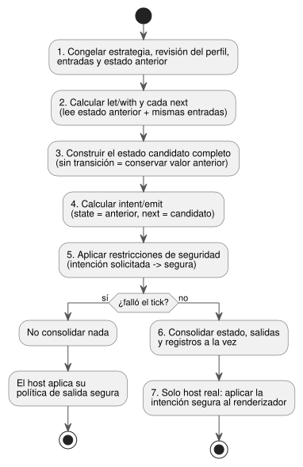
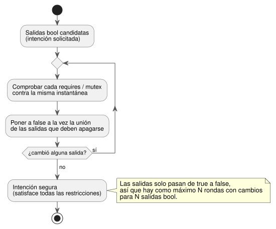

<!-- translation-source: docs/LANGUAGE.en.md -->
[Original en inglés](LANGUAGE.en.md)

# Contrato del lenguaje GhostFlow · borrador de diseño

Fecha: 2026-09-05. Este documento define el **contrato de ejecución común** del lenguaje GhostFlow: las reglas que toda sintaxis y todo runtime deben compartir.

Relación de este documento con los demás:

- **Sintaxis de autoría.** La sintaxis seleccionada actualmente es la [sintaxis de control](LANGUAGE-SURFACE.es.md). El [formato literate](LITERATE.es.md) permite escribir el mismo código dentro de un documento Markdown.
- **Restricciones y sensores.** El [contrato común de restricciones/sensores](CONSTRAINTS.es.md) recoge decisiones de diseño posteriores sobre enclavamientos de modo, información opcional de dispositivos, procesamiento de sensores y límites de tiempo.
- **Qué se ejecuta hoy.** La implementación ejecutable cubre un subconjunto finito de la fuente de control/literate, además de la entrada compatible en S-expressions y el bytecode GFB1. El alcance de la implementación y la evidencia de reproducción (replay) se definen en el [contrato de implementación](IMPLEMENTATION.es.md) y en la [trazabilidad](TRACEABILITY.es.md).
- **Bytecode.** El bytecode actual sigue [GFB1](BYTECODE.es.md).

Este documento aún contiene la semántica común y las notaciones A/B/C del diseño 0.2.
Reglas de precedencia:

- Donde el vocabulario o el formato de la fuente difieran, prevalecen los documentos posteriores de control/literate.
- Para las restricciones y la aplicación de ajustes operativos, prevalece el contrato común de restricciones posterior.

Registros históricos:

- Los [tres ejemplos de sintaxis](LANGUAGE-EXAMPLES.es.md) se conservan como registro de la comparación inicial.
- La especificación anterior se conserva sin cambios en [LANGUAGE-MVP-0.1.md](LANGUAGE-MVP-0.1.es.md).

Estado de la implementación en una línea: están implementados el tratamiento ok/fault de sensores, las funciones puras estáticas y la fuente en forma de documento (literate). **No** están implementados los tipos Result/ADT generales, la composición de funciones de orden superior, las entradas específicas de estrategia ni las macros.

**En este documento:** dirección del lenguaje (§1), modelo de programa (§2), vocabulario y tipos (§3), expresiones (§4), flujos y flujo de errores (§5), consultas de dispositivos (§6), el tick (§7), restricciones de salida (§8), fuente literate y observabilidad (§9), macros (§10), viaje en el tiempo y ghosts (§11), reemplazo de módulos y despliegue (§12), estado de la implementación (§13) y referencias de sintaxis (§14).

## 1. Dirección del lenguaje

GhostFlow es un lenguaje de control. Recibe las entradas de sensores como flujos. Combina cálculo puro con transiciones de estado explícitas para producir **intenciones**: solicitudes de lo que los dispositivos deberían hacer.
Un solo programa puede contener varias **estrategias**. El runtime selecciona una según las capacidades de los dispositivos presentes en ese momento.
Como la ejecución es determinista, se pueden volver a ejecutar entradas idénticas y comparar el comportamiento antes y después de un cambio.

Las preferencias confirmadas en la conversación original y los juicios realizados en este diseño se recogen por separado en [DESIGN-NOTES.md](DESIGN-NOTES.es.md).

| Preferencia | Reflejo en el lenguaje/las herramientas |
|---|---|
| YAML | Declaraciones jerárquicas, `name: type`, ajustes legibles |
| Literate CoffeeScript | Sangría, funciones concisas, explicaciones combinadas con código ejecutable |
| Consultas Cypher | Patrones de capacidades y cláusulas explícitas de selección de dispositivos |
| Meta Lua | Extensión en tiempo de compilación que trata la sintaxis como datos |
| Composición funcional/a nivel de función | Funciones puras, encadenamiento de valores y composición de funciones |
| Programación orientada a raíles (railway) | Valores correctos y de error tratados en el mismo flujo |
| Cycle.js | Source de entrada e Intent de salida separados por un límite de Driver |
| Observable·marimo·D3.js | Valores intermedios, estado y cambios observados junto al código |
| Estabilidad de Elm/Rust | Validación de tipos, ramas y recursos; una base de ejecución predecible |

Se compararon tres alternativas:

- **A**: sintaxis declarativa centrada en YAML.
- **B**: sintaxis de flujo centrada en Literate CoffeeScript.
- **C**: sintaxis de consulta centrada en Cypher.

La discusión posterior eligió la **sintaxis de control** como dirección básica. Se construye en torno a llaves, expresiones, estado siguiente y conexiones de salida.
Literate es un formato de fuente que se apoya sobre esa sintaxis. El contrato de ejecución común siguiente también se aplica a esta elección.

## 2. Modelo de programa

Cada tick calcula tres cosas en orden:

```text
candidate_state = transition(old_state, input_snapshot, selected_strategy)
requested       = intents(old_state, candidate_state, input_snapshot)
safe            = safety(requested, constraints)
```

Si el cálculo tiene éxito, `candidate_state` y el resultado `safe` se consolidan juntos como un único **tick lógico**.
Después, el renderizador (renderer) del host aplica las salidas físicas.
La atomicidad lógica **no** significa que varios GPIO cambien físicamente en el mismo instante.

| Elemento | Significado |
|---|---|
| module / version | ID de módulo estable y versión del esquema de estado |
| input | Muestra tipada suministrada en cada tick; semánticamente `Signal<T>` |
| state | Valor que se conserva entre ticks y su valor predeterminado inicial |
| Function | Transformación de valores pura e interpretable estáticamente |
| strategy | Consulta de dispositivos, entradas específicas de la estrategia, cálculo, transición, intenciones |
| let / with | Cálculo intermedio sin estado y con nombre |
| next | Definición del estado siguiente |
| output / intent / emit | Declarar un tipo y solicitar la intención de salida de capacidad de este tick mediante exactamente una expresión de conexión |
| safety | Restricciones requires / mutex aplicadas a las salidas finales |

Reglas estructurales:

- Un ciclo combinacional en el grafo de expresiones es un error de compilación.
- La realimentación debe cruzar un límite explícito que lea un valor del tick anterior, como el estado.
- Un estado sin definición `next` conserva su valor.
- Definir el mismo estado o la misma salida dos veces en la misma estrategia es un error.

### Ejemplo: entrada → estado → salida en la sintaxis seleccionada

A continuación se muestra un ejemplo completo de fuente en la sintaxis de control seleccionada.
Se compila con `ghostc` y se ejecuta en un host conectado a un manifiesto de sensores.
El ejemplo supone que hay instalado un sensor de nivel bajo de agua. No aporta información adicional como la presión o el caudal.
Esto **no** significa que todo programa deba tener un sensor de nivel bajo de agua.

```ghost
fn hold(start: Bool, blocked: Bool, previous: Bool) -> Bool {
  !blocked && (start || previous)
}

control WateringDemand {
  input start, stop: Bool;
  sensor low_water: Bool;

  output pump, valve: Bool;
  state watering: Bool = false;

  let water_ok = case low_water {
    ok(low)  => !low;
    fault(_) => false;
  };

  let blocked = stop || !water_ok;
  watering' = hold(start, blocked, watering);

  valve <- watering';
  pump  <- watering';
  require pump => valve;
}
```

Cómo leerlo:

- `watering` es la memoria del tick anterior.
- `watering'` es el valor candidato que este tick consolidará.
- `<-` conecta una salida con su intención.
- La función `hold` no tiene memoria oculta.
- `start` y `stop` son muestras booleanas, no eventos de flanco.

Las declaraciones de salida siguen estas reglas:

- `output name: Type;` declara solo el tipo de un puerto de intención.
- Cada nombre de salida debe tener exactamente una conexión `name <- expression;`. Se prohíbe un valor inicial en la declaración.
- La expresión de conexión es la intención lógica que la VM solicita en este tick.
- La política de arranque y de seguridad ante fallos (fail-safe) es responsabilidad aparte del host/renderizador. Esa política mantiene las salidas en OFF, o deja de aplicarlas, en el arranque, ante un fallo de cálculo o cuando el host se desconecta.
- Un valor predeterminado en una declaración de salida nunca establece implícitamente la política de seguridad.

La tabla muestra los resultados esperados cuando las entradas se suministran en orden, partiendo de `watering=false`.

| tick | start | stop | low_water | watering' | intención valve / pump |
|---|---|---|---|---|---|
| 1 | true | false | ok(false) | true | ON / ON |
| 2 | false | false | ok(false) | true | ON / ON |
| 3 | false | false | fault(Stale) | false | OFF / OFF |
| 4 | false | false | ok(false) | false | OFF / OFF |
| 5 | true | true | ok(false) | false | OFF / OFF |

Dos comportamientos a tener en cuenta:

- La recuperación del sensor por sí sola no reactiva el latch (tick 4).
- Cuando start y stop son ambos true, gana stop (tick 5).

Este es un ejemplo de cálculo de control puro.
Entrar en un modo de instalación, ser titular de una bomba compartida y escalonar la conmutación física de bomba/válvula corresponden al gestor de la instalación y al renderizador de salidas descritos en el [contrato común de restricciones](CONSTRAINTS.es.md). El código anterior no implementa todo eso.

## 3. Vocabulario y tipos

**Identificadores.** Los identificadores de la nueva sintaxis siguen el patrón `[A-Za-z_][A-Za-z0-9_]*` y distinguen mayúsculas de minúsculas.
Los puntos separan rutas como `input.start`, `state.watering` y `next.watering`.
El nombre antiguo `low-water` se escribe `low_water` en los ejemplos nuevos. Al migrar un módulo real, se debe proporcionar una correspondencia explícita de cambio de nombre.

**Nombres y ámbitos.**

- Las palabras reservadas no pueden usarse como nombres.
- Los nombres de entradas, estados, estrategias y funciones deben ser únicos dentro de su ámbito.
- Una entrada de estrategia no puede ocultar una entrada común.
- Un cálculo local no puede ocultar una función ni un espacio de nombres reservado.
- Un parámetro de función existe solo dentro de su propia función.

**Disposición de las alternativas 0.2.**

- La alternativa B usa sangría de dos espacios y rechaza los tabuladores. Se sangra después de un introductor de bloque.
- La alternativa A analiza YAML restringido.
- La alternativa C separa los bloques con cláusulas y `end`.
- Las tres alternativas usan comentarios `#` y conservan los paréntesis de llamada.
- Una línea puede continuar dentro de paréntesis abiertos o después de una coma.

**Tipos escalares.** Los tipos de valor básicos implementados en el núcleo 0.2 son `bool` y `number`, un binary64 IEEE 754 finito. (La implementación de referencia actual también tiene Percent, Duration y enumeraciones; véase §13).

- Solo `true` y `false` son literales bool. Las cadenas y los números no tienen valor de verdad implícito ni conversión implícita.
- Un número empieza con notación decimal entera o fraccionaria. NaN e Infinity se rechazan.
- La versión de un módulo es un literal entero u32. La prioridad de una estrategia es un literal entero i32.
- La versión 0.2 del documento, la versión del módulo y la versión del formato de bytecode son tres identificadores distintos.

El [contrato de enteros exactos](EXACT-INTEGER-CONTRACT.es.md), preparado para la revisión R14, propone un tercer escalar, `Int/i32`.
No lo marque como implementado antes de que se completen los pasos N2–N4.

**Muestras de sensor.** Una muestra de sensor se representa como `Result<T, SensorFault>`.

- Los constructores son `Ok(value)` y `Err(fault)`.
- El conjunto inicial de SensorFault es `Disconnected | Stale | Invalid`.
- Usar un Result directamente como bool o como número es un error de tipo.
- Un estado requiere un valor inicial constante que coincida con su tipo declarado.

El contrato posterior de procesamiento de sensores añade `NotReady`, que se usa antes de que un filtro esté listo.
Mantenga separados dos casos:

- **Información opcional de dispositivo ausente** (Option): por ejemplo, no se introdujo una presión nominal.
- **Un fallo en un sensor instalado** (Result).

El control básico y los enclavamientos funcionan sin información complementaria de presión/caudal.
Las reglas detalladas siguen [CONSTRAINTS.md](CONSTRAINTS.es.md).

**Extensiones posteriores.** Los ADT generales, la coincidencia de patrones específica por fallo y los tipos de tiempo/unidades físicas son extensiones posteriores.
Toda nueva sintaxis de ramificación debe ir acompañada de una comprobación de ramificación exhaustiva.
El lenguaje no promete que los fallos de los dispositivos desaparezcan. Su objetivo es bloquear errores de tipo, de referencia y de recursos, y las excepciones del lenguaje no tratadas.

El diseño mínimo para DateTime, el tiempo transcurrido monotónico, las programaciones recurrentes, los eventos naturales, los calendarios laborales y el respaldo (fallback) obligatorio está en [TIME-AND-SCHEDULE-CONTRACT.md](TIME-AND-SCHEDULE-CONTRACT.es.md).
Ese documento separa claramente lo que está implementado hoy (`Duration`, DailySlots, Solar) de las propuestas T2–T4.

## 4. Expresiones y composición de funciones

Las expresiones comunes son literales, referencias, llamadas, definiciones de funciones, paréntesis y los operadores siguientes.

| Asociación más fuerte → más débil | Regla |
|---|---|
| Referencias/llamadas/paréntesis | `f(x)`, `input.x`, `(expr)` |
| Comparación | `< <= > >= is isnt`; se rechaza la comparación encadenada |
| not | Negación Bool; `not x is y` significa `not (x is y)` |
| and | Dos valores bool, asociativo por la izquierda |
| or | Dos valores bool, asociativo por la izquierda |
| >> | Composición de funciones unarias, asociativa por la izquierda |
| \|> | Encadenamiento de valores, asociativo por la izquierda |
| if / then / else | Expresión condicional cuyos dos tipos de resultado coinciden |

Reglas de análisis y comparación:

- El cuerpo de `(args) -> expr` es toda la expresión que sigue a la flecha.
- Si el límite de una expresión de función es ambiguo, enciérrela entre paréntesis.
- Use paréntesis al mezclar comparaciones y encadenamientos.
- `is`/`isnt` comprueban la igualdad/desigualdad entre valores del mismo tipo.
- Las comparaciones de orden se permiten actualmente solo sobre `number`.
- Si se adopta el contrato de enteros, también se permite el orden entre dos valores `Int`. Las comparaciones mixtas siguen rechazándose.
- `type is number` dentro de una consulta de dispositivos es algo distinto: una comparación de etiqueta de tipo.

**Pureza y terminación.**

- Las funciones y operaciones en esta etapa deben ser puras y siempre deben terminar.
- Se prohíben los efectos secundarios y los patrones para evitar errores que dependen de la evaluación en cortocircuito.
- Todas las ramas se comprueban por tipos. Las expresiones seguras pueden precalcularse.
- Las reglas aritméticas y de error de división las definirá un perfil numérico posterior.

El rango mínimo, las operaciones y las conversiones de los enteros exactos, y los vectores de aceptación para implementarlos, están en [EXACT-INTEGER-CONTRACT.md](EXACT-INTEGER-CONTRACT.es.md).
Ese enlace es una propuesta de diseño. No afirma que el analizador, el GFB o la VM actuales admitan `Int`.
El GFB1 actual solo tiene opcodes aritméticos `Number/f64`. No tiene opcodes de enteros ni operación de resto.

```ghost
latch = (start, stop, held) -> not stop and (start or held)
is_dry = map(below(35)) >> recover(false)
```

- `x |> f` significa `f(x)`.
- `f >> g` significa `(x) -> g(f(x))`.

Ninguno de los dos operadores crea estado nuevo. La memoria del latch existe solo en `state.watering`, que pasa quien hace la llamada.

**Tipos de función.** Los tipos de función se infieren del cuerpo y de los puntos de llamada. Si no se puede determinar un tipo único, es un error.
La recursión y la selección dinámica de funciones quedan fuera del alcance.
La composición de funciones y las funciones de biblioteca se especializan estáticamente en un grafo, por lo que la MCU nunca necesita clausuras dinámicas.

## 5. Flujos y flujo de errores Railway

El tipo de un campo de entrada describe la muestra de **un tick**.
`start: bool` significa la muestra actual de un puerto `Signal<bool>`.
`input.start` es esa muestra actual, y las funciones y operaciones se aplican en cada tick.
No hay ninguna cola asíncrona oculta ni un planificador de suscripciones aparte.
La semántica de eventos y temporizadores se definirá por separado en la próxima revisión.

| Función | Significado |
|---|---|
| below(limit) | Función que recibe number y devuelve `value < limit` |
| map(f) | Transforma Ok(x) en Ok(f(x)); reenvía Err(e) sin cambios |
| and_then(f) | Cuando f devuelve Result, conecta Ok(x) con f(x); conserva Err |
| recover(default) | Convierte Ok(x) en x, y Err(e) en el valor predeterminado del mismo tipo |

Llamar a `map`, `and_then` o `recover` produce una función unaria.
En el ejemplo, `is_dry` tiene el tipo `Result<number, SensorFault> -> bool`.
Aquí `map` transforma un Result. No es una operación de planificación de flujos.

```ghost
dry = input.moisture |> map(below(35)) |> recover(false)
blocked = input.stop or (input.low_water |> recover(true))
```

Los fallos de las entradas sin procesar siempre se conservan en el registro (journal), tanto si un cálculo los usa como si no, y tanto si se aplica `recover` como si no.
Así, `recover` es una transformación de valores pura. No borra el error del registro.
Los ejemplos eligen el respaldo que bloquea el riego:

- `recover(true)` para los errores de nivel bajo de agua: un nivel de agua desconocido cuenta como «bajo», lo que bloquea.
- `recover(false)` para los errores de humedad: una humedad desconocida cuenta como «no seco», lo que no solicita riego.

### Ejemplo: convertir errores en valores de control sin ocultarlos

El ejemplo de encadenamiento anterior conserva la notación de la alternativa B.
En la sintaxis seleccionada, la misma decisión se lee como una rama explícita.
El fragmento siguiente va dentro de un control que declara `sensor moisture: Percent;`.

```ghost
let dry = case moisture {
  ok(value) => value < 35%;
  fault(_)  => false;
};
```

| moisture | dry |
|---|---|
| `ok(25%)` | true |
| `ok(40%)` | false |
| `fault(Disconnected)` | false |
| `fault(NotReady)` | false |

En los dos casos de fallo solo se sustituye el valor de decisión por false. El fallo original del sensor permanece en el registro de entradas.
No muestre esto como «sensor normal».
Los ejemplos que añaden procesamiento de ruido y operaciones de recuperación están en el [contrato de sensores](CONSTRAINTS.es.md).

## 6. Consulta de dispositivos

Un **perfil de dispositivo** es el conjunto de capacidades semánticas que suministra el host.
El modelo de consulta inicial es la terna `(kind, name, type)`. El mismo par `(kind, name)` no puede aparecer dos veces.

```ghost
match (pump:actuator<bool>), (valve:actuator<bool>),
      (low_water:sensor<bool>), (moisture:sensor<number>)
```

Cómo leer una consulta:

- Nombres como `pump` son roles semánticos definidos por el perfil. No son variables de fila de una base de datos que recorran varios dispositivos.
- Cada elemento exige que una capacidad esté presente. Las comas significan AND.
- `sensor<number>` indica el tipo de la carga. El Driver envuelve cada muestra y la suministra como `Result<number, SensorFault>`.
- Omitir el tipo, como en `(moisture:sensor)`, solo comprueba la presencia.
- Se puede añadir una condición de tipo con `where moisture.type is number`.

Una cláusula `where` solo puede usar el kind/name/type de los nombres que aparecen en `match`, comparaciones con constantes y `and`/`or`/`not`.
No puede leer `input`, `state`, `next` ni el valor actual de humedad.

Este borrador no tiene rutas de longitud variable, recorrido de relaciones, vinculaciones dinámicas ni ejecución por fila de resultado.
Si los perfiles se amplían a un grafo, deben verificarse las vinculaciones únicas y un coste de recorrido acotado.

**Selección de estrategia.**

- El runtime selecciona la única estrategia coincidente con la prioridad más alta.
- Un empate en la prioridad más alta es un error de ambigüedad.
- Que no coincida ninguna estrategia es un error de activación.
- El orden de declaración nunca prevalece sobre nada.

**Comprobaciones de entradas y vinculaciones.**

- Una entrada común la requieren todas las estrategias. Una entrada de estrategia se requiere solo mientras esa estrategia está seleccionada.
- El perfil comprueba las capacidades de los destinos de intención y de las entradas de sensor, incluidos sus tipos.
- Las entradas del host, como los botones, pasan por una comprobación aparte de vinculación de puertos.
- Una muestra ausente es un error de envío del tick. Es distinto de una muestra `Err` enviada correctamente.

**Cambios de perfil.**

- El perfil nunca cambia durante un tick.
- Los fallos, la recuperación y los cambios de configuración se aplican en un límite de tick, después de verificar el perfil candidato y seleccionar una estrategia.
- La estrategia actual trata de inmediato las entradas con fallo. Un respaldo que reduce el nivel de protección sigue una política operativa explícita del host.
- Los ejemplos no declaran ningún respaldo automático.

## 7. Tick y lecturas de estado

Cada tick sigue los mismos siete pasos:

1. Congelar la estrategia, la revisión del perfil, las entradas comunes/de estrategia y el estado anterior.
2. Calcular cada `let`/`with` y cada definición `next` a partir del estado anterior y las mismas entradas.
3. Construir el estado candidato completo. Los campos sin transición conservan sus valores anteriores.
4. Calcular `intent`/`emit`. Aquí `state` sigue leyendo el valor anterior y `next` lee el candidato.
5. Calcular la intención segura que satisface todas las restricciones de seguridad.
6. Consolidar el estado, los resultados de salida y los registros de ejecución juntos como un único paso lógico.
7. Solo el host de la ejecución real (no ghost) aplica la intención segura al renderizador.

El diagrama muestra estos pasos y qué valores lee cada uno.



**El significado de los nombres nunca cambia durante un tick.**

- `state.x` siempre significa el estado anterior, en toda expresión.
- `next.x` significa el estado siguiente, y solo dentro de `intent`/`emit`.
- Leer `next.y` dentro de una definición `next` es un error.
- `let`/`with` no pueden hacer referencia a `next`.

**Definiciones.**

- En A/B, las definiciones `let` son puras y sus dependencias son acíclicas.
- En C, los alias de la única cláusula `with` se calculan de forma independiente a partir de la misma instantánea anterior. No pueden hacer referencia unos a otros.
- `with` no realiza filtrado de filas ni agregación.
- Las definiciones de salidas y estados son estáticas y completas en cada tick.

**Fallo.** Si un tick falla, ni el estado ni los resultados de salida ordinarios se consolidan parcialmente.
El error se devuelve al host, que aplica su política de salida segura especificada.

**Prohibido en el código de usuario:** `sleep`, escrituras directas en GPIO, bucles o recursión no acotados, tamaños de memoria dinámicos, llamadas de red y generación de código en tiempo de ejecución.

### Ejemplo: cada estado siguiente lee el mismo estado anterior

Este ejemplo de diseño en la sintaxis seleccionada solo intercambia estados; no acciona ningún dispositivo.

```ghost
control SnapshotPair {
  input swap: Bool;
  state left: Bool = true;
  state right: Bool = false;

  left'  = if swap then right else left;
  right' = if swap then left else right;
}
```

En el primer tick con `swap=true`, `(left, right)` cambia de `(true, false)` a `(false, true)`.
Reordenar las dos transiciones da el mismo resultado, porque ambas leen los valores anteriores.
El cambio siguiente infringe el contrato de diseño:

```ghost
// 잘못된 전이식: 다음 상태 참조는 출력식에서만 허용한다.
right' = left';
```

(El comentario dice: «Transición no válida: las referencias al estado siguiente solo se permiten en las expresiones de salida».)
El `left'` de la derecha debe diagnosticarse como error de compilación. No debe leerse según el orden de cálculo.

## 8. Restricciones de salida

Existen dos restricciones sobre salidas bool:

- **requires**: si el requisito previo es false, el destino pasa a false.
- **mutex**: si más de una salida del grupo es true, todas las salidas del grupo pasan a false.

Notación en las alternativas 0.2: A usa listas; B usa `pump requires valve` y `mutex forward, reverse`; C usa `requires pump, valve` y `mutex forward, reverse`.

Reglas:

- Los destinos deben ser intenciones bool que existan en todas las estrategias.
- `requires` toma dos nombres distintos. `mutex` toma de 2 a 32 nombres distintos.
- Las restricciones nunca crean valores true.

Para que el resultado no dependa del orden de declaración, las restricciones se evalúan así:

1. Comprobar cada restricción contra la misma instantánea de las salidas candidatas actuales.
2. Poner a false, simultáneamente, la unión de todas las salidas seleccionadas para apagarse.
3. Repetir hasta que nada cambie.



El bucle anterior siempre termina y no depende del orden:

- Una salida que ha pasado a false nunca vuelve a ser true.
- Con N salidas bool, como máximo N rondas contienen cambios.
- El resultado final debe satisfacer todas las restricciones.
- El registro de fallos enumera las restricciones infringidas y los ID de las salidas bloqueadas.

**El estado no es retroalimentación.**

- El estado retenido no es retroalimentación física.
- Cuando la seguridad bloquea una salida, no sobrescribe implícitamente el estado.
- La apertura real de la válvula o la marcha real de la bomba se modelan con entradas de sensor aparte.
- Las salidas físicas predeterminadas ante una retirada, una pérdida de dispositivo o un fallo del host pertenecen al contrato del lado del host (Driver/renderizador y host), no al código de control.

Las extensiones a modos, instalaciones compartidas y restricciones de tiempo siguen [CONSTRAINTS.md](CONSTRAINTS.es.md).
El bloqueo de salidas, el permiso para trabajo nuevo, las transiciones de modo y el análisis de advertencias tienen cada uno una semántica de ejecución distinta.
No fuerce cualquier condición arbitraria dentro de la iteración dirigida a false anterior.
Cuando varios controles usan un mismo dispositivo, deben obedecer conjuntamente las restricciones compartidas de ese dispositivo.

### Ejemplo: la intención de salida y el resultado bloqueado difieren

```ghost
control OutputGuard {
  input pump_request, valve_request: Bool;
  output pump, valve: Bool;

  valve <- valve_request;
  pump  <- pump_request;
  require pump => valve;
}
```

Para las solicitudes `(pump=true, valve=false)`:

- **requested** conserva y registra esos valores.
- **safe** es `(pump=false, valve=false)`.

La válvula no se enciende automáticamente para satisfacer la restricción.
Este también es un ejemplo de salida lógica. No sustituye la confirmación de que la válvula se abrió realmente, ni los enclavamientos de modo.

## 9. Literate, código como datos y observabilidad

**Fuente literate.** Una fuente `.ghost.md` en forma de documento se trata así:

- Los bloques de código `ghost` de nivel superior se extraen del Markdown en el orden del documento y se pasan al mismo analizador.
- Un control puede abarcar varios bloques. La fuente unida, en su conjunto, debe ser sintaxis ordinaria válida.
- No se añade ninguna semántica de ejecución por bloque.
- Las explicaciones, los bloques de código ordinarios y los resultados de visualización nunca se ejecutan.

El contrato detallado de extracción, diagnósticos y asociación con las ubicaciones originales está en [LITERATE.md](LITERATE.es.md).

**Una sola canalización.** La fuente ordinaria y la fuente en forma de documento producen el mismo AST y el mismo grafo de tipos.
La canalización es `source → AST → syntax expansion → type graph → verification → bytecode`.
El grafo es la definición canónica de la semántica de ejecución. La prosa del documento, los comentarios y el formato se conservan como información de fuente aparte.
No suponga que todas las superficies de sintaxis se convierten entre sí sin pérdidas.

**Observabilidad.**

- Las entradas, los cálculos con nombre, los estados, las intenciones y las restricciones reciben ID de nodo estables y rangos de la fuente.
- Un editor debe permitir a los usuarios inspeccionar, en la ubicación del código, el valor actual, los fallos, el momento del cambio y las entradas que lo influyeron.
- Los nombres locales como `blocked` o `dry` se identifican junto con el nombre de la estrategia.
- La traza de valores intermedios en la MCU es opcional y de tamaño acotado.
- En un PC, los valores deben poder recalcularse a partir de las entradas registradas.

**Edición.** Las ediciones de documento, de formulario y de grafo pasan todas por las mismas comprobaciones.
Editar solo el grafo no regenera los párrafos explicativos.
Las llamadas a macros se editan tal como están escritas; sus expansiones se observan por separado.
El objetivo es tratar datos y código juntos conservando las explicaciones escritas por personas.

## 10. Extensión sintáctica en tiempo de compilación

«Meta Lua» se interpretó como una preferencia por la metaprogramación en tiempo de compilación al estilo de Metalua.
En el [boceto de extensión de ejemplo](LANGUAGE-EXAMPLES.es.md) se propone una notación syntax/quote/splice.
El alcance inicial son plantillas de expresión tipadas. La redefinición sin restricciones de la sintaxis requiere una revisión posterior.

Reglas de las macros:

- Una macro recibe AST, no valores de tiempo de ejecución, y produce AST.
- La expansión debe ser higiénica: no debe capturar los nombres de quien la llama.
- Después de la expansión se vuelven a ejecutar las comprobaciones de tipos, de límites de estado, de ciclos y de recursos.
- Los nombres nuevos y el tamaño de la expansión están acotados.
- Se prohíbe la expansión recursiva, así como la lectura de archivos externos, redes o relojes.
- Superar un límite es un error de compilación.

Las funciones ordinarias bastan para las transformaciones de valores reales.
Incluso con macros, la MCU no debe necesitar ni un procesador de macros ni un runtime de Lua.

## 11. Viaje en el tiempo y comparación con ghost

El contrato de registro (journal) y puntos de control (checkpoint) necesita estos registros:

- ID de línea de tiempo/rama, tick lógico y punto de control base.
- Hash del módulo/versión del esquema, revisión del perfil, estrategia seleccionada y motivo de la selección.
- Entradas y fallos, estado anterior/candidato, intención solicitada/segura e intervención de las restricciones.
- ID de nodo que enlazan ubicaciones del código; las trazas de valores intermedios son opcionales y acotadas.

**Ramificación.** Se crea una rama en un instante registrado, conservando la ejecución original.
Un **ghost** (ejecución fantasma) se ejecuta en una instancia aparte del mismo núcleo Rust y no tiene sumidero de efectos físicos: nunca acciona salidas reales.
El rebobinado no es una orden que devuelva un dispositivo a una posición pasada.

**Comparación.**

- Las ejecuciones se alinean en el mismo tick lógico. La comparación muestra las diferencias de estado, salidas solicitadas, salidas seguras y fallos.
- La hora de reloj de pared es un dato de entrada. El tick lógico define el orden.
- Si se crea una rama hacia un perfil con un sensor adicional cuya entrada no está en el registro, se debe proporcionar una traza explícita de entrada virtual.
- Los valores de sensor ausentes nunca se fabrican automáticamente.

Cuando un programa usa procesamiento de sensores, permisos de modo/recursos compartidos, límites acumulativos u ocurrencias de programación, ese estado también se incluye en sus trazas y puntos de control.
Los registros de ejecución virtual de un ghost nunca modifican ni rebobinan los registros persistentes de uso o de programación de una instalación física.

**Límites de un ghost.** Un ghost con entradas registradas fijas muestra diferencias en las decisiones de control.
Para predecir cómo afectaría un cambio en el comportamiento de la bomba a la humedad real del suelo, se necesita un modelo de entorno aparte.

## 12. Reemplazo de módulos, despliegue y destinos de ejecución

Los módulos se compilan y verifican en el host, y luego se ejecutan bajo el mismo contrato en ESP-IDF Rust y en WASM.
Los usuarios cargan, activan y retiran módulos lógicos. El host verifica los puertos, la titularidad de las salidas, los perfiles y los límites de recursos.

Dentro de un único control escalar canónico, la política acotada de recursos Percent admite solicitudes con nombre, techos con nombre, selección explícita de min/max y un respaldo escrito por el autor; véase la [Referencia §4.9](reference/04-sensors-constraints-control.es.md#49-recursos-compartidos-y-arbitraje). La conexión de módulos productores independientes y la agregación PID siguen siendo alcance posterior.

**Reemplazar un módulo.**

- Un reemplazo se consolida en un límite de tick, después de la validación del módulo candidato, la selección de estrategia, las comprobaciones de compatibilidad del estado y, cuando sea necesario, la comparación con ghost.
- Si falla cualquier paso, el módulo existente sigue activo.
- Reemplazar un módulo/programa o actualizar el firmware detiene todas las tareas de dispositivo controladas por el mismo ESP.
- Los cambios en el perfil, las vinculaciones, las dependencias, la estructura de programación o las reglas también requieren un procedimiento explícito de parada y Configure.
- Un conjunto limitado de propiedades ajustables en tiempo de ejecución usa una ruta distinta de la de los cambios estructurales. Su sintaxis y su semántica durante la operación siguen la [Referencia §5.1–5.2](reference/05-settings-and-observation.es.md). Consulte el [alcance de la implementación](IMPLEMENTATION.es.md) para los límites de ejecución.
- Aplicar un cambio en un límite de tick **no** sustituye el requisito de parada para los cambios estructurales.

**Migrar el estado.**

- Se migra el estado con el mismo ID de módulo y el mismo nombre y tipo.
- Los campos nuevos toman sus valores predeterminados. Los campos eliminados se descartan.
- Un cambio de tipo bajo el mismo nombre se rechaza hasta que se admita la migración explícita.
- Un cambio en la grafía de un identificador no se trata como migración automática del estado.

**Entradas, salidas y registros persistentes tras el reemplazo.**

- La caché de entradas anterior se vacía. El host debe volver a suministrar entradas completas para el nuevo esquema.
- El host trata las salidas eliminadas según su política de liberación.
- El arranque usa los valores predeterminados declarados. Restaurar el estado persistente debe ser una política aparte del host que verifique la revisión.
- Los presupuestos diarios y los registros que impiden ejecuciones duplicadas de la programación son estado persistente de la instalación física, propiedad del host. Son distintos de los valores iniciales de control ordinarios.
- El reemplazo de un módulo, un reinicio o el rebobinado de un ghost nunca deben poner esos registros a cero.

**Actualizaciones.** Las actualizaciones de System, Logic, Profile y Web-assets comparten la misma experiencia OTA.
Las particiones, las ranuras y las rutas de transporte pertenecen al host y no se exponen en la sintaxis de control.
La implementación del manifiesto y del protocolo de despliegue queda fuera del alcance de este trabajo de comparación de sintaxis.

### 12.1 El reemplazo de dispositivo compatible no es un reemplazo del programa de control

Los programas de control hacen referencia a **contratos lógicos de dispositivo**, no a los modelos ni a las direcciones de los sensores y actuadores físicos.
Si el Driver/renderizador y la vinculación de la instalación conectan un dispositivo distinto que cumple el mismo contrato, la fuente de control y el Program compilado deben quedar como están.
Reemplazar solo un dispositivo no debe requerir recompilar.
El Driver es responsable de la comunicación específica del dispositivo y de la interpretación de los valores sin procesar.

«El mismo contrato» abarca más que los tipos. Incluye:

- la semántica y las unidades,
- las reglas de calidad, temporización y error,
- las capacidades requeridas.

Algunos límites que conviene tener presentes:

- Cambiar las reglas de sensores en la fuente es un cambio de fuente. No es un cambio de conexión física.
- Esta separación no implica que los Drivers puedan instalarse dinámicamente ni reemplazarse sin detener el sistema.
- El Driver/firmware y las vinculaciones de la instalación se despliegan en su propio ciclo, separado de las ediciones de la fuente de control.

**Por qué:** para que la misma intención de control pueda reutilizarse con dispositivos distintos, y para que un reemplazo de hardware nunca obligue a reescribir ni a recompilar innecesariamente las reglas de control.
Las reglas detalladas siguen la [Referencia del lenguaje §6.3, reemplazo de dispositivo compatible e independencia de la recompilación](reference/06-composition-and-replay.es.md).

## 13. Estado de la implementación y criterios de aceptación

El estado siguiente se confirmó leyendo el código actual.
No interprete un requisito de la nueva especificación como una implementación completada.

| Elemento | Implementación de referencia actual | Alcance restante de diseño/producción |
|---|---|---|
| Sintaxis de entrada | control + literate + S-expression compatible | adapt, macros, varios módulos |
| Tipos/funciones | Bool/Number/Percent/Duration, enum, fn estática, case de sensor | ADT general, composición de funciones de orden superior |
| Esquema de entradas | Todas las entradas requeridas en cada tick | Entradas comunes + de la estrategia seleccionada |
| Lecturas de estado | state=anterior, next=candidato | Conservar y formalizar este significado |
| Restricciones de seguridad | Punto fijo sobre instantánea solo hacia false, requires-any | Solucionador general de expresiones lógicas/optimización |
| Instalaciones compartidas/modos | Estación Rust + API WASM + vinculación estática de políticas | Límite de aprobación del despliegue de driver/renderizador de dispositivos físicos |
| Análisis de información complementaria de dispositivos | Pass/Violation/Unknown para el caudal entero opcional | Modelo físico de presión/curva, entrega de notificaciones |
| Procesamiento de señales de sensor | Filtros finitos, histéresis, calidad, recuperación | Medición real de WCET/memoria en la placa |
| Restricciones de tiempo | Temporizador monotónico, libro mayor (ledger) de presupuestos/ocurrencias por fecha, almacenamiento de escritorio | NVS de la MCU, confianza en el RTC, verificación ante cortes de energía |
| Cambios de tipo en reemplazo en caliente | Rechazar renombrados de módulos y cambios Bool↔Number en la VM para el mismo nombre de estado | Esquemas de enum nominales, migración explícita, reemplazo de paquetes del host |
| Cambios de perfil | Vaciar inmediatamente la estrategia activa | Consolidar en el límite tras validar el candidato |
| rewind/replay | Registro acotado, rebobinado que elimina los registros posteriores | Rama que conserva el original, registros de versión/perfil |
| IR/mapas de fuente | Ubicaciones de nodos del AST original y asociación de líneas literate | Traza de PC del bytecode→nodo, grafo tipado público |
| Recursos | Límites de pila de expresiones, asignaciones Vec/Map durante el tick | Verificar los límites de recursos de estado/traza/tick completo |
| Despliegue | Código basado en ESP32/WASM | Verificación de extremo a extremo de los contratos de reemplazo/recuperación/liberación de salidas |

Límites actuales del verificador:

| Límite | Valor |
|---|---|
| Entradas / estados / intenciones | 128 cada uno |
| Estrategias | 32 |
| Restricciones | 128 |
| Bytes por blob de expresión/consulta | 4096 |
| Profundidad de pila de expresión/consulta | 128 |

Estos son límites de referencia iniciales. No demuestran el coste máximo de las nuevas funciones.
Las especificaciones y las comprobaciones deben definirse juntas para que todo nuevo compilador o cargador aplique los mismos límites.

**Reducción (lowering).** La sintaxis de superficie para expresiones simples puede reducirse a los opcodes existentes.
Result, las entradas de estrategia y la información de traza necesitan una reducción explícita o extensiones del formato.
No afirme que el GFB1 actual los admite sin cambios.
Un módulo que use funciones no admitidas debe rechazarse; su semántica nunca debe cambiar de forma silenciosa.

Use estos criterios de aceptación al implementar la sintaxis seleccionada:

1. Ejecutar los escenarios comunes de los tres ejemplos en la sintaxis seleccionada y compararlos con lo esperado.
2. Reordenar las definiciones next/intent conserva los resultados; las referencias next no válidas se rechazan.
3. Las cadenas de requires y los mutex satisfacen las restricciones finales independientemente del orden de declaración.
4. Diagnosticar conflictos de estrategia, pérdida de dispositivos obligatorios, entradas ausentes y uso indebido del tipo Result.
5. Un reemplazo fallido de módulo/perfil no cambia parcialmente la ejecución existente.
6. Las ramas ghost muestran diferencias en el mismo tick sin tocar el historial original ni las salidas reales.
7. Verificar los límites de recursos tras la expansión de funciones/macros y enlazar las ubicaciones de error con el texto original.

## 14. Referencias de sintaxis

**YAML (alternativa A).** La jerarquía, los escalares y las cadenas de bloque de la alternativa A provienen de [YAML 1.2.2](https://yaml.org/spec/1.2.2/).
GhostFlow acepta solo un documento único con estructuras restringidas de escalares/mapas/listas. Rechaza las claves duplicadas, los anchors/aliases, las merge keys y las etiquetas de usuario.
Solo `true`/`false` y los números decimales se interpretan como literales.
El resto de la notación de tipos y los escalares de expresión se conservan como cadenas y los analiza GhostFlow.

**Literate CoffeeScript (alternativa B).** La idea de escribir explicaciones y código juntos proviene de [Literate CoffeeScript](https://coffeescript.org/#literate).
El Literate CoffeeScript original usa bloques de código sangrados.
La alternativa B es un diseño aparte: usa bloques `ghost` explícitos para marcar los bloques ejecutables.

**Cypher (alternativa C).** La legibilidad de los patrones de dispositivos se inspira en [Cypher MATCH](https://neo4j.com/docs/cypher-manual/current/clauses/match/).
La strategy/next/emit de GhostFlow y su notación de parámetros de tipo son propuestas originales.

**Metalua (macros).** La extensión en tiempo de compilación que construye AST se inspira en [Metalua](https://github.com/fab13n/metalua) y en su [documentación del compilador](https://github.com/fab13n/metalua/blob/master/README-compiler.md).
La sintaxis original y la notación propuesta por GhostFlow se mantienen diferenciadas.
