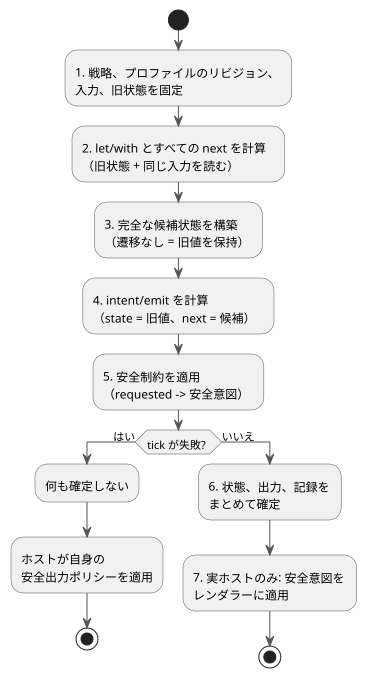
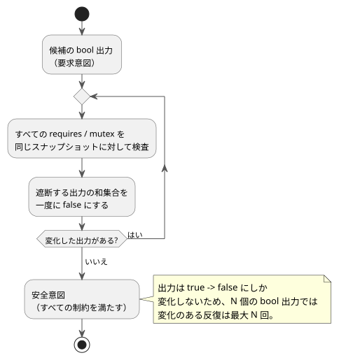

<!-- translation-source: docs/LANGUAGE.en.md -->
[英語の原文](LANGUAGE.en.md)

# GhostFlow 言語契約 · 設計草案

2026-09-05 付。この文書は GhostFlow 言語の**共通実行契約**、すなわちすべての構文とすべてのランタイムが共有しなければならない規則を定義します。

この文書と他の文書との関係:

- **記述構文。** 現在選定されている構文は[制御構文](LANGUAGE-SURFACE.ja.md)です。[文芸的（literate）形式](LITERATE.ja.md)を使うと、同じコードを Markdown 文書の中に書けます。
- **制約とセンサ。** [共通の制約/センサ契約](CONSTRAINTS.ja.md)には、モードインターロック、オプションのデバイス情報、センサ処理、時間制限に関する後続の設計判断が記録されています。
- **現在動作するもの。** 実行可能な実装は、制御/文芸的ソースの有限なサブセットに加え、互換の S 式入力と GFB1 バイトコードを扱います。実装範囲とリプレイの証拠は、[実装契約](IMPLEMENTATION.ja.md)と[トレーサビリティ](TRACEABILITY.ja.md)で定義されています。
- **バイトコード。** 現在のバイトコードは [GFB1](BYTECODE.ja.md) に従います。

この文書には、0.2 の設計にあった共通セマンティクスと A/B/C の表記が今も含まれています。
優先順位の規則:

- 語彙やソース形式が異なる箇所では、後続の制御/文芸的文書が優先されます。
- 制約と運用設定の適用については、後続の共通制約契約が優先されます。

過去の記録:

- [3 つの構文例](LANGUAGE-EXAMPLES.ja.md)は、初期の比較記録として保存されています。
- 以前の仕様は [LANGUAGE-MVP-0.1.md](LANGUAGE-MVP-0.1.ja.md) に変更なしで保存されています。

実装状況を一言で言うと、センサの ok/fault 処理、静的な純粋関数、文書形式（literate）のソースは実装済みです。一般的な Result/ADT 型、高階関数の合成、戦略固有の入力、マクロは実装**されていません**。

**この文書の内容:** 言語の方向性（§1）、プログラムモデル（§2）、語彙と型（§3）、式（§4）、ストリームとエラーフロー（§5）、デバイス照会（§6）、tick（§7）、出力制約（§8）、文芸的ソースと可観測性（§9）、マクロ（§10）、タイムトラベルとゴースト（§11）、モジュールの置換とデプロイ（§12）、実装状況（§13）、構文の参考資料（§14）。

## 1. 言語の方向性

GhostFlow は制御言語です。センサ入力をストリームとして受け取り、純粋な計算と明示的な状態遷移を組み合わせて**意図**（intent）、すなわちデバイスが何をすべきかの要求を生成します。
1 つのプログラムは複数の**戦略**（strategy）を持てます。ランタイムは、現在存在するデバイスのケイパビリティに応じてそのうちの 1 つを選択します。
実行は決定的なので、同一の入力を再実行して、変更前後の振る舞いを比較できます。

元の会話で確認された好みと、この設計で下した判断は、[DESIGN-NOTES.md](DESIGN-NOTES.ja.md) に別途記録されています。

| 好み | 言語/ツールへの反映 |
|---|---|
| YAML | 階層的な宣言、`name: type`、読みやすい設定 |
| Literate CoffeeScript | インデント、簡潔な関数、実行可能なコードと組み合わせた説明 |
| Cypher クエリ | ケイパビリティのパターンと、明示的なデバイス選択句 |
| Meta Lua | 構文をデータとして扱うコンパイル時拡張 |
| 関数型/関数レベルの合成 | 純粋関数、値のパイプ、関数合成 |
| Railway 指向プログラミング | 成功値とエラー値を同じフローで扱う |
| Cycle.js | Driver 境界で分離された入力 Source と出力 Intent |
| Observable·marimo·D3.js | 中間値、状態、変化をコードの横で観測 |
| Elm/Rust の安定性 | 型、分岐、リソースの検証。予測可能な実行基盤 |

3 つの代替案が比較されました。

- **A**: YAML 中心の宣言的構文。
- **B**: Literate CoffeeScript 中心のフロー構文。
- **C**: Cypher 中心のクエリ構文。

その後の議論で、基本方針として**制御構文**が選定されました。これは波括弧、式、次状態、出力接続を中心に構成されています。
literate は、その構文の上に重ねたソース形式です。以下の共通実行契約は、この選択にも適用されます。

## 2. プログラムモデル

各 tick は、次の 3 つを順に計算します。

```text
candidate_state = transition(old_state, input_snapshot, selected_strategy)
requested       = intents(old_state, candidate_state, input_snapshot)
safe            = safety(requested, constraints)
```

計算が成功すると、`candidate_state` と `safe` の結果は、1 つの**論理 tick** としてまとめて確定されます。
その後、ホストのレンダラーが物理出力を適用します。
論理的なアトミック性は、複数の GPIO が物理的に同じ瞬間に変化することを意味する**わけではありません**。

| 要素 | 意味 |
|---|---|
| module / version | 安定したモジュール ID と状態スキーマのバージョン |
| input | 各 tick に供給される型付きサンプル。意味的には `Signal<T>` |
| state | tick 間で保持される値と、その初期既定値 |
| Function | 純粋で、静的に解釈可能な値の変換 |
| strategy | デバイス照会、戦略固有の入力、計算、遷移、意図 |
| let / with | 名前付きの状態を持たない中間計算 |
| next | 次状態の定義 |
| output / intent / emit | 型を宣言し、ちょうど 1 つの接続式によって、この tick のケイパビリティ出力意図を要求する |
| safety | 最終出力に適用される requires / mutex 制約 |

構造上の規則:

- 式グラフ内の組み合わせ的な循環はコンパイルエラーです。
- フィードバックは、state のように前 tick の値を読む明示的な境界を経由しなければなりません。
- `next` 定義を持たない状態は、その値を保持します。
- 同じ戦略内で同じ状態や出力を 2 回定義するとエラーです。

### 例: 選定された構文での入力 → 状態 → 出力

以下は、選定された制御構文による完全なソース例です。
`ghostc` でコンパイルでき、センサマニフェストに接続されたホスト上で実行されます。
この例は、低水位センサが設置されていることを前提としています。圧力や流量のような追加情報は与えません。
これは、すべてのプログラムが低水位センサを持たなければならないという意味**ではありません**。

```ghost
fn hold(start: Bool, blocked: Bool, previous: Bool) -> Bool {
  !blocked && (start || previous)
}

control WateringDemand {
  input start, stop: Bool;
  sensor low_water: Bool;

  output pump, valve: Bool;
  state watering: Bool = false;

  let water_ok = case low_water {
    ok(low)  => !low;
    fault(_) => false;
  };

  let blocked = stop || !water_ok;
  watering' = hold(start, blocked, watering);

  valve <- watering';
  pump  <- watering';
  require pump => valve;
}
```

読み方:

- `watering` は前の tick からの記憶です。
- `watering'` は、この tick が確定する候補値です。
- `<-` は出力をその意図に接続します。
- 関数 `hold` は隠れた記憶を持ちません。
- `start` と `stop` は Boolean のサンプルであり、エッジイベントではありません。

出力宣言は次の規則に従います。

- `output name: Type;` は、意図ポートの型だけを宣言します。
- すべての出力名は、ちょうど 1 つの `name <- expression;` 接続を持たなければなりません。宣言での初期値は禁止されています。
- 接続式は、VM がこの tick に要求する論理的な意図です。
- 起動時とフェイルセーフのポリシーは、ホスト/レンダラーが別途担当します。そのポリシーは、起動時、計算の失敗時、ホストの切断時に、出力を OFF に保つか、出力の適用を停止します。
- 出力宣言の既定値が、暗黙に安全ポリシーを設定することは決してありません。

次の表は、`watering=false` から始めて入力を順に与えたときの期待結果を示しています。

| tick | start | stop | low_water | watering' | valve / pump の意図 |
|---|---|---|---|---|---|
| 1 | true | false | ok(false) | true | ON / ON |
| 2 | false | false | ok(false) | true | ON / ON |
| 3 | false | false | fault(Stale) | false | OFF / OFF |
| 4 | false | false | ok(false) | false | OFF / OFF |
| 5 | true | true | ok(false) | false | OFF / OFF |

注目すべき 2 つの振る舞い:

- センサが復旧しただけでは、ラッチは復活しません（tick 4）。
- start と stop が両方 true の場合は、stop が優先されます（tick 5）。

これは純粋な制御計算の例です。
設備モードへの移行、共有ポンプの所有、ポンプ/バルブの物理的な切り替えをずらすことは、[共通制約契約](CONSTRAINTS.ja.md)で説明されている設備マネージャと出力レンダラーの担当です。上のコードは、そのすべてを実装しているわけではありません。

## 3. 語彙と型

**識別子。** 新しい構文の識別子は `[A-Za-z_][A-Za-z0-9_]*` に一致し、大文字と小文字を区別します。
ドットは `input.start`、`state.watering`、`next.watering` のようなパスを区切ります。
古い名前 `low-water` は、新しい例では `low_water` と書きます。実際のモジュールを移行する際は、明示的な名前変更のマッピングを与えなければなりません。

**名前とスコープ。**

- 予約語は名前として使えません。
- 入力、状態、戦略、関数の名前は、それぞれのスコープ内で一意でなければなりません。
- 戦略の入力は、共通の入力をシャドウイングできません。
- ローカルな計算は、関数や予約された名前空間をシャドウイングできません。
- 関数のパラメータは、その関数の内部にのみ存在します。

**0.2 の代替案のレイアウト。**

- 代替案 B は 2 スペースのインデントを使い、タブを拒否します。ブロックを導入する行の後でインデントします。
- 代替案 A は制限された YAML を解析します。
- 代替案 C は句と `end` でブロックを区切ります。
- 3 つの代替案はいずれも `#` コメントを使い、呼び出しの括弧を保持します。
- 開いた括弧の中、またはカンマの後では、行を継続できます。

**スカラー型。** 0.2 のコアで実装されている基本の値型は、`bool` と、有限の IEEE 754 binary64 の `number` です（現在のリファレンス実装には Percent、Duration、列挙型もあります。§13 を参照してください）。

- bool のリテラルは `true` と `false` だけです。文字列や数値には真偽性も暗黙の変換もありません。
- 数値は 10 進の整数表記または小数表記で始まります。NaN と Infinity は拒否されます。
- モジュールのバージョンは u32 の整数リテラルです。戦略の優先度は i32 の整数リテラルです。
- 文書のバージョン 0.2、モジュールのバージョン、バイトコード形式のバージョンは、3 つの別々の識別子です。

R14 のレビュー用に準備された[厳密な整数の契約](EXACT-INTEGER-CONTRACT.ja.md)は、3 つ目のスカラーとして `Int/i32` を提案しています。
ステップ N2–N4 が完了するまでは、これを実装済みと表示してはなりません。

**センササンプル。** センササンプルは `Result<T, SensorFault>` として表されます。

- コンストラクタは `Ok(value)` と `Err(fault)` です。
- 初期の SensorFault の集合は `Disconnected | Stale | Invalid` です。
- Result をそのまま bool や number として使うと型エラーです。
- 状態には、宣言された型に一致する定数の初期値が必要です。

後続のセンサ処理契約では、フィルタの準備が整う前に使われる `NotReady` が追加されています。
次の 2 つのケースは区別してください。

- **オプションのデバイス情報の欠落**（Option）: たとえば、圧力定格が入力されていない場合。
- **設置済みのセンサの故障**（Result）。

基本的な制御とインターロックは、補足的な圧力/流量の情報がなくても動作します。
詳細な規則は [CONSTRAINTS.md](CONSTRAINTS.ja.md) に従います。

**後続の拡張。** 一般的な ADT、故障の種類ごとのパターンマッチ、時間/物理単位の型は後続の拡張です。
新しい分岐構文には、必ず網羅的な分岐検査を伴わなければなりません。
言語は、デバイスの故障がなくなることを約束しません。目標は、型、参照、リソースのエラーと、処理されない言語例外を防ぐことです。

DateTime、単調な経過時間、繰り返しのスケジュール、自然現象のイベント、稼働カレンダー、必須のフォールバックの最小設計は [TIME-AND-SCHEDULE-CONTRACT.md](TIME-AND-SCHEDULE-CONTRACT.ja.md) にあります。
その文書は、現在実装されているもの（`Duration`、DailySlots、Solar）と T2–T4 の提案とを明確に分けています。

## 4. 式と関数の合成

共通の式は、リテラル、参照、呼び出し、関数定義、括弧、および以下の演算子です。

| 結合が強い → 結合が弱い | 規則 |
|---|---|
| 参照/呼び出し/括弧 | `f(x)`、`input.x`、`(expr)` |
| 比較 | `< <= > >= is isnt`。連鎖した比較は拒否 |
| not | Bool の否定。`not x is y` は `not (x is y)` を意味する |
| and | 2 つの bool 値、左結合 |
| or | 2 つの bool 値、左結合 |
| >> | 単項関数の合成、左結合 |
| \|> | 値のパイプ、左結合 |
| if / then / else | 2 つの結果の型が一致する条件式 |

構文解析と比較の規則:

- `(args) -> expr` の本体は、矢印に続く式全体です。
- 関数式の境界があいまいな場合は、括弧で囲んでください。
- 比較とパイプを混在させる場合は括弧を使ってください。
- `is`/`isnt` は、同じ型の値の間の等価/非等価を判定します。
- 順序比較は、現在 `number` に対してのみ許可されています。
- 整数の契約が採用された場合は、2 つの `Int` 値の間の順序比較も許可されます。型の混在した比較は引き続き拒否されます。
- デバイス照会の中の `type is number` は別物で、型タグの比較です。

**純粋性と停止性。**

- この段階の関数と演算は、純粋で、必ず停止しなければなりません。
- 副作用や、短絡評価に頼ってエラーを回避するパターンは禁止されています。
- すべての分岐が型検査されます。安全な式は事前に計算してもかまいません。
- 算術と除算エラーの規則は、後続の数値プロファイルで定義されます。

厳密な整数の最小範囲、演算、変換、およびそれを実装するための受け入れベクタは [EXACT-INTEGER-CONTRACT.md](EXACT-INTEGER-CONTRACT.ja.md) にあります。
このリンクは設計提案です。現在のパーサ、GFB、VM が `Int` をサポートしていると主張するものではありません。
現在の GFB1 には `Number/f64` の算術オペコードしかありません。整数のオペコードも剰余演算もありません。

```ghost
latch = (start, stop, held) -> not stop and (start or held)
is_dry = map(below(35)) >> recover(false)
```

- `x |> f` は `f(x)` を意味します。
- `f >> g` は `(x) -> g(f(x))` を意味します。

どちらの演算子も新しい状態を作りません。ラッチの記憶は、呼び出し側が渡す `state.watering` の中にだけ存在します。

**関数の型。** 関数の型は、本体と呼び出し箇所から推論されます。一意の型が決まらない場合はエラーです。
再帰と動的な関数選択は対象外です。
関数の合成とライブラリ関数はグラフへと静的に特殊化されるため、MCU が動的なクロージャを必要とすることは決してありません。

## 5. ストリームと Railway エラーフロー

入力フィールドの型は、**1 つの tick** のサンプルを記述します。
`start: bool` は、`Signal<bool>` ポートの現在のサンプルを意味します。
`input.start` はその現在のサンプルであり、関数と演算は tick ごとに適用されます。
隠れた非同期キューも、別個の購読スケジューラもありません。
イベントとタイマーのセマンティクスは、次のリビジョンで別途定義されます。

| 関数 | 意味 |
|---|---|
| below(limit) | number を受け取り `value < limit` を返す関数 |
| map(f) | Ok(x) を Ok(f(x)) に変換し、Err(e) はそのまま渡す |
| and_then(f) | f が Result を返す場合、Ok(x) を f(x) につなぐ。Err は保持する |
| recover(default) | Ok(x) を x に、Err(e) を同じ型の default に変換する |

`map`、`and_then`、`recover` を呼び出すと、単項関数が生成されます。
例では、`is_dry` の型は `Result<number, SensorFault> -> bool` です。
ここでの `map` は Result を変換するものです。ストリームのスケジューリング操作ではありません。

```ghost
dry = input.moisture |> map(below(35)) |> recover(false)
blocked = input.stop or (input.low_water |> recover(true))
```

生の入力の故障は、計算がそれを使うかどうか、また `recover` が適用されるかどうかにかかわらず、常にジャーナルに保持されます。
したがって `recover` は純粋な値の変換です。エラーを記録から消すものではありません。
例では、灌水をブロックする側のフォールバックを選んでいます。

- 低水位のエラーには `recover(true)`: 水位が不明なら「低い」とみなし、ブロックします。
- 水分のエラーには `recover(false)`: 水分が不明なら「乾いていない」とみなし、灌水を要求しません。

### 例: エラーを隠さずに制御値へ変換する

上のパイプの例は、代替案 B の表記を保っています。
選定された構文では、同じ判断を明示的な分岐として読めます。
以下の断片は、`sensor moisture: Percent;` を宣言した制御の中に置きます。

```ghost
let dry = case moisture {
  ok(value) => value < 35%;
  fault(_)  => false;
};
```

| moisture | dry |
|---|---|
| `ok(25%)` | true |
| `ok(40%)` | false |
| `fault(Disconnected)` | false |
| `fault(NotReady)` | false |

2 つの故障のケースでは、判断の値だけが false に置き換えられます。元のセンサの故障は入力の記録に残ります。
これを「センサ正常」と表示してはなりません。
ノイズ処理と復旧の操作を加えた例は、[センサ契約](CONSTRAINTS.ja.md)にあります。

## 6. デバイス照会

**デバイスプロファイル**とは、ホストが提供する意味的なケイパビリティの集合です。
初期の照会モデルは `(kind, name, type)` の三つ組です。同じ `(kind, name)` の組が 2 回現れることはできません。

```ghost
match (pump:actuator<bool>), (valve:actuator<bool>),
      (low_water:sensor<bool>), (moisture:sensor<number>)
```

照会の読み方:

- `pump` のような名前は、プロファイルが定義する意味的な役割です。複数のデバイスを反復するデータベースの行変数ではありません。
- 各項目は、ケイパビリティが存在することを要求します。カンマは AND を意味します。
- `sensor<number>` はペイロードの型を与えます。Driver が各サンプルをラップし、`Result<number, SensorFault>` として供給します。
- `(moisture:sensor)` のように型を省略すると、存在だけを検査します。
- `where moisture.type is number` で型の条件を追加できます。

`where` 句で使えるのは、`match` に現れる名前の kind/name/type、定数との比較、`and`/`or`/`not` だけです。
`input`、`state`、`next`、現在の水分値を読むことはできません。

この草案には、可変長のパス、関係の走査、動的なバインディング、結果行ごとの実行はありません。
プロファイルをグラフに拡張する場合は、一意なバインディングと有界な走査コストを検証しなければなりません。

**戦略選択。**

- ランタイムは、一致する戦略のうち優先度が最も高い 1 つを選択します。
- 最高優先度で同順位になった場合は、あいまいさのエラーです。
- 一致する戦略がない場合は、有効化のエラーです。
- 宣言の順序が何かを上書きすることは決してありません。

**入力とバインディングの検査。**

- 共通の入力はすべての戦略で必須です。戦略の入力は、その戦略が選択されている間だけ必須です。
- プロファイルは、意図の対象とセンサ入力のケイパビリティを、型も含めて検査します。
- ボタンのようなホスト入力は、別個のポートバインディング検査を経ます。
- サンプルの欠落は tick の投入エラーです。正しく投入された `Err` サンプルとは異なります。

**プロファイルの変更。**

- tick の途中でプロファイルが変わることは決してありません。
- 故障、復旧、構成の変更は、候補プロファイルが検証され戦略が選択された後、tick の境界で適用されます。
- 現在の戦略は故障の入力を即座に処理します。保護レベルを下げるフォールバックは、明示的なホストの運用ポリシーに従います。
- 例では自動フォールバックを宣言していません。

## 7. tick と状態の読み取り

すべての tick は、同じ 7 つのステップに従います。

1. 戦略、プロファイルのリビジョン、共通/戦略の入力、旧状態を固定します。
2. 旧状態と同じ入力から、すべての `let`/`with` とすべての `next` 定義を計算します。
3. 完全な候補状態を構築します。遷移を持たないフィールドは旧値を保持します。
4. `intent`/`emit` を計算します。ここでは `state` は依然として旧値を読み、`next` は候補を読みます。
5. すべての安全制約を満たす安全意図を計算します。
6. 状態、出力結果、実行記録を 1 つの論理ステップとしてまとめて確定します。
7. 実際の（ゴーストでない）実行のホストだけが、安全意図をレンダラーに適用します。

次の図は、これらのステップと、各ステップがどの値を読むかを示しています。



**tick の間、名前の意味は決して変わりません。**

- `state.x` は、どの式においても常に前状態を意味します。
- `next.x` は次状態を意味し、`intent`/`emit` の中でのみ使えます。
- `next` 定義の中で `next.y` を読むとエラーです。
- `let`/`with` は `next` を参照できません。

**定義。**

- A/B では、`let` 定義は純粋であり、その依存関係は非循環です。
- C では、単一の `with` 句の中の別名は、同じ旧スナップショットからそれぞれ独立に計算されます。互いを参照することはできません。
- `with` は行のフィルタリングも集約も行いません。
- 出力と状態の定義は静的であり、tick ごとに完全です。

**失敗。** tick が失敗した場合、状態も通常の出力結果も部分的に確定されることはありません。
エラーはホストに返され、ホストは規定された安全出力ポリシーを適用します。

**ユーザーコードで禁止されているもの:** `sleep`、GPIO への直接書き込み、有界でないループや再帰、動的なメモリサイズ、ネットワーク呼び出し、実行時のコード生成。

### 例: すべての次状態は同じ前状態を読む

選定された構文によるこの設計例は、状態を入れ替えるだけで、デバイスは駆動しません。

```ghost
control SnapshotPair {
  input swap: Bool;
  state left: Bool = true;
  state right: Bool = false;

  left'  = if swap then right else left;
  right' = if swap then left else right;
}
```

`swap=true` の最初の tick で、`(left, right)` は `(true, false)` から `(false, true)` に変わります。
2 つの遷移の順序を入れ替えても、どちらも旧値を読むため、結果は同じです。
次の変更は設計契約に違反します。

```ghost
// 잘못된 전이식: 다음 상태 참조는 출력식에서만 허용한다.
right' = left';
```

（コメントの意味:「不正な遷移式: 次状態の参照は出力式でのみ許される。」）
右辺の `left'` はコンパイルエラーとして診断されなければなりません。計算の順序に従って読まれてはなりません。

## 8. 出力制約

bool 出力の制約は 2 つあります。

- **requires**: 前提条件が false の場合、対象は false になります。
- **mutex**: グループ内で複数の出力が true の場合、グループ内のすべての出力が false になります。

0.2 の代替案での表記: A はリストを使います。B は `pump requires valve` と `mutex forward, reverse` を使います。C は `requires pump, valve` と `mutex forward, reverse` を使います。

規則:

- 対象は、すべての戦略に存在する bool の意図でなければなりません。
- `requires` は 2 つの異なる名前を取ります。`mutex` は 2–32 個の異なる名前を取ります。
- 制約が true の値を作り出すことは決してありません。

結果を宣言の順序に依存させないため、制約は次のように評価されます。

1. すべての制約を、現在の候補出力の同じスナップショットに対して検査します。
2. 遮断対象として選ばれたすべての出力の和集合を、同時に false にします。
3. 何も変化しなくなるまで繰り返します。



上のループは必ず停止し、順序に依存しません。

- false になった出力が再び true になることは決してありません。
- N 個の bool 出力がある場合、変化を含む反復は最大 N 回です。
- 最終結果はすべての制約を満たさなければなりません。
- 故障の記録には、違反した制約とブロックされた出力の ID が列挙されます。

**状態はフィードバックではありません。**

- ラッチされた状態は物理的なフィードバックではありません。
- 安全制約が出力をブロックしても、状態を暗黙に上書きすることはありません。
- バルブが実際に開いていることやポンプが実際に動いていることは、別個のセンサ入力でモデル化します。
- 取り外し、デバイスの喪失、ホストの故障時の物理的な既定出力は、制御コードではなく、ホスト側の契約（Driver/レンダラーとホスト）に属します。

モード、共有設備、時間制約への拡張は [CONSTRAINTS.md](CONSTRAINTS.ja.md) に従います。
出力のブロック、新しい作業の許可、モードの遷移、警告の分析は、それぞれ異なる実行セマンティクスを持ちます。
あらゆる任意の条件を、上の false 方向の反復に無理に押し込んではなりません。
複数の制御が 1 つのデバイスを使う場合、それらは共同でそのデバイスの共有制約に従わなければなりません。

### 例: 出力意図とブロックされた結果は異なる

```ghost
control OutputGuard {
  input pump_request, valve_request: Bool;
  output pump, valve: Bool;

  valve <- valve_request;
  pump  <- pump_request;
  require pump => valve;
}
```

要求が `(pump=true, valve=false)` の場合:

- **requested** はその値を保持して記録します。
- **safe** は `(pump=false, valve=false)` です。

制約を満たすためにバルブが自動的にオンにされることはありません。
これも論理出力の例です。バルブが実際に開いたことの確認や、モードインターロックの代わりにはなりません。

## 9. 文芸的ソース、データとしてのコード、可観測性

**文芸的ソース。** 文書形式の `.ghost.md` ソースは、次のように扱われます。

- トップレベルの `ghost` コードフェンスが文書の順序で Markdown から抽出され、同じパーサに渡されます。
- 1 つの制御が複数のブロックにまたがってもかまいません。結合されたソース全体が、通常の構文として正しくなければなりません。
- ブロックごとの実行セマンティクスは追加されません。
- 説明、通常のコードフェンス、可視化の結果が実行されることは決してありません。

抽出、診断、元の位置への対応付けの詳細な契約は [LITERATE.md](LITERATE.ja.md) にあります。

**1 つのパイプライン。** 通常のソースと文書形式のソースは、同じ AST と型グラフを生成します。
パイプラインは `source → AST → syntax expansion → type graph → verification → bytecode` です。
グラフは実行セマンティクスの正準的な定義です。文書の散文、コメント、書式は、別個のソース情報として保存されます。
すべての構文表層が互いに損失なく変換できると仮定してはなりません。

**可観測性。**

- 入力、名前付きの計算、状態、意図、制約には、安定したノード ID とソース範囲が与えられます。
- エディタは、現在の値、故障、変化した時刻、影響を与えた入力を、コードの位置で確認できるようにしなければなりません。
- `blocked` や `dry` のようなローカルな名前は、戦略名と一緒に識別されます。
- MCU 上での中間値のトレースは任意であり、サイズに上限があります。
- PC 上では、記録された入力から値を再計算できなければなりません。

**編集。** 文書、フォーム、グラフのどの編集も、同じ検査を経ます。
グラフだけを編集しても、説明の段落は再生成されません。
マクロ呼び出しは書かれたとおりに編集され、その展開結果は別途観測されます。
目標は、人間が書いた説明を保ちながら、データとコードを一緒に扱うことです。

## 10. コンパイル時の構文拡張

「Meta Lua」は、Metalua 風のコンパイル時メタプログラミングへの好みとして解釈されました。
syntax/quote/splice の表記は、[拡張例のスケッチ](LANGUAGE-EXAMPLES.ja.md)で提案されています。
初期の範囲は型付きの式テンプレートです。制限のない構文の再定義には、後で検討が必要です。

マクロの規則:

- マクロは実行時の値ではなく AST を受け取り、AST を生成します。
- 展開は衛生的でなければなりません。つまり、呼び出し側の名前を捕捉してはなりません。
- 展開後に、型、状態境界、循環、リソースの検査が再び実行されます。
- 新しい名前と展開のサイズには上限があります。
- 再帰的な展開は禁止されており、外部ファイル、ネットワーク、クロックの読み取りも禁止されています。
- 上限を超えるとコンパイルエラーです。

実際の値の変換には、通常の関数で十分です。
マクロがあっても、MCU はマクロプロセッサも Lua ランタイムも必要としてはなりません。

## 11. タイムトラベルとゴースト比較

ジャーナル/チェックポイントの契約には、次の記録が必要です。

- タイムライン/ブランチ ID、論理 tick、基点となるチェックポイント。
- モジュールのハッシュ/スキーマのバージョン、プロファイルのリビジョン、選択された戦略と選択の理由。
- 入力と故障、旧/候補状態、要求/安全意図、制約による介入。
- コードの位置を結び付けるノード ID。中間値のトレースは任意であり、上限があります。

**分岐。** 元の実行を保存したまま、記録された時点でブランチを作ります。
**ゴースト**（ghost、ゴースト実行）は同じ Rust コアの別インスタンスで実行され、物理的な効果の出口を持ちません。実際の出力を駆動することは決してありません。
巻き戻しは、デバイスを過去の位置に戻すコマンドではありません。

**比較。**

- 実行は同じ論理 tick で揃えられます。比較では、状態、要求出力、安全出力、故障の差分が示されます。
- 壁時計の時刻は入力データです。順序は論理 tick が定義します。
- 記録に入力が存在しない追加のセンサを持つプロファイルへ分岐する場合は、明示的な仮想入力トレースを与えなければなりません。
- 欠けたセンサ値が自動的に捏造されることは決してありません。

プログラムがセンサ処理、モード/共有リソースの許可、累積の上限、スケジュールの発生を使う場合、その状態もトレースとチェックポイントに含まれます。
ゴーストの仮想実行の記録が、物理設備の永続的な使用量やスケジュールの記録を変更したり巻き戻したりすることは決してありません。

**ゴーストの限界。** 記録された入力を固定したゴーストは、制御判断の差分を示します。
変更されたポンプの振る舞いが実際の土壌水分にどう影響するかを予測するには、別個の環境モデルが必要です。

## 12. モジュールの置換、デプロイ、実行ターゲット

モジュールはホスト上でコンパイル・検証され、その後 ESP-IDF Rust と WASM の上で同じ契約のもとで実行されます。
ユーザーはロジックモジュールをアップロード、有効化、削除します。ホストは、ポート、出力の所有権、プロファイル、リソースの上限を検証します。

1 つの正準的なスカラー制御の中では、有界な Percent のリソースポリシーが、名前付きの要求、名前付きの上限、明示的な min/max の選択、記述されたフォールバックをサポートします。[Reference §4.9](reference/04-sensors-constraints-control.ja.md) を参照してください。独立したプロデューサモジュールの接続と PID の集約は、後続の範囲のままです。

**モジュールの置換。**

- 置換は、候補モジュールの検証、戦略選択、状態の互換性検査、および必要に応じてゴースト比較を行った後、tick の境界で確定します。
- いずれかのステップが失敗した場合は、既存のモジュールが有効なまま残ります。
- モジュール/プログラムの置換やファームウェアの更新は、同じ ESP が制御するすべてのデバイスタスクを停止します。
- プロファイル、バインディング、依存関係、スケジュールの構造、規則の変更にも、明示的な停止と Configure の手順が必要です。
- 実行時に調整可能な限られたプロパティは、構造的な変更とは異なる経路を使います。その構文と運用中のセマンティクスは [Reference §5.1–5.2](reference/05-settings-and-observation.ja.md) に従います。実行の境界については[実装範囲](IMPLEMENTATION.ja.md)を参照してください。
- tick の境界で変更を適用しても、構造的な変更に対する停止の要件が置き換わるわけでは**ありません**。

**状態の移行。**

- 同じモジュール ID で、名前と型が同じ状態は移行されます。
- 新しいフィールドは既定値を取ります。削除されたフィールドは破棄されます。
- 同じ名前での型の変更は、明示的な移行がサポートされるまで拒否されます。
- 識別子の綴りの変更は、自動的な状態移行としては扱われません。

**置換後の入力、出力、永続的な記録。**

- 古い入力キャッシュはクリアされます。ホストは、新しいスキーマに対して完全な入力を改めて与えなければなりません。
- ホストは、削除された出力を自身の解放ポリシーに従って処理します。
- 起動時には宣言された既定値が使われます。永続的な状態の復元は、リビジョンを検証する別個のホストポリシーでなければなりません。
- 1 日の予算や、スケジュールの重複実行を防ぐ記録は、物理設備に属するホスト所有の永続状態です。通常の制御の初期値とは区別されます。
- モジュールの置換、再起動、ゴーストの巻き戻しによって、これらの記録がゼロにリセットされることは決してあってはなりません。

**更新。** System、Logic、Profile、Web-assets の更新は、同じ OTA の体験を共有します。
パーティション、スロット、転送経路はホストに属し、制御構文には公開されません。
マニフェストとデプロイプロトコルの実装は、この構文比較の作業の範囲外です。

### 12.1 互換デバイスの交換は制御プログラムの置換ではない

制御プログラムが参照するのは、物理的なセンサやアクチュエータの型番やアドレスではなく、**論理的なデバイス契約**です。
Driver/レンダラーと設置時のバインディングが、同じ契約を満たす別のデバイスを接続する場合、制御ソースとコンパイル済みの Program はそのままでなければなりません。
デバイスの交換だけで再コンパイルが必要になってはなりません。
デバイス固有の通信と生の値の解釈は Driver が担当します。

「同じ契約」は型だけを意味しません。次のものが含まれます。

- 意味と単位
- 品質、タイミング、エラーの規則
- 必要なケイパビリティ

心に留めておくべき境界:

- ソース内のセンサの規則を変更することはソースの変更です。物理的な接続の変更ではありません。
- この分離は、Driver を動的にインストールしたり、停止せずに交換したりできることを意味しません。
- Driver/ファームウェアと設置時のバインディングは、制御ソースの版とは別の周期でデプロイされます。

**理由:** 同じ制御意図を異なるデバイスで再利用できるようにするため、そしてハードウェアの交換が、制御規則の不要な書き直しや再コンパイルを強いることが決してないようにするためです。
詳細な規則は [Language Reference §6.3 互換デバイスの交換と再コンパイルからの独立](reference/06-composition-and-replay.ja.md)に従います。

## 13. 実装状況と受け入れ基準

以下の状況は、現在のコードを読んで確認したものです。
新しい仕様の要件を、完了した実装として読んではなりません。

| 項目 | 現在のリファレンス実装 | 残りの設計/製品化の範囲 |
|---|---|---|
| 入力構文 | control + literate + 互換の S 式 | adapt、マクロ、複数モジュール |
| 型/関数 | Bool/Number/Percent/Duration、列挙型、静的 fn、センサの case | 一般的な ADT、高階関数の合成 |
| 入力スキーマ | すべての入力が tick ごとに必須 | 共通 + 選択された戦略の入力 |
| 状態の読み取り | state=旧値、next=候補 | この意味を保持し形式化する |
| 安全制約 | false のみのスナップショット不動点、requires-any | 一般的な論理式/最適化ソルバ |
| 共有設備/モード | Rust のステーション + WASM API + 静的なポリシーバインディング | 物理デバイスのドライバ/レンダラーのデプロイ承認の境界 |
| デバイスの補足情報の分析 | オプションの整数流量に対する Pass/Violation/Unknown | 物理的な圧力/曲線モデル、通知の配信 |
| センサ信号処理 | 有限のフィルタ、ヒステリシス、品質、復旧 | 実ボードでの WCET/メモリの測定 |
| 時間制約 | 単調タイマー、日付別の予算/発生の台帳、デスクトップのストレージ | MCU の NVS、RTC の信頼性、停電時の検証 |
| ホットスワップでの型変更 | モジュール名の変更と、同じ状態名に対する VM の Bool↔Number の変更を拒否 | 名前的な列挙型スキーマ、明示的な移行、ホストバンドルの置換 |
| プロファイルの変更 | 有効な戦略を即座にクリア | 候補の検証後に境界で確定 |
| rewind/replay | 有界なジャーナル、以降の記録を削除する巻き戻し | 元を保存するブランチ、バージョン/プロファイルの記録 |
| IR/ソースマップ | 元の AST ノードの位置と literate の行対応 | バイトコードの PC→ノードのトレース、公開の型付きグラフ |
| リソース | 式スタックの上限、tick 中の Vec/Map の割り当て | 状態/トレース/tick 全体のリソース上限を検証 |
| デプロイ | ESP32/WASM ベースのコード | 置換/復旧/出力解放の契約のエンドツーエンド検証 |

現在の検証器の上限:

| 上限 | 値 |
|---|---|
| 入力 / 状態 / 意図 | それぞれ 128 |
| 戦略 | 32 |
| 制約 | 128 |
| 式/照会の blob あたりのバイト数 | 4096 |
| 式/照会のスタックの深さ | 128 |

これらは初期のリファレンス上限です。新機能の最大コストを証明するものではありません。
新しいコンパイラやローダーがすべて同じ上限を適用するよう、仕様と検査を一緒に定義しなければなりません。

**ローワリング。** 単純な式の表層構文は、既存のオペコードにローワリングできます。
Result、戦略の入力、トレース情報には、明示的なローワリングまたは形式の拡張が必要です。
現在の GFB1 がそれらを変更なしでサポートしていると主張してはなりません。
サポートされていない機能を使うモジュールは拒否されなければなりません。そのセマンティクスが黙って変わることは決してあってはなりません。

選定された構文を実装する際は、次の受け入れ基準を使ってください。

1. 3 つの例の共通シナリオを選定された構文で実行し、期待値と比較します。
2. next/intent の定義の順序を入れ替えても結果は保たれます。不正な next の参照は拒否されます。
3. requires の連鎖と mutex は、宣言の順序にかかわらず最終的な制約を満たします。
4. 戦略の競合、必須デバイスの喪失、入力の欠落、Result 型の誤用を診断します。
5. モジュール/プロファイルの置換が失敗しても、既存の実行は部分的にも変わりません。
6. ゴーストのブランチは、元の履歴や実際の出力に触れることなく、同じ tick での差分を示します。
7. 関数/マクロの展開後にリソースの上限を検証し、エラーの位置を原文に結び付けます。

## 14. 構文の参考資料

**YAML（代替案 A）。** 代替案 A の階層、スカラー、ブロック文字列は [YAML 1.2.2](https://yaml.org/spec/1.2.2/) に由来します。
GhostFlow が受け入れるのは、制限されたスカラー/マップ/リスト構造を持つ単一の文書だけです。重複キー、アンカー/エイリアス、マージキー、ユーザータグは拒否します。
リテラルとして解釈されるのは `true`/`false` と 10 進数だけです。
その他の型表記や式のスカラーは文字列として保持され、GhostFlow が解析します。

**Literate CoffeeScript（代替案 B）。** 説明とコードを一緒に書くという考え方は [Literate CoffeeScript](https://coffeescript.org/#literate) に由来します。
元の Literate CoffeeScript はインデントによるコードブロックを使います。
代替案 B は別の設計であり、実行可能なブロックを示すために明示的な `ghost` フェンスを使います。

**Cypher（代替案 C）。** デバイスパターンの読みやすさは [Cypher MATCH](https://neo4j.com/docs/cypher-manual/current/clauses/match/) を参考にしています。
GhostFlow の strategy/next/emit と、その型パラメータの表記は独自の提案です。

**Metalua（マクロ）。** AST を構築するコンパイル時拡張は、[Metalua](https://github.com/fab13n/metalua) とその[コンパイラのドキュメント](https://github.com/fab13n/metalua/blob/master/README-compiler.md)を参考にしています。
元の構文と、GhostFlow が提案する表記は区別して扱います。
