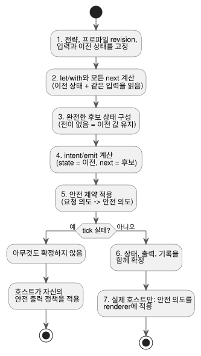
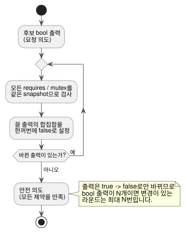

<!-- translation-source: docs/LANGUAGE.en.md -->
[영문 원문](LANGUAGE.en.md)

# GhostFlow language contract · design draft

2026-09-05 작성. 이 문서는 GhostFlow 언어의 **공통 실행 계약**, 즉 모든 문법과 모든 런타임이 함께 지켜야 하는 규칙을 정의합니다.

다른 문서와의 관계는 다음과 같습니다.

- **작성 문법.** 현재 선택한 문법은 [control 문법](LANGUAGE-SURFACE.md)입니다. [literate 형식](LITERATE.md)을 쓰면 같은 코드를 Markdown 문서 안에 작성할 수 있습니다.
- **제약과 센서.** [공통 제약·센서 계약](CONSTRAINTS.md)은 모드 인터록, 선택적 장치 정보, 센서 처리, 시간 한도에 대한 후속 설계 결정을 기록합니다.
- **현재 실행되는 것.** 실행 구현은 control/literate 소스의 유한한 부분집합과, 호환 S-expression 입력 및 GFB1 바이트코드를 다룹니다. 구현 범위와 재실행 증거는 [구현 계약](IMPLEMENTATION.ko.md)과 [추적성](TRACEABILITY.ko.md)에서 정의합니다.
- **바이트코드.** 현재 바이트코드는 [GFB1](BYTECODE.ko.md)을 따릅니다.

이 문서에는 0.2 설계에서 정한 공통 의미와 A/B/C 표기가 아직 남아 있습니다.
우선순위 규칙은 다음과 같습니다.

- 어휘나 소스 형식이 다르면 후속 control/literate 문서가 우선합니다.
- 제약과 운영 설정 적용에 관해서는 후속 공통 제약 계약이 우선합니다.

역사 기록:

- [세 가지 문법 예제](LANGUAGE-EXAMPLES.md)는 초기 비교 기록으로 보존합니다.
- 이전 사양은 [LANGUAGE-MVP-0.1.ko.md](LANGUAGE-MVP-0.1.ko.md)에 그대로 보존합니다.

구현 상태 한 줄 요약: 센서의 ok/fault 처리, 정적 순수 함수, 문서형(literate) 소스는 구현되어 있습니다. 일반 Result/ADT 타입, 고차 함수 합성, 전략별 입력, 매크로는 **구현되지 않았습니다**.

**이 문서의 구성:** 언어의 방향(§1), 프로그램 모델(§2), 어휘와 타입(§3), 표현식(§4), 스트림과 오류 흐름(§5), 장치 질의(§6), tick(§7), 출력 제약(§8), literate 소스와 관찰 가능성(§9), 매크로(§10), 타임트래블과 고스트(§11), 모듈 교체와 배포(§12), 구현 상태(§13), 문법 참고(§14).

## 1. 언어의 방향

GhostFlow는 제어 언어입니다. 센서 입력을 스트림으로 받습니다. 순수 계산과 명시적인 상태 전이를 조합해 **의도(intent)**, 즉 장치가 무엇을 해야 하는지에 대한 요청을 만듭니다.
하나의 프로그램에 여러 **전략(strategy)**을 둘 수 있습니다. 런타임은 현재 존재하는 장치의 capability에 따라 그중 하나를 선택합니다.
실행이 결정적이므로 동일한 입력을 다시 실행해 변경 전후의 동작을 비교할 수 있습니다.

원본 대화에서 확인한 선호와 이번 설계에서 내린 판단은 [DESIGN-NOTES.ko.md](DESIGN-NOTES.ko.md)에 구분해 기록했습니다.

| 선호 | 언어·도구에 반영하는 방식 |
|---|---|
| YAML | 선언의 계층과 `name: type`, 읽기 쉬운 설정 |
| Literate CoffeeScript | 들여쓰기, 간결한 함수, 설명과 실행 코드의 결합 |
| Cypher query | capability 패턴과 명시적인 장치 선택 절 |
| Meta Lua | 구문을 데이터로 다루는 컴파일 시점 확장 |
| 함수형·function-level composition | 순수 함수, 값 전달과 함수 합성 |
| Railway-oriented programming | 정상값과 오류값을 같은 흐름에서 처리 |
| Cycle.js | 입력 Source와 출력 Intent를 Driver 경계로 분리 |
| Observable·marimo·D3.js | 중간 값·상태·변화를 코드 옆에서 관찰 |
| Elm·Rust의 안정성 | 타입·분기·자원 검증, 예측 가능한 실행 기반 |

세 가지 대안을 비교했습니다.

- **A안**: YAML 중심의 선언형 문법.
- **B안**: Literate CoffeeScript 중심의 흐름형 문법.
- **C안**: Cypher 중심의 질의형 문법.

후속 논의에서 **control 문법**을 기본 방향으로 선택했습니다. control 문법은 중괄호, 식, 다음 상태, 출력 연결을 중심으로 구성됩니다.
Literate는 그 문법 위에 얹는 소스 형식입니다. 아래의 공통 실행 계약은 이 선택에도 적용됩니다.

## 2. 프로그램 모델

각 tick은 다음 세 가지를 순서대로 계산합니다.

```text
candidate_state = transition(old_state, input_snapshot, selected_strategy)
requested       = intents(old_state, candidate_state, input_snapshot)
safe            = safety(requested, constraints)
```

계산이 성공하면 `candidate_state`와 `safe` 결과를 하나의 **논리 tick**으로 함께 확정합니다.
그다음 호스트 renderer가 물리 출력을 적용합니다.
논리적 원자성은 여러 GPIO가 물리적으로 같은 순간에 바뀐다는 뜻이 **아닙니다**.

| 요소 | 의미 |
|---|---|
| module / version | 안정적인 모듈 ID와 상태 스키마 버전 |
| input | 매 tick에 공급되는 타입 있는 샘플, 의미상 `Signal<T>` |
| state | tick 사이에 유지되는 값과 최초 기본값 |
| 함수 | 순수하고 정적으로 해석할 수 있는 값 변환 |
| strategy | 장치 질의, 전략별 입력, 계산, 전이, 의도 |
| let / with | 상태를 갖지 않는 이름 있는 중간 계산 |
| next | 다음 상태의 정의 |
| output / intent / emit | 타입을 선언하고 정확히 하나의 연결식으로 현재 tick의 capability 출력 intent를 요청 |
| safety | 최종 출력에 적용할 requires / mutex 제약 |

구조 규칙:

- 식 그래프의 조합 논리 순환은 컴파일 오류입니다.
- 피드백은 state처럼 이전 tick 값을 읽는 명시적 경계를 통과해야 합니다.
- `next` 정의가 없는 상태는 값을 유지합니다.
- 같은 전략에서 하나의 상태나 출력을 두 번 정의하면 오류입니다.

### 예제: 선택한 문법으로 보는 입력 → 상태 → 출력

아래는 선택한 control 문법으로 작성한 완결된 소스 예제입니다.
`ghostc`로 컴파일하며, 센서 manifest를 연결한 호스트에서 실행됩니다.
이 예제는 저수위 센서가 설치되어 있다고 가정합니다. 압력이나 유량 같은 부가정보는 제공하지 않습니다.
그렇다고 모든 프로그램에 저수위 센서가 있어야 한다는 뜻은 **아닙니다**.

```ghost
fn hold(start: Bool, blocked: Bool, previous: Bool) -> Bool {
  !blocked && (start || previous)
}

control WateringDemand {
  input start, stop: Bool;
  sensor low_water: Bool;

  output pump, valve: Bool;
  state watering: Bool = false;

  let water_ok = case low_water {
    ok(low)  => !low;
    fault(_) => false;
  };

  let blocked = stop || !water_ok;
  watering' = hold(start, blocked, watering);

  valve <- watering';
  pump  <- watering';
  require pump => valve;
}
```

읽는 방법:

- `watering`은 이전 tick의 기억입니다.
- `watering'`은 이번 tick에 확정할 후보 값입니다.
- `<-`는 출력을 그 의도에 연결합니다.
- 함수 `hold`에는 숨은 기억이 없습니다.
- `start`와 `stop`은 Boolean 샘플이며 에지 이벤트가 아닙니다.

출력 선언은 다음 규칙을 따릅니다.

- `output name: Type;`은 intent 포트의 타입만 선언합니다.
- 모든 출력 이름에는 정확히 하나의 `name <- expression;` 연결이 있어야 합니다. 선언에 초기값을 두는 것은 금지됩니다.
- 연결식은 VM이 이번 tick에 요청하는 논리 intent입니다.
- 시작(startup)과 fail-safe 정책은 호스트/renderer가 별도로 소유합니다. 이 정책은 부팅 시, 계산 실패 시, 호스트 연결이 끊겼을 때 출력을 OFF로 유지하거나 적용을 중단합니다.
- 출력 선언의 기본값이 안전 정책을 암묵적으로 정하는 일은 결코 없습니다.

다음 표는 `watering=false`에서 시작해 입력을 순서대로 공급했을 때의 기대 결과입니다.

| tick | start | stop | low_water | watering' | valve / pump 의도 |
|---|---|---|---|---|---|
| 1 | true | false | ok(false) | true | ON / ON |
| 2 | false | false | ok(false) | true | ON / ON |
| 3 | false | false | fault(Stale) | false | OFF / OFF |
| 4 | false | false | ok(false) | false | OFF / OFF |
| 5 | true | true | ok(false) | false | OFF / OFF |

눈여겨볼 두 가지 동작:

- 센서가 복구됐다는 이유만으로 자기유지가 되살아나지 않습니다(tick 4).
- 시작과 정지가 함께 참이면 정지가 우선합니다(tick 5).

이것은 순수 제어 계산 예제입니다.
설비 모드 진입, 공유 펌프의 사용권, 실제 펌프/밸브 전환의 시간차 적용은 [공통 제약 계약](CONSTRAINTS.md)에서 설명하는 설비 관리자와 출력 renderer의 몫입니다. 위 코드가 그 모두를 구현하지는 않습니다.

## 3. 어휘와 타입

**식별자.** 새 문법의 식별자는 `[A-Za-z_][A-Za-z0-9_]*`에 맞아야 하며 대소문자를 구분합니다.
점은 `input.start`, `state.watering`, `next.watering` 같은 경로를 구분합니다.
기존 이름 `low-water`는 새 예제에서 `low_water`로 씁니다. 실제 모듈을 이전할 때는 이름 변경 매핑을 명시해야 합니다.

**이름과 범위.**

- 예약어는 이름으로 쓸 수 없습니다.
- 입력, 상태, 전략, 함수의 이름은 각각 해당 범위에서 유일해야 합니다.
- 전략 입력은 공통 입력을 가릴 수 없습니다.
- 지역 계산은 함수나 예약 namespace를 가릴 수 없습니다.
- 함수 인자는 자기 함수 안에만 존재합니다.

**0.2 대안들의 배치 규칙.**

- B안은 공백 두 칸 들여쓰기를 사용하며 탭은 거부합니다. 블록 도입부 뒤에서 들여씁니다.
- A안은 제한된 YAML을 파싱합니다.
- C안은 절과 `end`로 블록을 구분합니다.
- 세 대안 모두 `#` 주석을 쓰고 호출 괄호를 유지합니다.
- 줄은 열린 괄호 안이나 쉼표 뒤에서 이어 쓸 수 있습니다.

**스칼라 타입.** 0.2 코어에 구현된 기본 값 타입은 `bool`과 유한한 IEEE 754 binary64 `number`입니다. (현재 참조 구현에는 Percent, Duration, enum도 있습니다. §13을 참고하세요.)

- `true`와 `false`만 bool 리터럴입니다. 문자열과 숫자에는 truthiness도 암묵적 변환도 없습니다.
- 숫자는 십진 정수 또는 소수 표기로 시작합니다. NaN과 Infinity는 거부됩니다.
- module version은 u32 정수 리터럴입니다. strategy priority는 i32 정수 리터럴입니다.
- 문서 버전 0.2, module version, 바이트코드 포맷 버전은 서로 별개의 식별자입니다.

R14 검토용으로 준비한 [정확한 정수 계약](EXACT-INTEGER-CONTRACT.ko.md)은 세 번째 스칼라 `Int/i32`를 제안합니다.
N2–N4 단계가 끝나기 전에는 구현된 것으로 표시해서는 안 됩니다.

**센서 샘플.** 센서 샘플은 `Result<T, SensorFault>`로 표현합니다.

- 생성자는 `Ok(value)`와 `Err(fault)`입니다.
- 초기 SensorFault 집합은 `Disconnected | Stale | Invalid`입니다.
- Result를 bool이나 number처럼 직접 사용하면 타입 오류입니다.
- state에는 선언 타입과 일치하는 상수 초기값이 필요합니다.

후속 센서 처리 계약은 필터가 준비되기 전에 쓰는 `NotReady`를 추가합니다.
다음 두 경우를 구분해야 합니다.

- **선택적 장치 정보의 누락**(Option): 예를 들어 압력 정격을 입력하지 않은 경우.
- **설치된 센서의 fault**(Result).

압력·유량 부가정보가 없어도 기본 제어와 인터록은 동작합니다.
세부 규칙은 [CONSTRAINTS.md](CONSTRAINTS.md)를 따릅니다.

**후속 확장.** 일반 ADT, fault별 패턴 매칭, 시간·물리 단위 타입은 후속 확장입니다.
새 분기 문법을 추가할 때는 반드시 빠짐없는 분기 검사를 함께 제공해야 합니다.
언어는 장치 고장이 사라진다고 약속하지 않습니다. 언어의 목표는 타입·참조·자원 오류와 처리되지 않은 언어 예외를 차단하는 것입니다.

DateTime, 단조 경과 시간, 반복 예약, 자연 현상 이벤트, 업무 달력, 필수 fallback에 대한 최소 설계는 [TIME-AND-SCHEDULE-CONTRACT.ko.md](TIME-AND-SCHEDULE-CONTRACT.ko.md)에 있습니다.
그 문서는 현재 구현된 것(`Duration`, DailySlots, Solar)과 T2–T4 제안을 명확히 구분합니다.

## 4. 표현식과 함수 조합

공통 식은 리터럴, 참조, 호출, 함수 정의, 괄호, 그리고 아래의 연산자입니다.

| 강한 결합 → 약한 결합 | 규칙 |
|---|---|
| 참조·호출·괄호 | `f(x)`, `input.x`, `(expr)` |
| 비교 | `< <= > >= is isnt`; 비교 연쇄는 거부 |
| not | Bool 부정; `not x is y`는 `not (x is y)` |
| and | bool 두 값, 왼쪽 결합 |
| or | bool 두 값, 왼쪽 결합 |
| >> | 단항 함수 합성, 왼쪽 결합 |
| \|> | 값 전달, 왼쪽 결합 |
| if / then / else | 양쪽 결과 타입이 같은 조건식 |

파싱과 비교 규칙:

- `(args) -> expr`의 본문은 화살표 뒤에 오는 식 전체입니다.
- 함수식의 경계가 모호하면 괄호로 감쌉니다.
- 비교와 파이프를 섞을 때는 괄호를 사용합니다.
- `is`/`isnt`는 같은 타입 값 사이의 동등/비동등을 검사합니다.
- 순서 비교는 현재 `number`에만 허용됩니다.
- 정수 계약이 채택되면 두 `Int` 값 사이의 순서 비교도 허용됩니다. 혼합 비교는 계속 거부됩니다.
- 장치 질의 안의 `type is number`는 별개의 것으로, 타입 태그 비교입니다.

**순수성과 종료.**

- 이 단계의 함수와 연산은 순수해야 하며 반드시 종료해야 합니다.
- 부작용이나, 단축 평가에 의존하는 오류 회피 패턴은 금지됩니다.
- 모든 분기를 타입 검사합니다. 안전한 식은 미리 계산할 수 있습니다.
- 산술과 나눗셈 오류 규칙은 후속 수치 프로필에서 정의합니다.

정확한 정수의 최소 범위·연산·변환과, 이를 구현하기 위한 수용 벡터는 [EXACT-INTEGER-CONTRACT.ko.md](EXACT-INTEGER-CONTRACT.ko.md)에 있습니다.
이 링크는 설계 제안입니다. 현재 parser, GFB, VM이 `Int`를 지원한다는 주장이 아닙니다.
현재 GFB1에는 `Number/f64` 산술 opcode만 있습니다. 정수 opcode와 나머지 연산은 없습니다.

```ghost
latch = (start, stop, held) -> not stop and (start or held)
is_dry = map(below(35)) >> recover(false)
```

- `x |> f`는 `f(x)`를 뜻합니다.
- `f >> g`는 `(x) -> g(f(x))`를 뜻합니다.

두 연산자 모두 새 상태를 만들지 않습니다. latch의 기억은 호출자가 넘겨주는 `state.watering`에만 존재합니다.

**함수 타입.** 함수 타입은 본문과 호출 위치에서 추론합니다. 유일한 타입을 결정할 수 없으면 오류입니다.
재귀와 동적 함수 선택은 범위 밖입니다.
함수 합성과 라이브러리 함수는 정적으로 특수화되어 그래프가 되므로, MCU에는 동적 closure가 전혀 필요하지 않습니다.

## 5. 스트림과 Railway 오류 흐름

input 필드의 타입은 **한 tick**의 샘플을 나타냅니다.
`start: bool`은 `Signal<bool>` 포트의 현재 샘플을 뜻합니다.
`input.start`는 그 현재 샘플이며, 함수와 연산은 매 tick에 적용됩니다.
숨은 비동기 큐나 별도의 구독 스케줄러는 없습니다.
event와 타이머의 의미는 다음 개정에서 별도로 정의합니다.

| 함수 | 의미 |
|---|---|
| below(limit) | number를 받아 `value < limit`을 반환하는 함수 |
| map(f) | Ok(x)를 Ok(f(x))로 변환; Err(e)는 그대로 전달 |
| and_then(f) | f가 Result를 반환할 때 Ok(x)를 f(x)로 연결; Err 유지 |
| recover(default) | Ok(x)는 x로, Err(e)는 같은 타입의 default로 변환 |

`map`, `and_then`, `recover`를 호출하면 단항 함수가 만들어집니다.
예제에서 `is_dry`의 타입은 `Result<number, SensorFault> -> bool`입니다.
여기서 `map`은 Result를 변환합니다. 스트림 스케줄링 연산이 아닙니다.

```ghost
dry = input.moisture |> map(below(35)) |> recover(false)
blocked = input.stop or (input.low_water |> recover(true))
```

raw 입력의 fault는 계산에 쓰였는지, `recover`를 적용했는지와 관계없이 항상 journal에 남습니다.
따라서 `recover`는 순수한 값 변환입니다. 오류를 기록에서 지우지 않습니다.
예제는 관수를 차단하는 쪽의 fallback을 선택합니다.

- 저수위 오류에는 `recover(true)`: 수위를 알 수 없으면 "낮음"으로 간주해 차단합니다.
- 수분 오류에는 `recover(false)`: 수분을 알 수 없으면 "건조하지 않음"으로 간주해 관수를 요청하지 않습니다.

### 예제: 오류를 숨기지 않고 제어값으로 변환

위의 파이프 예제는 B안의 표기를 보존한 것입니다.
선택한 문법에서는 같은 판단을 명시적인 분기로 읽습니다.
아래 단편은 `sensor moisture: Percent;`를 선언한 control 안에 들어갑니다.

```ghost
let dry = case moisture {
  ok(value) => value < 35%;
  fault(_)  => false;
};
```

| moisture | dry |
|---|---|
| `ok(25%)` | true |
| `ok(40%)` | false |
| `fault(Disconnected)` | false |
| `fault(NotReady)` | false |

두 fault 경우에는 판단 값만 false로 대체됩니다. 원래 센서 fault는 입력 기록에 그대로 남습니다.
이를 "센서 정상"으로 표시해서는 안 됩니다.
노이즈 처리와 복구 연산을 덧붙인 예제는 [센서 계약](CONSTRAINTS.md)에 있습니다.

## 6. Device query

**장치 프로필**은 호스트가 제공하는 semantic capability의 집합입니다.
초기 질의 모델은 `(kind, name, type)` 세 값입니다. 같은 `(kind, name)` 쌍은 두 번 나올 수 없습니다.

```ghost
match (pump:actuator<bool>), (valve:actuator<bool>),
      (low_water:sensor<bool>), (moisture:sensor<number>)
```

질의를 읽는 방법:

- `pump` 같은 이름은 프로필이 정의한 semantic role입니다. 여러 장치를 순회하는 데이터베이스 행 변수가 아닙니다.
- 각 항목은 capability가 존재해야 한다는 조건입니다. 쉼표는 AND를 뜻합니다.
- `sensor<number>`는 payload 타입을 나타냅니다. Driver가 각 샘플을 감싸 `Result<number, SensorFault>`로 제공합니다.
- `(moisture:sensor)`처럼 타입을 생략하면 존재만 검사합니다.
- `where moisture.type is number`로 타입 조건을 덧붙일 수 있습니다.

`where` 절에서는 `match`에 나온 이름의 kind/name/type, 상수와의 비교, `and`/`or`/`not`만 사용할 수 있습니다.
`input`, `state`, `next`, 현재 수분값은 읽을 수 없습니다.

이 초안에는 가변 길이 경로, 관계 탐색, 동적 바인딩, 결과 행별 실행이 없습니다.
프로필을 그래프로 확장한다면 유일한 바인딩과 유한한 탐색 비용을 검증해야 합니다.

**전략 선택.**

- 런타임은 일치하는 전략 중 priority가 가장 높은 하나를 선택합니다.
- 최고 priority가 같으면 모호성 오류입니다.
- 일치하는 전략이 없으면 활성화 오류입니다.
- 선언 순서가 무엇을 덮어쓰는 일은 결코 없습니다.

**입력과 바인딩 검사.**

- 공통 입력은 모든 전략에 필요합니다. 전략 입력은 그 전략이 선택된 동안에만 필요합니다.
- 프로필은 intent 대상과 센서 입력의 capability를 타입까지 검사합니다.
- 버튼 같은 호스트 입력은 별도의 포트 바인딩 검사를 거칩니다.
- 샘플이 아예 없으면 tick 제출 오류입니다. 이는 정상적으로 제출된 `Err` 샘플과 다릅니다.

**프로필 변경.**

- 프로필은 tick 도중에 바뀌지 않습니다.
- 고장, 복구, 구성 변경은 후보 프로필을 검증하고 전략을 선택한 뒤 tick 경계에서 적용됩니다.
- fault 입력은 현재 전략이 즉시 처리합니다. 보호 수준을 낮추는 fallback은 명시적인 호스트 운전 정책을 따릅니다.
- 예제에는 자동 fallback을 선언하지 않았습니다.

## 7. Tick과 상태 읽기

모든 tick은 같은 일곱 단계를 따릅니다.

1. 전략, 프로필 revision, 공통·전략 입력, 이전 상태(old state)를 고정합니다.
2. 모든 `let`/`with`와 모든 `next` 정의를 이전 상태와 같은 입력에서 계산합니다.
3. 완전한 후보 상태를 만듭니다. 전이가 없는 필드는 이전 값을 유지합니다.
4. `intent`/`emit`을 계산합니다. 이때 `state`는 여전히 이전 값을, `next`는 후보 값을 읽습니다.
5. 모든 safety 제약을 만족하는 안전 의도(safe intent)를 계산합니다.
6. 상태, 출력 결과, 실행 기록을 하나의 논리 단계로 함께 확정합니다.
7. 실제(ghost가 아닌) 실행의 호스트만 안전 의도를 renderer에 적용합니다.

다이어그램은 이 단계들과 각 단계가 읽는 값을 보여 줍니다.



**tick 도중 이름의 의미는 바뀌지 않습니다.**

- `state.x`는 어느 식에서나 항상 이전 상태를 뜻합니다.
- `next.x`는 다음 상태를 뜻하며, `intent`/`emit` 안에서만 쓸 수 있습니다.
- `next` 정의 안에서 `next.y`를 읽으면 오류입니다.
- `let`/`with`는 `next`를 참조할 수 없습니다.

**정의.**

- A/B안에서 `let` 정의는 순수하며 의존 관계가 비순환입니다.
- C안에서 단일 `with` 절의 alias들은 같은 이전 snapshot에서 독립적으로 계산됩니다. 서로를 참조할 수 없습니다.
- `with`는 행 필터링이나 집계를 수행하지 않습니다.
- 출력과 상태 정의는 정적이며 매 tick 완전합니다.

**실패.** tick이 실패하면 상태와 일반 출력 결과를 부분적으로 확정하지 않습니다.
오류는 호스트에 반환되며, 호스트가 정해진 안전 출력 정책을 적용합니다.

**사용자 코드에서 금지되는 것:** `sleep`, 직접 GPIO 쓰기, 무제한 반복이나 재귀, 동적 메모리 크기, 네트워크 호출, 실행 시점 코드 생성.

### 예제: 모든 다음 상태는 같은 이전 상태를 읽는다

선택한 문법으로 쓴 이 설계 예제는 상태를 교환하기만 하며 장치를 구동하지 않습니다.

```ghost
control SnapshotPair {
  input swap: Bool;
  state left: Bool = true;
  state right: Bool = false;

  left'  = if swap then right else left;
  right' = if swap then left else right;
}
```

`swap=true`인 첫 tick에서 `(left, right)`는 `(true, false)`에서 `(false, true)`로 바뀝니다.
두 전이식의 순서를 바꿔도 결과는 같습니다. 둘 다 이전 값을 읽기 때문입니다.
다음과 같이 바꾸면 설계 계약 위반입니다.

```ghost
// 잘못된 전이식: 다음 상태 참조는 출력식에서만 허용한다.
right' = left';
```

(주석의 뜻: 다음 상태 참조는 출력식에서만 허용됩니다.)
오른쪽의 `left'`는 반드시 컴파일 오류로 진단해야 합니다. 계산 순서에 따라 읽어서는 안 됩니다.

## 8. 출력 제약

bool 출력 제약은 두 가지입니다.

- **requires**: 전제 조건이 false이면 대상이 false가 됩니다.
- **mutex**: 그룹에서 둘 이상의 출력이 true이면 그룹의 모든 출력이 false가 됩니다.

0.2 대안들의 표기: A안은 목록, B안은 `pump requires valve`와 `mutex forward, reverse`, C안은 `requires pump, valve`와 `mutex forward, reverse`를 사용합니다.

규칙:

- 대상은 모든 전략에 존재하는 bool intent여야 합니다.
- `requires`는 서로 다른 이름 두 개를 받습니다. `mutex`는 서로 다른 이름 2–32개를 받습니다.
- 제약은 true 값을 만들어 내지 않습니다.

결과가 선언 순서에 의존하지 않도록 제약은 다음과 같이 평가합니다.

1. 현재 후보 출력의 같은 snapshot에 대해 모든 제약을 검사합니다.
2. 끄기로 선택된 모든 출력의 합집합을 동시에 false로 만듭니다.
3. 아무것도 바뀌지 않을 때까지 반복합니다.



위 반복은 항상 종료하며 순서와 무관합니다.

- 한 번 false가 된 출력은 다시 true가 되지 않습니다.
- bool 출력이 N개이면 변경이 있는 라운드는 최대 N번입니다.
- 최종 결과는 모든 제약을 만족해야 합니다.
- fault 기록에는 위반한 제약과 차단된 출력 ID가 남습니다.

**상태는 피드백이 아닙니다.**

- 자기유지 상태는 물리 피드백이 아닙니다.
- safety가 출력을 차단해도 상태를 암묵적으로 덮어쓰지 않습니다.
- 실제 밸브 개방이나 펌프 가동은 별도의 센서 입력으로 모델링합니다.
- 제거, 장치 상실, 호스트 장애 시의 물리 기본 출력은 제어 코드가 아니라 호스트 측 계약(Driver/renderer와 호스트)이 소유합니다.

모드, 공유 설비, 시간 제약으로의 확장은 [CONSTRAINTS.md](CONSTRAINTS.md)를 따릅니다.
출력 차단, 새 작업 허가, 모드 전이, 경고 분석은 각각 실행 의미가 다릅니다.
임의의 조건을 모두 위의 false 방향 반복에 억지로 넣지 마십시오.
여러 control이 하나의 장치를 사용하면 그 장치의 공유 제약을 함께 지켜야 합니다.

### 예제: 출력 의도와 차단 결과는 다르다

```ghost
control OutputGuard {
  input pump_request, valve_request: Bool;
  output pump, valve: Bool;

  valve <- valve_request;
  pump  <- pump_request;
  require pump => valve;
}
```

요청이 `(pump=true, valve=false)`이면:

- **requested**는 그 값을 그대로 유지해 기록합니다.
- **safe**는 `(pump=false, valve=false)`입니다.

제약을 만족시키려고 밸브를 자동으로 켜지 않습니다.
이 역시 논리 출력 예제입니다. 밸브가 실제로 열렸는지의 확인이나 모드 인터록을 대신하지 않습니다.

## 9. Literate, code-as-data, 관찰 가능성

**Literate 소스.** 문서형 `.ghost.md` 소스는 다음과 같이 처리합니다.

- Markdown의 최상위 `ghost` 코드 펜스를 문서 순서대로 추출해 같은 파서에 전달합니다.
- 하나의 control이 여러 블록에 걸칠 수 있습니다. 합친 소스 전체가 일반 문법으로 유효해야 합니다.
- 블록별 실행 의미는 추가하지 않습니다.
- 설명, 일반 코드 펜스, 시각화 결과는 실행하지 않습니다.

추출, 진단, 원문 위치 매핑의 상세 계약은 [LITERATE.md](LITERATE.md)에 있습니다.

**하나의 파이프라인.** 일반 소스와 문서형 소스는 같은 AST와 타입 그래프를 만듭니다.
파이프라인은 `소스 → AST → 구문 확장 → 타입 그래프 → 검증 → 바이트코드`입니다.
그래프가 실행 의미의 정본 정의입니다. 문서 설명, 주석, 서식은 별도의 소스 정보로 보존합니다.
모든 문법 표면이 서로 무손실로 변환된다고 가정하지 마십시오.

**관찰 가능성.**

- 입력, 이름 있는 계산, 상태, 의도, 제약에는 안정적인 노드 ID와 소스 범위가 붙습니다.
- 편집기는 사용자가 코드 위치에서 현재 값, fault, 바뀐 시점, 영향을 준 입력을 볼 수 있게 해야 합니다.
- `blocked`나 `dry` 같은 지역 이름은 전략 이름과 함께 식별합니다.
- MCU에서의 중간 값 추적은 선택 사항이며 크기가 제한됩니다.
- PC에서는 기록된 입력으로 값을 다시 계산할 수 있어야 합니다.

**편집.** 문서, 폼, 그래프 편집은 모두 같은 검사를 거칩니다.
그래프만 편집해서는 설명 문단이 다시 생성되지 않습니다.
매크로 호출은 작성한 그대로 편집하며, 확장 결과는 별도로 관찰합니다.
목표는 사람이 쓴 설명을 유지하면서 데이터와 코드를 함께 다루는 것입니다.

## 10. 컴파일 시점 구문 확장

"Meta Lua"는 Metalua 방식의 컴파일 시점 메타프로그래밍에 대한 선호로 해석했습니다.
syntax/quote/splice 표기는 [예제의 확장 스케치](LANGUAGE-EXAMPLES.md)에서 제안했습니다.
최초 범위는 타입 있는 표현식 템플릿입니다. 제한 없는 문법 재정의는 후속 검토가 필요합니다.

매크로 규칙:

- 매크로는 런타임 값이 아니라 AST를 받아 AST를 만듭니다.
- 확장은 위생적이어야 합니다. 즉 호출자의 이름을 포획해서는 안 됩니다.
- 확장 후에 타입, 상태 경계, 순환, 자원 검사를 다시 실행합니다.
- 새 이름의 수와 확장 크기에는 한도가 있습니다.
- 재귀 확장은 금지되며, 외부 파일·네트워크·시계 읽기도 금지됩니다.
- 한도를 넘으면 컴파일 오류입니다.

실제 값 변환에는 일반 함수로 충분합니다.
매크로를 쓰더라도 MCU에 매크로 처리기나 Lua 런타임이 필요해서는 안 됩니다.

## 11. 타임트래블과 고스트 비교

journal/checkpoint 계약에는 다음 기록이 필요합니다.

- timeline/branch ID, 논리 tick, 기준 checkpoint.
- 모듈 hash·스키마 버전, 프로필 revision, 선택된 전략과 선택 이유.
- 입력과 fault, 이전/후보 상태, requested/safe intent, 제약 개입.
- 코드 위치와 연결되는 노드 ID; 중간 값 trace는 선택 사항이며 크기가 제한됩니다.

**분기.** 원본 실행을 보존한 채 기록된 시점에서 분기합니다.
**ghost(고스트 실행)**는 같은 Rust 코어의 별도 인스턴스에서 실행되며 물리 effect sink가 없습니다. 즉 실제 출력을 구동하지 않습니다.
되감기는 장치를 과거 위치로 되돌리는 명령이 아닙니다.

**비교.**

- 실행들을 같은 논리 tick에 맞춰 정렬합니다. 비교는 상태, 요청 출력, 안전 출력, fault의 차이를 보여 줍니다.
- 벽시계 시간은 입력 데이터입니다. 순서는 논리 tick이 정합니다.
- 추가 센서가 있는 프로필로 분기했는데 기록에 그 입력이 없다면, 명시적인 가상 입력 trace를 제공해야 합니다.
- 누락된 센서값을 자동으로 만들어 내는 일은 결코 없습니다.

프로그램이 센서 처리, 모드·공유 자원 허가, 누적 한도, 예약 발생을 사용하면 그 상태도 trace와 checkpoint에 포함됩니다.
고스트의 가상 실행 기록은 물리 설비의 영속 사용량 기록이나 예약 기록을 결코 수정하거나 되감지 않습니다.

**고스트의 한계.** 기록 입력을 고정한 고스트는 제어 판단의 차이를 보여 줍니다.
바뀐 펌프 동작이 실제 토양 수분에 어떤 영향을 줄지 예측하려면 별도의 환경 모델이 필요합니다.

## 12. 모듈 교체, 배포, 실행 대상

모듈은 호스트에서 컴파일·검증된 뒤 ESP-IDF Rust와 WASM에서 같은 계약으로 실행됩니다.
사용자는 logic module을 올리고, 활성화하고, 제거합니다. 호스트는 포트, 출력 소유권, 프로필, 자원 상한을 검증합니다.

하나의 canonical scalar control 안에서, 제한된 Percent 자원 정책은 이름 있는 요청, 이름 있는 상한, 명시적 min/max 선택, 작성자가 정한 fallback을 지원합니다. [Reference §4.9](reference/04-sensors-constraints-control.md)를 참고하세요. 독립 producer 모듈 연결과 PID 통합은 후속 범위로 남아 있습니다.

**모듈 교체.**

- 교체는 후보 모듈 검증, 전략 선택, 상태 호환성 검사, 필요한 경우 고스트 비교를 거친 뒤 tick 경계에서 확정됩니다.
- 어느 단계든 실패하면 기존 모듈이 계속 활성 상태로 남습니다.
- 모듈/program 교체나 펌웨어 갱신은 같은 ESP가 제어하는 모든 장치 작업을 정지시킵니다.
- 프로필, 바인딩, 의존성, 예약 구조, 규칙의 변경에도 명시적인 정지와 Configure 절차가 필요합니다.
- 운전 중 조정 가능한(runtime-adjustable) 일부 속성은 구조적 변경과 다른 경로를 사용합니다. 운전 중의 문법과 의미는 [Reference §5.1–5.2](reference/05-settings-and-observation.md)를 따릅니다. 실행 경계는 [구현 범위](IMPLEMENTATION.ko.md)를 참고하세요.
- tick 경계에서 변경을 적용한다고 해서 구조적 변경의 정지 요건이 **대체되지는 않습니다**.

**상태 이전.**

- 같은 module ID에서 이름과 타입이 같은 상태는 이전됩니다.
- 새 필드는 기본값을 받습니다. 제거된 필드는 버려집니다.
- 같은 이름에서 타입이 바뀌면 명시적 migration이 지원되기 전까지 거부됩니다.
- 식별자 표기가 바뀐 것은 자동 상태 이전으로 취급하지 않습니다.

**교체 후의 입력, 출력, 영속 기록.**

- 이전 입력 캐시는 비워집니다. 호스트는 새 스키마에 맞는 완전한 입력을 다시 공급해야 합니다.
- 제거된 출력은 호스트가 해제 정책에 따라 처리합니다.
- 부팅 시에는 선언된 기본값을 사용합니다. 영속 상태 복원은 revision을 검증하는 별도의 호스트 정책이어야 합니다.
- 일일 예산과 예약 중복 실행을 막는 기록은 물리 설비의 호스트 소유 영속 상태입니다. 일반 control 초기값과는 구분됩니다.
- 모듈 교체, 재부팅, 고스트 되감기로 그 기록을 0으로 초기화해서는 절대 안 됩니다.

**업데이트.** System, Logic, Profile, Web-assets 업데이트는 같은 OTA 경험을 공유합니다.
파티션, 슬롯, 전송 경로는 호스트에 속하며 제어 문법에 노출하지 않습니다.
manifest와 배포 프로토콜 구현은 이번 문법 비교 작업의 범위 밖입니다.

### 12.1 호환 장치 교체는 제어 프로그램 교체가 아니다

제어 프로그램은 실제 센서와 액추에이터의 모델이나 주소가 아니라 **논리 장치 계약**을 참조합니다.
Driver/renderer와 설치 바인딩이 같은 계약을 만족하는 다른 장치를 연결하면, 제어 소스와 컴파일된 Program은 그대로 유지되어야 합니다.
장치 교체만을 이유로 재컴파일을 요구해서는 안 됩니다.
장치별 통신과 원시값 해석은 Driver가 담당합니다.

"같은 계약"은 타입 이상의 것을 포함합니다.

- 의미와 단위,
- 품질, 시간, 오류 규칙,
- 필요한 capability.

기억해 둘 경계:

- 소스의 센서 규칙을 바꾸는 것은 소스 변경입니다. 물리 연결 변경이 아닙니다.
- 이 분리가 Driver를 동적으로 설치하거나 정지 없이 교체할 수 있다는 뜻은 아닙니다.
- Driver/펌웨어와 설치 바인딩은 제어 소스의 판본과 별도로 자체 주기에 따라 배포됩니다.

**이유:** 같은 제어 의도를 다른 장치에서도 재사용하고, 하드웨어 교체가 제어 규칙의 불필요한 재작성이나 재컴파일을 강요하지 않도록 하기 위해서입니다.
상세 규칙은 [Language Reference §6.3 호환 장치 교체와 재컴파일 독립성](reference/06-composition-and-replay.md#호환-장치-교체와-재컴파일-독립성)을 따릅니다.

## 13. 구현 상태와 수용 기준

아래 상태는 현재 코드를 읽어 확인한 것입니다.
새 사양의 요구 사항을 구현 완료로 읽지 마십시오.

| 항목 | 현재 참조 구현 | 남은 설계·제품화 범위 |
|---|---|---|
| 입력 문법 | control + literate + 호환 S-expression | adapt·매크로·다중 모듈 |
| 타입·함수 | Bool/Number/Percent/Duration, enum, 정적 fn, 센서 case | 일반 ADT·고차 함수 합성 |
| 입력 스키마 | 모든 입력을 매 tick 요구 | 공통 + 선택 전략 입력 |
| 상태 읽기 | state=old, next=candidate | 이 의미 유지·명문화 |
| 안전 제약 | false-only snapshot 고정점, requires-any | 일반 논리식/최적화 solver |
| 공유 설비·모드 | Rust station + WASM API + 정적 policy 바인딩 | 실장치 driver/renderer 배포 승인 경계 |
| 장치 부가정보 분석 | optional 정수 유량의 Pass/Violation/Unknown | 물리 수압/곡선 모델·알림 전송 |
| 센서 신호 처리 | 유한 필터·히스테리시스·품질·복구 | 실제 보드 WCET/메모리 측정 |
| 시간 제약 | 단조 timer, 날짜별 예산/발생 ledger, desktop 저장 | MCU NVS·RTC 신뢰·전원 차단 검증 |
| hot-swap 타입 변경 | 모듈 이름 변경/같은 상태 이름의 VM Bool↔Number 변경 거부 | 명목 enum 스키마·명시적 migration·호스트 bundle 교체 |
| 프로필 변경 | 활성 전략 즉시 해제 | 후보 검증 후 경계에서 확정 |
| rewind/replay | bounded journal, 이후 기록 삭제형 rewind | 원본 보존 분기, 버전·프로필 기록 |
| IR·소스맵 | AST 노드 원본 위치와 literate 줄 매핑 | bytecode PC→노드 추적·공개 typed graph |
| 자원 | 식 스택 제한, tick 중 Vec/Map 할당 | 상태·trace·전체 tick 자원 상한 검증 |
| 배포 | ESP32/WASM 기반 코드 | 교체·복구·출력 해제 계약의 종단 간 검증 |

현재 verifier 한도:

| 한도 | 값 |
|---|---|
| 입력 / 상태 / intent | 각 128 |
| 전략 | 32 |
| 제약 | 128 |
| 식·질의 blob당 바이트 | 4096 |
| 식·질의 스택 깊이 | 128 |

이 값들은 초기 참조 한도입니다. 새 기능의 최대 비용을 증명하지 않습니다.
새 compiler나 loader가 모두 같은 한도를 적용하도록 명세와 검사를 함께 정의해야 합니다.

**Lowering.** 단순한 식의 표면 문법은 기존 opcode로 낮출 수 있습니다.
Result, 전략 입력, 추적 정보에는 명시적인 lowering이나 포맷 확장이 필요합니다.
현재 GFB1이 이를 그대로 지원한다고 주장하지 마십시오.
지원하지 않는 기능을 쓰는 모듈은 반드시 거부해야 합니다. 의미가 조용히 바뀌어서는 결코 안 됩니다.

선택한 문법을 구현할 때는 다음 수용 기준을 사용합니다.

1. 세 예제의 공통 시나리오를 선택한 문법으로 실행해 기대값과 비교합니다.
2. next/intent 정의를 재배치해도 결과가 유지되고, 잘못된 next 참조는 거부됩니다.
3. requires 체인과 mutex는 선언 순서와 관계없이 최종 제약을 만족합니다.
4. 전략 충돌, 필수 장치 상실, 입력 누락, Result 타입 오용을 진단합니다.
5. 실패한 모듈·프로필 교체가 기존 실행을 부분적으로 바꾸지 않습니다.
6. 고스트 분기는 원본 이력과 실제 출력을 건드리지 않고 같은 tick의 차이를 보여 줍니다.
7. 함수·매크로 확장 후 자원 한도를 검증하고, 오류 위치를 원문에 연결합니다.

## 14. 문법 참고

**YAML(A안).** A안의 계층, 스칼라, 블록 문자열은 [YAML 1.2.2](https://yaml.org/spec/1.2.2/)에서 가져왔습니다.
GhostFlow는 제한된 scalar/map/list 구조를 가진 단일 문서만 받습니다. 중복 키, anchor/alias, merge key, 사용자 tag는 거부합니다.
`true`/`false`와 십진수만 리터럴로 해석합니다.
그 밖의 타입 표기와 표현식 스칼라는 문자열로 보존되어 GhostFlow가 파싱합니다.

**Literate CoffeeScript(B안).** 설명과 코드를 함께 쓰는 발상은 [Literate CoffeeScript](https://coffeescript.org/#literate)에서 왔습니다.
원래 Literate CoffeeScript는 들여쓴 코드 블록을 사용합니다.
B안은 별개의 설계로, 명시적인 `ghost` 펜스로 실행 블록을 표시합니다.

**Cypher(C안).** 장치 패턴의 가독성은 [Cypher MATCH](https://neo4j.com/docs/cypher-manual/current/clauses/match/)를 참고했습니다.
GhostFlow의 strategy/next/emit과 타입 파라미터 표기는 자체 제안입니다.

**Metalua(매크로).** AST를 구성하는 컴파일 시점 확장은 [Metalua](https://github.com/fab13n/metalua)와 그 [compiler 문서](https://github.com/fab13n/metalua/blob/master/README-compiler.md)를 참고했습니다.
원래 문법과 GhostFlow가 제안하는 표기는 구분해 둡니다.
