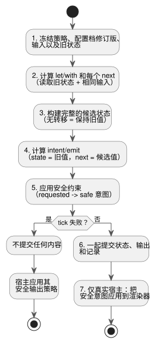
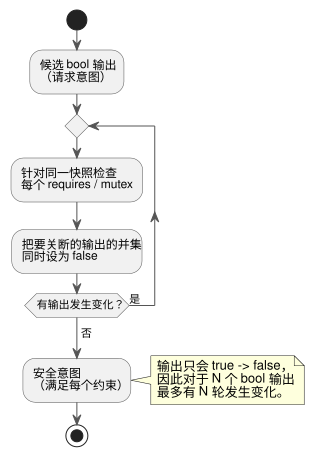

<!-- translation-source: docs/LANGUAGE.en.md -->
[英文原文](LANGUAGE.en.md)

# GhostFlow 语言契约 · 设计草案

撰写于 2026-09-05。本文定义 GhostFlow 语言的**公共执行契约**：所有语法和所有运行时都必须共同遵守的规则。

本文与其他文档的关系：

- **编写语法。** 当前选定的语法是 [control 语法](LANGUAGE-SURFACE.zh.md)。[文学式（literate）格式](LITERATE.zh.md)允许在 Markdown 文档中编写同样的代码。
- **约束与传感器。** [公共约束/传感器契约](CONSTRAINTS.zh.md)记录了后来关于模式互锁、可选设备信息、传感器处理和时间限制的设计决定。
- **目前可运行的部分。** 可执行实现涵盖 control/literate 源文件的一个有限子集，以及兼容的 S 表达式输入和 GFB1 字节码。实现范围和重放证据由[实现契约](IMPLEMENTATION.zh.md)和[可追溯性](TRACEABILITY.zh.md)定义。
- **字节码。** 当前字节码遵循 [GFB1](BYTECODE.zh.md)。

本文仍然包含 0.2 设计中的公共语义以及 A/B/C 三种写法。
优先规则：

- 在词汇或源文件格式存在差异时，以后来的 control/literate 文档为准。
- 关于约束以及运行设置的应用，以后来的公共约束契约为准。

历史记录：

- [三种语法示例](LANGUAGE-EXAMPLES.zh.md)作为最初的比较记录保留。
- 之前的规范原样保存在 [LANGUAGE-MVP-0.1.md](LANGUAGE-MVP-0.1.zh.md) 中。

一句话概括实现状态：传感器 ok/fault 处理、静态纯函数以及文档形式（literate）的源文件已经实现。通用 Result/ADT 类型、高阶函数组合、策略专用输入和宏**尚未**实现。

**本文内容：** 语言方向（§1）、程序模型（§2）、词汇与类型（§3）、表达式（§4）、流与错误流（§5）、设备查询（§6）、tick（§7）、输出约束（§8）、文学式源文件与可观测性（§9）、宏（§10）、时间旅行与 ghost（§11）、模块替换与部署（§12）、实现状态（§13）以及语法参考（§14）。

## 1. 语言方向

GhostFlow 是一种控制语言。它以流的形式接收传感器输入，把纯计算与显式的状态转移结合起来，产生**意图**（intent）：即对设备应当做什么的请求。
一个程序可以包含多个**策略**（strategy）。运行时根据当前存在的设备的能力（capability）选择其中之一。
由于执行是确定性的，你可以用相同的输入重新执行，并比较变更前后的行为。

原始对话中确认的偏好以及本设计中作出的判断，单独记录在 [DESIGN-NOTES.md](DESIGN-NOTES.zh.md) 中。

| 偏好 | 在语言/工具中的体现 |
|---|---|
| YAML | 分层声明、`name: type`、易读的设置 |
| Literate CoffeeScript | 缩进、简洁的函数、说明与可执行代码相结合 |
| Cypher 查询 | 能力模式以及显式的设备选择子句 |
| Meta Lua | 把语法当作数据的编译期扩展 |
| 函数式/函数级组合 | 纯函数、值管道以及函数组合 |
| 面向铁路编程（Railway-oriented programming） | 成功值与错误值在同一个流中处理 |
| Cycle.js | 输入 Source 与输出 Intent 由 Driver 边界隔开 |
| Observable·marimo·D3.js | 在代码旁观测中间值、状态及其变化 |
| Elm/Rust 的稳定性 | 类型、分支和资源校验；可预测的执行基础 |

比较过三种备选方案：

- **A**：以 YAML 为中心的声明式语法。
- **B**：以 Literate CoffeeScript 为中心的流式语法。
- **C**：以 Cypher 为中心的查询式语法。

后来的讨论选定了 **control 语法**作为基本方向。它围绕花括号、表达式、下一状态和输出连接构建。
literate 是叠加在该语法之上的一种源文件格式。下面的公共执行契约同样适用于这一选择。

## 2. 程序模型

每个 tick（逻辑决策步）按顺序计算三件事：

```text
candidate_state = transition(old_state, input_snapshot, selected_strategy)
requested       = intents(old_state, candidate_state, input_snapshot)
safe            = safety(requested, constraints)
```

如果计算成功，`candidate_state` 和 `safe` 结果作为一个**逻辑 tick** 一起提交。
随后由宿主的渲染器应用物理输出。
逻辑上的原子性**并不**意味着多个 GPIO 会在同一瞬间发生物理变化。

| 元素 | 含义 |
|---|---|
| module / version | 稳定的模块 ID 和状态模式（state-schema）版本 |
| input | 每个 tick 提供的带类型样本；语义上是 `Signal<T>` |
| state | 在 tick 之间保持的值及其初始默认值 |
| Function | 纯的、可静态解释的值变换 |
| strategy | 设备查询、策略专用输入、计算、转移、意图 |
| let / with | 具名的无状态中间计算 |
| next | 下一状态的定义 |
| output / intent / emit | 声明类型，并通过恰好一个连接表达式请求本 tick 的能力输出意图 |
| safety | 作用于最终输出的 requires / mutex 约束 |

结构规则：

- 表达式图中的组合环是编译错误。
- 反馈必须跨越一个读取前一 tick 值的显式边界，例如 state。
- 没有 `next` 定义的 state 保持其值。
- 在同一个策略中两次定义同一个 state 或 output 是错误。

### 示例：选定语法中的 输入 → 状态 → 输出

下面是用选定的 control 语法编写的完整源文件示例。
它可以用 `ghostc` 编译，并在连接了传感器清单（manifest）的宿主上运行。
本示例假设安装了一个缺水传感器。它不提供压力或流量之类的额外信息。
这**并不**意味着每个程序都必须有缺水传感器。

```ghost
fn hold(start: Bool, blocked: Bool, previous: Bool) -> Bool {
  !blocked && (start || previous)
}

control WateringDemand {
  input start, stop: Bool;
  sensor low_water: Bool;

  output pump, valve: Bool;
  state watering: Bool = false;

  let water_ok = case low_water {
    ok(low)  => !low;
    fault(_) => false;
  };

  let blocked = stop || !water_ok;
  watering' = hold(start, blocked, watering);

  valve <- watering';
  pump  <- watering';
  require pump => valve;
}
```

阅读方法：

- `watering` 是来自前一 tick 的记忆。
- `watering'` 是本 tick 将要提交的候选值。
- `<-` 把输出连接到其意图。
- 函数 `hold` 没有隐藏的记忆。
- `start` 和 `stop` 是 Boolean 样本，而不是沿事件。

输出声明遵循以下规则：

- `output name: Type;` 只声明意图端口的类型。
- 每个输出名称必须恰好有一个 `name <- expression;` 连接。禁止在声明中给出初始值。
- 连接表达式就是 VM 在本 tick 请求的逻辑意图。
- 启动和故障安全策略由宿主/渲染器单独负责。该策略在启动时、计算失败时或宿主断开连接时，使输出保持 OFF 或停止应用输出。
- 输出声明上的默认值绝不会隐式地设定安全策略。

下表展示了从 `watering=false` 开始、按顺序提供输入时的预期结果。

| tick | start | stop | low_water | watering' | valve / pump 意图 |
|---|---|---|---|---|---|
| 1 | true | false | ok(false) | true | ON / ON |
| 2 | false | false | ok(false) | true | ON / ON |
| 3 | false | false | fault(Stale) | false | OFF / OFF |
| 4 | false | false | ok(false) | false | OFF / OFF |
| 5 | true | true | ok(false) | false | OFF / OFF |

需要注意的两种行为：

- 仅靠传感器恢复不会重新激活锁存（tick 4）。
- 当 start 和 stop 同时为 true 时，stop 优先（tick 5）。

这是一个纯粹的控制计算示例。
进入设施模式、占有共享泵以及错开泵/阀的物理切换，属于[公共约束契约](CONSTRAINTS.zh.md)中描述的设施管理器和输出渲染器的职责。上面的代码并没有实现全部这些内容。

## 3. 词汇与类型

**标识符。** 新语法中的标识符匹配 `[A-Za-z_][A-Za-z0-9_]*`，并区分大小写。
点号用于分隔路径，例如 `input.start`、`state.watering` 和 `next.watering`。
旧名称 `low-water` 在新示例中写作 `low_water`。迁移真实模块时，必须提供显式的重命名映射。

**名称与作用域。**

- 保留字不能用作名称。
- input、state、strategy 和函数的名称在各自的作用域内必须唯一。
- 策略输入不能遮蔽公共输入。
- 局部计算不能遮蔽函数或保留的命名空间。
- 函数参数只存在于其所属函数内部。

**0.2 备选方案的布局。**

- 备选方案 B 使用两个空格缩进并拒绝制表符。在块引导语之后缩进。
- 备选方案 A 解析受限的 YAML。
- 备选方案 C 用子句和 `end` 分隔块。
- 三种备选方案都使用 `#` 注释，并保留调用括号。
- 一行可以在未闭合的括号内或逗号之后延续。

**标量类型。** 0.2 核心中实现的基本值类型是 `bool` 和有限的 IEEE 754 binary64 `number`。（当前参考实现还有 Percent、Duration 和枚举；见 §13。）

- 只有 `true` 和 `false` 是 bool 字面量。字符串和数字没有真值性，也没有隐式转换。
- 数字以十进制整数或小数写法开头。NaN 和 Infinity 会被拒绝。
- 模块版本是 u32 整数字面量。策略优先级是 i32 整数字面量。
- 文档版本 0.2、模块版本和字节码格式版本是三个彼此独立的标识。

为 R14 评审准备的[精确整数契约](EXACT-INTEGER-CONTRACT.zh.md)提议引入第三种标量 `Int/i32`。
在步骤 N2–N4 完成之前，不要将其标记为已实现。

**传感器样本。** 传感器样本表示为 `Result<T, SensorFault>`。

- 构造器是 `Ok(value)` 和 `Err(fault)`。
- 初始的 SensorFault 集合是 `Disconnected | Stale | Invalid`。
- 直接把 Result 当作 bool 或 number 使用是类型错误。
- state 需要一个与其声明类型相匹配的常量初始值。

后来的传感器处理契约增加了 `NotReady`，用于滤波器就绪之前。
需要区分两种情况：

- **缺失的可选设备信息**（Option）：例如没有输入额定压力。
- **已安装传感器的故障**（Result）。

基本控制和互锁在没有压力/流量补充信息的情况下也能工作。
详细规则遵循 [CONSTRAINTS.md](CONSTRAINTS.zh.md)。

**后续扩展。** 通用 ADT、按故障区分的模式匹配以及时间/物理单位类型属于后续扩展。
任何新的分支语法都必须附带穷尽分支检查。
语言并不承诺设备故障会消失。它的目标是阻止类型错误、引用错误和资源错误，以及未处理的语言异常。

关于 DateTime、单调经过时间、周期性调度计划、自然事件、工作日历和强制回退（fallback）的最小设计，见 [TIME-AND-SCHEDULE-CONTRACT.md](TIME-AND-SCHEDULE-CONTRACT.zh.md)。
该文档明确区分了目前已实现的部分（`Duration`、DailySlots、Solar）与 T2–T4 提案。

## 4. 表达式与函数组合

常见的表达式包括字面量、引用、调用、函数定义、括号以及下列运算符。

| 结合较强 → 结合较弱 | 规则 |
|---|---|
| 引用/调用/括号 | `f(x)`、`input.x`、`(expr)` |
| 比较 | `< <= > >= is isnt`；拒绝链式比较 |
| not | Bool 取反；`not x is y` 表示 `not (x is y)` |
| and | 两个 bool 值，左结合 |
| or | 两个 bool 值，左结合 |
| >> | 一元函数组合，左结合 |
| \|> | 值管道，左结合 |
| if / then / else | 两个结果类型一致的条件表达式 |

解析与比较规则：

- `(args) -> expr` 的函数体是箭头之后的整个表达式。
- 如果函数表达式的边界有歧义，请用括号包起来。
- 混用比较和管道时请使用括号。
- `is`/`isnt` 检验同类型值之间的相等/不等。
- 目前只允许对 `number` 进行顺序比较。
- 如果采纳整数契约，两个 `Int` 值之间的顺序比较也被允许。混合比较仍然被拒绝。
- 设备查询中的 `type is number` 是另一回事：它是类型标签的比较。

**纯度与终止性。**

- 这一阶段的函数和运算必须是纯的，并且必须总是终止。
- 禁止副作用，以及依赖短路求值来规避错误的写法。
- 所有分支都会进行类型检查。安全的表达式可以预先计算。
- 算术和除法错误的规则将由后续的数值配置定义。

精确整数的最小范围、运算和转换，以及实现它们的验收向量，见 [EXACT-INTEGER-CONTRACT.md](EXACT-INTEGER-CONTRACT.zh.md)。
该链接是一份设计提案，并不表示当前的解析器、GFB 或 VM 支持 `Int`。
当前 GFB1 只有 `Number/f64` 算术操作码，没有整数操作码，也没有取余运算。

```ghost
latch = (start, stop, held) -> not stop and (start or held)
is_dry = map(below(35)) >> recover(false)
```

- `x |> f` 表示 `f(x)`。
- `f >> g` 表示 `(x) -> g(f(x))`。

这两个运算符都不会创建新的状态。锁存的记忆只存在于调用方传入的 `state.watering` 中。

**函数类型。** 函数类型根据函数体和调用位置推断。如果无法确定唯一的类型，则为错误。
递归和动态函数选择不在范围之内。
函数组合和库函数会被静态特化为图，因此 MCU 永远不需要动态闭包。

## 5. 流与 Railway 错误流

输入字段的类型描述的是**一个 tick** 的样本。
`start: bool` 表示 `Signal<bool>` 端口的当前样本。
`input.start` 就是该当前样本，函数和运算在每个 tick 都会应用。
不存在隐藏的异步队列，也没有单独的订阅调度器。
事件和定时器的语义将在下一个修订版中单独定义。

| 函数 | 含义 |
|---|---|
| below(limit) | 接收 number 并返回 `value < limit` 的函数 |
| map(f) | 把 Ok(x) 变换为 Ok(f(x))；原样转发 Err(e) |
| and_then(f) | 当 f 返回 Result 时，把 Ok(x) 连接到 f(x)；保留 Err |
| recover(default) | 把 Ok(x) 转换为 x，把 Err(e) 转换为同类型的 default |

调用 `map`、`and_then` 或 `recover` 会产生一个一元函数。
在示例中，`is_dry` 的类型是 `Result<number, SensorFault> -> bool`。
这里的 `map` 变换的是 Result，而不是流调度操作。

```ghost
dry = input.moisture |> map(below(35)) |> recover(false)
blocked = input.stop or (input.low_water |> recover(true))
```

无论计算是否使用原始输入故障，也无论是否应用了 `recover`，原始输入故障总会保存在日志（journal）中。
因此 `recover` 是纯粹的值变换，它不会从记录中抹去错误。
示例选择了会阻止浇水的回退值：

- 缺水错误使用 `recover(true)`：未知水位按“低”处理，从而阻止浇水。
- 湿度错误使用 `recover(false)`：未知湿度按“不干燥”处理，从而不请求浇水。

### 示例：把错误转换为控制值而不隐藏它们

上面的管道示例保留了备选方案 B 的写法。
在选定的语法中，同样的判定写成显式分支。
下面的片段放在声明了 `sensor moisture: Percent;` 的 control 内部。

```ghost
let dry = case moisture {
  ok(value) => value < 35%;
  fault(_)  => false;
};
```

| moisture | dry |
|---|---|
| `ok(25%)` | true |
| `ok(40%)` | false |
| `fault(Disconnected)` | false |
| `fault(NotReady)` | false |

在两种故障情况下，只有判定值被替换为 false。原始的传感器故障仍保留在输入记录中。
不要将其显示为“传感器正常”。
加入噪声处理和恢复操作的示例见[传感器契约](CONSTRAINTS.zh.md)。

## 6. 设备查询

**设备配置档**（device profile）是宿主提供的语义能力的集合。
初始的查询模型是三元组 `(kind, name, type)`。同一个 `(kind, name)` 对不能出现两次。

```ghost
match (pump:actuator<bool>), (valve:actuator<bool>),
      (low_water:sensor<bool>), (moisture:sensor<number>)
```

如何阅读查询：

- 像 `pump` 这样的名称是由配置档定义的语义角色，而不是遍历多个设备的数据库行变量。
- 每一项都要求某个能力存在。逗号表示 AND。
- `sensor<number>` 给出载荷类型。Driver 包装每个样本，并将其作为 `Result<number, SensorFault>` 提供。
- 省略类型（如 `(moisture:sensor)`）时只检查是否存在。
- 可以用 `where moisture.type is number` 添加类型条件。

`where` 子句只能使用出现在 `match` 中的名称的 kind/name/type、与常量的比较，以及 `and`/`or`/`not`。
它不能读取 `input`、`state`、`next` 或当前湿度值。

本草案没有可变长度路径、关系遍历、动态绑定，也没有按结果行执行。
如果将配置档扩展为图，则必须验证绑定的唯一性以及有界的遍历开销。

**策略选择。**

- 运行时选择优先级最高的唯一匹配策略。
- 最高优先级出现并列属于歧义错误。
- 没有匹配的策略属于激活错误。
- 声明顺序绝不会覆盖任何规则。

**输入与绑定检查。**

- 公共输入是每个策略都需要的。策略输入只在该策略被选中期间才需要。
- 配置档检查意图目标和传感器输入的能力，包括它们的类型。
- 按钮之类的宿主输入要经过单独的端口绑定检查。
- 缺失样本属于 tick 提交错误。它与正确提交的 `Err` 样本不同。

**配置档变更。**

- 配置档在 tick 期间绝不会改变。
- 故障、恢复和配置变更在 tick 边界处应用，即在候选配置档经过验证并选定策略之后。
- 当前策略会立即处理故障输入。降低保护等级的回退遵循显式的宿主运行策略。
- 示例中没有声明自动回退。

## 7. tick 与状态读取

每个 tick 都遵循相同的七个步骤：

1. 冻结策略、配置档修订版、公共/策略输入以及旧状态。
2. 根据旧状态和相同的输入，计算每个 `let`/`with` 和每个 `next` 定义。
3. 构建完整的候选状态。没有转移的字段保持其旧值。
4. 计算 `intent`/`emit`。此时 `state` 仍读取旧值，而 `next` 读取候选值。
5. 计算满足所有安全约束的安全意图。
6. 把状态、输出结果和执行记录作为一个逻辑步骤一起提交。
7. 只有真实（非 ghost）执行的宿主才会把安全意图应用到渲染器。

下图展示了这些步骤以及每一步读取哪些值。



**名称的含义在 tick 期间绝不会改变。**

- `state.x` 在每个表达式中始终表示前一状态。
- `next.x` 表示下一状态，并且只能在 `intent`/`emit` 内部使用。
- 在 `next` 定义中读取 `next.y` 是错误。
- `let`/`with` 不能引用 `next`。

**定义。**

- 在 A/B 中，`let` 定义是纯的，并且其依赖关系无环。
- 在 C 中，单个 `with` 子句中的别名都根据同一个旧快照独立计算，它们不能相互引用。
- `with` 不执行行过滤或聚合。
- 输出和状态定义是静态的，并在每个 tick 都是完整的。

**失败。** 如果某个 tick 失败，状态和普通输出结果都不会被部分提交。
错误会返回给宿主，由宿主应用其指定的安全输出策略。

**用户代码中禁止：** `sleep`、直接写 GPIO、无界循环或递归、动态内存大小、网络调用以及运行时代码生成。

### 示例：每个下一状态都读取同一个前一状态

这个用选定语法编写的设计示例只交换状态，不驱动任何设备。

```ghost
control SnapshotPair {
  input swap: Bool;
  state left: Bool = true;
  state right: Bool = false;

  left'  = if swap then right else left;
  right' = if swap then left else right;
}
```

在 `swap=true` 的第一个 tick 上，`(left, right)` 从 `(true, false)` 变为 `(false, true)`。
调换两个转移的顺序会得到相同的结果，因为两者读取的都是旧值。
下面的修改违反了设计契约：

```ghost
// 잘못된 전이식: 다음 상태 참조는 출력식에서만 허용한다.
right' = left';
```

（注释的意思是：“无效的转移：下一状态引用只允许出现在输出表达式中。”）
右侧的 `left'` 必须被诊断为编译错误，而不得按照计算顺序来读取。

## 8. 输出约束

存在两种 bool 输出约束：

- **requires**：如果前提条件为 false，则目标变为 false。
- **mutex**：如果组中有多于一个输出为 true，则组中所有输出都变为 false。

0.2 备选方案中的写法：A 使用列表；B 使用 `pump requires valve` 和 `mutex forward, reverse`；C 使用 `requires pump, valve` 和 `mutex forward, reverse`。

规则：

- 目标必须是在每个策略中都存在的 bool 意图。
- `requires` 接受两个不同的名称。`mutex` 接受 2–32 个不同的名称。
- 约束绝不会产生 true 值。

为使结果与声明顺序无关，约束按如下方式求值：

1. 针对当前候选输出的同一个快照检查每个约束。
2. 把所有被选中关断的输出的并集同时设为 false。
3. 重复，直到不再有任何变化。



上述循环总会终止，并且与顺序无关：

- 已变为 false 的输出绝不会再次变为 true。
- 对于 N 个 bool 输出，最多有 N 轮包含变化。
- 最终结果必须满足每个约束。
- 故障记录会列出被违反的约束以及被阻止的输出 ID。

**状态不是反馈。**

- 锁存的状态不是物理反馈。
- 当安全约束阻止某个输出时，它不会隐式覆盖状态。
- 阀门实际打开或泵实际运行，要用单独的传感器输入来建模。
- 在移除、设备丢失或宿主失效时的物理默认输出，属于宿主侧契约（Driver/渲染器和宿主），而不属于控制代码。

模式、共享设施和时间约束的扩展遵循 [CONSTRAINTS.md](CONSTRAINTS.zh.md)。
输出阻止、新工作的许可、模式转换以及警告分析各自具有不同的执行语义。
不要把任意条件都硬塞进上面这种朝 false 方向的迭代中。
当多个 control 使用同一个设备时，它们必须共同遵守该设备的共享约束。

### 示例：输出意图与被阻止的结果不同

```ghost
control OutputGuard {
  input pump_request, valve_request: Bool;
  output pump, valve: Bool;

  valve <- valve_request;
  pump  <- pump_request;
  require pump => valve;
}
```

对于请求 `(pump=true, valve=false)`：

- **requested** 保持并记录这些值。
- **safe** 为 `(pump=false, valve=false)`。

阀门不会为了满足约束而被自动打开。
这同样是一个逻辑输出示例。它既不能代替对阀门实际已打开的确认，也不能代替模式互锁。

## 9. literate、代码即数据与可观测性

**文学式源文件。** 文档形式的 `.ghost.md` 源文件按如下方式处理：

- 按文档顺序从 Markdown 中提取顶层的 `ghost` 代码围栏，并传给同一个解析器。
- 一个 control 可以跨越多个代码块。拼接后的源代码作为整体必须是有效的常规语法。
- 不增加按代码块划分的执行语义。
- 说明、普通代码围栏和可视化结果绝不会被执行。

关于提取、诊断和原始位置映射的详细契约，见 [LITERATE.md](LITERATE.zh.md)。

**一条流水线。** 普通源文件和文档形式的源文件产生相同的 AST 和类型图。
流水线为 `source → AST → syntax expansion → type graph → verification → bytecode`。
该图是执行语义的规范定义。文档说明文字、注释和格式作为单独的源信息保留。
不要假设所有语法表面都能彼此无损地相互转换。

**可观测性。**

- 输入、具名计算、状态、意图和约束都有稳定的节点 ID 和源范围。
- 编辑器必须让用户能在代码位置查看当前值、故障、变化时间以及影响它的输入。
- 像 `blocked` 或 `dry` 这样的局部名称会与策略名称一起标识。
- 在 MCU 上追踪中间值是可选的，并且大小有界。
- 在 PC 上，值必须能根据记录的输入重新计算。

**编辑。** 文档、表单和图编辑都要经过相同的检查。
仅编辑图不会重新生成说明段落。
宏调用按书写形式编辑；其展开结果单独观测。
目标是在保留人工编写的说明的同时，统一处理数据和代码。

## 10. 编译期语法扩展

“Meta Lua”被理解为对 Metalua 风格编译期元编程的偏好。
[扩展示例草图](LANGUAGE-EXAMPLES.zh.md)中提出了 syntax/quote/splice 写法。
初始范围是带类型的表达式模板。不受限制的语法重定义需要后续评审。

宏规则：

- 宏接收的是 AST 而不是运行时值，并产生 AST。
- 展开必须是卫生的：它不得捕获调用方的名称。
- 展开之后，会再次运行类型、状态边界、环和资源检查。
- 新名称和展开规模都是有界的。
- 禁止递归展开，也禁止读取外部文件、网络或时钟。
- 超出限制属于编译错误。

对于实际的值变换，普通函数就足够了。
即使使用宏，MCU 也必须既不需要宏处理器，也不需要 Lua 运行时。

## 11. 时间旅行与 ghost 比较

日志/检查点（journal/checkpoint）契约需要以下记录：

- 时间线/分支 ID、逻辑 tick 以及基准检查点。
- 模块哈希/模式版本、配置档修订版、所选策略以及选择原因。
- 输入和故障、旧/候选状态、请求/安全意图以及约束的干预。
- 关联代码位置的节点 ID；中间值追踪是可选的，并且有界。

**分支。** 在保留原始执行的同时，从某个已记录的时间点创建分支。
**ghost**（影子运行）在同一个 Rust 核心的独立实例中运行，并且没有物理效果出口：它绝不会驱动真实输出。
倒带不是让设备回到过去位置的命令。

**比较。**

- 各次运行在同一个逻辑 tick 上对齐。比较会展示状态、请求输出、安全输出和故障方面的差异。
- 墙钟时间是输入数据。逻辑 tick 定义顺序。
- 如果分支到一个带有额外传感器的配置档，而记录中没有该传感器的输入，则必须提供显式的虚拟输入轨迹。
- 缺失的传感器值绝不会被自动伪造。

当程序使用传感器处理、模式/共享资源许可、累计限制或调度计划的触发实例时，这些状态也会包含在其追踪和检查点中。
ghost 的虚拟执行记录绝不会修改或倒带物理设施的持久使用记录或调度记录。

**ghost 的局限。** 使用固定记录输入的 ghost 展示的是控制判定上的差异。
要预测泵行为的改变会如何影响实际的土壤湿度，需要一个单独的环境模型。

## 12. 模块替换、部署与执行目标

模块在宿主上编译和验证，然后在 ESP-IDF Rust 和 WASM 上按同一契约执行。
用户上传、激活和移除逻辑模块。宿主验证端口、输出所有权、配置档以及资源边界。

在单个规范标量 control 内，有界的 Percent 资源策略支持具名请求、具名上限、显式的 min/max 选择以及编写好的回退；见 [Reference §4.9](reference/04-sensors-constraints-control.zh.md)。连接独立的生产方模块以及 PID 聚合仍属于后续范围。

**替换模块。**

- 替换在 tick 边界处提交，前提是完成候选模块验证、策略选择、状态兼容性检查，以及必要时的 ghost 比较。
- 如果任何一步失败，现有模块保持激活。
- 替换模块/程序或更新固件会停止同一个 ESP 控制的所有设备任务。
- 对配置档、绑定、依赖、调度结构或规则的更改，同样需要显式的停止和 Configure 流程。
- 一组有限的运行时可调属性走的是与结构性更改不同的路径。它们在运行期间的语法和语义遵循 [Reference §5.1–5.2](reference/05-settings-and-observation.zh.md)。执行边界见[实现范围](IMPLEMENTATION.zh.md)。
- 在 tick 边界处应用更改**并不**能取代结构性更改所需的停止要求。

**迁移状态。**

- 模块 ID 相同且名称和类型相同的状态会被迁移。
- 新字段取其默认值。被移除的字段会被丢弃。
- 在支持显式迁移之前，同名下的类型变化会被拒绝。
- 标识符拼写的变化不会被当作自动状态迁移。

**替换后的输入、输出与持久记录。**

- 旧的输入缓存会被清除。宿主必须重新为新模式提供完整的输入。
- 宿主按照其释放策略处理被移除的输出。
- 启动时使用声明的默认值。恢复持久状态必须是一个单独的、会验证修订版的宿主策略。
- 每日预算以及防止调度计划重复运行的记录，是宿主拥有的物理设施的持久状态。它们与普通的控制初始值不同。
- 模块替换、重启或 ghost 倒带绝不能把这些记录重置为零。

**更新。** System、Logic、Profile 和 Web-assets 更新共享相同的 OTA 体验。
分区、槽位和传输路径属于宿主，不在 control 语法中暴露。
清单和部署协议的实现不在本次语法比较工作的范围之内。

### 12.1 兼容设备替换不是控制程序替换

控制程序引用的是**逻辑设备契约**，而不是物理传感器和执行器的型号或地址。
如果 Driver/渲染器和安装绑定连接了一个满足同一契约的不同设备，控制源代码和已编译的 Program 必须保持不变。
仅替换设备不得要求重新编译。
Driver 负责设备专用的通信以及原始值的解释。

“同一契约”涵盖的不只是类型，还包括：

- 语义和单位，
- 质量、时序和错误规则，
- 所需的能力。

需要牢记的一些边界：

- 在源代码中修改传感器规则是源代码变更，而不是物理连接变更。
- 这种分离并不意味着 Driver 可以被动态安装或在不停止的情况下替换。
- Driver/固件和安装绑定按各自的周期部署，与控制源代码的版本分开。

**原因：** 这样同一个控制意图可以在不同设备上复用，硬件替换也绝不会迫使对控制规则进行不必要的重写或重新编译。
详细规则遵循[语言参考 §6.3 兼容设备替换与不依赖重新编译](reference/06-composition-and-replay.zh.md)。

## 13. 实现状态与验收标准

以下状态是通过阅读当前代码确认的。
不要把新规范中的要求理解为已完成的实现。

| 项目 | 当前参考实现 | 剩余的设计/产品化范围 |
|---|---|---|
| 输入语法 | control + literate + 兼容的 S 表达式 | adapt、宏、多模块 |
| 类型/函数 | Bool/Number/Percent/Duration、enum、静态 fn、传感器 case | 通用 ADT、高阶函数组合 |
| 输入模式 | 每个 tick 都需要所有输入 | 公共输入 + 所选策略的输入 |
| 状态读取 | state=旧值，next=候选值 | 保持并形式化这一含义 |
| 安全约束 | 仅向 false 方向的快照不动点、requires-any | 通用逻辑表达式/优化求解器 |
| 共享设施/模式 | Rust station + WASM API + 静态策略绑定 | 物理设备驱动程序/渲染器的部署审批边界 |
| 设备补充信息分析 | 针对可选整数流量的 Pass/Violation/Unknown | 物理压力/曲线模型、通知投递 |
| 传感器信号处理 | 有限滤波器、迟滞、质量、恢复 | 实际板卡上的 WCET/内存测量 |
| 时间约束 | 单调定时器、按日期的预算/触发实例账本、桌面端存储 | MCU NVS、RTC 可信度、掉电验证 |
| 热替换中的类型变化 | 拒绝模块重命名，以及同一状态名的 VM Bool↔Number 变化 | 名义 enum 模式、显式迁移、宿主包替换 |
| 配置档变更 | 立即清除当前激活的策略 | 在候选验证之后于边界处提交 |
| rewind/replay | 有界日志，倒带时删除后续记录 | 保留原始执行的分支、版本/配置档记录 |
| IR/源映射 | 原始 AST 节点位置和 literate 行映射 | 字节码 PC→节点追踪、公开的带类型图 |
| 资源 | 表达式栈限制、tick 期间的 Vec/Map 分配 | 验证状态/追踪/整个 tick 的资源边界 |
| 部署 | 基于 ESP32/WASM 的代码 | 替换/恢复/输出释放契约的端到端验证 |

当前验证器的限制：

| 限制 | 值 |
|---|---|
| 输入 / 状态 / 意图 | 各 128 |
| 策略 | 32 |
| 约束 | 128 |
| 每个表达式/查询 blob 的字节数 | 4096 |
| 表达式/查询栈深度 | 128 |

这些是初始的参考限制，并不能证明新功能的最大开销。
规范和检查必须一起定义，以便每个新的编译器或加载器都应用相同的限制。

**降级（lowering）。** 简单表达式的表面语法可以降级为现有的操作码。
Result、策略输入和追踪信息需要显式的降级或格式扩展。
不要声称当前 GFB1 无需修改即可支持它们。
使用不受支持功能的模块必须被拒绝；其语义绝不能悄然改变。

实现选定语法时，请使用以下验收标准：

1. 用选定语法执行全部三个示例的公共场景，并与预期结果比较。
2. 调换 next/intent 定义的顺序不改变结果；无效的 next 引用会被拒绝。
3. requires 链和 mutex 无论声明顺序如何都满足最终约束。
4. 诊断策略冲突、必需设备丢失、输入缺失以及 Result 类型误用。
5. 失败的模块/配置档替换不会部分改变现有执行。
6. ghost 分支在同一 tick 上展示差异，而不触及原始历史或实际输出。
7. 在函数/宏展开之后验证资源限制，并把错误位置关联到原文。

## 14. 语法参考

**YAML（备选方案 A）。** 备选方案 A 的层级、标量和块字符串来自 [YAML 1.2.2](https://yaml.org/spec/1.2.2/)。
GhostFlow 只接受具有受限标量/映射/列表结构的单个文档。它拒绝重复键、锚点/别名、合并键以及用户标签。
只有 `true`/`false` 和十进制数字会被解释为字面量。
其他类型写法和表达式标量作为字符串保留，并由 GhostFlow 解析。

**Literate CoffeeScript（备选方案 B）。** 把说明和代码写在一起的想法来自 [Literate CoffeeScript](https://coffeescript.org/#literate)。
原始的 Literate CoffeeScript 使用缩进代码块。
备选方案 B 是一个独立的设计：它使用显式的 `ghost` 围栏来标记可执行块。

**Cypher（备选方案 C）。** 设备模式的可读性借鉴了 [Cypher MATCH](https://neo4j.com/docs/cypher-manual/current/clauses/match/)。
GhostFlow 的 strategy/next/emit 及其类型参数写法是原创提案。

**Metalua（宏）。** 构造 AST 的编译期扩展借鉴了 [Metalua](https://github.com/fab13n/metalua) 及其[编译器文档](https://github.com/fab13n/metalua/blob/master/README-compiler.md)。
原始语法与 GhostFlow 提议的写法保持区分。
