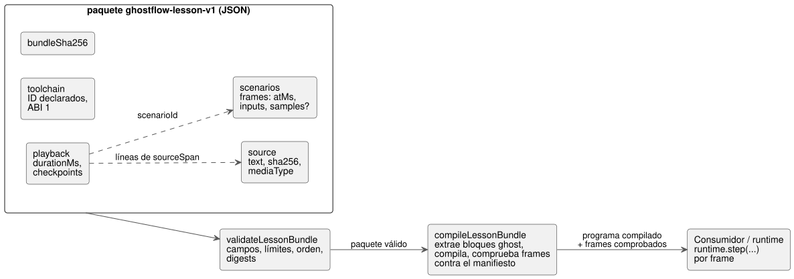

<!-- translation-source: docs/LESSON-BUNDLE.md -->
[Original en inglés](LESSON-BUNDLE.md)

# Paquete de lección v1

Seguimiento: https://github.com/callin2/ghostflow-language/issues/7 (TASK-58.4).

Un **paquete de lección** (lesson bundle) es un único archivo JSON que empaqueta una fuente literate de GhostFlow junto con puntos de control de narración y escenarios de entrada, de modo que una lección pueda trasladarse entre herramientas y compilarse en cualquier lugar.
Este documento trata solo del artefacto portátil y de su compilación. **No** define la aceptación de un reproductor de lecciones ni de la ejecución.

El diagrama muestra qué contiene un paquete y qué comprobaciones se ejecutan antes y durante la compilación.



## Responsabilidades y API

**Qué hace `tools/lesson.mjs`.** Valida una entrada JSON acotada, extrae los bloques delimitados de GhostFlow autorizados según CommonMark y llama al compilador de control existente.

**De qué no se encarga.** No tiene intérprete, conexión con dispositivos, almacenamiento ni reloj de lección.

**Entorno.**

- Los consumidores en navegador deben proporcionar Web Crypto en un contexto seguro.
- Los medios externos no se admiten en v1.

**Extracción estricta.**

- El adaptador de compilación rechaza cualquier advertencia de extracción, incluidos los bloques de GhostFlow anidados que se ignoran. Ese código nunca se presenta como parte de la lección ejecutada.
- Los diagnósticos del compilador se asocian de vuelta a la fuente solo cuando hay disponible una ubicación en la fuente original.

**Campos de nivel superior.** El documento contiene `format: ghostflow-lesson-v1`, lessonId, revision, title, locale, source, playback, scenarios, toolchain y bundleSha256.
Los campos desconocidos se rechazan, de modo que una instrucción no admitida nunca puede adquirir significado de forma silenciosa.

- **Source** contiene el texto sin procesar, su SHA-256 y el tipo de medio
  `text/markdown; profile=ghostflow-literate`.
- **Playback** contiene durationMs y puntos de control ordenados. Un punto de control contiene:
  - atMs;
  - sourceSpan startLine/endLine (empezando en 1, inclusivo). Los intervalos se refieren al Markdown original y pueden apuntar a prosa;
  - narración en texto plano;
  - scenarioId.
- **Scenarios**: cada escenario tiene un id único, un título y frames ordenados. Cada frame contiene:
  - atMs;
  - un mapa `inputs` de nombres de entradas de software a valores booleanos o numéricos finitos;
  - un mapa `samples` opcional para las entradas de adquisición.

  Reglas para escenarios, frames y puntos de control:
  - Debe haber al menos un escenario, un frame y un punto de control.
  - Los tiempos de cada arreglo son estrictamente crecientes.
  - Cada frame admite como máximo 128 entradas con nombre de identificador. Los nombres relacionados con prototipos se rechazan.
  - El mapa de muestras, independiente, también admite como máximo 128 entradas con nombre de identificador.
- **Toolchain** registra compilerId/compilerRevision/runtimeId/runtimeRevision y la
  versión 1 del ABI. Estos identificadores son declaraciones, no una prueba de qué artefactos se cargaron realmente.

**Dos relojes separados.** El tiempo de narración y el tiempo de escaneo del escenario son dominios separados, aunque ambos usen milisegundos enteros.

- Volver a ejecutar un escenario siempre parte de un runtime nuevo.
- Un punto de control de narración nunca es una instantánea de la VM.

**Verificar una comparación.** Antes de afirmar que una comparación es válida, el consumidor de ejecución debe verificar las identidades del compilador y del runtime cargados y la compatibilidad de las vinculaciones de entrada. Una identidad declarada no constituye esa verificación.

## Muestras de adquisición en los frames de escenario

Para las declaraciones `input` canónicas, use la forma de muestra existente de `ControlRuntime.step`. Una **muestra de adquisición** es una observación de una entrada, con su propia identidad, marca de tiempo y calidad.
Por ejemplo, `input enabled: Bool;` con una política
`enabled |> recover(false)` escrita por el autor puede recibir este frame:

```json
{
  "atMs": 100,
  "inputs": {},
  "samples": {
    "enabled": { "epoch": 1, "id": 1, "timestampMs": 100, "quality": "Good", "value": true }
  }
}
```

**Forma de la muestra.** Cada muestra contiene exactamente `epoch`, `id`, `timestampMs`, `quality` y `value`.

| Campo | Regla |
|---|---|
| `epoch`, `id`, `timestampMs` | Enteros seguros no negativos. `timestampMs` no puede superar el `atMs` del frame. |
| `quality` | `NotReady`, `Good`, `Disconnected`, `Stale` o `Invalid`, o el código numérico existente 0–4 en ese orden. |
| `value` | Un booleano o un número JSON finito, incluso en las observaciones de fallo. |

Los valores usan las unidades canónicas del manifiesto. El validador de lecciones nunca convierte unidades.

**Comprobación de vinculaciones tras la compilación.** `compileLessonBundle` comprueba cada frame contra el manifiesto real:

- `inputs` debe proporcionar exactamente las entradas de software, con sus tipos escalares y sus límites.
- Los nombres de las muestras deben identificar entradas de `manifest.sensors`.
- Las muestras Bool requieren cargas booleanas; las demás muestras escalares requieren cargas numéricas.

**Qué queda en el runtime.** Las comprobaciones numéricas de rango y calidad de adquisición, el orden de identidad de las muestras y el tratamiento de fallos permanecen en el runtime compartido.
Por ejemplo, una carga Int de `1.5` permanece en el artefacto tal como se escribió y se convierte en `Invalid` en el runtime. La capa de lecciones no la fuerza a un entero.
La respuesta ante fallos se escribe en la fuente de GhostFlow.

**Las observaciones ausentes no se inventan.** Omitir `samples`, usar un mapa vacío u omitir una entrada de adquisición no aporta ninguna observación nueva.

- La capa de lecciones no sintetiza Good, false, un ID nuevo ni una marca de tiempo.
- Una entrada que nunca se ha observado empieza como `NotReady` en el runtime. La retención y el vencimiento posteriores siguen su contrato de runtime existente.

Un consumidor reenvía un frame como
`runtime.step({ nowMs: frame.atMs, inputs: frame.inputs, samples: frame.samples })`.
Los mapas de observaciones y las muestras anidadas se incluyen en el digest canónico del paquete y se devuelven como valores desacoplados y congelados.

**Compatibilidad.**

- `samples` es un campo opcional de `ghostflow-lesson-v1`. No cambia ni el GFB ni el ABI de WASM.
- Los frames existentes sin muestras conservan su forma.
- Migrar una fuente de valores de software simples a Results de adquisición requiere una nueva revisión de la lección, escrita por el autor, con muestras y políticas de fallo explícitas. Poner un nombre de sensor en `inputs` ahora hace fallar la validación de vinculación de frames en tiempo de compilación.
- Los validadores de lecciones anteriores rechazan el campo desconocido `samples`, por lo que los consumidores deben fijar una revisión del lenguaje que lo admita.
- La validación estructural por sí sola no establece la compatibilidad con el manifiesto.

## Integridad y límites

**Digests.**

- **El SHA-256 de la fuente** se calcula sobre los bytes UTF-8 exactos, sin normalización de saltos de línea ni de Unicode.
- **El SHA-256 del paquete** se calcula sobre el JSON canónico omitiendo el bundleSha256 de nivel superior. Las claves de los objetos se ordenan; el orden de los arreglos se conserva.

Un digest detecta contenido incoherente, no una autoría maliciosa: cualquiera puede recalcular un digest sin firmar.
La función auxiliar de canonicalización exportada serializa exactamente el valor que recibe. Para calcular el digest del paquete, los autores deben eliminar el bundleSha256 de nivel superior antes de llamarla.

**Límites estrictos.**

| Elemento | Límite |
|---|---|
| Tamaño del JSON | 1 MiB |
| Tamaño de la fuente | 64 KiB |
| Tiempo de narración/escenario | 600,000 ms |
| Puntos de control | 256 |
| Escenarios | 16 |
| Frames por escenario | 1,024 |
| Frames en total | 4,096 |
| Caracteres por narración | 4,096 |

Un paquete no puede ampliar estos límites.
Las posiciones en la fuente, los tiempos, el orden y las referencias a escenarios se comprueban antes de la compilación.
Las comprobaciones de recursos propias del compilador siguen aplicándose.
Los plazos de ejecución de los workers son responsabilidad del frontend; este validador de artefactos no afirma nada sobre ellos.

## Límite de la evidencia

Qué demuestra cada paso:

- **La validación** demuestra solo que el paquete cumple el contrato de artefacto admitido y que es coherente internamente.
- **La compilación** demuestra que el compilador existente acepta la fuente.

Ninguna de las dos demuestra una traza coincidente, una reproducción correcta en el navegador, el funcionamiento de una carga física ni la preparación para el despliegue.
La identidad de traza esperada la producirá y comprobará la siguiente tarea de primer ejemplo/consumidor. Este validador nunca la fabrica.
