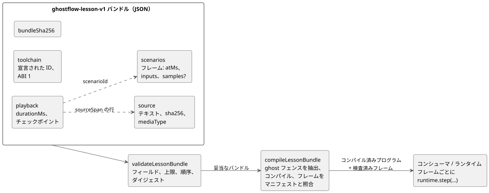

<!-- translation-source: docs/LESSON-BUNDLE.md -->
[英語の原文](LESSON-BUNDLE.md)

# レッスンバンドル v1

トラッキング: https://github.com/callin2/ghostflow-language/issues/7 （TASK-58.4）。

**レッスンバンドル**（lesson bundle）は、GhostFlow の文芸的ソース（literate source）を、ナレーションのチェックポイントおよび入力シナリオとまとめて 1 つの JSON ファイルにパッケージしたものです。これにより、レッスンをツール間で移動し、どこでもコンパイルできます。
この文書が扱うのは、可搬な成果物とそのコンパイルだけです。レッスンプレーヤーや実行の受け入れ基準は定義**しません**。

次の図は、バンドルに含まれる内容と、コンパイルの前およびコンパイル中に実行される検査を示しています。



## 責務と API

**`tools/lesson.mjs` が行うこと。** 上限が定められた JSON 入力を検証し、正本となる CommonMark の GhostFlow フェンスを抽出して、既存の制御コンパイラを呼び出します。

**担当しないこと。** インタプリタ、デバイス接続、ストレージ、レッスン用のクロックは持ちません。

**環境。**

- ブラウザのコンシューマは、セキュアコンテキストで Web Crypto を提供しなければなりません。
- 外部メディアは v1 ではサポートされていません。

**厳格な抽出。**

- コンパイルアダプタは、無視されたネストした GhostFlow フェンスを含め、あらゆる抽出警告を拒否します。そのようなコードが、実行されるレッスンの一部として提示されることは決してありません。
- コンパイラの診断は、元のソース位置が得られる場合にのみソースへ対応付けられます。

**トップレベルのフィールド。** 文書は `format: ghostflow-lesson-v1`、lessonId、revision、title、locale、source、playback、scenarios、toolchain、bundleSha256 を持ちます。
未知のフィールドは拒否されます。そのため、サポートされていない指示が黙って意味を持ってしまうことはありません。

- **Source** には、生のテキスト、その SHA-256、およびメディアタイプ
  `text/markdown; profile=ghostflow-literate` が含まれます。
- **Playback** には durationMs と、順序付きのチェックポイントが含まれます。チェックポイントには次のものが含まれます。
  - atMs
  - sourceSpan の startLine/endLine（1 始まり、両端を含む）。スパンは元の Markdown を指し、散文を指していてもかまいません
  - プレーンテキストのナレーション
  - scenarioId
- **Scenarios** は、それぞれ一意の id、タイトル、順序付きのフレームを持ちます。各フレームには次のものが含まれます。
  - atMs
  - ソフトウェア入力名から Boolean または有限の数値への `inputs` マップ
  - 取得入力のための任意の `samples` マップ

  シナリオ、フレーム、チェックポイントの規則:
  - シナリオ、フレーム、チェックポイントは、それぞれ少なくとも 1 つ必要です。
  - 各配列内の時刻は狭義単調増加でなければなりません。
  - 各フレームで許される識別子名の入力は最大 128 個です。プロトタイプ関連の名前は拒否されます。
  - 別個の samples マップでも、識別子名のエントリは最大 128 個です。
- **Toolchain** には compilerId/compilerRevision/runtimeId/runtimeRevision と
  ABI バージョン 1 が記録されます。これらの識別子は宣言であり、実際にどの成果物がロードされたかの証明ではありません。

**2 つの独立したクロック。** ナレーション時刻とシナリオのスキャン時刻は、どちらも整数ミリ秒を使いますが、別々の領域です。

- シナリオの再実行は、常に新しいランタイムから始まります。
- ナレーションのチェックポイントは、決して VM のスナップショットではありません。

**比較の検証。** 妥当な比較であると主張する前に、実行側のコンシューマは、ロードされたコンパイラ/ランタイムの同一性と、入力バインディングの互換性を検証しなければなりません。宣言された同一性は、この検証の代わりにはなりません。

## シナリオフレーム内の取得サンプル

正準的な `input` 宣言には、既存の `ControlRuntime.step` のサンプル形式を使います。**取得サンプル**（acquisition sample）とは、入力の 1 回の観測であり、それ自身の同一性、タイムスタンプ、品質を持ちます。
たとえば、`input enabled: Bool;` に
`enabled |> recover(false)` というポリシーが記述されている場合、次のフレームを受け取れます。

```json
{
  "atMs": 100,
  "inputs": {},
  "samples": {
    "enabled": { "epoch": 1, "id": 1, "timestampMs": 100, "quality": "Good", "value": true }
  }
}
```

**サンプルの形式。** 各サンプルはちょうど `epoch`、`id`、`timestampMs`、`quality`、`value` を含みます。

| フィールド | 規則 |
|---|---|
| `epoch`、`id`、`timestampMs` | 非負の安全な整数。`timestampMs` はフレームの `atMs` を超えられません。 |
| `quality` | `NotReady`、`Good`、`Disconnected`、`Stale`、`Invalid`、またはこの順序に対応する既存の数値コード 0–4。 |
| `value` | Boolean または有限の JSON 数値。故障の観測であっても同様です。 |

値はマニフェストの正準単位を使います。レッスンバリデータが単位を変換することはありません。

**コンパイル後のバインディング検査。** `compileLessonBundle` は、すべてのフレームを実際のマニフェストと照合します。

- `inputs` は、ソフトウェア入力をその型と範囲どおりに、過不足なく与えなければなりません。
- サンプル名は `manifest.sensors` のエントリを指していなければなりません。
- Bool のサンプルには Boolean のペイロードが必要です。その他のスカラーのサンプルには数値のペイロードが必要です。

**ランタイムに残るもの。** 数値の取得範囲/品質の検査、サンプル同一性の順序付け、故障の処理は、共有ランタイムに残ります。
たとえば、Int に対するペイロード `1.5` は、成果物には記述されたとおりに残り、ランタイムで `Invalid` になります。レッスン層がそれを整数に強制変換することはありません。
故障への応答は GhostFlow ソースに記述します。

**欠けた観測を捏造しません。** `samples` を省略する、空のマップを使う、または取得入力の 1 つを省略すると、新しい観測は与えられません。

- レッスン層は Good、false、新しい ID、タイムスタンプを合成しません。
- 一度も観測されていない入力は、ランタイムの `NotReady` から始まります。以後の保持と期限切れは、既存のランタイム契約に従います。

コンシューマはフレームを
`runtime.step({ nowMs: frame.atMs, inputs: frame.inputs, samples: frame.samples })`
として転送します。
観測マップとネストしたサンプルは、正準的なバンドルダイジェストに含まれ、切り離された凍結値として返されます。

**互換性。**

- `samples` は `ghostflow-lesson-v1` の任意フィールドです。GFB も WASM ABI も変更しません。
- サンプルを持たない既存のフレームは、その形式を保ちます。
- ソースを単純なソフトウェア値から取得 Result へ移行するには、明示的なサンプルと故障ポリシーを持つ、新しく記述したレッスンのリビジョンが必要です。現在は、センサ名を `inputs` に置くと、コンパイル時のフレームバインディング検証が失敗します。
- 古いレッスンバリデータは未知の `samples` フィールドを拒否します。そのため、コンシューマはこれをサポートする言語リビジョンに固定しなければなりません。
- 構造的な検証だけでは、マニフェストとの互換性は確立されません。

## 完全性と上限

**ダイジェスト。**

- **Source SHA-256** は、改行や Unicode の正規化を行わず、UTF-8 バイト列そのものをハッシュします。
- **Bundle SHA-256** は、トップレベルの bundleSha256 を除いた正準 JSON をハッシュします。オブジェクトのキーはソートされ、配列の順序は保たれます。

ダイジェストが検出するのは内容の不整合であり、悪意のある作成ではありません。署名のないダイジェストは誰でも再計算できます。
エクスポートされている正準化ヘルパーは、受け取った値をそのまま直列化します。バンドルダイジェストを計算するには、作成者は呼び出す前にトップレベルの bundleSha256 を取り除かなければなりません。

**固定の上限。**

| 項目 | 上限 |
|---|---|
| JSON のサイズ | 1 MiB |
| ソースのサイズ | 64 KiB |
| ナレーション/シナリオの時間 | 600,000 ms |
| チェックポイント | 256 |
| シナリオ | 16 |
| シナリオあたりのフレーム | 1,024 |
| フレームの合計 | 4,096 |
| ナレーションあたりの文字数 | 4,096 |

バンドルがこれらの上限を引き上げることはできません。
ソース位置、時刻、順序、シナリオ参照は、コンパイルの前に検査されます。
コンパイラ自身のリソース検査も引き続き適用されます。
ワーカーの実行期限はフロントエンドが担当します。この成果物バリデータは、それについて何も保証しません。

## 証拠の境界

各ステップが証明すること:

- **検証**が証明するのは、バンドルがサポートされた成果物契約を満たし、内部的に一貫していることだけです。
- **コンパイル**が証明するのは、既存のコンパイラがソースを受け入れることです。

どちらも、トレースの一致、ブラウザでの再生の成功、物理的な負荷の動作、デプロイの準備が整っていることは証明しません。
期待されるトレースの同一性は、後続の最初のサンプル/コンシューマのタスクで生成・検査されます。このバリデータがそれを捏造することは決してありません。
