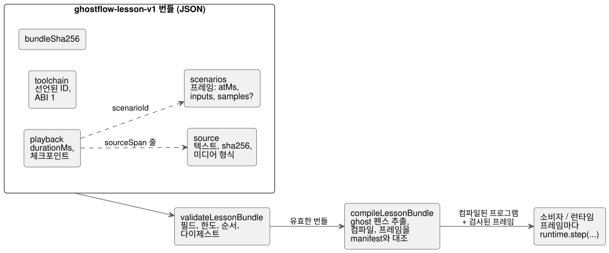

<!-- translation-source: docs/LESSON-BUNDLE.md -->
[영문 원문](LESSON-BUNDLE.md)

# 강의 번들 v1

추적: https://github.com/callin2/ghostflow-language/issues/7 (TASK-58.4).

**강의 번들(lesson bundle)**은 GhostFlow 문서형 소스(literate source)와 설명 체크포인트, 입력 시나리오를 하나로 묶은 단일 JSON 파일입니다. 강의를 도구 사이에서 옮기고 어디서든 컴파일할 수 있게 해 줍니다.
이 문서는 이식 가능한 아티팩트와 그 컴파일만 다룹니다. 강의 플레이어나 실행의 수용 기준은 정의하지 **않습니다**.

다이어그램은 번들에 무엇이 들어 있는지, 컴파일 전과 컴파일 중에 어떤 검사가 실행되는지 보여 줍니다.



## 소유권과 API

**`tools/lesson.mjs`가 하는 일.** 제한된 JSON 입력을 검증하고, 정본 CommonMark GhostFlow 펜스를 추출한 뒤, 기존 control 컴파일러를 호출합니다.

**소유하지 않는 것.** 인터프리터, 장치 연결, 저장소, 강의 시계는 갖고 있지 않습니다.

**환경.**

- 브라우저 소비자는 보안 컨텍스트에서 Web Crypto를 제공해야 합니다.
- v1은 외부 미디어를 지원하지 않습니다.

**엄격한 추출.**

- 컴파일 어댑터는 무시된 중첩 GhostFlow 펜스를 포함해 모든 추출 경고를 거부합니다. 그런 코드를 실행되는 강의의 일부인 것처럼 제시하는 일은 결코 없습니다.
- 컴파일러 진단은 원본 소스 위치가 있을 때에만 소스로 다시 매핑됩니다.

**최상위 필드.** 문서에는 `format: ghostflow-lesson-v1`, lessonId, revision, title, locale, source, playback, scenarios, toolchain, bundleSha256이 들어갑니다.
알 수 없는 필드는 거부되므로, 지원하지 않는 지시가 조용히 의미를 얻는 일은 없습니다.

- **Source**에는 원문 텍스트, 그 SHA-256, 미디어 형식
  `text/markdown; profile=ghostflow-literate`가 들어갑니다.
- **Playback**에는 durationMs와 순서가 정해진 체크포인트가 들어갑니다. 체크포인트에는 다음이 들어갑니다.
  - atMs;
  - sourceSpan의 startLine/endLine(1부터 시작, 양끝 포함). 범위는 원본 Markdown을 가리키며 설명 문단을 가리킬 수도 있습니다;
  - 일반 텍스트 설명;
  - scenarioId.
- **Scenarios**는 각각 고유 id, title, 순서가 정해진 프레임을 가집니다. 각 프레임에는 다음이 들어갑니다.
  - atMs;
  - 소프트웨어 입력 이름을 Boolean 또는 유한한 숫자 값에 대응시키는 `inputs` 맵;
  - 취득 입력을 위한 선택적 `samples` 맵.

  시나리오, 프레임, 체크포인트에 대한 규칙:
  - 시나리오, 프레임, 체크포인트가 각각 하나 이상 있어야 합니다.
  - 각 배열의 시간은 엄격히 증가해야 합니다.
  - 각 프레임에는 식별자 이름의 입력을 최대 128개까지 둘 수 있습니다. prototype 관련 이름은 거부됩니다.
  - 별도의 samples 맵에도 식별자 이름의 항목을 최대 128개까지 둘 수 있습니다.
- **Toolchain**은 compilerId/compilerRevision/runtimeId/runtimeRevision과
  ABI 버전 1을 기록합니다. 이 식별자들은 선언일 뿐, 실제로 어떤 아티팩트가 로드되었는지에 대한 증명이 아닙니다.

**서로 다른 두 시계.** 설명 시간과 시나리오 스캔 시간은 둘 다 정수 밀리초를 쓰지만 서로 다른 영역입니다.

- 시나리오를 다시 실행하면 항상 새 런타임에서 시작합니다.
- 설명 체크포인트는 결코 VM 스냅샷이 아닙니다.

**비교 검증.** 유효한 비교라고 주장하기 전에, 실행 소비자는 로드된 컴파일러/런타임의 식별 정보와 입력 바인딩의 호환성을 검증해야 합니다. 선언된 식별 정보는 그 검증이 아닙니다.

## 시나리오 프레임의 취득 샘플

정본 `input` 선언에는 기존 `ControlRuntime.step` 샘플 형식을 사용합니다. **취득 샘플(acquisition sample)**은 입력에 대한 한 번의 관측으로, 고유한 식별 정보, 타임스탬프, 품질을 가집니다.
예를 들어 `input enabled: Bool;`과 작성자가 정한
`enabled |> recover(false)` 정책은 다음 프레임을 받을 수 있습니다.

```json
{
  "atMs": 100,
  "inputs": {},
  "samples": {
    "enabled": { "epoch": 1, "id": 1, "timestampMs": 100, "quality": "Good", "value": true }
  }
}
```

**샘플 형식.** 각 샘플에는 정확히 `epoch`, `id`, `timestampMs`, `quality`, `value`만 들어갑니다.

| 필드 | 규칙 |
|---|---|
| `epoch`, `id`, `timestampMs` | 음이 아닌 안전한 정수. `timestampMs`는 프레임의 `atMs`를 넘을 수 없습니다. |
| `quality` | `NotReady`, `Good`, `Disconnected`, `Stale`, `Invalid` 중 하나, 또는 이 순서에 대응하는 기존 숫자 코드 0–4. |
| `value` | fault 관측에서도 Boolean 또는 유한한 JSON 숫자. |

값은 manifest의 정규 단위를 사용합니다. lesson 검증기는 단위를 결코 변환하지 않습니다.

**컴파일 후 바인딩 검사.** `compileLessonBundle`은 모든 프레임을 실제 manifest와 대조합니다.

- `inputs`는 소프트웨어 입력을 그 스칼라 타입과 범위에 맞게 정확히 공급해야 합니다.
- 샘플 이름은 `manifest.sensors`의 항목을 가리켜야 합니다.
- Bool 샘플에는 Boolean payload가, 다른 스칼라 샘플에는 숫자 payload가 필요합니다.

**런타임에 남는 것.** 숫자 취득의 범위/품질 검사, 샘플 식별 정보의 순서, fault 처리는 공유 런타임에 남습니다.
예를 들어 Int payload `1.5`는 아티팩트에 작성된 그대로 남고, 런타임에서 `Invalid`가 됩니다. lesson 계층은 이를 정수로 강제 변환하지 않습니다.
fault 대응은 GhostFlow 소스에 작성합니다.

**누락된 관측을 만들어 내지 않습니다.** `samples`를 생략하거나, 빈 맵을 쓰거나, 취득 입력 하나를 생략하면 새 관측이 공급되지 않습니다.

- lesson 계층은 Good, false, 새 ID, 타임스탬프를 합성하지 않습니다.
- 한 번도 관측되지 않은 입력은 런타임의 `NotReady`로 시작합니다. 이후의 보존과 만료는 기존 런타임 계약을 따릅니다.

소비자는 프레임을
`runtime.step({ nowMs: frame.atMs, inputs: frame.inputs, samples: frame.samples })`로 전달합니다.
관측 맵과 중첩 샘플은 정규 번들 다이제스트에 포함되며, 분리된 동결 값으로 반환됩니다.

**호환성.**

- `samples`는 `ghostflow-lesson-v1`의 선택적 필드입니다. GFB도 WASM ABI도 바꾸지 않습니다.
- samples가 없는 기존 프레임은 형태를 그대로 유지합니다.
- 일반 소프트웨어 값에서 취득 Result로 소스를 이행하려면, 명시적인 샘플과 fault 정책을 담은 새로 작성한 lesson revision이 필요합니다. 이제 sensor 이름을 `inputs`에 넣으면 컴파일 시 프레임 바인딩 검증에 실패합니다.
- 이전 lesson 검증기는 알 수 없는 `samples` 필드를 거부하므로, 소비자는 이를 지원하는 language revision을 고정해야 합니다.
- 구조 검증만으로는 manifest 호환성이 입증되지 않습니다.

## 무결성과 한도

**다이제스트.**

- **소스 SHA-256**은 개행이나 유니코드 정규화 없이 정확한 UTF-8 바이트를 해싱합니다.
- **번들 SHA-256**은 최상위 bundleSha256을 제외한 정규 JSON을 해싱합니다. 객체 키는 정렬하고 배열 순서는 유지합니다.

다이제스트는 내용의 불일치를 찾아낼 뿐, 악의적인 작성자를 판별하지는 않습니다. 서명되지 않은 다이제스트는 누구나 다시 계산할 수 있습니다.
내보낸 정규화 헬퍼는 받은 값을 정확히 그대로 직렬화합니다. 번들 다이제스트를 계산하려면 작성자가 호출 전에 최상위 bundleSha256을 제거해야 합니다.

**엄격한 한도.**

| 항목 | 한도 |
|---|---|
| JSON 크기 | 1 MiB |
| 소스 크기 | 64 KiB |
| 설명/시나리오 시간 | 600,000 ms |
| 체크포인트 | 256 |
| 시나리오 | 16 |
| 시나리오당 프레임 | 1,024 |
| 전체 프레임 | 4,096 |
| 설명당 문자 수 | 4,096 |

번들은 이 한도를 늘릴 수 없습니다.
소스 위치, 시간, 순서, 시나리오 참조는 컴파일 전에 검사합니다.
컴파일러 자체의 자원 검사도 계속 적용됩니다.
Worker 실행 기한은 프런트엔드가 소유하며, 이 아티팩트 검증기는 그에 대해 아무것도 보장하지 않습니다.

## 증거 경계

각 단계가 입증하는 것:

- **검증**은 번들이 지원되는 아티팩트 계약을 충족하고 내부적으로 일관된다는 것만 입증합니다.
- **컴파일**은 기존 컴파일러가 해당 소스를 수용한다는 것을 입증합니다.

어느 쪽도 일치하는 trace, 성공적인 브라우저 재생, 물리 부하 동작, 배포 준비 상태를 입증하지 않습니다.
기대 trace 식별 정보는 이후의 첫 예제/소비자 작업에서 생성하고 확인합니다. 이 검증기가 그것을 꾸며 내는 일은 결코 없습니다.
