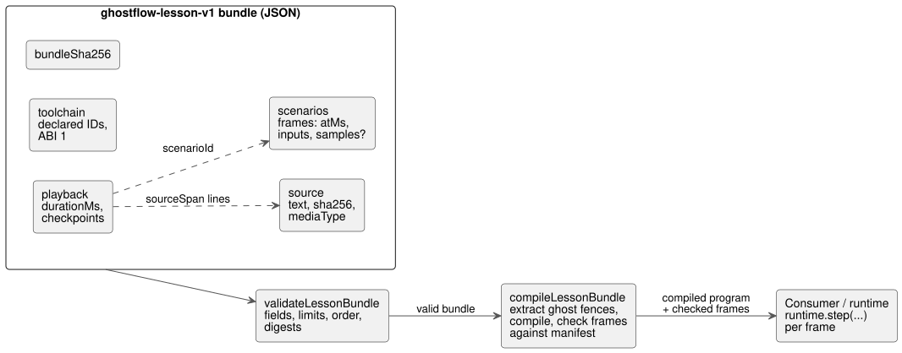

# Lesson bundle v1

Tracking: https://github.com/callin2/ghostflow-language/issues/7 (TASK-58.4).

A **lesson bundle** is a single JSON file that packages a GhostFlow literate source together with narration checkpoints and input scenarios, so a lesson can be moved between tools and compiled anywhere.
This document covers only the portable artifact and its compilation. It does **not** define acceptance of a lesson player or of execution.

The diagram shows what a bundle contains and which checks run before and during compilation.



## Ownership and API

**What `tools/lesson.mjs` does.** It validates bounded JSON input, extracts the authoritative CommonMark GhostFlow fences, and calls the existing control compiler.

**What it does not own.** It has no interpreter, device connection, storage, or lesson clock.

**Environment.**

- Browser consumers must provide Web Crypto in a secure context.
- External media is not supported in v1.

**Strict extraction.**

- The compile adapter rejects any extraction warning, including ignored nested GhostFlow fences. Such code is never presented as part of the executed lesson.
- Compiler diagnostics are mapped back to the source only when an original source location is available.

**Top-level fields.** The document carries `format: ghostflow-lesson-v1`, lessonId, revision, title, locale, source, playback, scenarios, toolchain and bundleSha256.
Unknown fields are rejected, so an unsupported instruction can never silently acquire meaning.

- **Source** contains the raw text, its SHA-256, and the media type
  `text/markdown; profile=ghostflow-literate`.
- **Playback** contains durationMs and ordered checkpoints. A checkpoint contains:
  - atMs;
  - sourceSpan startLine/endLine (1-based, inclusive). Spans refer to the original Markdown and may point at prose;
  - plain-text narration;
  - scenarioId.
- **Scenarios** each have a unique id, a title, and ordered frames. Each frame contains:
  - atMs;
  - an `inputs` map from software input names to Boolean or finite numeric values;
  - an optional `samples` map for acquisition inputs.

  Rules for scenarios, frames, and checkpoints:
  - There must be at least one scenario, one frame, and one checkpoint.
  - Times in each array are strictly increasing.
  - Each frame allows at most 128 identifier-named inputs. Prototype-related names are rejected.
  - The separate samples map also allows at most 128 identifier-named entries.
- **Toolchain** records compilerId/compilerRevision/runtimeId/runtimeRevision and
  ABI version 1. These identifiers are declarations, not proof of which artifacts were actually loaded.

**Two separate clocks.** Narration time and scenario scan time are separate domains, even though both use integer milliseconds.

- Rerunning a scenario always starts from a fresh runtime.
- A narration checkpoint is never a VM snapshot.

**Verifying a comparison.** Before claiming a valid comparison, the execution consumer must verify the loaded compiler/runtime identities and the compatibility of the input bindings. A declared identity is not that verification.

## Acquisition samples in scenario frames

For canonical `input` declarations, use the existing `ControlRuntime.step` sample shape. An **acquisition sample** is one observation of an input, with its own identity, timestamp, and quality.
For example, `input enabled: Bool;` with an authored
`enabled |> recover(false)` policy can receive this frame:

```json
{
  "atMs": 100,
  "inputs": {},
  "samples": {
    "enabled": { "epoch": 1, "id": 1, "timestampMs": 100, "quality": "Good", "value": true }
  }
}
```

**Sample shape.** Each sample contains exactly `epoch`, `id`, `timestampMs`, `quality` and `value`.

| Field | Rule |
|---|---|
| `epoch`, `id`, `timestampMs` | Nonnegative safe integers. `timestampMs` cannot exceed the frame's `atMs`. |
| `quality` | `NotReady`, `Good`, `Disconnected`, `Stale` or `Invalid`, or the existing numeric code 0–4 in that order. |
| `value` | A Boolean or finite JSON number, even on fault observations. |

Values use the manifest's canonical units. The lesson validator never converts units.

**Binding check after compilation.** `compileLessonBundle` checks every frame against the actual manifest:

- `inputs` must supply exactly the software inputs, with their scalar types and bounds.
- Sample names must identify entries in `manifest.sensors`.
- Bool samples require Boolean payloads; other scalar samples require numeric payloads.

**What stays in the runtime.** Numeric acquisition range/quality checks, sample identity ordering, and fault handling remain in the shared runtime.
For example, an Int payload of `1.5` stays in the artifact as written and becomes `Invalid` at runtime. The lesson layer does not coerce it to an integer.
Fault response is authored in GhostFlow source.

**Missing observations are not invented.** Omitting `samples`, using an empty map, or omitting one acquisition input supplies no new observation.

- The lesson layer does not synthesize Good, false, a fresh ID, or a timestamp.
- An input that has never been observed starts as runtime `NotReady`. Later retention and expiry follow its existing runtime contract.

A consumer forwards a frame as
`runtime.step({ nowMs: frame.atMs, inputs: frame.inputs, samples: frame.samples })`.
Observation maps and nested samples are included in the canonical bundle digest and are returned as detached, frozen values.

**Compatibility.**

- `samples` is an optional field of `ghostflow-lesson-v1`. It changes neither GFB nor the WASM ABI.
- Existing frames without samples keep their shape.
- Migrating a source from plain software values to acquisition Results needs a new authored lesson revision with explicit samples and fault policies. Placing a sensor name in `inputs` now fails the compile-time frame binding validation.
- Older lesson validators reject the unknown `samples` field, so consumers must pin a language revision that supports it.
- Structural validation alone does not establish manifest compatibility.

## Integrity and limits

**Digests.**

- **Source SHA-256** hashes the exact UTF-8 bytes, with no newline or Unicode normalization.
- **Bundle SHA-256** hashes canonical JSON with the top-level bundleSha256 omitted. Object keys are sorted; array order is kept.

A digest detects inconsistent contents, not malicious authorship: anyone can recompute an unsigned digest.
The exported canonicalization helper serializes exactly the value it receives. To compute the bundle digest, authors must remove the top-level bundleSha256 before calling it.

**Hard limits.**

| Item | Limit |
|---|---|
| JSON size | 1 MiB |
| Source size | 64 KiB |
| Narration/scenario time | 600,000 ms |
| Checkpoints | 256 |
| Scenarios | 16 |
| Frames per scenario | 1,024 |
| Frames in total | 4,096 |
| Characters per narration | 4,096 |

A bundle cannot raise these limits.
Source positions, times, ordering, and scenario references are checked before compilation.
The compiler's own resource checks still apply.
Worker execution deadlines are owned by the frontend; this artifact validator makes no claim about them.

## Evidence boundary

What each step proves:

- **Validation** proves only that the bundle meets the supported artifact contract and is internally consistent.
- **Compilation** proves that the existing compiler accepts the source.

Neither proves a matching trace, successful browser playback, physical load operation, or deployment readiness.
The expected trace identity will be produced and checked by the subsequent first example/consumer task. This validator never fabricates it.
